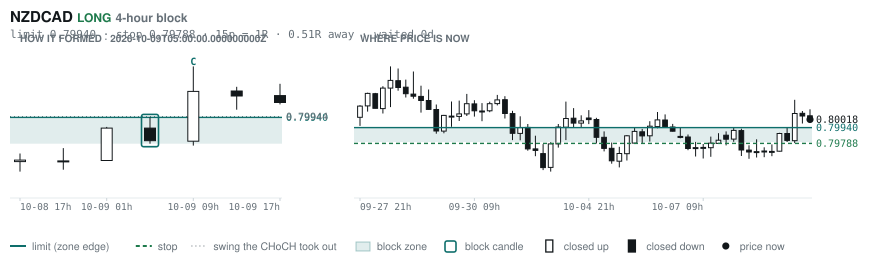
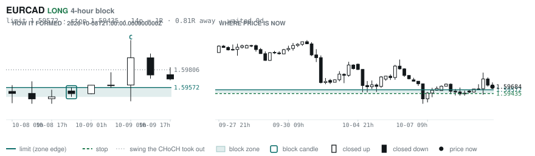
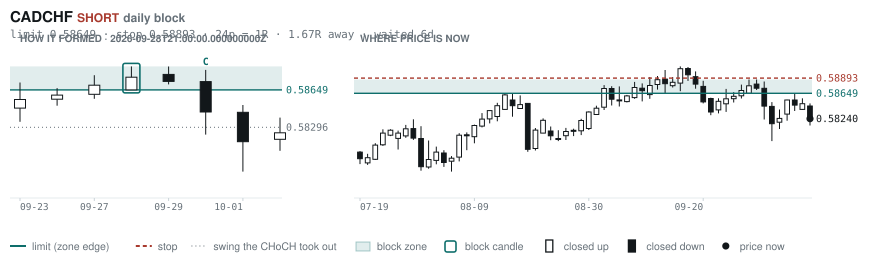

# Scanner Review — 2026-10-11 (weekly)

Generated: 2026-10-11T19:03:48.318Z

```
## The clock

It is **14:00 Chicago** — a **DEAD** hour at 0.74x an average one.
An order placed now rests through **tomorrow — the rest of today is dead**.
Next window: **Tokyo** in 5h.

## Where the energy is

**Running hot:** USDCAD 1.23 · EURCAD 1.17
**Quiet:** USDCHF 0.84 · NZDUSD 0.84 · EURNZD 0.83 · GBPNZD 0.82 · USDJPY 0.77 · AUDNZD 0.77

_Volatility persists for about two days, so a hot pair stays hot. It says nothing about direction — this picks the pair, the levels pick the side._

## Account

NAV **$1178.49**   unrealised $125.45   margin available $115.56   2 open

| pair | units | now | P/L | stop | distance | news lean |
|---|---|---|---|---|---|---|
| USDCHF | -26500 | 0.83025 | $82.00 | 0.83310 | 29p | 🟢 6 tailwind · 🔴 9 headwind |
| USDCHF | -8931 | 0.83025 | $43.44 | 0.83310 | 29p | 🟢 6 tailwind · 🔴 9 headwind |

**What the system reads on each position**

- **USDCHF** SHORT — last CONTINUATION SHORT 458h ago at 0.82209 — system stop 0.82763, target **0.79478** (Grade C); 355p to that target from here

## What is coming, and which way it leans

**USDCHF SHORT**
- 🟢 10-13T14:00 USD — Existing Home Sales  (fc 3960000 vs prev 3980000)
- 🟢 10-14T08:30 USD — Core CPI m/m  (fc 0.2% vs prev 0.3%)
- 🔴 10-14T08:30 USD — Core CPI y/y  (fc 2.5% vs prev 2.4%)
- 🔴 10-14T08:30 USD — CPI m/m  (fc 0.6% vs prev 0.4%)
- 🔴 10-14T08:30 USD — CPI y/y  (fc 3.6% vs prev 3.4%)
- 🔴 10-14T12:30 USD — Core Inflation Rate YoY  (fc 2.5 vs prev 2.4)
- 🔴 10-14T12:30 USD — Inflation Rate MoM  (fc 0.6 vs prev 0.4)
- 🟢 10-14T12:30 USD — Core Inflation Rate MoM  (fc 0.2 vs prev 0.3)
- 🔴 10-14T12:30 USD — Inflation Rate YoY  (fc 3.7 vs prev 3.4)
- 🔴 10-15T08:30 USD — Core PPI m/m  (fc 0.3% vs prev 0.2%)
- 🟢 10-15T08:30 USD — Core Retail Sales m/m  (fc 0.5% vs prev 1.4%)
- 🔴 10-15T08:30 USD — PPI m/m  (fc 0.5% vs prev 0.4%)
- 🟢 10-15T08:30 USD — Retail Sales m/m  (fc 0.3% vs prev 1.2%)
- 🔴 10-15T12:30 USD — PPI MoM  (fc 0.5 vs prev 0.4)
- 🟢 10-15T13:30 USD — Retail Sales MoM  (fc 0.3 vs prev 1.2)

_Lean is read from forecast vs previous — which way consensus leans, not what will print._

## Order blocks live right now

### Daily

| pair | dir | limit | stop | 1R | spread | away | fills | waited | window | reaches 1R / 2R |
|---|---|---|---|---|---|---|---|---|---|---|
| CADCHF | SHORT | **0.58649** | 0.58893 | 24p $2.94 | **31%** | 1.7R | 81% | 6d | 1.56x | 68% / 39% |

_9 more live but further out, 2.4R to 8.0R away. They alert on their own when they come within 1R._
_Older blocks run further: 60+ days reaches 2R 58% of the time against 34% for a same-day fill._

### 4-hour

| pair | dir | limit | stop | 1R | spread | away | fills | waited | window | reaches 1R / 2R |
|---|---|---|---|---|---|---|---|---|---|---|
| NZDCAD | LONG | **0.79940** | 0.79788 | 15p $1.06 | **90%** | 0.5R | 83% | 0d | 1.33x | 70% / 46% |
| EURCAD | LONG | **1.59572** | 1.59435 | 14p $0.96 | **86%** | 0.8R | 83% | 0d | 1.59x | 70% / 46% |

_13 more live but further out, 2.1R to 7.4R away. They alert on their own when they come within 1R._
_H4 stops are a third of a daily one, so spread bites three times as hard — a bolded spread figure is most of the edge gone before price moves._

### In reach, drawn

_3 blocks within 2R of the limit. Blocks further out are in the tables above but not worth a picture yet._

**NZDCAD LONG** · 4-hour · 0.51R away · waited 0d



**EURCAD LONG** · 4-hour · 0.81R away · waited 0d



**CADCHF SHORT** · daily · 1.67R away · waited 6d



_Left panel is the block forming, right is where price sits now. Legend is in each image._

## Scanner calls, last 7 days

| when | pair | dir | branch | firing | entry | stop | target | outcome |
|---|---|---|---|---|---|---|---|---|
| 10-04T21:00 | NZDJPY | SHORT | REV | 10th | 88.517 | 89.613 | 82.704 | open -0.32R |
| 10-04T21:00 | EURAUD | SHORT | REV | 3rd | 1.61666 | 1.63426 | 1.59370 | open +0.73R |
| 10-04T21:00 | EURNZD | SHORT | REV | 10th | 2.00348 | 2.02310 | 1.97672 | open +0.40R |
| 10-04T21:00 | USDCHF | SHORT | REV | 3rd | 0.82856 | 0.83728 | 0.81028 | open -0.19R |
| 10-05T01:00 | CADCHF | SHORT | REV | 1st ⚠ | 0.58120 | 0.58635 | 0.57511 | stopped -1.00R |
| 10-05T01:00 | NZDUSD | SHORT | REV | 2nd | 0.55902 | 0.56830 | 0.54188 | open -0.24R |
| 10-05T01:00 | NZDCHF | SHORT | REV | 1st ⚠ | 0.46406 | 0.46883 | 0.45920 | open -0.42R |
| 10-05T01:00 | EURJPY | LONG | REV | 3rd | 176.807 | 174.977 | 183.868 | open +0.29R |
| 10-05T01:00 | EURAUD | SHORT | WALL | 1st ⚠ | 1.61192 | 1.61957 | 1.59370 | open +1.06R |
| 10-05T01:00 | CHFJPY | LONG | REV | 5th | 190.452 | 188.207 | 197.119 | open +0.11R |
| 10-05T05:00 | AUDCAD | LONG | REV | 4th | 0.99175 | 0.98429 | 1.00472 | open +0.52R |
| 10-05T05:00 | AUDUSD | LONG | REV | 1st ⚠ | 0.69631 | 0.68744 | 0.72057 | open +0.24R |
| 10-05T09:00 | AUDJPY | SHORT | REV | 3rd | 110.146 | 111.335 | 104.378 | open -0.37R |
| 10-05T13:00 | EURCHF | LONG | REV | 1st ⚠ | 0.93196 | 0.92462 | 0.96513 | open -0.28R |
| 10-05T13:00 | CADCHF | SHORT | REV | 9th | 0.58359 | 0.58800 | 0.57511 | open +0.27R |
| 10-05T13:00 | GBPAUD | LONG | REV | 1st ⚠ | 1.89730 | 1.88233 | 1.91701 | open -0.16R |
| 10-05T13:00 | EURNZD | SHORT | REV | 1st ⚠ | 2.00390 | 2.02490 | 1.97672 | open +0.39R |
| 10-05T13:00 | NZDCHF | SHORT | REV | 2nd | 0.46506 | 0.46877 | 0.45920 | open -0.26R |
| 10-05T13:00 | AUDUSD | LONG | REV | 3rd | 0.69644 | 0.68992 | 0.72057 | open +0.30R |
| 10-05T13:00 | USDCHF | LONG | WALL | 4th | 0.83192 | 0.82783 | 0.84757 | open -0.41R |
| 10-05T05:00 | USDCAD | SHORT | REV | 1st ⚠ | 1.42441 | 1.43314 | 1.35795 | open -0.14R |
| 10-05T17:00 | AUDCAD | LONG | WALL | 1st ⚠ | 0.99430 | 0.98946 | 1.00472 | stopped -1.00R |
| 10-05T17:00 | NZDCAD | LONG | REV | 1st ⚠ | 0.79862 | 0.79056 | 0.81534 | open +0.19R |
| 10-05T17:00 | GBPJPY | SHORT | REV | 5th | 208.834 | 211.271 | 202.486 | open -0.28R |
| 10-05T17:00 | CADJPY | SHORT | REV | 3rd | 110.746 | 111.746 | 107.746 | open -0.31R |
| 10-05T17:00 | AUDCHF | SHORT | REV | 1st ⚠ | 0.57914 | 0.58354 | 0.56996 | open -0.16R |
| 10-05T21:00 | NZDJPY | SHORT | REV | 1st ⚠ | 88.404 | 89.555 | 82.704 | open -0.40R |
| 10-05T21:00 | USDJPY | SHORT | REV | 9th | 157.812 | 159.362 | 153.713 | open -0.32R |
| 10-05T21:00 | AUDJPY | SHORT | REV | 1st ⚠ | 109.996 | 111.127 | 104.378 | open -0.52R |
| 10-05T21:00 | NZDUSD | SHORT | REV | 3rd | 0.56020 | 0.56732 | 0.54188 | open -0.14R |
| 10-05T21:00 | EURAUD | SHORT | REV | 2nd | 1.61015 | 1.62105 | 1.59370 | open +0.58R |
| 10-05T17:00 | USDCHF | SHORT | REV | 2nd | 0.83058 | 0.84021 | 0.81028 | open +0.04R |
| 10-06T05:00 | EURCHF | SHORT | REV | 4th | 0.93526 | 0.94215 | 0.92672 | open +0.78R |
| 10-06T05:00 | GBPAUD | LONG | REV | 2nd | 1.89867 | 1.88307 | 1.91701 | open -0.25R |
| 10-06T05:00 | EURNZD | LONG | REV | 1st ⚠ | 2.00666 | 1.98893 | 2.03619 | open -0.62R |
| 10-06T05:00 | AUDUSD | LONG | REV | 4th | 0.69744 | 0.69037 | 0.72057 | open +0.14R |
| 10-06T05:00 | AUDCHF | LONG | WALL | 2nd | 0.58018 | 0.57834 | 0.59203 | stopped -1.00R |
| 10-06T09:00 | CADCHF | LONG | REV | 2nd | 0.58341 | 0.57890 | 0.59446 | open -0.22R |
| 10-06T09:00 | GBPJPY | SHORT | REV | 5th | 209.864 | 211.694 | 202.486 | open +0.18R |
| 10-06T09:00 | GBPCHF | LONG | REV | 1st ⚠ | 1.10278 | 1.09275 | 1.12378 | open -0.40R |
| 10-06T09:00 | AUDJPY | SHORT | REV | 4th | 110.392 | 111.585 | 104.378 | open -0.16R |
| 10-06T09:00 | EURAUD | SHORT | REV | 1st ⚠ | 1.61258 | 1.62327 | 1.59370 | open +0.82R |
| 10-06T09:00 | USDCHF | SHORT | REV | 3rd | 0.83084 | 0.83973 | 0.81028 | open +0.07R |
| 10-06T09:00 | CADJPY | LONG | REV | 13th | 111.025 | 110.066 | 114.634 | open +0.04R |
| 10-06T09:00 | USDCAD | SHORT | REV | 2nd | 1.42416 | 1.43286 | 1.35795 | open -0.16R |
| 10-06T13:00 | USDJPY | LONG | REV | 5th | 158.159 | 156.380 | 165.186 | open +0.08R |
| 10-06T13:00 | GBPCAD | SHORT | REV | 1st ⚠ | 1.88745 | 1.89943 | 1.85129 | open +0.07R |
| 10-06T17:00 | GBPUSD | SHORT | REV | 2nd | 1.32752 | 1.33766 | 1.30505 | open +0.41R |
| 10-06T21:00 | CADCHF | SHORT | REV | 4th | 0.58570 | 0.59020 | 0.57511 | open +0.73R |
| 10-06T21:00 | NZDCAD | SHORT | REV | 1st ⚠ | 0.79848 | 0.80569 | 0.79015 | open -0.24R |
| 10-06T21:00 | NZDJPY | SHORT | REV | 1st ⚠ | 88.996 | 89.797 | 85.690 | open +0.16R |
| 10-06T21:00 | EURAUD | SHORT | REV | 1st ⚠ | 1.61174 | 1.62261 | 1.59370 | open +0.73R |
| 10-06T21:00 | GBPAUD | SHORT | REV | 2nd | 1.90030 | 1.91343 | 1.85168 | open +0.42R |
| 10-07T01:00 | EURCHF | SHORT | REV | 2nd | 0.93626 | 0.94241 | 0.92672 | open +1.03R |
| 10-07T01:00 | NZDUSD | SHORT | REV | 3rd | 0.56057 | 0.56760 | 0.54188 | open -0.09R |
| 10-07T01:00 | GBPJPY | SHORT | REV | 6th | 209.902 | 211.574 | 202.486 | open +0.22R |
| 10-07T01:00 | USDJPY | LONG | REV | 10th | 158.426 | 157.125 | 160.539 | open -0.09R |
| 10-07T01:00 | AUDNZD | LONG | REV | 1st ⚠ | 1.24330 | 1.23465 | 1.29274 | open +0.11R |
| 10-07T01:00 | AUDUSD | SHORT | REV | 1st ⚠ | 0.69696 | 0.70299 | 0.66676 | open -0.24R |
| 10-07T01:00 | CHFJPY | SHORT | REV | 9th | 190.076 | 191.516 | 182.720 | open -0.43R |
| 10-07T01:00 | GBPAUD | LONG | REV | 2nd | 1.90098 | 1.88989 | 1.94986 | open -0.55R |
| 10-07T05:00 | USDJPY | LONG | REV | 6th | 158.181 | 156.427 | 160.539 | open +0.07R |
| 10-07T05:00 | AUDCAD | LONG | REV | 5th | 0.99164 | 0.98534 | 1.00472 | open +0.64R |
| 10-07T05:00 | GBPCHF | SHORT | REV | 2nd | 1.10318 | 1.11082 | 1.07332 | open +0.58R |
| 10-07T05:00 | CADJPY | LONG | REV | 4th | 111.233 | 110.261 | 114.634 | open -0.18R |
| 10-07T05:00 | EURJPY | LONG | REV | 4th | 177.130 | 175.052 | 183.868 | open +0.10R |
| 10-07T05:00 | CHFJPY | SHORT | REV | 1st ⚠ | 189.852 | 191.687 | 182.720 | open -0.46R |
| 10-07T05:00 | AUDCHF | LONG | REV | 3rd | 0.58099 | 0.57637 | 0.59203 | open -0.24R |
| 10-07T09:00 | GBPUSD | SHORT | WALL | 1st ⚠ | 1.32030 | 1.33103 | 1.30505 | open -0.29R |
| 10-07T09:00 | EURNZD | LONG | REV | 5th | 1.99936 | 1.98373 | 2.03913 | open -0.23R |
| 10-07T09:00 | CADCHF | SHORT | REV | 5th | 0.58417 | 0.59026 | 0.57511 | open +0.29R |
| 10-07T09:00 | EURCAD | LONG | REV | 2nd | 1.59452 | 1.58208 | 1.62445 | open +0.19R |
| 10-07T09:00 | AUDJPY | SHORT | WALL | 2nd | 109.956 | 110.600 | 104.786 | stopped -1.00R |
| 10-07T09:00 | NZDCHF | LONG | REV | 7th | 0.46586 | 0.46239 | 0.47758 | open +0.05R |
| 10-07T09:00 | EURGBP | LONG | REV | 1st ⚠ | 0.84630 | 0.84287 | 0.86717 | open +0.02R |
| 10-07T13:00 | NZDCHF | LONG | REV | 3rd | 0.46656 | 0.46273 | 0.47758 | open -0.14R |
| 10-07T13:00 | EURGBP | LONG | REV | 2nd | 0.84717 | 0.84225 | 0.86717 | open -0.16R |
| 10-07T13:00 | GBPCAD | SHORT | REV | 1st ⚠ | 1.88343 | 1.89439 | 1.85129 | open -0.29R |
| 10-07T13:00 | USDCAD | SHORT | REV | 1st ⚠ | 1.42560 | 1.43485 | 1.35795 | open +0.00R |
| 10-07T13:00 | AUDNZD | LONG | REV | 2nd | 1.24376 | 1.23484 | 1.29274 | open +0.05R |
| 10-07T17:00 | NZDJPY | LONG | REV | 4th | 88.489 | 87.493 | 92.130 | open +0.38R |
| 10-07T17:00 | CADJPY | LONG | REV | 1st ⚠ | 110.884 | 109.815 | 114.634 | open +0.16R |
| 10-07T17:00 | CHFJPY | LONG | REV | 1st ⚠ | 189.677 | 188.034 | 194.306 | open +0.62R |
| 10-07T17:00 | NZDCAD | LONG | REV | 6th | 0.79819 | 0.79263 | 0.81534 | open +0.36R |
| 10-07T17:00 | GBPAUD | LONG | REV | 1st ⚠ | 1.89804 | 1.88794 | 1.94986 | open -0.32R |
| 10-07T17:00 | EURCAD | LONG | REV | 5th | 1.59622 | 1.58378 | 1.62445 | open +0.05R |
| 10-07T21:00 | EURCHF | LONG | REV | 3rd | 0.93286 | 0.92541 | 0.95992 | open -0.40R |
| 10-07T21:00 | EURNZD | LONG | REV | 5th | 2.00054 | 1.98450 | 2.03913 | open -0.30R |
| 10-07T21:00 | AUDUSD | SHORT | REV | 3rd | 0.69570 | 0.70269 | 0.66676 | open -0.39R |
| 10-07T21:00 | EURCAD | LONG | REV | 1st ⚠ | 1.59701 | 1.58729 | 1.62445 | open -0.02R |
| 10-07T21:00 | EURJPY | LONG | REV | 5th | 176.762 | 175.122 | 183.868 | open +0.35R |
| 10-07T21:00 | AUDJPY | LONG | REV | 1st ⚠ | 109.814 | 108.768 | 115.582 | open +0.73R |
| 10-08T01:00 | USDJPY | LONG | REV | 7th | 158.232 | 156.439 | 160.539 | open +0.04R |
| 10-08T01:00 | GBPJPY | LONG | REV | 1st ⚠ | 209.022 | 206.418 | 215.468 | open +0.19R |
| 10-08T01:00 | USDCAD | SHORT | REV | 1st ⚠ | 1.42626 | 1.43443 | 1.35795 | open +0.08R |
| 10-08T01:00 | NZDUSD | SHORT | REV | 2nd | 0.56042 | 0.56670 | 0.54188 | open -0.13R |
| 10-08T05:00 | AUDCAD | LONG | REV | 1st ⚠ | 0.99125 | 0.98541 | 1.00472 | open +0.75R |
| 10-08T05:00 | GBPAUD | SHORT | REV | 4th | 1.89756 | 1.90904 | 1.85168 | open +0.24R |
| 10-08T05:00 | GBPCHF | SHORT | REV | 5th | 1.10027 | 1.10832 | 1.06748 | open +0.19R |
| 10-08T05:00 | AUDNZD | LONG | REV | 3rd | 1.24338 | 1.23494 | 1.29274 | open +0.10R |
| 10-08T05:00 | EURAUD | SHORT | REV | 2nd | 1.60927 | 1.62000 | 1.59370 | open +0.51R |
| 10-08T05:00 | CHFJPY | SHORT | REV | 3rd | 189.768 | 191.193 | 182.720 | open -0.65R |
| 10-08T09:00 | AUDCAD | LONG | REV | 3rd | 0.99007 | 0.98267 | 1.00472 | open +0.76R |
| 10-08T09:00 | CADCHF | SHORT | REV | 2nd | 0.58472 | 0.58879 | 0.56885 | open +0.57R |
| 10-08T09:00 | AUDCHF | LONG | REV | 1st ⚠ | 0.57894 | 0.57453 | 0.59203 | open +0.21R |
| 10-08T09:00 | GBPCAD | SHORT | REV | 5th | 1.88280 | 1.89139 | 1.85129 | open -0.44R |
| 10-08T13:00 | NZDUSD | SHORT | REV | 4th | 0.55976 | 0.56744 | 0.54188 | open -0.19R |
| 10-08T13:00 | GBPUSD | SHORT | REV | 2nd | 1.32138 | 1.33519 | 1.30505 | open -0.15R |
| 10-08T13:00 | CADJPY | SHORT | REV | 1st ⚠ | 110.965 | 112.278 | 107.746 | open -0.07R |
| 10-08T13:00 | USDJPY | SHORT | REV | 2nd | 158.007 | 159.382 | 153.713 | open -0.22R |
| 10-08T13:00 | USDCAD | SHORT | REV | 2nd | 1.42422 | 1.43483 | 1.35795 | open -0.13R |
| 10-08T13:00 | CHFJPY | SHORT | REV | 1st ⚠ | 189.726 | 191.692 | 182.720 | open -0.49R |
| 10-08T17:00 | NZDJPY | LONG | REV | 6th | 88.490 | 87.479 | 92.130 | open +0.38R |
| 10-08T17:00 | NZDCAD | LONG | REV | 2nd | 0.79716 | 0.79157 | 0.81534 | open +0.54R |
| 10-08T17:00 | USDCAD | SHORT | REV | 10th | 1.42248 | 1.43468 | 1.35795 | open -0.25R |
| 10-08T13:00 | EURUSD | SHORT | REV | 2nd | 1.11956 | 1.12810 | 1.06680 | open -0.07R |
| 10-08T21:00 | NZDCAD | LONG | REV | 1st ⚠ | 0.79712 | 0.79167 | 0.81534 | open +0.56R |
| 10-08T21:00 | AUDJPY | SHORT | REV | 4th | 110.070 | 111.089 | 104.786 | open -0.50R |
| 10-09T01:00 | AUDCAD | LONG | REV | 2nd | 0.99180 | 0.98546 | 1.00472 | open +0.61R |
| 10-09T01:00 | NZDCHF | LONG | REV | 6th | 0.46672 | 0.46305 | 0.47758 | open -0.19R |
| 10-09T01:00 | CADJPY | LONG | REV | 4th | 111.248 | 110.243 | 114.634 | open -0.19R |
| 10-09T01:00 | EURCAD | LONG | REV | 6th | 1.59602 | 1.58485 | 1.62445 | open +0.07R |
| 10-09T01:00 | EURAUD | SHORT | REV | 3rd | 1.60923 | 1.61941 | 1.59370 | open +0.53R |
| 10-09T05:00 | EURCHF | LONG | REV | 1st ⚠ | 0.93242 | 0.92634 | 0.95992 | open -0.41R |
| 10-09T05:00 | GBPJPY | SHORT | REV | 4th | 209.280 | 211.283 | 202.486 | open -0.12R |
| 10-09T05:00 | NZDJPY | SHORT | REV | 6th | 88.696 | 89.708 | 85.690 | open -0.17R |
| 10-09T05:00 | EURJPY | SHORT | REV | 5th | 177.362 | 179.130 | 171.585 | open +0.01R |
| 10-09T05:00 | AUDNZD | LONG | REV | 4th | 1.24368 | 1.23524 | 1.26118 | open +0.07R |
| 10-09T05:00 | AUDJPY | SHORT | REV | 6th | 110.302 | 111.562 | 104.786 | open -0.22R |
| 10-09T05:00 | GBPCAD | SHORT | REV | 6th | 1.88334 | 1.89084 | 1.85129 | open -0.44R |
| 10-09T09:00 | NZDUSD | SHORT | REV | 5th | 0.56054 | 0.56726 | 0.51726 | open -0.10R |
| 10-09T09:00 | CADCHF | LONG | REV | 1st ⚠ | 0.58221 | 0.57717 | 0.59446 | open +0.04R |
| 10-09T09:00 | GBPUSD | SHORT | REV | 1st ⚠ | 1.32136 | 1.33466 | 1.30505 | open -0.15R |
| 10-09T09:00 | GBPCHF | SHORT | REV | 1st ⚠ | 1.09898 | 1.10778 | 1.06748 | open +0.03R |
| 10-09T09:00 | GBPCAD | SHORT | REV | 1st ⚠ | 1.88762 | 1.89933 | 1.85129 | open +0.09R |
| 10-09T13:00 | AUDCHF | SHORT | REV | 1st ⚠ | 0.57922 | 0.58329 | 0.56031 | open -0.16R |

## Running tally, last 30 days

18 resolved · 5 target / 13 stopped · **-5.2R** · -0.289R per call · 42 still open

```
