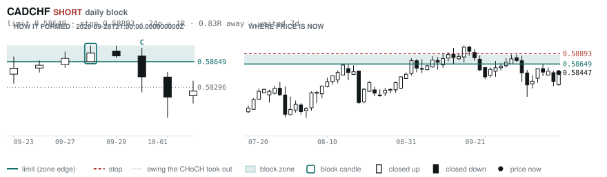
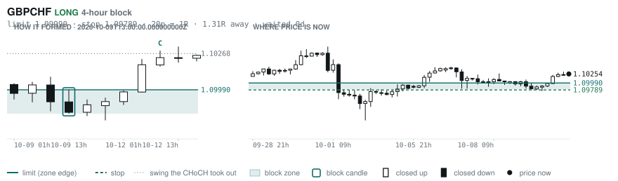
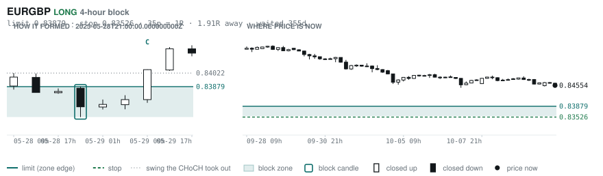

# Scanner Review — 2026-10-12 (evening)

Generated: 2026-10-12T23:03:40.999Z

```
## The clock

It is **18:00 Chicago** — a **DEAD** hour at 0.65x an average one.
An order placed now rests through **Tokyo, London and tomorrow's NY overlap** — about 16h of cover.
Next window: **Tokyo** in 1h.

_Evening pass. Orders placed now get the longest cover of the day: Tokyo, London, and tomorrow's NY overlap. Place limits and stops here — whatever does not fill overnight is still live for the morning._

## Where the energy is

**Running hot:** _nothing unusually active_
**Quiet:** NZDCAD 0.78 · CHFJPY 0.77 · NZDJPY 0.76 · AUDNZD 0.75 · GBPNZD 0.75 · USDJPY 0.68

_Volatility persists for about two days, so a hot pair stays hot. It says nothing about direction — this picks the pair, the levels pick the side._

## Account

NAV **$1064.58**   unrealised $-30.24   margin available $685.21   1 open

| pair | units | now | P/L | stop | distance | news lean |
|---|---|---|---|---|---|---|
| EURCAD | 17000 | 1.59337 | $-30.24 | 1.58900 | 44p | 2 neutral |

**What the system reads on each position**

- **EURCAD** LONG — last REVERSAL LONG 18h ago at 1.59300 — system stop 1.58472, target **1.62445**; 311p to that target from here

## What is coming, and which way it leans

**EURCAD LONG**
- ⚪ 10-14T02:10 EUR — ECB President Lagarde Speech
- ⚪ 10-14T08:30 EUR — ECB President Lagarde Speech

_Lean is read from forecast vs previous — which way consensus leans, not what will print._

## Order blocks live right now

### Daily

| pair | dir | limit | stop | 1R | spread | away | fills | waited | window | reaches 1R / 2R |
|---|---|---|---|---|---|---|---|---|---|---|
| CADCHF | SHORT | **0.58649** | 0.58893 | 24p $2.93 | 12% | 0.8R | 87% | 7d | 0.83x ⚠ | 68% / 39% |

_8 more live but further out, 2.5R to 7.9R away. They alert on their own when they come within 1R._
_Older blocks run further: 60+ days reaches 2R 58% of the time against 34% for a same-day fill._

### 4-hour

| pair | dir | limit | stop | 1R | spread | away | fills | waited | window | reaches 1R / 2R |
|---|---|---|---|---|---|---|---|---|---|---|
| GBPCHF | LONG | **1.09990** | 1.09789 | 20p $2.41 | **25%** | 1.3R | 79% | 0d | 0.86x ⚠ | 70% / 46% |
| EURGBP | LONG | **0.83879** | 0.83526 | 35p $4.66 | 4% | 1.6R | 79% | 355d | 0.85x ⚠ | 78% / 51% |

_12 more live but further out, 2.0R to 7.7R away. They alert on their own when they come within 1R._
_H4 stops are a third of a daily one, so spread bites three times as hard — a bolded spread figure is most of the edge gone before price moves._

### In reach, drawn

_3 blocks within 2R of the limit. Blocks further out are in the tables above but not worth a picture yet._

**CADCHF SHORT** · daily · 0.83R away · waited 7d



**GBPCHF LONG** · 4-hour · 1.31R away · waited 0d



**EURGBP LONG** · 4-hour · 1.65R away · waited 355d



_Left panel is the block forming, right is where price sits now. Legend is in each image._

## Scanner calls, last 1 day

| when | pair | dir | branch | firing | entry | stop | target | outcome |
|---|---|---|---|---|---|---|---|---|
| 10-12T01:00 | USDJPY | LONG | REV | 9th | 158.336 | 156.581 | 160.539 | open +0.17R |
| 10-12T01:00 | NZDUSD | SHORT | REV | 6th | 0.56064 | 0.56711 | 0.51726 | open +0.30R |
| 10-12T05:00 | USDJPY | LONG | REV | 1st ⚠ | 158.450 | 157.227 | 160.539 | open +0.16R |
| 10-12T05:00 | EURJPY | SHORT | REV | 6th | 177.356 | 178.973 | 171.585 | open +0.24R |
| 10-12T05:00 | AUDUSD | SHORT | REV | 3rd | 0.69704 | 0.70275 | 0.66676 | open +0.20R |
| 10-12T05:00 | AUDCHF | LONG | REV | 4th | 0.58018 | 0.57658 | 0.59203 | open +0.19R |
| 10-12T05:00 | EURUSD | SHORT | REV | 3rd | 1.11930 | 1.12703 | 1.06680 | open +0.49R |
| 10-12T09:00 | GBPUSD | SHORT | REV | 2nd | 1.32322 | 1.33281 | 1.30505 | open +0.25R |
| 10-12T09:00 | NZDCHF | SHORT | REV | 1st ⚠ | 0.46612 | 0.46984 | 0.45425 | open -0.07R |
| 10-12T13:00 | GBPUSD | SHORT | REV | 5th | 1.32076 | 1.33246 | 1.30505 | open -0.01R |
| 10-12T13:00 | EURNZD | LONG | REV | 8th | 1.99790 | 1.98614 | 2.03913 | open -0.11R |
| 10-12T13:00 | NZDJPY | SHORT | REV | 1st ⚠ | 88.612 | 89.579 | 85.690 | open -0.04R |
| 10-12T13:00 | EURGBP | LONG | REV | 1st ⚠ | 0.84490 | 0.84119 | 0.86717 | open -0.08R |
| 10-12T13:00 | GBPCAD | LONG | REV | 7th | 1.88604 | 1.87856 | 1.92054 | open +0.04R |
| 10-12T17:00 | EURCAD | SHORT | WALL | 2nd | 1.59310 | 1.59801 | 1.56736 | open +0.00R |

```
