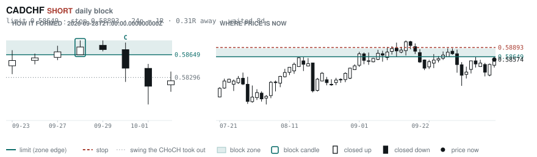
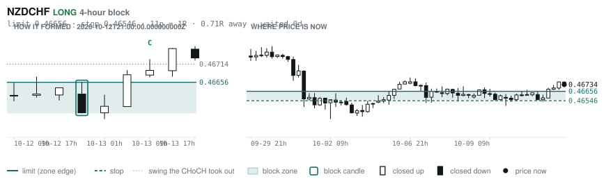
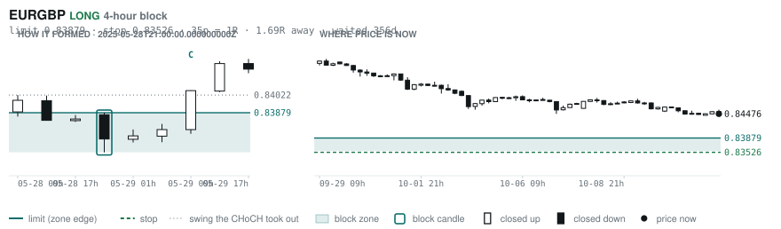
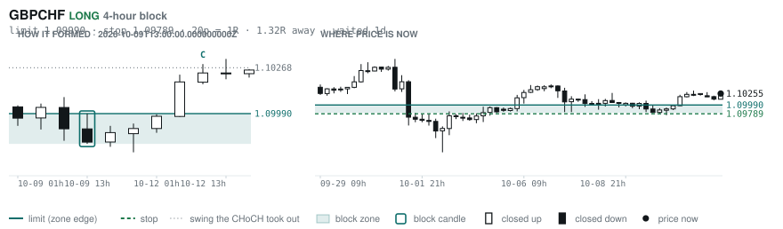

# Scanner Review — 2026-10-13 (evening)

Generated: 2026-10-13T23:03:40.162Z

```
## The clock

It is **18:00 Chicago** — a **DEAD** hour at 0.65x an average one.
An order placed now rests through **Tokyo, London and tomorrow's NY overlap** — about 16h of cover.
Next window: **Tokyo** in 1h.

_Evening pass. Orders placed now get the longest cover of the day: Tokyo, London, and tomorrow's NY overlap. Place limits and stops here — whatever does not fill overnight is still live for the morning._

## Where the energy is

**Running hot:** _nothing unusually active_
**Quiet:** GBPAUD 0.77 · CHFJPY 0.76 · NZDUSD 0.76 · AUDNZD 0.74 · GBPNZD 0.72 · USDJPY 0.71

_Volatility persists for about two days, so a hot pair stays hot. It says nothing about direction — this picks the pair, the levels pick the side._

## Account

NAV **$1050.44**   unrealised $-44.00   margin available $669.68   1 open

| pair | units | now | P/L | stop | distance | news lean |
|---|---|---|---|---|---|---|
| EURCAD | 17000 | 1.59222 | $-44.00 | **none** | — | 2 neutral |

**What the system reads on each position**

- **EURCAD** LONG — last REVERSAL LONG 42h ago at 1.59300 — system stop 1.58472, target **1.62445**; 322p to that target from here

## What is coming, and which way it leans

**EURCAD LONG**
- ⚪ 10-14T02:10 EUR — ECB President Lagarde Speech
- ⚪ 10-14T08:30 EUR — ECB President Lagarde Speech

_Lean is read from forecast vs previous — which way consensus leans, not what will print._

## Order blocks live right now

### Daily

| pair | dir | limit | stop | 1R | spread | away | fills | waited | window | reaches 1R / 2R |
|---|---|---|---|---|---|---|---|---|---|---|
| CADCHF | SHORT | **0.58649** | 0.58893 | 24p $2.93 | 12% | 0.3R | 94% | 8d | 0.83x ⚠ | 68% / 39% |

_7 more live but further out, 2.7R to 7.7R away. They alert on their own when they come within 1R._
_Older blocks run further: 60+ days reaches 2R 58% of the time against 34% for a same-day fill._

### 4-hour

| pair | dir | limit | stop | 1R | spread | away | fills | waited | window | reaches 1R / 2R |
|---|---|---|---|---|---|---|---|---|---|---|
| NZDCHF | LONG | **0.46656** | 0.46546 | 11p $1.32 | **37%** | 0.7R | 83% | 0d | 1.03x | 70% / 46% |
| EURGBP | LONG | **0.83879** | 0.83526 | 35p $4.68 | 4% | 1.7R | 79% | 356d | 0.85x ⚠ | 78% / 51% |
| GBPCHF | LONG | **1.09990** | 1.09789 | 20p $2.42 | **22%** | 1.9R | 79% | 1d | 0.86x ⚠ | 70% / 46% |

_14 more live but further out, 2.1R to 7.8R away. They alert on their own when they come within 1R._
_H4 stops are a third of a daily one, so spread bites three times as hard — a bolded spread figure is most of the edge gone before price moves._

### In reach, drawn

_4 blocks within 2R of the limit. Blocks further out are in the tables above but not worth a picture yet._

**CADCHF SHORT** · daily · 0.31R away · waited 8d



**NZDCHF LONG** · 4-hour · 0.71R away · waited 0d



**EURGBP LONG** · 4-hour · 1.71R away · waited 356d



**GBPCHF LONG** · 4-hour · 1.87R away · waited 1d



_Left panel is the block forming, right is where price sits now. Legend is in each image._

## Scanner calls, last 1 day

| when | pair | dir | branch | firing | entry | stop | target | outcome |
|---|---|---|---|---|---|---|---|---|
| 10-13T01:00 | AUDUSD | LONG | REV | 1st ⚠ | 0.69593 | 0.68904 | 0.70760 | open +0.35R |
| 10-13T01:00 | NZDCHF | LONG | REV | 1st ⚠ | 0.46579 | 0.46290 | 0.47298 | open +0.54R |
| 10-13T01:00 | EURGBP | LONG | REV | 2nd | 0.84532 | 0.84138 | 0.86717 | open -0.12R |
| 10-13T05:00 | EURCHF | SHORT | REV | 4th | 0.93137 | 0.93705 | 0.90334 | open -0.18R |
| 10-13T05:00 | GBPUSD | LONG | REV | 1st ⚠ | 1.32365 | 1.31361 | 1.33906 | open +0.18R |
| 10-13T05:00 | AUDCAD | LONG | REV | 1st ⚠ | 0.99416 | 0.98755 | 1.00472 | open -0.22R |
| 10-13T05:00 | NZDCHF | LONG | REV | 8th | 0.46680 | 0.46329 | 0.47298 | open +0.15R |
| 10-13T05:00 | USDCAD | SHORT | REV | 1st ⚠ | 1.42614 | 1.43433 | 1.35795 | open +0.56R |
| 10-13T05:00 | GBPCAD | LONG | REV | 1st ⚠ | 1.88763 | 1.87937 | 1.92054 | open -0.41R |
| 10-13T09:00 | USDJPY | LONG | REV | 10th | 158.168 | 156.622 | 160.539 | open +0.10R |
| 10-13T09:00 | CADJPY | LONG | REV | 2nd | 111.072 | 109.884 | 112.870 | open +0.25R |
| 10-13T09:00 | GBPJPY | LONG | REV | 2nd | 209.566 | 207.831 | 213.533 | open +0.16R |
| 10-13T09:00 | GBPAUD | LONG | REV | 1st ⚠ | 1.89848 | 1.88848 | 1.94986 | open -0.04R |
| 10-13T09:00 | EURJPY | LONG | REV | 2nd | 177.080 | 175.444 | 183.868 | open +0.13R |
| 10-13T09:00 | AUDNZD | LONG | REV | 6th | 1.24334 | 1.23573 | 1.26118 | open +0.11R |
| 10-13T13:00 | NZDCAD | SHORT | REV | 6th | 0.79777 | 0.80393 | 0.78367 | open -0.02R |
| 10-13T13:00 | CADCHF | LONG | REV | 1st ⚠ | 0.58617 | 0.58155 | 0.59396 | open -0.09R |
| 10-13T13:00 | GBPCAD | LONG | REV | 1st ⚠ | 1.88264 | 1.87345 | 1.92054 | open +0.17R |
| 10-13T13:00 | GBPAUD | LONG | REV | 5th | 1.89750 | 1.88529 | 1.94986 | open +0.05R |
| 10-13T13:00 | EURCAD | SHORT | REV | 1st ⚠ | 1.59056 | 1.60162 | 1.56736 | open -0.12R |
| 10-13T13:00 | USDJPY | LONG | REV | 2nd | 158.402 | 157.245 | 160.539 | open -0.07R |
| 10-13T13:00 | GBPCHF | LONG | REV | 1st ⚠ | 1.10352 | 1.09726 | 1.12032 | open +0.02R |
| 10-13T13:00 | EURUSD | SHORT | REV | 2nd | 1.11894 | 1.12673 | 1.06680 | open -0.12R |
| 10-13T13:00 | EURGBP | LONG | REV | 3rd | 0.84486 | 0.84142 | 0.86717 | open -0.01R |
| 10-13T13:00 | USDCHF | LONG | REV | 1st ⚠ | 0.83322 | 0.82601 | 0.85818 | open -0.08R |

```
