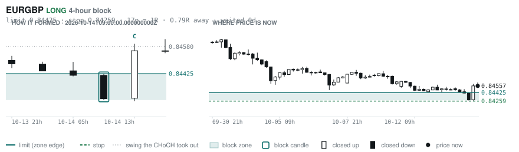
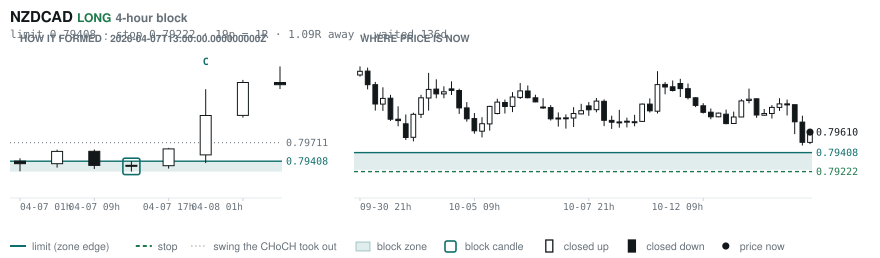

# Scanner Review — 2026-10-14 (evening)

Generated: 2026-10-14T23:03:38.830Z

```
## The clock

It is **18:00 Chicago** — a **DEAD** hour at 0.65x an average one.
An order placed now rests through **Tokyo, London and tomorrow's NY overlap** — about 16h of cover.
Next window: **Tokyo** in 1h.

_Evening pass. Orders placed now get the longest cover of the day: Tokyo, London, and tomorrow's NY overlap. Place limits and stops here — whatever does not fill overnight is still live for the morning._

## Where the energy is

**Running hot:** _nothing unusually active_
**Quiet:** CADJPY 0.85 · AUDNZD 0.84 · EURNZD 0.81 · USDJPY 0.81 · CHFJPY 0.79 · GBPNZD 0.79

_Volatility persists for about two days, so a hot pair stays hot. It says nothing about direction — this picks the pair, the levels pick the side._

## Account

NAV **$1011.32**   unrealised $-81.98   margin available $631.46   1 open

| pair | units | now | P/L | stop | distance | news lean |
|---|---|---|---|---|---|---|
| EURCAD | 17000 | 1.58908 | $-81.98 | **none** | — | — |

**What the system reads on each position**

- **EURCAD** LONG — last REVERSAL LONG 14h ago at 1.58524 — system stop 1.57836, target **1.62445**; 354p to that target from here

## Order blocks live right now

### Daily

_None within 2R. 8 further out — nearest 2.6R away._

### 4-hour

| pair | dir | limit | stop | 1R | spread | away | fills | waited | window | reaches 1R / 2R |
|---|---|---|---|---|---|---|---|---|---|---|
| EURGBP | LONG | **0.84425** | 0.84259 | 17p $2.19 | 9% | 0.8R | 83% | 0d | 0.85x ⚠ | 70% / 46% |
| NZDCAD | LONG | **0.79408** | 0.79222 | 19p $1.31 | **26%** | 1.1R | 79% | 136d | 0.99x ⚠ | 78% / 51% |
| EURGBP | LONG | **0.83879** | 0.83526 | 35p $4.66 | 4% | 1.9R | 79% | 357d | 0.85x ⚠ | 78% / 51% |

_14 more live but further out, 2.6R to 7.9R away. They alert on their own when they come within 1R._
_H4 stops are a third of a daily one, so spread bites three times as hard — a bolded spread figure is most of the edge gone before price moves._

### In reach, drawn

_3 blocks within 2R of the limit. Blocks further out are in the tables above but not worth a picture yet._

**EURGBP LONG** · 4-hour · 0.79R away · waited 0d



**NZDCAD LONG** · 4-hour · 1.09R away · waited 136d



**EURGBP LONG** · 4-hour · 1.92R away · waited 357d


_Left panel is the block forming, right is where price sits now. Legend is in each image._

## Scanner calls, last 1 day

| when | pair | dir | branch | firing | entry | stop | target | outcome |
|---|---|---|---|---|---|---|---|---|
| 10-14T01:00 | AUDCAD | LONG | REV | 2nd | 0.99414 | 0.98769 | 1.00472 | open -0.25R |
| 10-14T01:00 | EURNZD | SHORT | REV | 10th | 1.99214 | 2.00406 | 1.97216 | open -0.23R |
| 10-14T01:00 | CADJPY | SHORT | REV | 2nd | 111.388 | 112.647 | 107.746 | open +0.13R |
| 10-14T01:00 | NZDJPY | SHORT | REV | 1st ⚠ | 88.983 | 89.705 | 85.690 | open +0.63R |
| 10-14T01:00 | CHFJPY | SHORT | REV | 1st ⚠ | 190.135 | 191.268 | 187.556 | open +0.43R |
| 10-14T01:00 | AUDNZD | LONG | REV | 7th | 1.24438 | 1.23581 | 1.26118 | open +0.27R |
| 10-14T05:00 | USDJPY | LONG | REV | 11th | 158.461 | 156.648 | 160.539 | open -0.07R |
| 10-14T05:00 | USDCAD | LONG | REV | 1st ⚠ | 1.42152 | 1.41341 | 1.48280 | open +0.25R |
| 10-14T05:00 | GBPAUD | LONG | REV | 6th | 1.89220 | 1.88277 | 1.94986 | open +0.01R |
| 10-14T05:00 | GBPNZD | LONG | REV | 1st ⚠ | 2.35996 | 2.34758 | 2.40874 | open -0.06R |
| 10-14T09:00 | NZDUSD | SHORT | REV | 7th | 0.55874 | 0.56700 | 0.51726 | open -0.06R |
| 10-14T09:00 | EURNZD | SHORT | REV | 1st ⚠ | 1.99178 | 2.00483 | 1.97216 | open -0.24R |
| 10-14T09:00 | GBPUSD | SHORT | REV | 6th | 1.32042 | 1.33228 | 1.30833 | open +0.08R |
| 10-14T09:00 | AUDUSD | SHORT | REV | 7th | 0.69731 | 0.70475 | 0.66676 | open +0.01R |
| 10-14T09:00 | GBPJPY | SHORT | REV | 2nd | 209.728 | 211.649 | 206.187 | open +0.43R |
| 10-14T09:00 | USDJPY | LONG | REV | 1st ⚠ | 158.832 | 157.482 | 160.539 | open -0.37R |
| 10-14T09:00 | AUDJPY | SHORT | REV | 4th | 110.758 | 112.024 | 104.786 | open +0.28R |
| 10-14T09:00 | USDCHF | LONG | REV | 1st ⚠ | 0.83766 | 0.82707 | 0.85818 | open -0.26R |
| 10-14T09:00 | EURJPY | SHORT | REV | 1st ⚠ | 176.769 | 178.265 | 171.585 | open +0.08R |
| 10-14T13:00 | EURCHF | LONG | REV | 2nd | 0.93257 | 0.92741 | 0.94774 | open -0.23R |
| 10-14T13:00 | GBPJPY | SHORT | REV | 7th | 208.832 | 211.160 | 206.187 | open -0.03R |
| 10-14T13:00 | GBPAUD | LONG | REV | 3rd | 1.89037 | 1.87851 | 1.94986 | open +0.16R |
| 10-14T13:00 | AUDCAD | SHORT | REV | 1st ⚠ | 0.99258 | 1.00051 | 0.98124 | open +0.01R |
| 10-14T13:00 | EURGBP | LONG | REV | 2nd | 0.84557 | 0.83974 | 0.86717 | open +0.00R |
| 10-14T13:00 | CADJPY | LONG | REV | 3rd | 111.297 | 110.446 | 112.870 | open -0.08R |
| 10-14T17:00 | USDCAD | SHORT | REV | 1st ⚠ | 1.42357 | 1.43436 | 1.35795 | open +0.00R |
| 10-14T17:00 | AUDCHF | SHORT | REV | 1st ⚠ | 0.58210 | 0.58685 | 0.56031 | open +0.00R |
| 10-14T17:00 | GBPNZD | LONG | REV | 1st ⚠ | 2.35925 | 2.34756 | 2.40874 | open +0.00R |

## Running tally, last 30 days

4 resolved · 0 target / 4 stopped · **-4.0R** · -1.000R per call · 56 still open

```
