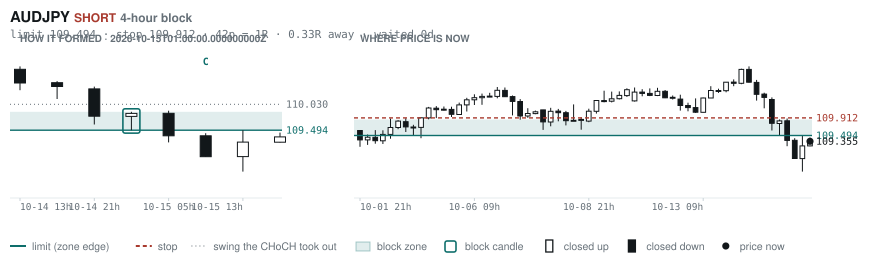
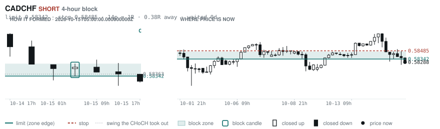
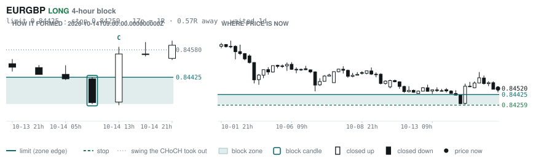
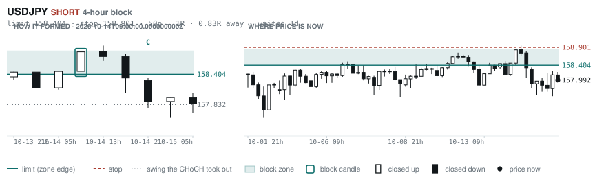
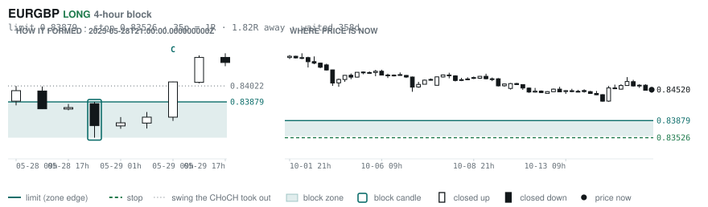
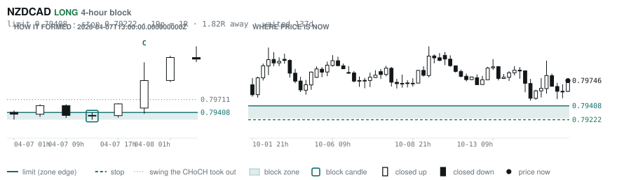

# Scanner Review — 2026-10-15 (evening)

Generated: 2026-10-15T23:03:40.666Z

```
## The clock

It is **18:00 Chicago** — a **DEAD** hour at 0.65x an average one.
An order placed now rests through **Tokyo, London and tomorrow's NY overlap** — about 16h of cover.
Next window: **Tokyo** in 1h.

_Evening pass. Orders placed now get the longest cover of the day: Tokyo, London, and tomorrow's NY overlap. Place limits and stops here — whatever does not fill overnight is still live for the morning._

## Where the energy is

**Running hot:** EURAUD 1.34 · AUDCHF 1.29 · GBPAUD 1.26 · AUDNZD 1.21 · EURUSD 1.21 · USDCAD 1.20 · AUDCAD 1.17 · USDCHF 1.16 · GBPUSD 1.15
**Quiet:** EURJPY 0.88 · CHFJPY 0.88 · CADJPY 0.87

_Volatility persists for about two days, so a hot pair stays hot. It says nothing about direction — this picks the pair, the levels pick the side._

## Account

NAV **$1040.45**   unrealised $-52.47   margin available $659.12   1 open

| pair | units | now | P/L | stop | distance | news lean |
|---|---|---|---|---|---|---|
| EURCAD | 17000 | 1.59153 | $-52.47 | **none** | — | 1 neutral |

**What the system reads on each position**

- **EURCAD** LONG — last CONTINUATION LONG 22h ago at 1.59055 — system stop 1.58309, target **1.62445** (Grade C); 329p to that target from here

## What is coming, and which way it leans

**EURCAD LONG**
- ⚪ 10-19T12:30 CAD — Inflation Rate YoY

_Lean is read from forecast vs previous — which way consensus leans, not what will print._

## Order blocks live right now

### Daily

| pair | dir | limit | stop | 1R | spread | away | fills | waited | window | reaches 1R / 2R |
|---|---|---|---|---|---|---|---|---|---|---|
| NZDCHF | LONG | **0.45968** | 0.45702 | 27p $3.22 | 15% | 1.9R | 81% | 69d | 1.03x | 75% / 53% |

_9 more live but further out, 2.2R to 8.0R away. They alert on their own when they come within 1R._
_Older blocks run further: 60+ days reaches 2R 58% of the time against 34% for a same-day fill._

### 4-hour

| pair | dir | limit | stop | 1R | spread | away | fills | waited | window | reaches 1R / 2R |
|---|---|---|---|---|---|---|---|---|---|---|
| AUDJPY | SHORT | **109.494** | 109.912 | 42p $2.65 | 5% | 0.3R | 87% | 0d | 1.10x | 70% / 46% |
| CADCHF | SHORT | **0.58342** | 0.58485 | 14p $1.73 | 20% | 0.4R | 87% | 0d | 0.83x ⚠ | 70% / 46% |
| EURGBP | LONG | **0.84425** | 0.84259 | 17p $2.21 | 9% | 0.6R | 83% | 1d | 0.85x ⚠ | 70% / 46% |
| USDJPY | SHORT | **158.404** | 158.901 | 50p $3.15 | 3% | 0.8R | 83% | 1d | 1.04x | 70% / 46% |
| EURGBP | LONG | **0.83879** | 0.83526 | 35p $4.69 | 4% | 1.8R | 79% | 358d | 0.85x ⚠ | 78% / 51% |
| NZDCAD | LONG | **0.79408** | 0.79222 | 19p $1.31 | **26%** | 1.8R | 79% | 137d | 0.99x ⚠ | 78% / 51% |
| CHFJPY | LONG | **190.350** | 189.974 | 38p $2.38 | 15% | 2.0R | 79% | 0d | 1.01x | 70% / 46% |

_14 more live but further out, 3.1R to 7.6R away. They alert on their own when they come within 1R._
_H4 stops are a third of a daily one, so spread bites three times as hard — a bolded spread figure is most of the edge gone before price moves._

### In reach, drawn

_6 blocks within 2R of the limit. Blocks further out are in the tables above but not worth a picture yet._

**AUDJPY SHORT** · 4-hour · 0.33R away · waited 0d



**CADCHF SHORT** · 4-hour · 0.38R away · waited 0d



**EURGBP LONG** · 4-hour · 0.57R away · waited 1d



**USDJPY SHORT** · 4-hour · 0.83R away · waited 1d



**EURGBP LONG** · 4-hour · 1.82R away · waited 358d



**NZDCAD LONG** · 4-hour · 1.82R away · waited 137d



_Left panel is the block forming, right is where price sits now. Legend is in each image._

## Scanner calls, last 1 day

| when | pair | dir | branch | firing | entry | stop | target | outcome |
|---|---|---|---|---|---|---|---|---|
| 10-15T01:00 | NZDCHF | LONG | REV | 2nd | 0.46628 | 0.46137 | 0.47298 | open -0.31R |
| 10-15T01:00 | NZDJPY | LONG | REV | 10th | 88.742 | 87.485 | 90.044 | open +0.05R |
| 10-15T01:00 | GBPCAD | LONG | REV | 4th | 1.88143 | 1.87147 | 1.92054 | open +0.19R |
| 10-15T01:00 | EURNZD | SHORT | REV | 7th | 1.99640 | 2.01076 | 1.97216 | open +0.02R |
| 10-15T01:00 | USDCHF | LONG | REV | 3rd | 0.82997 | 0.81902 | 0.85818 | open -0.29R |
| 10-15T01:00 | GBPCHF | LONG | REV | 4th | 1.09914 | 1.09080 | 1.12032 | open -0.18R |
| 10-15T01:00 | EURJPY | LONG | REV | 1st ⚠ | 177.160 | 175.434 | 183.868 | open +0.07R |
| 10-15T01:00 | AUDJPY | LONG | REV | 1st ⚠ | 109.840 | 108.726 | 112.586 | stopped -1.00R |
| 10-15T01:00 | EURAUD | SHORT | REV | 1st ⚠ | 1.61287 | 1.62462 | 1.59370 | stopped -1.00R |
| 10-15T01:00 | CHFJPY | LONG | REV | 4th | 190.324 | 188.957 | 192.453 | open +0.57R |
| 10-15T05:00 | NZDCAD | SHORT | REV | 8th | 0.79671 | 0.80466 | 0.78367 | open -0.09R |
| 10-15T13:00 | EURCHF | LONG | REV | 1st ⚠ | 0.92848 | 0.92271 | 0.94774 | open -0.13R |
| 10-15T09:00 | GBPUSD | SHORT | REV | 3rd | 1.32535 | 1.33803 | 1.30833 | open -0.19R |
| 10-15T13:00 | USDJPY | LONG | REV | 13th | 158.135 | 156.460 | 160.539 | open -0.09R |
| 10-15T13:00 | CADCHF | LONG | REV | 1st ⚠ | 0.58364 | 0.57888 | 0.59396 | open -0.16R |
| 10-15T13:00 | EURAUD | SHORT | REV | 9th | 1.62222 | 1.63747 | 1.59370 | open +0.07R |
| 10-15T13:00 | NZDCHF | LONG | REV | 1st ⚠ | 0.46458 | 0.46012 | 0.47298 | open +0.04R |
| 10-15T13:00 | USDCHF | LONG | REV | 4th | 0.82848 | 0.81867 | 0.85818 | open -0.18R |
| 10-15T05:00 | EURCAD | SHORT | REV | 2nd | 1.59254 | 1.60215 | 1.56736 | open +0.10R |
| 10-15T13:00 | GBPCHF | LONG | REV | 5th | 1.09870 | 1.09057 | 1.12032 | open -0.13R |
| 10-15T13:00 | AUDCHF | LONG | REV | 6th | 0.57234 | 0.56511 | 0.59034 | open -0.01R |
| 10-15T13:00 | USDCAD | LONG | REV | 1st ⚠ | 1.41974 | 1.40985 | 1.48280 | open -0.12R |
| 10-15T09:00 | EURGBP | LONG | REV | 5th | 0.84612 | 0.84182 | 0.86717 | open -0.21R |
| 10-15T13:00 | NZDCAD | SHORT | REV | 8th | 0.79600 | 0.80196 | 0.78367 | open -0.25R |
| 10-15T13:00 | GBPAUD | SHORT | REV | 1st ⚠ | 1.91962 | 1.93547 | 1.85168 | open +0.09R |
| 10-15T13:00 | EURUSD | SHORT | REV | 1st ⚠ | 1.12068 | 1.12995 | 1.06680 | open -0.16R |
| 10-15T05:00 | AUDCHF | LONG | REV | 5th | 0.57492 | 0.56930 | 0.59034 | open -0.48R |
| 10-15T05:00 | CHFJPY | SHORT | REV | 11th | 190.251 | 191.490 | 187.556 | open -0.69R |
| 10-15T17:00 | AUDCAD | LONG | REV | 4th | 0.98172 | 0.97413 | 1.00604 | open +0.00R |

## Running tally, last 30 days

10 resolved · 1 target / 9 stopped · **-7.6R** · -0.757R per call · 50 still open

```
