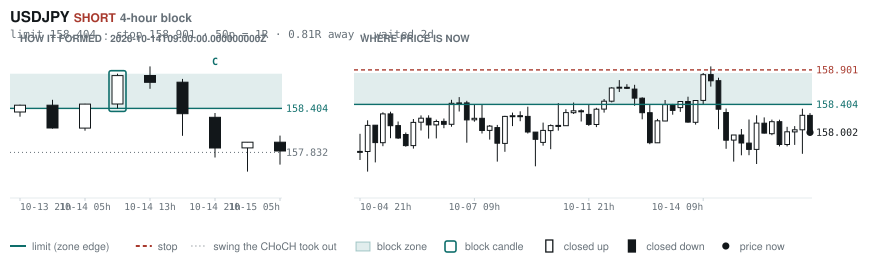
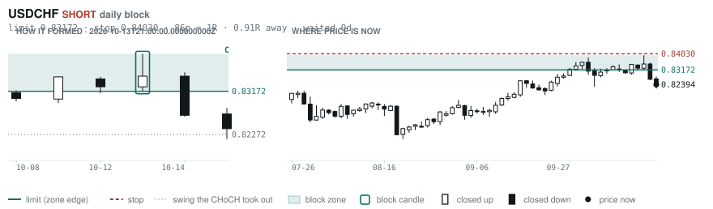
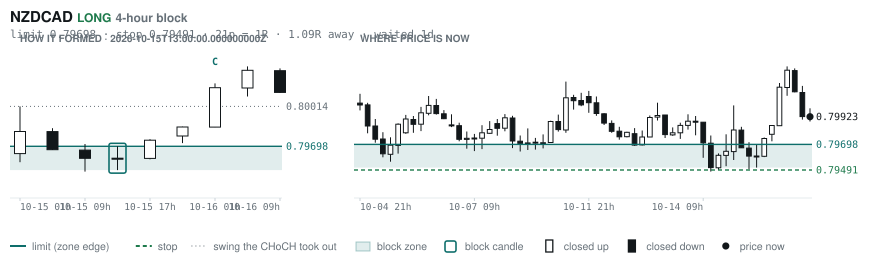
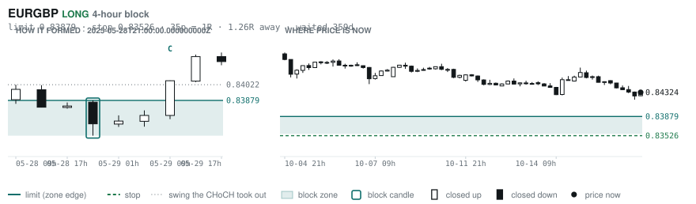

# Scanner Review — 2026-10-18 (weekly)

Generated: 2026-10-18T19:03:43.071Z

```
## The clock

It is **14:00 Chicago** — a **DEAD** hour at 0.74x an average one.
An order placed now rests through **tomorrow — the rest of today is dead**.
Next window: **Tokyo** in 5h.

## Where the energy is

**Running hot:** EURAUD 1.24 · EURUSD 1.22 · AUDCHF 1.20 · USDCHF 1.20 · USDCAD 1.19 · GBPUSD 1.17 · GBPAUD 1.17 · AUDNZD 1.16
**Quiet:** CHFJPY 0.90 · USDJPY 0.89 · GBPJPY 0.89 · CADJPY 0.84 · EURJPY 0.83

_Volatility persists for about two days, so a hot pair stays hot. It says nothing about direction — this picks the pair, the levels pick the side._

## Account

NAV **$1005.81**   unrealised $-86.71   margin available $623.66   1 open

| pair | units | now | P/L | stop | distance | news lean |
|---|---|---|---|---|---|---|
| EURCAD | 17000 | 1.58898 | $-86.71 | **none** | — | 🔴 1 headwind |

**What the system reads on each position**

- **EURCAD** LONG — last CONTINUATION LONG 62h ago at 1.59047 — system stop 1.58363, target **1.62445** (Grade C); 355p to that target from here

## What is coming, and which way it leans

**EURCAD LONG**
- 🔴 10-19T08:30 CAD — CPI m/m  (fc 0.2% vs prev -0.1%)
- ⚪ 10-19T08:30 CAD — Median CPI y/y  (fc 2.0% vs prev 2.0%)
- ⚪ 10-19T08:30 CAD — Trimmed CPI y/y  (fc 1.9% vs prev 1.9%)
- ⚪ 10-19T12:30 CAD — Inflation Rate YoY

_Lean is read from forecast vs previous — which way consensus leans, not what will print._

## Order blocks live right now

### Daily

| pair | dir | limit | stop | 1R | spread | away | fills | waited | window | reaches 1R / 2R |
|---|---|---|---|---|---|---|---|---|---|---|
| USDCHF | SHORT | **0.83172** | 0.84030 | 86p $10.41 | 6% | 0.9R | 87% | 0d | 1.54x | 68% / 39% |

_8 more live but further out, 2.3R to 8.0R away. They alert on their own when they come within 1R._
_Older blocks run further: 60+ days reaches 2R 58% of the time against 34% for a same-day fill._

### 4-hour

| pair | dir | limit | stop | 1R | spread | away | fills | waited | window | reaches 1R / 2R |
|---|---|---|---|---|---|---|---|---|---|---|
| USDJPY | SHORT | **158.404** | 158.901 | 50p $3.15 | 6% | 0.8R | 83% | 2d | 1.37x | 77% / 47% |
| NZDCAD | LONG | **0.79698** | 0.79491 | 21p $1.46 | **56%** | 1.1R | 79% | 1d | 1.33x | 70% / 46% |
| EURGBP | LONG | **0.83879** | 0.83526 | 35p $4.71 | 20% | 1.3R | 79% | 359d | 1.50x | 78% / 51% |

_15 more live but further out, 2.4R to 7.8R away. They alert on their own when they come within 1R._
_H4 stops are a third of a daily one, so spread bites three times as hard — a bolded spread figure is most of the edge gone before price moves._

### In reach, drawn

_4 blocks within 2R of the limit. Blocks further out are in the tables above but not worth a picture yet._

**USDJPY SHORT** · 4-hour · 0.81R away · waited 2d



**USDCHF SHORT** · daily · 0.91R away · waited 0d



**NZDCAD LONG** · 4-hour · 1.09R away · waited 1d



**EURGBP LONG** · 4-hour · 1.26R away · waited 359d



_Left panel is the block forming, right is where price sits now. Legend is in each image._

## Scanner calls, last 7 days

| when | pair | dir | branch | firing | entry | stop | target | outcome |
|---|---|---|---|---|---|---|---|---|
| 10-11T21:00 | EURCHF | LONG | REV | 1st ⚠ | 0.93024 | 0.92443 | 0.95992 | open -0.73R |
| 10-11T21:00 | NZDCHF | LONG | REV | 1st ⚠ | 0.46576 | 0.46147 | 0.47758 | open +0.01R |
| 10-11T21:00 | CADCHF | LONG | REV | 1st ⚠ | 0.58194 | 0.57720 | 0.59446 | open +0.17R |
| 10-11T21:00 | CADJPY | LONG | REV | 1st ⚠ | 110.933 | 109.805 | 114.634 | open +0.73R |
| 10-11T21:00 | NZDCAD | SHORT | REV | 15th | 0.80036 | 0.80651 | 0.78367 | open +0.18R |
| 10-11T21:00 | EURCAD | LONG | REV | 1st ⚠ | 1.59848 | 1.58765 | 1.62445 | stopped -1.00R |
| 10-11T21:00 | AUDUSD | SHORT | REV | 3rd | 0.69902 | 0.70519 | 0.66676 | open +0.72R |
| 10-11T21:00 | GBPCAD | SHORT | REV | 1st ⚠ | 1.88853 | 1.89920 | 1.85129 | open +0.38R |
| 10-11T21:00 | USDCAD | SHORT | REV | 1st ⚠ | 1.42540 | 1.43536 | 1.35795 | open +1.16R |
| 10-11T21:00 | AUDNZD | LONG | REV | 5th | 1.24483 | 1.23531 | 1.26118 | stopped -1.00R |
| 10-11T21:00 | GBPAUD | SHORT | REV | 4th | 1.89550 | 1.90648 | 1.85168 | stopped -1.00R |
| 10-12T01:00 | USDJPY | LONG | REV | 9th | 158.336 | 156.581 | 160.539 | open -0.19R |
| 10-12T01:00 | NZDUSD | SHORT | REV | 6th | 0.56064 | 0.56711 | 0.51726 | stopped -1.00R |
| 10-12T05:00 | USDJPY | LONG | REV | 1st ⚠ | 158.450 | 157.227 | 160.539 | open -0.37R |
| 10-12T05:00 | EURJPY | SHORT | REV | 6th | 177.356 | 178.973 | 171.585 | open -0.15R |
| 10-12T05:00 | AUDUSD | SHORT | REV | 3rd | 0.69704 | 0.70275 | 0.66676 | open +0.43R |
| 10-12T05:00 | AUDCHF | LONG | REV | 4th | 0.58018 | 0.57658 | 0.59203 | stopped -1.00R |
| 10-12T05:00 | EURUSD | SHORT | REV | 3rd | 1.11930 | 1.12703 | 1.06680 | open -0.59R |
| 10-12T09:00 | GBPUSD | SHORT | REV | 2nd | 1.32322 | 1.33281 | 1.30505 | stopped -1.00R |
| 10-12T09:00 | NZDCHF | SHORT | REV | 1st ⚠ | 0.46612 | 0.46984 | 0.45425 | open +0.09R |
| 10-12T13:00 | GBPUSD | SHORT | REV | 5th | 1.32076 | 1.33246 | 1.30505 | stopped -1.00R |
| 10-12T13:00 | EURNZD | LONG | REV | 8th | 1.99790 | 1.98614 | 2.03913 | stopped -1.00R |
| 10-12T13:00 | NZDJPY | SHORT | REV | 1st ⚠ | 88.612 | 89.579 | 85.690 | stopped -1.00R |
| 10-12T13:00 | EURGBP | LONG | REV | 1st ⚠ | 0.84490 | 0.84119 | 0.86717 | open -0.45R |
| 10-12T13:00 | GBPCAD | LONG | REV | 7th | 1.88604 | 1.87856 | 1.92054 | stopped -1.00R |
| 10-12T17:00 | EURCAD | SHORT | WALL | 2nd | 1.59310 | 1.59801 | 1.56736 | open +0.84R |
| 10-12T21:00 | NZDCAD | LONG | REV | 2nd | 0.79693 | 0.79194 | 0.81534 | open +0.46R |
| 10-12T21:00 | GBPJPY | SHORT | REV | 6th | 209.372 | 211.070 | 202.486 | open -0.72R |
| 10-12T21:00 | EURJPY | LONG | REV | 1st ⚠ | 176.876 | 175.479 | 183.868 | open +0.51R |
| 10-12T21:00 | CHFJPY | LONG | REV | 9th | 190.024 | 188.639 | 194.306 | open +1.25R |
| 10-12T21:00 | AUDCHF | SHORT | REV | 5th | 0.57996 | 0.58445 | 0.56031 | stopped -1.00R |
| 10-12T21:00 | CADJPY | LONG | REV | 14th | 111.013 | 110.154 | 112.870 | open +0.86R |
| 10-13T01:00 | AUDUSD | LONG | REV | 1st ⚠ | 0.69593 | 0.68904 | 0.70760 | open -0.19R |
| 10-13T01:00 | NZDCHF | LONG | REV | 1st ⚠ | 0.46579 | 0.46290 | 0.47298 | open +0.00R |
| 10-13T01:00 | EURGBP | LONG | REV | 2nd | 0.84532 | 0.84138 | 0.86717 | open -0.53R |
| 10-13T05:00 | EURCHF | SHORT | REV | 4th | 0.93137 | 0.93705 | 0.90334 | open +0.95R |
| 10-13T05:00 | GBPUSD | LONG | REV | 1st ⚠ | 1.32365 | 1.31361 | 1.33906 | open +0.92R |
| 10-13T05:00 | AUDCAD | LONG | REV | 1st ⚠ | 0.99416 | 0.98755 | 1.00472 | stopped -1.00R |
| 10-13T05:00 | NZDCHF | LONG | REV | 8th | 0.46680 | 0.46329 | 0.47298 | open -0.28R |
| 10-13T05:00 | USDCAD | SHORT | REV | 1st ⚠ | 1.42614 | 1.43433 | 1.35795 | open +1.50R |
| 10-13T05:00 | GBPCAD | LONG | REV | 1st ⚠ | 1.88763 | 1.87937 | 1.92054 | stopped -1.00R |
| 10-13T09:00 | USDJPY | LONG | REV | 10th | 158.168 | 156.622 | 160.539 | open -0.11R |
| 10-13T09:00 | CADJPY | LONG | REV | 2nd | 111.072 | 109.884 | 112.870 | open +0.57R |
| 10-13T09:00 | GBPJPY | LONG | REV | 2nd | 209.566 | 207.831 | 213.533 | open +0.59R |
| 10-13T09:00 | GBPAUD | LONG | REV | 1st ⚠ | 1.89848 | 1.88848 | 1.94986 | open +2.04R |
| 10-13T09:00 | EURJPY | LONG | REV | 2nd | 177.080 | 175.444 | 183.868 | open +0.31R |
| 10-13T09:00 | AUDNZD | LONG | REV | 6th | 1.24334 | 1.23573 | 1.26118 | stopped -1.00R |
| 10-13T13:00 | NZDCAD | SHORT | REV | 6th | 0.79777 | 0.80393 | 0.78367 | open -0.24R |
| 10-13T13:00 | CADCHF | LONG | REV | 1st ⚠ | 0.58617 | 0.58155 | 0.59396 | stopped -1.00R |
| 10-13T13:00 | GBPCAD | LONG | REV | 1st ⚠ | 1.88264 | 1.87345 | 1.92054 | open +0.20R |
| 10-13T13:00 | GBPAUD | LONG | REV | 5th | 1.89750 | 1.88529 | 1.94986 | open +1.75R |
| 10-13T13:00 | EURCAD | SHORT | REV | 1st ⚠ | 1.59056 | 1.60162 | 1.56736 | open +0.14R |
| 10-13T13:00 | USDJPY | LONG | REV | 2nd | 158.402 | 157.245 | 160.539 | open -0.35R |
| 10-13T13:00 | GBPCHF | LONG | REV | 1st ⚠ | 1.10352 | 1.09726 | 1.12032 | stopped -1.00R |
| 10-13T13:00 | EURUSD | SHORT | REV | 2nd | 1.11894 | 1.12673 | 1.06680 | stopped -1.00R |
| 10-13T13:00 | EURGBP | LONG | REV | 3rd | 0.84486 | 0.84142 | 0.86717 | open -0.47R |
| 10-13T13:00 | USDCHF | LONG | REV | 1st ⚠ | 0.83322 | 0.82601 | 0.85818 | stopped -1.00R |
| 10-14T01:00 | AUDCAD | LONG | REV | 2nd | 0.99414 | 0.98769 | 1.00472 | stopped -1.00R |
| 10-14T01:00 | EURNZD | SHORT | REV | 10th | 1.99214 | 2.00406 | 1.97216 | open +0.35R |
| 10-14T01:00 | CADJPY | SHORT | REV | 2nd | 111.388 | 112.647 | 107.746 | open -0.29R |
| 10-14T01:00 | NZDJPY | SHORT | REV | 1st ⚠ | 88.983 | 89.705 | 85.690 | open -0.46R |
| 10-14T01:00 | CHFJPY | SHORT | REV | 1st ⚠ | 190.135 | 191.268 | 187.556 | stopped -1.00R |
| 10-14T01:00 | AUDNZD | LONG | REV | 7th | 1.24438 | 1.23581 | 1.26118 | stopped -1.00R |
| 10-14T05:00 | USDJPY | LONG | REV | 11th | 158.461 | 156.648 | 160.539 | open -0.25R |
| 10-14T05:00 | USDCAD | LONG | REV | 1st ⚠ | 1.42152 | 1.41341 | 1.48280 | open -0.94R |
| 10-14T05:00 | GBPAUD | LONG | REV | 6th | 1.89220 | 1.88277 | 1.94986 | open +2.83R |
| 10-14T05:00 | GBPNZD | LONG | REV | 1st ⚠ | 2.35996 | 2.34758 | 2.40874 | open -0.18R |
| 10-14T09:00 | NZDUSD | SHORT | REV | 7th | 0.55874 | 0.56700 | 0.51726 | stopped -1.00R |
| 10-14T09:00 | EURNZD | SHORT | REV | 1st ⚠ | 1.99178 | 2.00483 | 1.97216 | open +0.29R |
| 10-14T09:00 | GBPUSD | SHORT | REV | 6th | 1.32042 | 1.33228 | 1.30833 | stopped -1.00R |
| 10-14T09:00 | AUDUSD | SHORT | REV | 7th | 0.69731 | 0.70475 | 0.66676 | open +0.36R |
| 10-14T09:00 | GBPJPY | SHORT | REV | 2nd | 209.728 | 211.649 | 206.187 | open -0.45R |
| 10-14T09:00 | USDJPY | LONG | REV | 1st ⚠ | 158.832 | 157.482 | 160.539 | open -0.62R |
| 10-14T09:00 | AUDJPY | SHORT | REV | 4th | 110.758 | 112.024 | 104.786 | open +0.80R |
| 10-14T09:00 | USDCHF | LONG | REV | 1st ⚠ | 0.83766 | 0.82707 | 0.85818 | stopped -1.00R |
| 10-14T09:00 | EURJPY | SHORT | REV | 1st ⚠ | 176.769 | 178.265 | 171.585 | open -0.55R |
| 10-14T13:00 | EURCHF | LONG | REV | 2nd | 0.93257 | 0.92741 | 0.94774 | stopped -1.00R |
| 10-14T13:00 | GBPJPY | SHORT | REV | 7th | 208.832 | 211.160 | 206.187 | open -0.76R |
| 10-14T13:00 | GBPAUD | LONG | REV | 3rd | 1.89037 | 1.87851 | 1.94986 | open +2.41R |
| 10-14T13:00 | AUDCAD | SHORT | REV | 1st ⚠ | 0.99258 | 1.00051 | 0.98124 | target +1.43R |
| 10-14T13:00 | EURGBP | LONG | REV | 2nd | 0.84557 | 0.83974 | 0.86717 | open -0.40R |
| 10-14T13:00 | CADJPY | LONG | REV | 3rd | 111.297 | 110.446 | 112.870 | open +0.54R |
| 10-14T17:00 | USDCAD | SHORT | REV | 1st ⚠ | 1.42357 | 1.43436 | 1.35795 | open +0.90R |
| 10-14T17:00 | AUDCHF | SHORT | REV | 1st ⚠ | 0.58210 | 0.58685 | 0.56031 | open +2.06R |
| 10-14T17:00 | GBPNZD | LONG | REV | 1st ⚠ | 2.35925 | 2.34756 | 2.40874 | open -0.14R |
| 10-14T21:00 | GBPUSD | LONG | REV | 2nd | 1.32334 | 1.31200 | 1.33906 | open +0.84R |
| 10-14T21:00 | CADCHF | SHORT | REV | 1st ⚠ | 0.58466 | 0.58993 | 0.57623 | open +0.36R |
| 10-14T21:00 | CHFJPY | LONG | REV | 2nd | 190.080 | 188.195 | 192.453 | open +0.89R |
| 10-14T21:00 | EURCAD | LONG | REV | 3rd | 1.59068 | 1.57846 | 1.62445 | open -0.14R |
| 10-14T21:00 | EURUSD | SHORT | REV | 3rd | 1.11960 | 1.12763 | 1.06680 | open -0.53R |
| 10-14T21:00 | EURAUD | SHORT | REV | 4th | 1.61025 | 1.62033 | 1.59370 | stopped -1.00R |
| 10-14T21:00 | AUDCHF | SHORT | REV | 2nd | 0.57754 | 0.58636 | 0.56031 | open +0.59R |
| 10-15T01:00 | NZDCHF | LONG | REV | 2nd | 0.46628 | 0.46137 | 0.47298 | open -0.10R |
| 10-15T01:00 | NZDJPY | LONG | REV | 10th | 88.742 | 87.485 | 90.044 | open +0.46R |
| 10-15T01:00 | GBPCAD | LONG | REV | 4th | 1.88143 | 1.87147 | 1.92054 | open +0.31R |
| 10-15T01:00 | EURNZD | SHORT | REV | 7th | 1.99640 | 2.01076 | 1.97216 | open +0.59R |
| 10-15T01:00 | USDCHF | LONG | REV | 3rd | 0.82997 | 0.81902 | 0.85818 | open -0.55R |
| 10-15T01:00 | GBPCHF | LONG | REV | 4th | 1.09914 | 1.09080 | 1.12032 | open -0.11R |
| 10-15T01:00 | EURJPY | LONG | REV | 1st ⚠ | 177.160 | 175.434 | 183.868 | open +0.25R |
| 10-15T01:00 | AUDJPY | LONG | REV | 1st ⚠ | 109.840 | 108.726 | 112.586 | stopped -1.00R |
| 10-15T01:00 | EURAUD | SHORT | REV | 1st ⚠ | 1.61287 | 1.62462 | 1.59370 | stopped -1.00R |
| 10-15T01:00 | CHFJPY | LONG | REV | 4th | 190.324 | 188.957 | 192.453 | open +1.05R |
| 10-15T05:00 | NZDCAD | SHORT | REV | 8th | 0.79671 | 0.80466 | 0.78367 | open -0.32R |
| 10-15T13:00 | EURCHF | LONG | REV | 1st ⚠ | 0.92848 | 0.92271 | 0.94774 | open -0.43R |
| 10-15T09:00 | GBPUSD | SHORT | REV | 3rd | 1.32535 | 1.33803 | 1.30833 | open -0.59R |
| 10-15T13:00 | USDJPY | LONG | REV | 13th | 158.135 | 156.460 | 160.539 | open -0.08R |
| 10-15T13:00 | CADCHF | LONG | REV | 1st ⚠ | 0.58364 | 0.57888 | 0.59396 | open -0.18R |
| 10-15T13:00 | EURAUD | SHORT | REV | 9th | 1.62222 | 1.63747 | 1.59370 | open +0.28R |
| 10-15T13:00 | NZDCHF | LONG | REV | 1st ⚠ | 0.46458 | 0.46012 | 0.47298 | open +0.27R |
| 10-15T13:00 | USDCHF | LONG | REV | 4th | 0.82848 | 0.81867 | 0.85818 | open -0.46R |
| 10-15T05:00 | EURCAD | SHORT | REV | 2nd | 1.59254 | 1.60215 | 1.56736 | open +0.37R |
| 10-15T13:00 | GBPCHF | LONG | REV | 5th | 1.09870 | 1.09057 | 1.12032 | open -0.06R |
| 10-15T13:00 | AUDCHF | LONG | REV | 6th | 0.57234 | 0.56511 | 0.59034 | open -0.00R |
| 10-15T13:00 | USDCAD | LONG | REV | 1st ⚠ | 1.41974 | 1.40985 | 1.48280 | open -0.59R |
| 10-15T09:00 | EURGBP | LONG | REV | 5th | 0.84612 | 0.84182 | 0.86717 | open -0.67R |
| 10-15T13:00 | NZDCAD | SHORT | REV | 8th | 0.79600 | 0.80196 | 0.78367 | stopped -1.00R |
| 10-15T13:00 | GBPAUD | SHORT | REV | 1st ⚠ | 1.91962 | 1.93547 | 1.85168 | open +0.05R |
| 10-15T13:00 | EURUSD | SHORT | REV | 1st ⚠ | 1.12068 | 1.12995 | 1.06680 | open -0.34R |
| 10-15T05:00 | AUDCHF | LONG | REV | 5th | 0.57492 | 0.56930 | 0.59034 | open -0.46R |
| 10-15T05:00 | CHFJPY | SHORT | REV | 11th | 190.251 | 191.490 | 187.556 | stopped -1.00R |
| 10-15T17:00 | AUDCAD | LONG | REV | 4th | 0.98172 | 0.97413 | 1.00604 | open +0.05R |
| 10-15T21:00 | NZDCHF | LONG | REV | 3rd | 0.46571 | 0.46124 | 0.47298 | open +0.02R |
| 10-15T21:00 | GBPUSD | SHORT | REV | 4th | 1.32700 | 1.33757 | 1.30833 | open -0.55R |
| 10-15T21:00 | AUDCHF | LONG | REV | 4th | 0.57310 | 0.56772 | 0.59034 | open -0.15R |
| 10-15T21:00 | GBPNZD | SHORT | REV | 2nd | 2.35930 | 2.37418 | 2.34227 | open +0.11R |
| 10-16T01:00 | NZDCAD | SHORT | REV | 1st ⚠ | 0.80162 | 0.80857 | 0.78367 | open +0.34R |
| 10-16T01:00 | GBPCAD | LONG | WALL | 1st ⚠ | 1.88598 | 1.87950 | 1.92054 | open -0.23R |
| 10-16T01:00 | GBPJPY | SHORT | REV | 10th | 209.964 | 211.466 | 206.187 | open -0.42R |
| 10-16T01:00 | USDJPY | SHORT | REV | 1st ⚠ | 157.828 | 159.377 | 153.713 | open -0.11R |
| 10-16T01:00 | AUDCHF | LONG | REV | 1st ⚠ | 0.57439 | 0.56842 | 0.59034 | open -0.35R |
| 10-16T01:00 | EURCAD | SHORT | REV | 3rd | 1.59187 | 1.60180 | 1.56736 | open +0.29R |
| 10-16T01:00 | EURAUD | SHORT | REV | 4th | 1.61642 | 1.63148 | 1.59370 | open -0.11R |
| 10-16T01:00 | AUDCAD | LONG | REV | 1st ⚠ | 0.98480 | 0.97760 | 1.00604 | open -0.38R |
| 10-16T01:00 | AUDUSD | LONG | REV | 1st ⚠ | 0.69470 | 0.68690 | 0.70760 | open -0.01R |
| 10-16T01:00 | USDCAD | SHORT | REV | 1st ⚠ | 1.41768 | 1.42620 | 1.35795 | open +0.45R |
| 10-16T01:00 | GBPAUD | SHORT | REV | 2nd | 1.91500 | 1.92985 | 1.85168 | open -0.26R |
| 10-16T01:00 | EURUSD | LONG | REV | 2nd | 1.12292 | 1.11459 | 1.17423 | open +0.11R |
| 10-16T01:00 | CHFJPY | SHORT | REV | 1st ⚠ | 190.882 | 192.261 | 187.556 | open -0.64R |
| 10-16T05:00 | EURCHF | LONG | REV | 3rd | 0.92698 | 0.92148 | 0.94774 | open -0.18R |
| 10-16T05:00 | CADCHF | SHORT | REV | 1st ⚠ | 0.58210 | 0.58793 | 0.57623 | open -0.11R |
| 10-16T09:00 | NZDCHF | SHORT | REV | 2nd | 0.46638 | 0.47023 | 0.45425 | open +0.15R |
| 10-16T09:00 | GBPCAD | LONG | WALL | 1st ⚠ | 1.88921 | 1.88318 | 1.92054 | open -0.78R |
| 10-16T09:00 | AUDJPY | SHORT | REV | 2nd | 109.874 | 111.125 | 104.786 | open +0.10R |
| 10-16T09:00 | CADJPY | SHORT | REV | 3rd | 111.532 | 112.641 | 107.746 | open -0.20R |
| 10-16T09:00 | USDCHF | LONG | REV | 3rd | 0.82486 | 0.81587 | 0.85818 | open -0.10R |
| 10-16T09:00 | AUDNZD | LONG | REV | 1st ⚠ | 1.22962 | 1.22273 | 1.26118 | open -0.14R |
| 10-16T13:00 | USDJPY | SHORT | REV | 11th | 158.248 | 159.528 | 153.713 | open +0.19R |
| 10-16T13:00 | NZDCHF | SHORT | REV | 1st ⚠ | 0.46602 | 0.47027 | 0.45425 | open +0.05R |
| 10-16T13:00 | GBPNZD | LONG | REV | 1st ⚠ | 2.35862 | 2.34379 | 2.40874 | open -0.06R |

## Running tally, last 30 days

24 resolved · 0 target / 24 stopped · **-24.0R** · -1.000R per call · 36 still open

```
