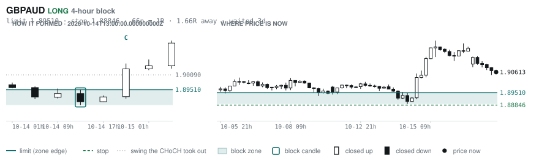
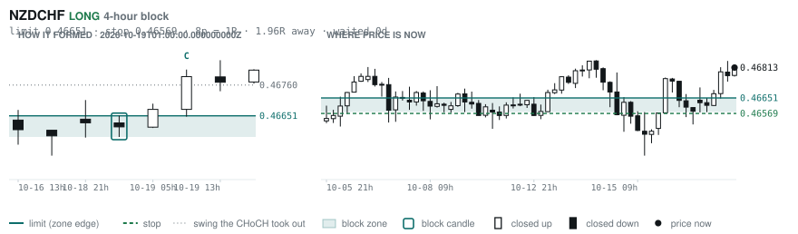

# Scanner Review — 2026-10-19 (evening)

Generated: 2026-10-19T23:03:38.264Z

```
## The clock

It is **18:00 Chicago** — a **DEAD** hour at 0.65x an average one.
An order placed now rests through **Tokyo, London and tomorrow's NY overlap** — about 16h of cover.
Next window: **Tokyo** in 1h.

_Evening pass. Orders placed now get the longest cover of the day: Tokyo, London, and tomorrow's NY overlap. Place limits and stops here — whatever does not fill overnight is still live for the morning._

## Where the energy is

**Running hot:** EURCAD 1.33 · EURAUD 1.30 · EURUSD 1.20 · USDCAD 1.19 · GBPCAD 1.18 · AUDCHF 1.18 · AUDCAD 1.16 · GBPAUD 1.16
**Quiet:** NZDJPY 0.88 · CADJPY 0.88 · EURJPY 0.86 · CHFJPY 0.83 · USDJPY 0.82 · GBPJPY 0.79

_Volatility persists for about two days, so a hot pair stays hot. It says nothing about direction — this picks the pair, the levels pick the side._

## Account

NAV **$919.42**   unrealised $-172.70   margin available $538.18   1 open

| pair | units | now | P/L | stop | distance | news lean |
|---|---|---|---|---|---|---|
| EURCAD | 17000 | 1.58160 | $-172.70 | **none** | — | — |

**What the system reads on each position**

- **EURCAD** LONG — last CONTINUATION LONG 90h ago at 1.59047 — system stop 1.58363, target **1.62445** (Grade C); 429p to that target from here

## Order blocks live right now

### Daily

| pair | dir | limit | stop | 1R | spread | away | fills | waited | window | reaches 1R / 2R |
|---|---|---|---|---|---|---|---|---|---|---|
| USDCHF | SHORT | **0.83172** | 0.84030 | 86p $10.38 | 2% | 0.6R | 87% | 1d | 0.89x ⚠ | 68% / 39% |

_7 more live but further out, 2.8R to 7.4R away. They alert on their own when they come within 1R._
_Older blocks run further: 60+ days reaches 2R 58% of the time against 34% for a same-day fill._

### 4-hour

| pair | dir | limit | stop | 1R | spread | away | fills | waited | window | reaches 1R / 2R |
|---|---|---|---|---|---|---|---|---|---|---|
| EURGBP | LONG | **0.83879** | 0.83526 | 35p $4.70 | 4% | 1.1R | 79% | 360d | 0.85x ⚠ | 78% / 51% |
| GBPAUD | LONG | **1.89510** | 1.88846 | 66p $4.64 | 9% | 1.7R | 79% | 3d | 1.04x | 77% / 47% |
| NZDCHF | LONG | **0.46651** | 0.46569 | 8p $1.00 | **53%** | 2.0R | 79% | 0d | 1.03x | 70% / 46% |

_12 more live but further out, 2.2R to 6.7R away. They alert on their own when they come within 1R._
_H4 stops are a third of a daily one, so spread bites three times as hard — a bolded spread figure is most of the edge gone before price moves._

### In reach, drawn

_4 blocks within 2R of the limit. Blocks further out are in the tables above but not worth a picture yet._

**USDCHF SHORT** · daily · 0.58R away · waited 1d


**EURGBP LONG** · 4-hour · 1.12R away · waited 360d


**GBPAUD LONG** · 4-hour · 1.66R away · waited 3d



**NZDCHF LONG** · 4-hour · 1.96R away · waited 0d



_Left panel is the block forming, right is where price sits now. Legend is in each image._

## Scanner calls, last 1 day

| when | pair | dir | branch | firing | entry | stop | target | outcome |
|---|---|---|---|---|---|---|---|---|
| 10-19T01:00 | USDJPY | SHORT | REV | 1st ⚠ | 158.092 | 159.368 | 153.713 | open -0.34R |
| 10-19T01:00 | GBPJPY | LONG | REV | 11th | 210.706 | 209.065 | 213.533 | open +0.12R |
| 10-19T01:00 | AUDUSD | LONG | REV | 8th | 0.69752 | 0.69042 | 0.70760 | open +0.06R |
| 10-19T01:00 | AUDNZD | SHORT | REV | 5th | 1.23345 | 1.24116 | 1.21994 | open +0.11R |
| 10-19T05:00 | NZDUSD | LONG | REV | 3rd | 0.56610 | 0.56081 | 0.61544 | open +0.03R |
| 10-19T09:00 | CADCHF | SHORT | REV | 2nd | 0.58526 | 0.59009 | 0.57623 | open -0.13R |
| 10-19T09:00 | GBPCHF | SHORT | REV | 3rd | 1.09947 | 1.10682 | 1.06748 | open -0.05R |
| 10-19T09:00 | EURJPY | LONG | REV | 2nd | 177.725 | 176.153 | 183.868 | open +0.01R |
| 10-19T09:00 | EURUSD | LONG | REV | 3rd | 1.12236 | 1.11488 | 1.17423 | open -0.16R |
| 10-19T13:00 | EURCHF | SHORT | REV | 6th | 0.92622 | 0.93071 | 0.90334 | open -0.15R |
| 10-19T13:00 | USDCHF | SHORT | REV | 3rd | 0.82610 | 0.83206 | 0.80718 | open -0.10R |
| 10-19T13:00 | EURGBP | LONG | REV | 2nd | 0.84276 | 0.83891 | 0.86717 | open -0.01R |
| 10-19T17:00 | AUDCAD | LONG | REV | 3rd | 0.98489 | 0.97747 | 1.00604 | open +0.00R |

## Running tally, last 30 days

9 resolved · 0 target / 9 stopped · **-9.0R** · -1.000R per call · 51 still open

```
