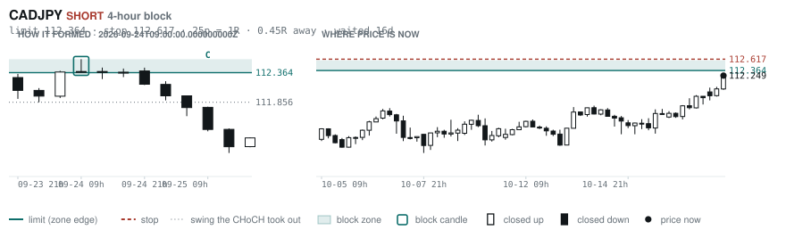
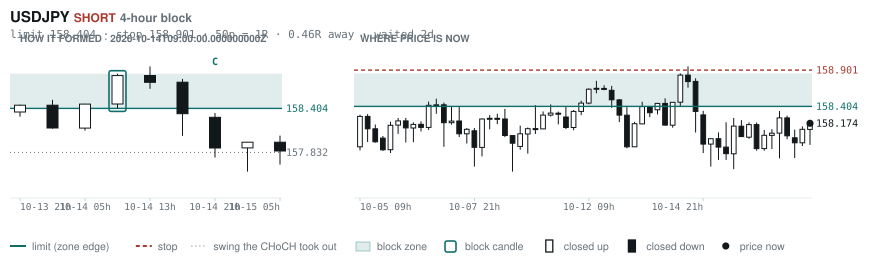
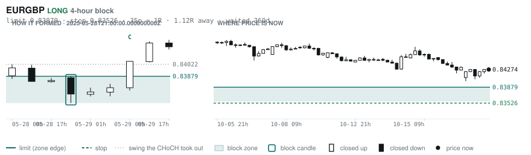
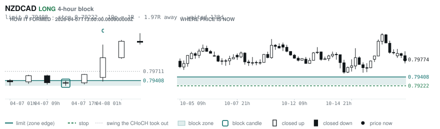

# Scanner Review — 2026-10-19 (morning)

Generated: 2026-10-19T11:03:38.683Z

```
## The clock

It is **06:00 Chicago** — a **normal** hour at 1.10x an average one.
An order placed now rests through **the NY overlap** — about 5h of cover.
Next window: **NY overlap** in 1h.

_Morning pass. The NY overlap is the single best window of the day but it is the only one left before the afternoon goes dead, so this is the adjustment pass: the morning-skewed pairs, and anything that filled overnight._

## Where the energy is

**Running hot:** EURAUD 1.40 · EURCAD 1.34 · EURUSD 1.28 · GBPAUD 1.23 · EURGBP 1.21 · AUDCHF 1.20 · USDCAD 1.17 · AUDNZD 1.17
**Quiet:** CHFJPY 0.88 · USDJPY 0.87 · CADJPY 0.87 · GBPJPY 0.87

_Volatility persists for about two days, so a hot pair stays hot. It says nothing about direction — this picks the pair, the levels pick the side._

## Account

NAV **$901.06**   unrealised $-191.46   margin available $519.55   1 open

| pair | units | now | P/L | stop | distance | news lean |
|---|---|---|---|---|---|---|
| EURCAD | 17000 | 1.58003 | $-191.46 | **none** | — | 🔴 2 headwind |

**What the system reads on each position**

- **EURCAD** LONG — last CONTINUATION LONG 78h ago at 1.59047 — system stop 1.58363, target **1.62445** (Grade C); 444p to that target from here

## What is coming, and which way it leans

**EURCAD LONG**
- 🔴 10-19T08:30 CAD — CPI m/m  (fc 0.2% vs prev -0.1%)
- ⚪ 10-19T08:30 CAD — Median CPI y/y  (fc 2.0% vs prev 2.0%)
- ⚪ 10-19T08:30 CAD — Trimmed CPI y/y  (fc 1.9% vs prev 1.9%)
- 🔴 10-19T12:30 CAD — Inflation Rate YoY  (fc 3.2 vs prev 3)

_Lean is read from forecast vs previous — which way consensus leans, not what will print._

## Order blocks live right now

### Daily

| pair | dir | limit | stop | 1R | spread | away | fills | waited | window | reaches 1R / 2R |
|---|---|---|---|---|---|---|---|---|---|---|
| USDCHF | SHORT | **0.83172** | 0.84030 | 86p $10.41 | 2% | 0.9R | 87% | 0d | 1.54x | 68% / 39% |

_8 more live but further out, 2.3R to 8.0R away. They alert on their own when they come within 1R._
_Older blocks run further: 60+ days reaches 2R 58% of the time against 34% for a same-day fill._

### 4-hour

| pair | dir | limit | stop | 1R | spread | away | fills | waited | window | reaches 1R / 2R |
|---|---|---|---|---|---|---|---|---|---|---|
| CADJPY | SHORT | **112.364** | 112.617 | 25p $1.60 | 15% | 0.5R | 87% | 16d | 1.44x | 78% / 51% |
| USDJPY | SHORT | **158.404** | 158.901 | 50p $3.15 | 3% | 0.5R | 87% | 2d | 1.37x | 77% / 47% |
| EURGBP | LONG | **0.83879** | 0.83526 | 35p $4.71 | 4% | 0.7R | 83% | 360d | 1.50x | 78% / 51% |
| NZDCAD | LONG | **0.79408** | 0.79222 | 19p $1.31 | **23%** | 2.0R | 79% | 138d | 1.33x | 78% / 51% |

_13 more live but further out, 2.3R to 8.0R away. They alert on their own when they come within 1R._
_H4 stops are a third of a daily one, so spread bites three times as hard — a bolded spread figure is most of the edge gone before price moves._

### In reach, drawn

_5 blocks within 2R of the limit. Blocks further out are in the tables above but not worth a picture yet._

**CADJPY SHORT** · 4-hour · 0.45R away · waited 16d



**USDJPY SHORT** · 4-hour · 0.46R away · waited 2d



**EURGBP LONG** · 4-hour · 0.71R away · waited 360d



**USDCHF SHORT** · daily · 0.91R away · waited 0d


**NZDCAD LONG** · 4-hour · 1.97R away · waited 138d



_Left panel is the block forming, right is where price sits now. Legend is in each image._

## Scanner calls, last 1 day

| when | pair | dir | branch | firing | entry | stop | target | outcome |
|---|---|---|---|---|---|---|---|---|
| 10-18T21:00 | AUDCHF | SHORT | REV | 3rd | 0.57397 | 0.57984 | 0.56031 | open -0.22R |
| 10-18T21:00 | GBPAUD | LONG | REV | 2nd | 1.91402 | 1.89810 | 1.94986 | open -0.24R |
| 10-18T21:00 | USDCAD | LONG | REV | 4th | 1.41251 | 1.40329 | 1.48280 | open -0.36R |
| 10-18T21:00 | EURGBP | LONG | REV | 1st ⚠ | 0.84227 | 0.83712 | 0.86717 | open -0.19R |
| 10-18T21:00 | NZDCAD | LONG | REV | 9th | 0.79903 | 0.79211 | 0.80896 | open -0.19R |
| 10-18T21:00 | AUDJPY | SHORT | REV | 9th | 109.965 | 111.161 | 104.786 | open -0.34R |
| 10-19T01:00 | USDJPY | SHORT | REV | 1st ⚠ | 158.092 | 159.368 | 153.713 | open -0.06R |
| 10-19T01:00 | GBPJPY | LONG | REV | 11th | 210.706 | 209.065 | 213.533 | open +0.07R |
| 10-19T01:00 | AUDUSD | LONG | REV | 8th | 0.69752 | 0.69042 | 0.70760 | open +0.03R |
| 10-19T01:00 | AUDNZD | SHORT | REV | 5th | 1.23345 | 1.24116 | 1.21994 | open +0.12R |
| 10-19T05:00 | NZDUSD | LONG | REV | 3rd | 0.56610 | 0.56081 | 0.61544 | open +0.00R |

## Running tally, last 30 days

9 resolved · 0 target / 9 stopped · **-9.0R** · -1.000R per call · 51 still open

```
