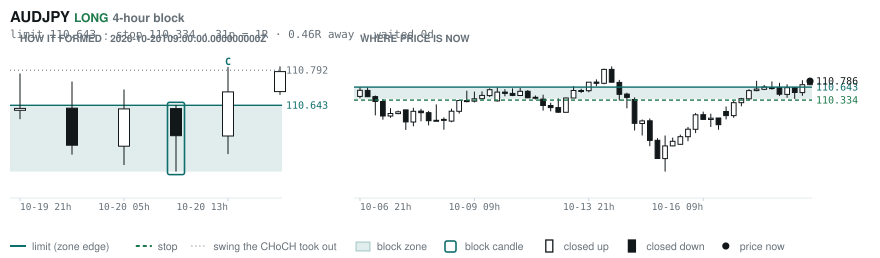
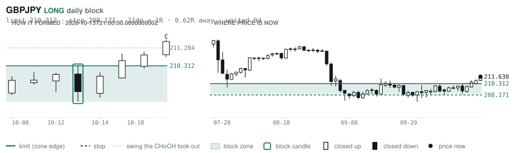
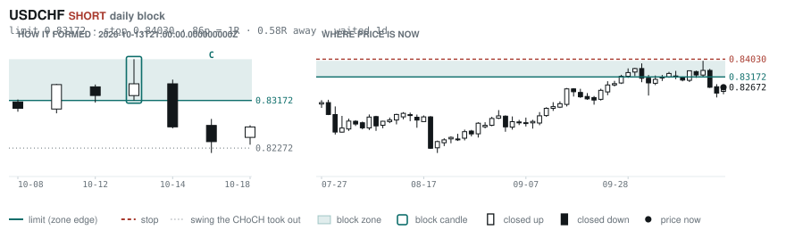

# Scanner Review — 2026-10-20 (evening)

Generated: 2026-10-20T23:03:39.455Z

```
## The clock

It is **18:00 Chicago** — a **DEAD** hour at 0.65x an average one.
An order placed now rests through **Tokyo, London and tomorrow's NY overlap** — about 16h of cover.
Next window: **Tokyo** in 1h.

_Evening pass. Orders placed now get the longest cover of the day: Tokyo, London, and tomorrow's NY overlap. Place limits and stops here — whatever does not fill overnight is still live for the morning._

## Where the energy is

**Running hot:** EURCAD 1.28 · AUDCHF 1.21 · GBPCAD 1.21 · AUDCAD 1.16 · EURCHF 1.15 · EURAUD 1.15
**Quiet:** CHFJPY 0.88 · CADJPY 0.86 · EURJPY 0.81 · NZDJPY 0.80 · USDJPY 0.79 · GBPJPY 0.78

_Volatility persists for about two days, so a hot pair stays hot. It says nothing about direction — this picks the pair, the levels pick the side._

## Account

NAV **$886.20**   unrealised $-205.52   margin available $504.42   1 open

| pair | units | now | P/L | stop | distance | news lean |
|---|---|---|---|---|---|---|
| EURCAD | 17000 | 1.57893 | $-205.52 | **none** | — | — |

**What the system reads on each position**

- **EURCAD** LONG — last CONTINUATION LONG 114h ago at 1.59047 — system stop 1.58363, target **1.62445** (Grade C); 455p to that target from here

## Order blocks live right now

### Daily

| pair | dir | limit | stop | 1R | spread | away | fills | waited | window | reaches 1R / 2R |
|---|---|---|---|---|---|---|---|---|---|---|
| GBPJPY | LONG | **210.312** | 208.171 | 214p $13.53 | 2% | 0.6R | 87% | 0d | 1.03x | 68% / 39% |
| USDCHF | SHORT | **0.83172** | 0.84030 | 86p $10.40 | 2% | 0.8R | 87% | 2d | 0.89x ⚠ | 68% / 39% |

_7 more live but further out, 3.0R to 7.0R away. They alert on their own when they come within 1R._
_Older blocks run further: 60+ days reaches 2R 58% of the time against 34% for a same-day fill._

### 4-hour

| pair | dir | limit | stop | 1R | spread | away | fills | waited | window | reaches 1R / 2R |
|---|---|---|---|---|---|---|---|---|---|---|
| AUDJPY | LONG | **110.643** | 110.334 | 31p $1.95 | 8% | 0.5R | 87% | 0d | 1.10x | 70% / 46% |

_14 more live but further out, 2.0R to 7.3R away. They alert on their own when they come within 1R._
_H4 stops are a third of a daily one, so spread bites three times as hard — a bolded spread figure is most of the edge gone before price moves._

### In reach, drawn

_3 blocks within 2R of the limit. Blocks further out are in the tables above but not worth a picture yet._

**AUDJPY LONG** · 4-hour · 0.46R away · waited 0d



**GBPJPY LONG** · daily · 0.62R away · waited 0d



**USDCHF SHORT** · daily · 0.83R away · waited 2d



_Left panel is the block forming, right is where price sits now. Legend is in each image._

## Scanner calls, last 1 day

| when | pair | dir | branch | firing | entry | stop | target | outcome |
|---|---|---|---|---|---|---|---|---|
| 10-20T01:00 | NZDUSD | LONG | REV | 1st ⚠ | 0.56768 | 0.56114 | 0.61544 | open +0.12R |
| 10-20T01:00 | USDJPY | SHORT | REV | 12th | 158.186 | 159.431 | 153.713 | open +0.01R |
| 10-20T01:00 | GBPAUD | LONG | REV | 1st ⚠ | 1.90920 | 1.89620 | 1.94986 | open +0.08R |
| 10-20T01:00 | AUDUSD | LONG | REV | 2nd | 0.69838 | 0.69176 | 0.71228 | open +0.31R |
| 10-20T01:00 | EURCHF | SHORT | REV | 7th | 0.92638 | 0.93039 | 0.90334 | open -0.06R |
| 10-20T05:00 | EURCHF | SHORT | REV | 2nd | 0.92556 | 0.93141 | 0.90334 | open -0.18R |
| 10-20T05:00 | GBPCHF | LONG | REV | 3rd | 1.10102 | 1.09417 | 1.12516 | open +0.33R |
| 10-20T05:00 | EURCAD | SHORT | WALL | 5th | 1.57763 | 1.58550 | 1.56736 | open -0.28R |
| 10-20T05:00 | EURAUD | SHORT | REV | 1st ⚠ | 1.60414 | 1.61768 | 1.55743 | open -0.02R |
| 10-20T09:00 | AUDCAD | LONG | REV | 4th | 0.98262 | 0.97418 | 1.00604 | open +0.24R |
| 10-20T13:00 | GBPCHF | LONG | REV | 1st ⚠ | 1.10448 | 1.09383 | 1.12516 | open -0.12R |
| 10-20T13:00 | EURGBP | LONG | REV | 6th | 0.83998 | 0.83462 | 0.86717 | open -0.02R |
| 10-20T13:00 | CHFJPY | SHORT | REV | 1st ⚠ | 191.515 | 193.466 | 187.540 | open -0.16R |
| 10-20T17:00 | USDJPY | LONG | REV | 10th | 158.172 | 156.607 | 161.527 | open +0.00R |

## Running tally, last 30 days

12 resolved · 0 target / 12 stopped · **-12.0R** · -1.000R per call · 48 still open

```
