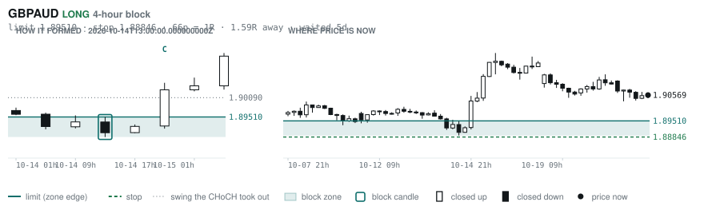

# Scanner Review — 2026-10-21 (evening)

Generated: 2026-10-21T23:03:39.315Z

```
## The clock

It is **18:00 Chicago** — a **DEAD** hour at 0.65x an average one.
An order placed now rests through **Tokyo, London and tomorrow's NY overlap** — about 16h of cover.
Next window: **Tokyo** in 1h.

_Evening pass. Orders placed now get the longest cover of the day: Tokyo, London, and tomorrow's NY overlap. Place limits and stops here — whatever does not fill overnight is still live for the morning._

## Where the energy is

**Running hot:** _nothing unusually active_
**Quiet:** CADJPY 0.83 · NZDJPY 0.81 · CHFJPY 0.80 · GBPJPY 0.78 · USDJPY 0.77 · EURJPY 0.73

_Volatility persists for about two days, so a hot pair stays hot. It says nothing about direction — this picks the pair, the levels pick the side._

## Account

NAV **$869.98**   unrealised $-218.88   margin available $38.89   2 open

| pair | units | now | P/L | stop | distance | news lean |
|---|---|---|---|---|---|---|
| EURGBP | 8000 | 0.83868 | $5.25 | **none** | — | 🟢 3 tailwind |
| EURCAD | 17000 | 1.57739 | $-224.13 | **none** | — | — |

**What the system reads on each position**

- **EURGBP** LONG — last REVERSAL LONG 6h ago at 0.83780 — system stop 0.83480, target **0.86717**; 285p to that target from here
- **EURCAD** LONG — last REVERSAL LONG 14h ago at 1.57425 — system stop 1.56566, target **1.62445**; 471p to that target from here

## What is coming, and which way it leans

**EURGBP LONG**
- 🟢 10-23T06:00 GBP — Retail Sales MoM  (fc -0.1 vs prev 0.5)
- 🟢 10-23T08:30 GBP — S&P Global Services PMI Flash  (fc 51.8 vs prev 52.1)
- 🟢 10-23T08:30 GBP — S&P Global Manufacturing PMI Flash  (fc 51.7 vs prev 51.9)

_Lean is read from forecast vs previous — which way consensus leans, not what will print._

## Order blocks live right now

### Daily

| pair | dir | limit | stop | 1R | spread | away | fills | waited | window | reaches 1R / 2R |
|---|---|---|---|---|---|---|---|---|---|---|
| GBPJPY | LONG | **210.312** | 208.171 | 214p $13.54 | 2% | 0.7R | 87% | 1d | 1.03x | 68% / 39% |
| USDCHF | SHORT | **0.83172** | 0.84030 | 86p $10.41 | 2% | 0.9R | 87% | 3d | 0.89x ⚠ | 68% / 39% |

_8 more live but further out, 3.1R to 7.2R away. They alert on their own when they come within 1R._
_Older blocks run further: 60+ days reaches 2R 58% of the time against 34% for a same-day fill._

### 4-hour

| pair | dir | limit | stop | 1R | spread | away | fills | waited | window | reaches 1R / 2R |
|---|---|---|---|---|---|---|---|---|---|---|
| AUDNZD | LONG | **1.23229** | 1.22974 | 26p $1.45 | 12% | 0.2R | 87% | 1d | 1.15x | 70% / 46% |
| AUDCHF | SHORT | **0.58232** | 0.58450 | 22p $2.64 | 11% | 1.3R | 79% | 4d | 1.04x | 77% / 47% |
| AUDCAD | LONG | **0.98352** | 0.98095 | 26p $1.83 | 13% | 1.5R | 79% | 1d | 1.00x | 70% / 46% |
| GBPAUD | LONG | **1.89510** | 1.88846 | 66p $4.67 | 7% | 1.6R | 79% | 5d | 1.04x | 77% / 47% |
| AUDJPY | LONG | **110.643** | 110.334 | 31p $1.95 | 6% | 1.6R | 79% | 1d | 1.10x | 70% / 46% |
| EURCAD | LONG | **1.56944** | 1.56513 | 43p $3.07 | 9% | 2.0R | 79% | 157d | 0.80x ⚠ | 78% / 51% |

_10 more live but further out, 2.2R to 7.0R away. They alert on their own when they come within 1R._
_H4 stops are a third of a daily one, so spread bites three times as hard — a bolded spread figure is most of the edge gone before price moves._

### In reach, drawn

_6 blocks within 2R of the limit. Blocks further out are in the tables above but not worth a picture yet._

**AUDNZD LONG** · 4-hour · 0.18R away · waited 1d


**GBPJPY LONG** · daily · 0.70R away · waited 1d


**USDCHF SHORT** · daily · 0.85R away · waited 3d


**AUDCHF SHORT** · 4-hour · 1.33R away · waited 4d


**AUDCAD LONG** · 4-hour · 1.48R away · waited 1d


**GBPAUD LONG** · 4-hour · 1.59R away · waited 5d



_Left panel is the block forming, right is where price sits now. Legend is in each image._

## Scanner calls, last 1 day

| when | pair | dir | branch | firing | entry | stop | target | outcome |
|---|---|---|---|---|---|---|---|---|
| 10-21T01:00 | NZDCHF | SHORT | REV | 4th | 0.46836 | 0.47328 | 0.45836 | open -0.32R |
| 10-21T01:00 | GBPCHF | SHORT | REV | 1st ⚠ | 1.10413 | 1.11081 | 1.08540 | open -0.02R |
| 10-21T01:00 | EURJPY | SHORT | REV | 1st ⚠ | 177.454 | 178.748 | 171.729 | open -0.14R |
| 10-21T01:00 | GBPJPY | SHORT | REV | 2nd | 211.435 | 213.086 | 206.523 | open -0.23R |
| 10-21T01:00 | AUDUSD | SHORT | REV | 4th | 0.70098 | 0.70686 | 0.67750 | open -0.32R |
| 10-21T05:00 | EURCHF | SHORT | REV | 3rd | 0.92526 | 0.93163 | 0.90334 | open -0.13R |
| 10-21T09:00 | EURCAD | LONG | REV | 2nd | 1.57823 | 1.56423 | 1.62445 | open -0.03R |
| 10-21T09:00 | NZDJPY | SHORT | REV | 6th | 89.907 | 90.749 | 87.497 | open -0.27R |
| 10-21T09:00 | AUDCAD | LONG | WALL | 3rd | 0.98850 | 0.98461 | 1.00604 | open -0.30R |
| 10-21T09:00 | EURUSD | LONG | REV | 1st ⚠ | 1.12314 | 1.11601 | 1.17423 | open +0.02R |
| 10-21T13:00 | GBPAUD | LONG | REV | 1st ⚠ | 1.90548 | 1.89138 | 1.95694 | open +0.01R |
| 10-21T13:00 | GBPJPY | LONG | REV | 2nd | 211.776 | 210.296 | 213.533 | open +0.03R |
| 10-21T13:00 | GBPCHF | SHORT | REV | 2nd | 1.10441 | 1.11092 | 1.08540 | open +0.02R |
| 10-21T13:00 | USDCHF | LONG | REV | 1st ⚠ | 0.82438 | 0.81708 | 0.85632 | open +0.00R |
| 10-21T13:00 | AUDUSD | SHORT | REV | 6th | 0.70306 | 0.70941 | 0.67750 | open +0.03R |
| 10-21T13:00 | AUDJPY | LONG | REV | 7th | 111.141 | 109.831 | 113.562 | open +0.01R |
| 10-21T13:00 | AUDNZD | SHORT | REV | 1st ⚠ | 1.23340 | 1.24123 | 1.21994 | open +0.08R |
| 10-21T17:00 | NZDCAD | SHORT | REV | 16th | 0.80091 | 0.80678 | 0.78749 | open +0.00R |
| 10-21T17:00 | EURJPY | SHORT | REV | 1st ⚠ | 177.634 | 178.687 | 171.729 | open +0.00R |
| 10-21T17:00 | EURGBP | LONG | REV | 7th | 0.83866 | 0.83480 | 0.86717 | open +0.00R |
| 10-21T17:00 | CADJPY | SHORT | REV | 1st ⚠ | 112.578 | 113.453 | 107.746 | open +0.00R |

## Running tally, last 30 days

9 resolved · 0 target / 9 stopped · **-9.0R** · -1.000R per call · 51 still open

```
