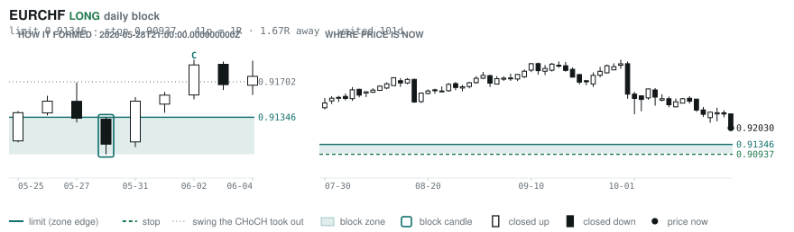
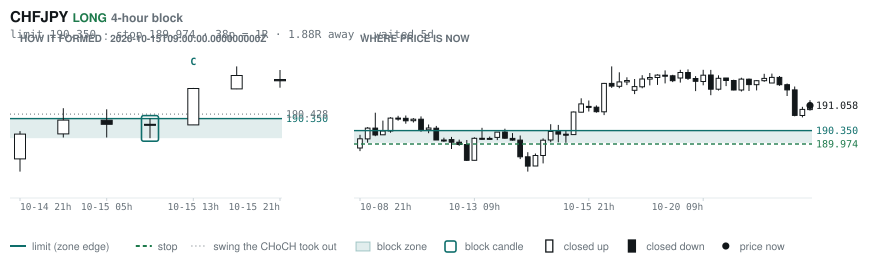

# Scanner Review — 2026-10-22 (evening)

Generated: 2026-10-22T23:03:41.677Z

```
## The clock

It is **18:00 Chicago** — a **DEAD** hour at 0.65x an average one.
An order placed now rests through **Tokyo, London and tomorrow's NY overlap** — about 16h of cover.
Next window: **Tokyo** in 1h.

_Evening pass. Orders placed now get the longest cover of the day: Tokyo, London, and tomorrow's NY overlap. Place limits and stops here — whatever does not fill overnight is still live for the morning._

## Where the energy is

**Running hot:** AUDCHF 1.27 · NZDCHF 1.20
**Quiet:** CHFJPY 0.82

_Volatility persists for about two days, so a hot pair stays hot. It says nothing about direction — this picks the pair, the levels pick the side._

## Account

NAV **$780.13**   unrealised $-307.76   margin available $0.00   2 open

| pair | units | now | P/L | stop | distance | news lean |
|---|---|---|---|---|---|---|
| EURGBP | 8000 | 0.83725 | $-10.08 | **none** | — | 🟢 3 tailwind |
| EURCAD | 17000 | 1.57140 | $-297.68 | **none** | — | — |

**What the system reads on each position**

- **EURGBP** LONG — last REVERSAL LONG 58h ago at 0.83772 — system stop 0.83416, target **0.86717**; 299p to that target from here
- **EURCAD** LONG — last REVERSAL LONG 22h ago at 1.57483 — system stop 1.56636, target **1.62445**; 530p to that target from here

## What is coming, and which way it leans

**EURGBP LONG**
- 🟢 10-23T06:00 GBP — Retail Sales MoM  (fc -0.1 vs prev 0.5)
- 🟢 10-23T08:30 GBP — S&P Global Services PMI Flash  (fc 51.8 vs prev 52.1)
- 🟢 10-23T08:30 GBP — S&P Global Manufacturing PMI Flash  (fc 51.7 vs prev 51.9)

_Lean is read from forecast vs previous — which way consensus leans, not what will print._

## Order blocks live right now

### Daily

| pair | dir | limit | stop | 1R | spread | away | fills | waited | window | reaches 1R / 2R |
|---|---|---|---|---|---|---|---|---|---|---|
| USDCHF | SHORT | **0.83172** | 0.84030 | 86p $10.46 | 2% | 1.3R | 81% | 4d | 0.89x ⚠ | 68% / 39% |
| EURCHF | LONG | **0.91346** | 0.90937 | 41p $4.99 | 6% | 1.7R | 81% | 101d | 0.90x ⚠ | 75% / 53% |

_7 more live but further out, 2.5R to 7.6R away. They alert on their own when they come within 1R._
_Older blocks run further: 60+ days reaches 2R 58% of the time against 34% for a same-day fill._

### 4-hour

| pair | dir | limit | stop | 1R | spread | away | fills | waited | window | reaches 1R / 2R |
|---|---|---|---|---|---|---|---|---|---|---|
| NZDCAD | LONG | **0.79408** | 0.79222 | 19p $1.33 | **27%** | 1.1R | 79% | 142d | 0.99x ⚠ | 78% / 51% |
| NZDCHF | SHORT | **0.46878** | 0.47087 | 21p $2.55 | 20% | 1.2R | 79% | 1d | 1.03x | 70% / 46% |
| NZDJPY | SHORT | **89.929** | 90.383 | 45p $2.90 | 8% | 1.9R | 79% | 1d | 1.09x | 70% / 46% |
| CHFJPY | LONG | **190.350** | 189.974 | 38p $2.40 | 14% | 1.9R | 79% | 5d | 1.01x | 77% / 47% |

_9 more live but further out, 2.1R to 6.9R away. They alert on their own when they come within 1R._
_H4 stops are a third of a daily one, so spread bites three times as hard — a bolded spread figure is most of the edge gone before price moves._

### In reach, drawn

_6 blocks within 2R of the limit. Blocks further out are in the tables above but not worth a picture yet._

**NZDCAD LONG** · 4-hour · 1.14R away · waited 142d


**NZDCHF SHORT** · 4-hour · 1.19R away · waited 1d


**USDCHF SHORT** · daily · 1.31R away · waited 4d


**EURCHF LONG** · daily · 1.67R away · waited 101d



**NZDJPY SHORT** · 4-hour · 1.85R away · waited 1d


**CHFJPY LONG** · 4-hour · 1.88R away · waited 5d



_Left panel is the block forming, right is where price sits now. Legend is in each image._

## Scanner calls, last 1 day

| when | pair | dir | branch | firing | entry | stop | target | outcome |
|---|---|---|---|---|---|---|---|---|
| 10-22T01:00 | GBPUSD | SHORT | REV | 1st ⚠ | 1.33979 | 1.34888 | 1.29883 | open -0.03R |
| 10-22T01:00 | NZDUSD | SHORT | REV | 2nd | 0.56892 | 0.57535 | 0.51428 | open +0.09R |
| 10-22T01:00 | EURNZD | LONG | REV | 5th | 1.97635 | 1.96021 | 2.01019 | open -0.17R |
| 10-22T01:00 | EURCAD | LONG | REV | 1st ⚠ | 1.57767 | 1.56636 | 1.62445 | open -0.58R |
| 10-22T01:00 | NZDJPY | SHORT | REV | 7th | 89.720 | 90.827 | 87.497 | open +0.57R |
| 10-22T01:00 | GBPNZD | LONG | REV | 3rd | 2.35491 | 2.33671 | 2.37918 | open +0.16R |
| 10-22T01:00 | GBPJPY | SHORT | REV | 3rd | 211.302 | 213.121 | 206.523 | open +0.68R |
| 10-22T01:00 | EURAUD | SHORT | REV | 1st ⚠ | 1.60210 | 1.61243 | 1.55743 | open +0.41R |
| 10-22T05:00 | GBPJPY | SHORT | REV | 1st ⚠ | 210.522 | 212.961 | 206.523 | open +0.19R |
| 10-22T05:00 | GBPJPY | SHORT | WALL | 1st ⚠ | 210.522 | 211.365 | 206.523 | open +0.55R |
| 10-22T05:00 | EURJPY | SHORT | WALL | 1st ⚠ | 176.404 | 177.632 | 171.729 | open +0.46R |
| 10-22T05:00 | AUDNZD | LONG | REV | 2nd | 1.23342 | 1.22493 | 1.26706 | open +0.19R |
| 10-22T09:00 | GBPCHF | LONG | REV | 2nd | 1.10102 | 1.09360 | 1.12516 | open -0.21R |
| 10-22T09:00 | USDCAD | LONG | REV | 3rd | 1.40349 | 1.39595 | 1.48398 | open -0.34R |
| 10-22T09:00 | EURUSD | SHORT | WALL | 1st ⚠ | 1.12052 | 1.12341 | 1.05714 | open -0.39R |
| 10-22T13:00 | GBPAUD | LONG | REV | 3rd | 1.90853 | 1.89109 | 1.95694 | open +0.02R |
| 10-22T13:00 | AUDUSD | LONG | REV | 9th | 0.70218 | 0.69421 | 0.71228 | open -0.03R |
| 10-22T13:00 | CHFJPY | LONG | REV | 1st ⚠ | 190.947 | 189.586 | 195.117 | open +0.08R |
| 10-22T17:00 | GBPUSD | SHORT | REV | 2nd | 1.34002 | 1.34933 | 1.29883 | open +0.00R |

## Running tally, last 30 days

7 resolved · 0 target / 7 stopped · **-7.0R** · -1.000R per call · 53 still open

```
