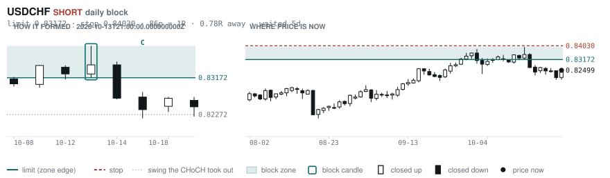
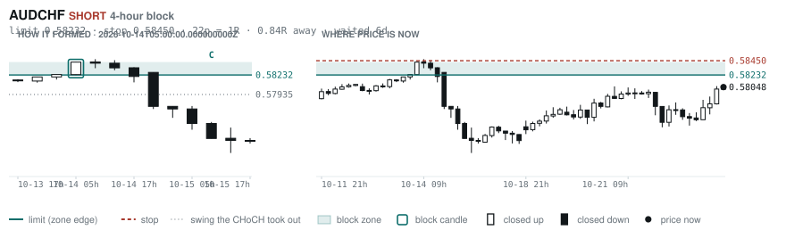
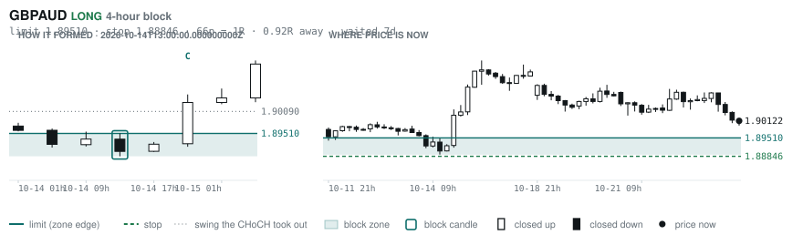
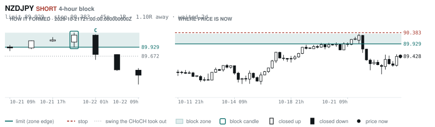

# Scanner Review — 2026-10-25 (weekly)

Generated: 2026-10-25T19:03:47.527Z

```
## The clock

It is **14:00 Chicago** — a **DEAD** hour at 0.74x an average one.
An order placed now rests through **tomorrow — the rest of today is dead**.
Next window: **Tokyo** in 5h.

## Where the energy is

**Running hot:** AUDCHF 1.28 · NZDCHF 1.19 · AUDJPY 1.16 · CADCHF 1.16
**Quiet:** NZDUSD 0.88

_Volatility persists for about two days, so a hot pair stays hot. It says nothing about direction — this picks the pair, the levels pick the side._

## Account

NAV **$746.61**   unrealised $-329.23   margin available $365.67   1 open

| pair | units | now | P/L | stop | distance | news lean |
|---|---|---|---|---|---|---|
| EURCAD | 17000 | 1.56907 | $-329.23 | **none** | — | 🔴 1 headwind |

**What the system reads on each position**

- **EURCAD** LONG — last REVERSAL LONG 78h ago at 1.56672 — system stop 1.55787, target **1.62445**; 554p to that target from here

## What is coming, and which way it leans

**EURCAD LONG**
- ⚪ 10-28T09:45 CAD — BOC Monetary Policy Report
- ⚪ 10-28T09:45 CAD — BOC Rate Statement
- 🔴 10-28T09:45 CAD — Overnight Rate  (fc 2.50% vs prev 2.25%)
- ⚪ 10-28T10:30 CAD — BOC Press Conference
- ⚪ 10-28T13:45 CAD — BoC Interest Rate Decision  (fc 2.5 vs prev 2.25)
- ⚪ 10-28T13:45 CAD — BoC Monetary Policy Report
- ⚪ 10-29T09:15 EUR — Main Refinancing Rate  (fc 2.65% vs prev 2.65%)
- ⚪ 10-29T09:15 EUR — Monetary Policy Statement
- ⚪ 10-29T09:45 EUR — ECB Press Conference
- ⚪ 10-29T13:15 EUR — ECB Interest Rate Decision  (fc 2.65 vs prev 2.65)
- ⚪ 10-29T13:15 EUR — Deposit Facility Rate  (fc 2.5 vs prev 2.5)
- ⚪ 10-29T13:45 EUR — ECB Press Conference

_Lean is read from forecast vs previous — which way consensus leans, not what will print._

## Order blocks live right now

### Daily

| pair | dir | limit | stop | 1R | spread | away | fills | waited | window | reaches 1R / 2R |
|---|---|---|---|---|---|---|---|---|---|---|
| CADCHF | LONG | **0.58753** | 0.58424 | 33p $3.99 | 20% | 0.5R | 94% | 0d | 1.56x | 68% / 39% |
| USDCHF | SHORT | **0.83172** | 0.84030 | 86p $10.40 | 6% | 0.8R | 87% | 5d | 1.54x | 68% / 39% |

_9 more live but further out, 2.6R to 7.7R away. They alert on their own when they come within 1R._
_Older blocks run further: 60+ days reaches 2R 58% of the time against 34% for a same-day fill._

### 4-hour

| pair | dir | limit | stop | 1R | spread | away | fills | waited | window | reaches 1R / 2R |
|---|---|---|---|---|---|---|---|---|---|---|
| AUDCHF | SHORT | **0.58232** | 0.58450 | 22p $2.64 | **45%** | 0.8R | 83% | 6d | 1.36x | 77% / 47% |
| GBPAUD | LONG | **1.89510** | 1.88846 | 66p $4.67 | **59%** | 0.9R | 83% | 7d | 1.34x | 78% / 51% |
| NZDJPY | SHORT | **89.929** | 90.383 | 45p $2.90 | **24%** | 1.1R | 79% | 2d | 1.28x | 77% / 47% |

_10 more live but further out, 2.4R to 7.5R away. They alert on their own when they come within 1R._
_H4 stops are a third of a daily one, so spread bites three times as hard — a bolded spread figure is most of the edge gone before price moves._

### In reach, drawn

_5 blocks within 2R of the limit. Blocks further out are in the tables above but not worth a picture yet._

**CADCHF LONG** · daily · 0.45R away · waited 0d


**USDCHF SHORT** · daily · 0.78R away · waited 5d



**AUDCHF SHORT** · 4-hour · 0.84R away · waited 6d



**GBPAUD LONG** · 4-hour · 0.92R away · waited 7d



**NZDJPY SHORT** · 4-hour · 1.10R away · waited 2d



_Left panel is the block forming, right is where price sits now. Legend is in each image._

## Scanner calls, last 7 days

| when | pair | dir | branch | firing | entry | stop | target | outcome |
|---|---|---|---|---|---|---|---|---|
| 10-18T21:00 | AUDCHF | SHORT | REV | 3rd | 0.57397 | 0.57984 | 0.56031 | stopped -1.00R |
| 10-18T21:00 | GBPAUD | LONG | REV | 2nd | 1.91402 | 1.89810 | 1.94986 | open -0.80R |
| 10-18T21:00 | USDCAD | LONG | REV | 4th | 1.41251 | 1.40329 | 1.48280 | stopped -1.00R |
| 10-18T21:00 | EURGBP | LONG | REV | 1st ⚠ | 0.84227 | 0.83712 | 0.86717 | stopped -1.00R |
| 10-18T21:00 | NZDCAD | LONG | REV | 9th | 0.79903 | 0.79211 | 0.80896 | open -0.07R |
| 10-18T21:00 | AUDJPY | SHORT | REV | 9th | 109.965 | 111.161 | 104.786 | stopped -1.00R |
| 10-19T01:00 | USDJPY | SHORT | REV | 1st ⚠ | 158.092 | 159.368 | 153.713 | open +0.96R |
| 10-19T01:00 | GBPJPY | LONG | REV | 11th | 210.706 | 209.065 | 213.533 | open -0.53R |
| 10-19T01:00 | AUDUSD | LONG | REV | 8th | 0.69752 | 0.69042 | 0.70760 | open +0.86R |
| 10-19T01:00 | AUDNZD | SHORT | REV | 5th | 1.23345 | 1.24116 | 1.21994 | open -0.08R |
| 10-19T05:00 | NZDUSD | LONG | REV | 3rd | 0.56610 | 0.56081 | 0.61544 | open +0.77R |
| 10-19T09:00 | CADCHF | SHORT | REV | 2nd | 0.58526 | 0.59009 | 0.57623 | stopped -1.00R |
| 10-19T09:00 | GBPCHF | SHORT | REV | 3rd | 1.09947 | 1.10682 | 1.06748 | open -0.56R |
| 10-19T09:00 | EURJPY | LONG | REV | 2nd | 177.725 | 176.153 | 183.868 | stopped -1.00R |
| 10-19T09:00 | EURUSD | LONG | REV | 3rd | 1.12236 | 1.11488 | 1.17423 | open -0.27R |
| 10-19T13:00 | EURCHF | SHORT | REV | 6th | 0.92622 | 0.93071 | 0.90334 | open +0.45R |
| 10-19T13:00 | USDCHF | SHORT | REV | 3rd | 0.82610 | 0.83206 | 0.80718 | open +0.19R |
| 10-19T13:00 | EURGBP | LONG | REV | 2nd | 0.84276 | 0.83891 | 0.86717 | stopped -1.00R |
| 10-19T17:00 | AUDCAD | LONG | REV | 3rd | 0.98489 | 0.97747 | 1.00604 | open +0.08R |
| 10-19T21:00 | NZDCHF | SHORT | REV | 3rd | 0.46787 | 0.47310 | 0.45425 | open -0.47R |
| 10-19T21:00 | NZDCAD | SHORT | REV | 1st ⚠ | 0.79836 | 0.80585 | 0.78749 | open -0.03R |
| 10-19T21:00 | GBPJPY | LONG | REV | 1st ⚠ | 211.112 | 209.428 | 213.533 | stopped -1.00R |
| 10-19T21:00 | AUDCHF | SHORT | REV | 1st ⚠ | 0.57624 | 0.58225 | 0.56031 | open -0.71R |
| 10-20T01:00 | NZDUSD | LONG | REV | 1st ⚠ | 0.56768 | 0.56114 | 0.61544 | open +0.38R |
| 10-20T01:00 | USDJPY | SHORT | REV | 12th | 158.186 | 159.431 | 153.713 | open +1.06R |
| 10-20T01:00 | GBPAUD | LONG | REV | 1st ⚠ | 1.90920 | 1.89620 | 1.94986 | open -0.61R |
| 10-20T01:00 | AUDUSD | LONG | REV | 2nd | 0.69838 | 0.69176 | 0.71228 | open +0.79R |
| 10-20T01:00 | EURCHF | SHORT | REV | 7th | 0.92638 | 0.93039 | 0.90334 | open +0.54R |
| 10-20T05:00 | EURCHF | SHORT | REV | 2nd | 0.92556 | 0.93141 | 0.90334 | open +0.23R |
| 10-20T05:00 | GBPCHF | LONG | REV | 3rd | 1.10102 | 1.09417 | 1.12516 | open +0.38R |
| 10-20T05:00 | EURCAD | SHORT | WALL | 5th | 1.57763 | 1.58550 | 1.56736 | target +1.31R |
| 10-20T05:00 | EURAUD | SHORT | REV | 1st ⚠ | 1.60414 | 1.61768 | 1.55743 | open +0.88R |
| 10-20T09:00 | AUDCAD | LONG | REV | 4th | 0.98262 | 0.97418 | 1.00604 | open +0.34R |
| 10-20T13:00 | GBPCHF | LONG | REV | 1st ⚠ | 1.10448 | 1.09383 | 1.12516 | open -0.08R |
| 10-20T13:00 | EURGBP | LONG | REV | 6th | 0.83998 | 0.83462 | 0.86717 | open -0.46R |
| 10-20T13:00 | CHFJPY | SHORT | REV | 1st ⚠ | 191.515 | 193.466 | 187.540 | open +0.70R |
| 10-20T17:00 | USDJPY | LONG | REV | 10th | 158.172 | 156.607 | 161.527 | stopped -1.00R |
| 10-20T21:00 | GBPAUD | SHORT | REV | 3rd | 1.90735 | 1.92142 | 1.86649 | open +0.44R |
| 10-20T21:00 | USDJPY | LONG | REV | 5th | 158.348 | 157.193 | 161.527 | stopped -1.00R |
| 10-20T21:00 | AUDJPY | SHORT | REV | 5th | 111.044 | 112.095 | 106.138 | open +0.64R |
| 10-20T21:00 | NZDJPY | SHORT | REV | 5th | 89.918 | 90.733 | 87.497 | open +0.60R |
| 10-20T21:00 | AUDCHF | SHORT | REV | 2nd | 0.57908 | 0.58476 | 0.55613 | open -0.25R |
| 10-21T01:00 | NZDCHF | SHORT | REV | 4th | 0.46836 | 0.47328 | 0.45836 | open -0.40R |
| 10-21T01:00 | GBPCHF | SHORT | REV | 1st ⚠ | 1.10413 | 1.11081 | 1.08540 | open +0.08R |
| 10-21T01:00 | EURJPY | SHORT | REV | 1st ⚠ | 177.454 | 178.748 | 171.729 | open +1.32R |
| 10-21T01:00 | GBPJPY | SHORT | REV | 2nd | 211.435 | 213.086 | 206.523 | open +0.96R |
| 10-21T01:00 | AUDUSD | SHORT | REV | 4th | 0.70098 | 0.70686 | 0.67750 | open -0.45R |
| 10-21T05:00 | EURCHF | SHORT | REV | 3rd | 0.92526 | 0.93163 | 0.90334 | open +0.16R |
| 10-21T09:00 | EURCAD | LONG | REV | 2nd | 1.57823 | 1.56423 | 1.62445 | open -0.65R |
| 10-21T09:00 | NZDJPY | SHORT | REV | 6th | 89.907 | 90.749 | 87.497 | open +0.57R |
| 10-21T09:00 | AUDCAD | LONG | WALL | 3rd | 0.98850 | 0.98461 | 1.00604 | stopped -1.00R |
| 10-21T09:00 | EURUSD | LONG | REV | 1st ⚠ | 1.12314 | 1.11601 | 1.17423 | open -0.40R |
| 10-21T13:00 | GBPAUD | LONG | REV | 1st ⚠ | 1.90548 | 1.89138 | 1.95694 | open -0.30R |
| 10-21T13:00 | GBPJPY | LONG | REV | 2nd | 211.776 | 210.296 | 213.533 | stopped -1.00R |
| 10-21T13:00 | GBPCHF | SHORT | REV | 2nd | 1.10441 | 1.11092 | 1.08540 | open +0.12R |
| 10-21T13:00 | USDCHF | LONG | REV | 1st ⚠ | 0.82438 | 0.81708 | 0.85632 | open +0.08R |
| 10-21T13:00 | AUDUSD | SHORT | REV | 6th | 0.70306 | 0.70941 | 0.67750 | open -0.09R |
| 10-21T13:00 | AUDJPY | LONG | REV | 7th | 111.141 | 109.831 | 113.562 | stopped -1.00R |
| 10-21T13:00 | AUDNZD | SHORT | REV | 1st ⚠ | 1.23340 | 1.24123 | 1.21994 | open -0.09R |
| 10-21T17:00 | NZDCAD | SHORT | REV | 16th | 0.80091 | 0.80678 | 0.78749 | open +0.40R |
| 10-21T17:00 | EURJPY | SHORT | REV | 1st ⚠ | 177.634 | 178.687 | 171.729 | open +1.80R |
| 10-21T17:00 | EURGBP | LONG | REV | 7th | 0.83866 | 0.83480 | 0.86717 | open -0.30R |
| 10-21T17:00 | CADJPY | SHORT | REV | 1st ⚠ | 112.578 | 113.453 | 107.746 | open +0.67R |
| 10-21T21:00 | GBPCAD | SHORT | REV | 2nd | 1.88066 | 1.89089 | 1.85129 | open +0.68R |
| 10-21T21:00 | GBPCHF | SHORT | REV | 1st ⚠ | 1.10432 | 1.11062 | 1.08540 | open +0.11R |
| 10-21T21:00 | AUDJPY | LONG | REV | 2nd | 111.210 | 109.940 | 113.562 | stopped -1.00R |
| 10-21T21:00 | USDCHF | LONG | REV | 1st ⚠ | 0.82442 | 0.81738 | 0.85632 | open +0.08R |
| 10-21T21:00 | AUDCHF | LONG | REV | 3rd | 0.57970 | 0.57426 | 0.59652 | open +0.14R |
| 10-21T21:00 | NZDCHF | SHORT | REV | 6th | 0.47054 | 0.47381 | 0.45836 | open +0.06R |
| 10-21T13:00 | EURCAD | SHORT | REV | 1st ⚠ | 1.57886 | 1.58826 | 1.56736 | target +1.22R |
| 10-22T01:00 | GBPUSD | SHORT | REV | 1st ⚠ | 1.33979 | 1.34888 | 1.29883 | open +0.22R |
| 10-22T01:00 | NZDUSD | SHORT | REV | 2nd | 0.56892 | 0.57535 | 0.51428 | open -0.20R |
| 10-22T01:00 | EURNZD | LONG | REV | 5th | 1.97635 | 1.96021 | 2.01019 | open -0.71R |
| 10-22T01:00 | EURCAD | LONG | REV | 1st ⚠ | 1.57767 | 1.56636 | 1.62445 | stopped -1.00R |
| 10-22T01:00 | NZDJPY | SHORT | REV | 7th | 89.720 | 90.827 | 87.497 | open +0.26R |
| 10-22T01:00 | GBPNZD | LONG | REV | 3rd | 2.35491 | 2.33671 | 2.37918 | open -0.48R |
| 10-22T01:00 | GBPJPY | SHORT | REV | 3rd | 211.302 | 213.121 | 206.523 | open +0.80R |
| 10-22T01:00 | EURAUD | SHORT | REV | 1st ⚠ | 1.60210 | 1.61243 | 1.55743 | open +0.96R |
| 10-22T05:00 | GBPJPY | SHORT | REV | 1st ⚠ | 210.522 | 212.961 | 206.523 | open +0.28R |
| 10-22T05:00 | GBPJPY | SHORT | WALL | 1st ⚠ | 210.522 | 211.365 | 206.523 | open +0.81R |
| 10-22T05:00 | EURJPY | SHORT | WALL | 1st ⚠ | 176.404 | 177.632 | 171.729 | open +0.54R |
| 10-22T05:00 | AUDNZD | LONG | REV | 2nd | 1.23342 | 1.22493 | 1.26706 | open +0.08R |
| 10-22T09:00 | GBPCHF | LONG | REV | 2nd | 1.10102 | 1.09360 | 1.12516 | open +0.35R |
| 10-22T09:00 | USDCAD | LONG | REV | 3rd | 1.40349 | 1.39595 | 1.48398 | open -0.38R |
| 10-22T09:00 | EURUSD | SHORT | WALL | 1st ⚠ | 1.12052 | 1.12341 | 1.05714 | open +0.07R |
| 10-22T13:00 | GBPAUD | LONG | REV | 3rd | 1.90853 | 1.89109 | 1.95694 | open -0.42R |
| 10-22T13:00 | AUDUSD | LONG | REV | 9th | 0.70218 | 0.69421 | 0.71228 | open +0.18R |
| 10-22T13:00 | CHFJPY | LONG | REV | 1st ⚠ | 190.947 | 189.586 | 195.117 | open -0.59R |
| 10-22T17:00 | GBPUSD | SHORT | REV | 2nd | 1.34002 | 1.34933 | 1.29883 | open +0.24R |
| 10-22T21:00 | GBPCHF | SHORT | REV | 2nd | 1.09930 | 1.10986 | 1.08540 | open -0.41R |
| 10-22T21:00 | NZDCHF | LONG | REV | 10th | 0.46654 | 0.46238 | 0.47370 | open +0.91R |
| 10-22T21:00 | GBPJPY | LONG | REV | 2nd | 209.747 | 207.697 | 213.533 | open +0.05R |
| 10-22T21:00 | CHFJPY | LONG | REV | 3rd | 190.804 | 189.347 | 195.117 | open -0.45R |
| 10-22T21:00 | USDCHF | LONG | REV | 5th | 0.82022 | 0.81343 | 0.85632 | open +0.70R |
| 10-22T21:00 | AUDCHF | LONG | REV | 1st ⚠ | 0.57574 | 0.56984 | 0.59652 | open +0.80R |
| 10-23T01:00 | NZDCAD | SHORT | REV | 2nd | 0.79718 | 0.80484 | 0.78749 | open -0.18R |
| 10-23T01:00 | AUDCAD | SHORT | REV | 4th | 0.98154 | 0.99088 | 0.96059 | open -0.42R |
| 10-23T01:00 | USDCHF | LONG | REV | 1st ⚠ | 0.82156 | 0.81371 | 0.85632 | open +0.44R |
| 10-23T01:00 | GBPAUD | LONG | REV | 3rd | 1.91131 | 1.89834 | 1.95694 | open -0.78R |
| 10-23T01:00 | NZDJPY | SHORT | REV | 3rd | 89.304 | 90.440 | 87.497 | open -0.11R |
| 10-23T01:00 | EURJPY | LONG | REV | 1st ⚠ | 175.952 | 174.314 | 179.642 | open -0.13R |
| 10-23T01:00 | GBPNZD | LONG | REV | 4th | 2.35320 | 2.33727 | 2.37918 | open -0.44R |
| 10-23T01:00 | AUDNZD | SHORT | REV | 1st ⚠ | 1.23120 | 1.24249 | 1.20438 | open -0.26R |
| 10-23T01:00 | EURUSD | SHORT | WALL | 2nd | 1.12089 | 1.12539 | 1.05714 | open +0.13R |
| 10-23T01:00 | NZDUSD | SHORT | REV | 1st ⚠ | 0.56896 | 0.57466 | 0.51428 | open -0.21R |
| 10-23T05:00 | GBPUSD | SHORT | REV | 1st ⚠ | 1.33760 | 1.34733 | 1.29883 | open -0.02R |
| 10-23T05:00 | CADCHF | LONG | REV | 3rd | 0.58732 | 0.58244 | 0.59450 | open +0.35R |
| 10-23T05:00 | EURUSD | SHORT | REV | 1st ⚠ | 1.11900 | 1.12720 | 1.05714 | open -0.16R |
| 10-23T05:00 | NZDJPY | SHORT | REV | 1st ⚠ | 89.126 | 89.988 | 87.497 | open -0.35R |
| 10-23T05:00 | USDCAD | LONG | REV | 9th | 1.40164 | 1.39600 | 1.48398 | open -0.18R |
| 10-23T05:00 | EURGBP | LONG | REV | 7th | 0.83658 | 0.83316 | 0.86717 | open +0.27R |
| 10-23T09:00 | CADCHF | LONG | WALL | 1st ⚠ | 0.58848 | 0.58493 | 0.59450 | open +0.15R |
| 10-23T09:00 | USDCHF | SHORT | REV | 2nd | 0.82228 | 0.83320 | 0.80408 | open -0.25R |
| 10-23T09:00 | USDCAD | LONG | REV | 2nd | 1.39736 | 1.38996 | 1.48398 | open +0.44R |
| 10-23T09:00 | AUDJPY | SHORT | REV | 2nd | 109.916 | 111.222 | 106.138 | open -0.35R |
| 10-23T09:00 | NZDJPY | SHORT | REV | 1st ⚠ | 89.064 | 89.977 | 87.497 | open -0.40R |
| 10-23T09:00 | NZDCAD | SHORT | REV | 15th | 0.79576 | 0.80183 | 0.78749 | open -0.46R |
| 10-23T09:00 | EURGBP | LONG | REV | 1st ⚠ | 0.83732 | 0.83258 | 0.86717 | open +0.04R |
| 10-23T13:00 | NZDUSD | SHORT | REV | 3rd | 0.56988 | 0.57512 | 0.51428 | open -0.06R |
| 10-23T13:00 | AUDNZD | SHORT | REV | 2nd | 1.23379 | 1.24253 | 1.20438 | open -0.04R |
| 10-23T13:00 | AUDJPY | SHORT | REV | 9th | 110.345 | 111.754 | 106.138 | open -0.02R |
| 10-23T13:00 | USDCAD | LONG | REV | 5th | 1.40060 | 1.39242 | 1.48398 | open +0.00R |
| 10-23T13:00 | CHFJPY | SHORT | WALL | 3rd | 190.193 | 190.965 | 187.540 | open +0.07R |

## Running tally, last 30 days

28 resolved · 6 target / 22 stopped · **-10.8R** · -0.386R per call · 32 still open

```
