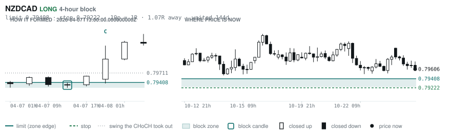

# Scanner Review — 2026-10-26 (evening)

Generated: 2026-10-26T23:03:43.299Z

```
## The clock

It is **18:00 Chicago** — a **DEAD** hour at 0.65x an average one.
An order placed now rests through **Tokyo, London and tomorrow's NY overlap** — about 16h of cover.
Next window: **Tokyo** in 1h.

_Evening pass. Orders placed now get the longest cover of the day: Tokyo, London, and tomorrow's NY overlap. Place limits and stops here — whatever does not fill overnight is still live for the morning._

## Where the energy is

**Running hot:** AUDCHF 1.16
**Quiet:** AUDUSD 0.89 · CHFJPY 0.89 · NZDUSD 0.85

_Volatility persists for about two days, so a hot pair stays hot. It says nothing about direction — this picks the pair, the levels pick the side._

## Account

NAV **$712.72**   unrealised $-362.73   margin available $332.74   1 open

| pair | units | now | P/L | stop | distance | news lean |
|---|---|---|---|---|---|---|
| EURCAD | 17000 | 1.56600 | $-362.73 | **none** | — | 🔴 3 headwind |

**What the system reads on each position**

- **EURCAD** LONG — last REVERSAL LONG 134h ago at 1.57311 — system stop 1.56423, target **1.62445**; 585p to that target from here

## What is coming, and which way it leans

**EURCAD LONG**
- ⚪ 10-28T09:45 CAD — BOC Monetary Policy Report
- ⚪ 10-28T09:45 CAD — BOC Rate Statement
- 🔴 10-28T09:45 CAD — Overnight Rate  (fc 2.50% vs prev 2.25%)
- ⚪ 10-28T10:30 CAD — BOC Press Conference
- ⚪ 10-28T13:45 CAD — BoC Monetary Policy Report
- ⚪ 10-28T13:45 CAD — BoC Interest Rate Decision  (fc 2.5 vs prev 2.25)
- ⚪ 10-29T09:15 EUR — Main Refinancing Rate  (fc 2.65% vs prev 2.65%)
- ⚪ 10-29T09:15 EUR — Monetary Policy Statement
- ⚪ 10-29T09:45 EUR — ECB Press Conference
- ⚪ 10-29T13:15 EUR — Deposit Facility Rate  (fc 2.5 vs prev 2.5)
- ⚪ 10-29T13:15 EUR — ECB Interest Rate Decision  (fc 2.65 vs prev 2.65)
- ⚪ 10-29T13:45 EUR — ECB Press Conference
- 🔴 10-30T10:00 EUR — GDP Growth Rate QoQ Flash  (fc 0.2 vs prev 0.6)
- 🔴 10-30T10:00 EUR — GDP Growth Rate YoY Flash  (fc 1.1 vs prev 1.2)

_Lean is read from forecast vs previous — which way consensus leans, not what will print._

## Order blocks live right now

### Daily

| pair | dir | limit | stop | 1R | spread | away | fills | waited | window | reaches 1R / 2R |
|---|---|---|---|---|---|---|---|---|---|---|
| USDCHF | SHORT | **0.83172** | 0.84030 | 86p $10.37 | 2% | 0.5R | 94% | 6d | 0.89x ⚠ | 68% / 39% |

_8 more live but further out, 2.8R to 7.5R away. They alert on their own when they come within 1R._
_Older blocks run further: 60+ days reaches 2R 58% of the time against 34% for a same-day fill._

### 4-hour

| pair | dir | limit | stop | 1R | spread | away | fills | waited | window | reaches 1R / 2R |
|---|---|---|---|---|---|---|---|---|---|---|
| AUDCHF | SHORT | **0.58232** | 0.58450 | 22p $2.63 | 11% | 0.7R | 83% | 7d | 1.04x | 78% / 51% |
| GBPAUD | LONG | **1.89510** | 1.88846 | 66p $4.66 | 9% | 1.0R | 83% | 8d | 1.04x | 78% / 51% |
| NZDJPY | SHORT | **89.929** | 90.383 | 45p $2.88 | 8% | 1.0R | 83% | 3d | 1.09x | 77% / 47% |
| NZDCAD | LONG | **0.79408** | 0.79222 | 19p $1.33 | **32%** | 1.1R | 79% | 144d | 0.99x ⚠ | 78% / 51% |

_10 more live but further out, 2.8R to 7.7R away. They alert on their own when they come within 1R._
_H4 stops are a third of a daily one, so spread bites three times as hard — a bolded spread figure is most of the edge gone before price moves._

### In reach, drawn

_5 blocks within 2R of the limit. Blocks further out are in the tables above but not worth a picture yet._

**USDCHF SHORT** · daily · 0.47R away · waited 6d


**AUDCHF SHORT** · 4-hour · 0.72R away · waited 7d


**GBPAUD LONG** · 4-hour · 0.97R away · waited 8d


**NZDJPY SHORT** · 4-hour · 0.98R away · waited 3d


**NZDCAD LONG** · 4-hour · 1.07R away · waited 144d



_Left panel is the block forming, right is where price sits now. Legend is in each image._

## Scanner calls, last 1 day

| when | pair | dir | branch | firing | entry | stop | target | outcome |
|---|---|---|---|---|---|---|---|---|
| 10-26T01:00 | GBPCAD | SHORT | REV | 5th | 1.87396 | 1.88270 | 1.85129 | open +0.52R |
| 10-26T01:00 | AUDUSD | SHORT | REV | 2nd | 0.70296 | 0.70911 | 0.67750 | open +0.21R |
| 10-26T01:00 | NZDJPY | SHORT | REV | 1st ⚠ | 89.453 | 90.339 | 87.497 | open -0.03R |
| 10-26T01:00 | USDCHF | LONG | REV | 4th | 0.82404 | 0.81614 | 0.85632 | open +0.46R |
| 10-26T01:00 | EURJPY | SHORT | REV | 2nd | 176.086 | 177.553 | 171.729 | open +0.06R |
| 10-26T05:00 | GBPUSD | SHORT | REV | 5th | 1.33466 | 1.34619 | 1.29883 | open +0.04R |
| 10-26T05:00 | CADCHF | LONG | REV | 2nd | 0.58932 | 0.58456 | 0.59450 | open +0.29R |
| 10-26T05:00 | GBPAUD | LONG | REV | 2nd | 1.89822 | 1.88530 | 1.95694 | open +0.26R |
| 10-26T05:00 | USDCHF | LONG | WALL | 3rd | 0.82601 | 0.82032 | 0.85632 | open +0.29R |
| 10-26T05:00 | EURUSD | SHORT | REV | 4th | 1.12060 | 1.12852 | 1.05714 | open +0.40R |
| 10-26T05:00 | EURAUD | SHORT | REV | 1st ⚠ | 1.59376 | 1.60451 | 1.55743 | open +0.11R |
| 10-26T09:00 | EURCHF | SHORT | REV | 6th | 0.92372 | 0.93194 | 0.90334 | open -0.14R |
| 10-26T09:00 | GBPAUD | LONG | REV | 7th | 1.90068 | 1.88197 | 1.95694 | open +0.04R |
| 10-26T09:00 | GBPNZD | LONG | REV | 2nd | 2.34957 | 2.33110 | 2.37918 | open -0.06R |
| 10-26T09:00 | NZDJPY | SHORT | REV | 1st ⚠ | 89.417 | 90.392 | 87.497 | open -0.07R |
| 10-26T09:00 | CADJPY | SHORT | REV | 1st ⚠ | 112.224 | 113.198 | 107.746 | open -0.18R |
| 10-26T09:00 | AUDCAD | SHORT | REV | 5th | 0.98495 | 0.99285 | 0.96059 | open +0.23R |
| 10-26T09:00 | AUDCHF | SHORT | REV | 8th | 0.58000 | 0.58608 | 0.55613 | open -0.13R |
| 10-26T09:00 | EURUSD | SHORT | REV | 2nd | 1.11904 | 1.12659 | 1.05714 | open +0.21R |
| 10-26T13:00 | NZDUSD | LONG | REV | 3rd | 0.56837 | 0.56152 | 0.61544 | open -0.04R |
| 10-26T13:00 | GBPCAD | SHORT | REV | 6th | 1.87129 | 1.88281 | 1.85129 | open +0.16R |
| 10-26T13:00 | AUDJPY | LONG | REV | 3rd | 110.551 | 109.208 | 113.562 | open -0.03R |
| 10-26T13:00 | EURJPY | SHORT | REV | 3rd | 176.136 | 177.496 | 171.729 | open +0.10R |
| 10-26T13:00 | GBPCHF | LONG | REV | 2nd | 1.10428 | 1.09605 | 1.12516 | open +0.01R |
| 10-26T17:00 | EURJPY | SHORT | REV | 2nd | 175.996 | 177.800 | 171.729 | open +0.00R |
| 10-26T17:00 | CHFJPY | SHORT | WALL | 4th | 190.280 | 190.947 | 187.540 | open +0.00R |

## Running tally, last 30 days

3 resolved · 0 target / 3 stopped · **-3.0R** · -1.000R per call · 57 still open

```
