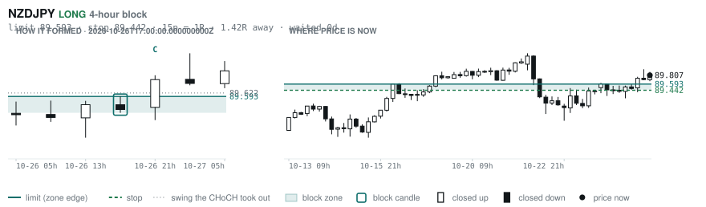

# Scanner Review — 2026-10-27 (evening)

Generated: 2026-10-27T23:03:47.391Z

```
## The clock

It is **18:00 Chicago** — a **DEAD** hour at 0.65x an average one.
An order placed now rests through **Tokyo, London and tomorrow's NY overlap** — about 16h of cover.
Next window: **Tokyo** in 1h.

_Evening pass. Orders placed now get the longest cover of the day: Tokyo, London, and tomorrow's NY overlap. Place limits and stops here — whatever does not fill overnight is still live for the morning._

## Where the energy is

**Running hot:** _nothing unusually active_
**Quiet:** USDCHF 0.88 · EURUSD 0.88 · EURJPY 0.88 · AUDUSD 0.87 · USDJPY 0.85 · CHFJPY 0.80

_Volatility persists for about two days, so a hot pair stays hot. It says nothing about direction — this picks the pair, the levels pick the side._

## Account

NAV **$684.89**   unrealised $-390.11   margin available $306.46   1 open

| pair | units | now | P/L | stop | distance | news lean |
|---|---|---|---|---|---|---|
| EURCAD | 17000 | 1.56368 | $-390.11 | **none** | — | 🔴 3 headwind |

**What the system reads on each position**

- **EURCAD** LONG — last REVERSAL LONG 14h ago at 1.55924 — system stop 1.54908, target **1.62445**; 608p to that target from here

## What is coming, and which way it leans

**EURCAD LONG**
- ⚪ 10-28T09:45 CAD — BOC Monetary Policy Report
- ⚪ 10-28T09:45 CAD — BOC Rate Statement
- 🔴 10-28T09:45 CAD — Overnight Rate  (fc 2.50% vs prev 2.25%)
- ⚪ 10-28T10:30 CAD — BOC Press Conference
- ⚪ 10-28T13:45 CAD — BoC Interest Rate Decision  (fc 2.5 vs prev 2.25)
- ⚪ 10-28T13:45 CAD — BoC Monetary Policy Report
- ⚪ 10-29T09:15 EUR — Main Refinancing Rate  (fc 2.65% vs prev 2.65%)
- ⚪ 10-29T09:15 EUR — Monetary Policy Statement
- ⚪ 10-29T09:45 EUR — ECB Press Conference
- ⚪ 10-29T13:15 EUR — ECB Interest Rate Decision  (fc 2.65 vs prev 2.65)
- ⚪ 10-29T13:15 EUR — Deposit Facility Rate  (fc 2.5 vs prev 2.5)
- ⚪ 10-29T13:45 EUR — ECB Press Conference
- 🔴 10-30T10:00 EUR — GDP Growth Rate YoY Flash  (fc 1.1 vs prev 1.2)
- 🔴 10-30T10:00 EUR — GDP Growth Rate QoQ Flash  (fc 0.2 vs prev 0.6)

_Lean is read from forecast vs previous — which way consensus leans, not what will print._

## Order blocks live right now

### Daily

| pair | dir | limit | stop | 1R | spread | away | fills | waited | window | reaches 1R / 2R |
|---|---|---|---|---|---|---|---|---|---|---|
| USDCHF | SHORT | **0.83172** | 0.84030 | 86p $10.35 | 2% | 0.3R | 94% | 7d | 0.89x ⚠ | 68% / 39% |

_9 more live but further out, 2.2R to 7.8R away. They alert on their own when they come within 1R._
_Older blocks run further: 60+ days reaches 2R 58% of the time against 34% for a same-day fill._

### 4-hour

| pair | dir | limit | stop | 1R | spread | away | fills | waited | window | reaches 1R / 2R |
|---|---|---|---|---|---|---|---|---|---|---|
| NZDJPY | LONG | **89.593** | 89.442 | 15p $0.95 | **27%** | 0.9R | 83% | 1d | 1.09x | 70% / 46% |

_12 more live but further out, 2.2R to 7.1R away. They alert on their own when they come within 1R._
_H4 stops are a third of a daily one, so spread bites three times as hard — a bolded spread figure is most of the edge gone before price moves._

### In reach, drawn

_2 blocks within 2R of the limit. Blocks further out are in the tables above but not worth a picture yet._

**USDCHF SHORT** · daily · 0.31R away · waited 7d


**NZDJPY LONG** · 4-hour · 0.91R away · waited 1d



_Left panel is the block forming, right is where price sits now. Legend is in each image._

## Scanner calls, last 1 day

| when | pair | dir | branch | firing | entry | stop | target | outcome |
|---|---|---|---|---|---|---|---|---|
| 10-27T01:00 | GBPNZD | LONG | REV | 3rd | 2.34335 | 2.32109 | 2.37918 | open -0.05R |
| 10-27T01:00 | EURCHF | SHORT | REV | 2nd | 0.92448 | 0.93028 | 0.90334 | open +0.36R |
| 10-27T01:00 | GBPCHF | SHORT | REV | 1st ⚠ | 1.10404 | 1.11079 | 1.08540 | open +0.12R |
| 10-27T01:00 | GBPAUD | LONG | REV | 1st ⚠ | 1.89995 | 1.88578 | 1.95694 | open -0.43R |
| 10-27T01:00 | USDJPY | SHORT | REV | 2nd | 157.593 | 158.942 | 156.143 | open -0.26R |
| 10-27T01:00 | AUDCHF | SHORT | REV | 2nd | 0.58108 | 0.58758 | 0.55613 | open -0.22R |
| 10-27T01:00 | NZDJPY | SHORT | REV | 3rd | 89.702 | 90.825 | 87.497 | open -0.02R |
| 10-27T05:00 | EURJPY | SHORT | REV | 3rd | 175.948 | 177.722 | 171.729 | open +0.12R |
| 10-27T05:00 | GBPJPY | SHORT | REV | 1st ⚠ | 210.142 | 211.915 | 206.523 | open -0.02R |
| 10-27T05:00 | AUDCAD | LONG | REV | 7th | 0.98484 | 0.97795 | 0.99852 | open +0.35R |
| 10-27T05:00 | CHFJPY | SHORT | REV | 1st ⚠ | 190.424 | 191.875 | 187.540 | open -0.06R |
| 10-27T09:00 | EURCAD | LONG | REV | 1st ⚠ | 1.56376 | 1.54908 | 1.62445 | open -0.03R |
| 10-27T09:00 | GBPCAD | LONG | REV | 1st ⚠ | 1.86942 | 1.85511 | 1.91646 | open +0.02R |
| 10-27T09:00 | USDCHF | LONG | REV | 3rd | 0.82854 | 0.81972 | 0.85632 | open +0.06R |
| 10-27T09:00 | USDCAD | LONG | REV | 7th | 1.40228 | 1.39466 | 1.48398 | open +0.38R |
| 10-27T09:00 | EURGBP | LONG | REV | 8th | 0.83650 | 0.83317 | 0.86717 | open -0.10R |
| 10-27T13:00 | EURNZD | LONG | REV | 1st ⚠ | 1.95892 | 1.93970 | 2.01019 | open -0.03R |
| 10-27T13:00 | GBPUSD | SHORT | REV | 1st ⚠ | 1.33147 | 1.34091 | 1.29883 | open +0.08R |
| 10-27T13:00 | GBPNZD | LONG | REV | 4th | 2.34131 | 2.32089 | 2.37918 | open +0.04R |
| 10-27T13:00 | AUDUSD | SHORT | REV | 3rd | 0.70304 | 0.70891 | 0.67750 | open +0.07R |
| 10-27T13:00 | NZDCHF | SHORT | REV | 2nd | 0.47124 | 0.47517 | 0.45836 | open +0.07R |
| 10-27T13:00 | NZDJPY | SHORT | REV | 4th | 89.790 | 90.823 | 87.497 | open +0.06R |
| 10-27T13:00 | EURGBP | LONG | REV | 10th | 0.83666 | 0.83194 | 0.86717 | open -0.11R |
| 10-27T17:00 | NZDCAD | SHORT | REV | 2nd | 0.79832 | 0.80532 | 0.78678 | open +0.00R |

## Running tally, last 30 days

3 resolved · 0 target / 3 stopped · **-3.0R** · -1.000R per call · 57 still open

```
