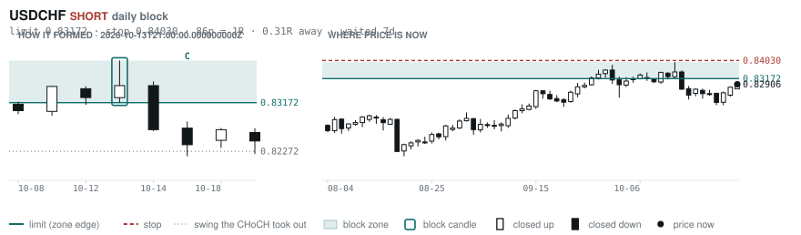
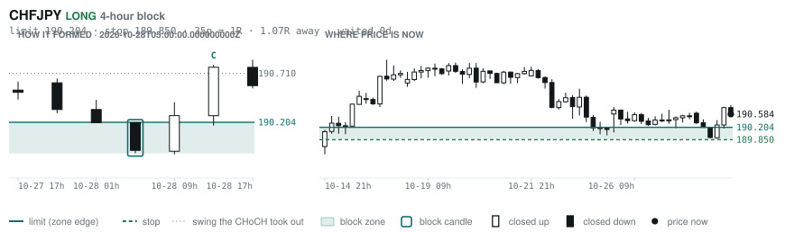

# Scanner Review — 2026-10-28 (evening)

Generated: 2026-10-28T23:03:48.074Z

```
## The clock

It is **18:00 Chicago** — a **DEAD** hour at 0.65x an average one.
An order placed now rests through **Tokyo, London and tomorrow's NY overlap** — about 16h of cover.
Next window: **Tokyo** in 1h.

_Evening pass. Orders placed now get the longest cover of the day: Tokyo, London, and tomorrow's NY overlap. Place limits and stops here — whatever does not fill overnight is still live for the morning._

## Where the energy is

**Running hot:** AUDNZD 1.43 · GBPNZD 1.35 · EURNZD 1.32 · NZDCHF 1.29 · NZDCAD 1.27 · NZDJPY 1.23 · NZDUSD 1.20
**Quiet:** GBPJPY 0.89 · EURJPY 0.87 · GBPCHF 0.86 · EURCHF 0.86 · USDJPY 0.85 · CHFJPY 0.84

_Volatility persists for about two days, so a hot pair stays hot. It says nothing about direction — this picks the pair, the levels pick the side._

## Account

NAV **$640.76**   unrealised $-432.69   margin available $261.53   1 open

| pair | units | now | P/L | stop | distance | news lean |
|---|---|---|---|---|---|---|
| EURCAD | 17000 | 1.56032 | $-432.69 | **none** | — | 🔴 2 headwind |

**What the system reads on each position**

- **EURCAD** LONG — last REVERSAL LONG 10h ago at 1.56185 — system stop 1.55450, target **1.62445**; 641p to that target from here

## What is coming, and which way it leans

**EURCAD LONG**
- ⚪ 10-29T09:15 EUR — Main Refinancing Rate  (fc 2.65% vs prev 2.65%)
- ⚪ 10-29T09:15 EUR — Monetary Policy Statement
- ⚪ 10-29T09:45 EUR — ECB Press Conference
- ⚪ 10-29T13:15 EUR — Deposit Facility Rate  (fc 2.5 vs prev 2.5)
- ⚪ 10-29T13:15 EUR — ECB Interest Rate Decision  (fc 2.65 vs prev 2.65)
- ⚪ 10-29T13:45 EUR — ECB Press Conference
- 🔴 10-30T10:00 EUR — GDP Growth Rate YoY Flash  (fc 1.1 vs prev 1.2)
- 🔴 10-30T10:00 EUR — GDP Growth Rate QoQ Flash  (fc 0.2 vs prev 0.6)

_Lean is read from forecast vs previous — which way consensus leans, not what will print._

## Order blocks live right now

### Daily

| pair | dir | limit | stop | 1R | spread | away | fills | waited | window | reaches 1R / 2R |
|---|---|---|---|---|---|---|---|---|---|---|
| USDCHF | SHORT | **0.83172** | 0.84030 | 86p $10.36 | 2% | 0.4R | 94% | 8d | 0.89x ⚠ | 68% / 39% |
| AUDCHF | LONG | **0.58010** | 0.57376 | 63p $7.65 | 3% | 0.6R | 87% | 0d | 1.04x | 68% / 39% |
| GBPAUD | SHORT | **1.89588** | 1.90609 | 102p $7.20 | 6% | 0.7R | 87% | 0d | 1.04x | 68% / 39% |

_7 more live but further out, 2.3R to 7.6R away. They alert on their own when they come within 1R._
_Older blocks run further: 60+ days reaches 2R 58% of the time against 34% for a same-day fill._

### 4-hour

| pair | dir | limit | stop | 1R | spread | away | fills | waited | window | reaches 1R / 2R |
|---|---|---|---|---|---|---|---|---|---|---|
| CHFJPY | LONG | **190.204** | 189.850 | 35p $2.24 | 16% | 1.1R | 79% | 0d | 1.01x | 70% / 46% |

_12 more live but further out, 2.2R to 7.0R away. They alert on their own when they come within 1R._
_H4 stops are a third of a daily one, so spread bites three times as hard — a bolded spread figure is most of the edge gone before price moves._

### In reach, drawn

_4 blocks within 2R of the limit. Blocks further out are in the tables above but not worth a picture yet._

**USDCHF SHORT** · daily · 0.41R away · waited 8d



**AUDCHF LONG** · daily · 0.65R away · waited 0d


**GBPAUD SHORT** · daily · 0.65R away · waited 0d


**CHFJPY LONG** · 4-hour · 1.07R away · waited 0d



_Left panel is the block forming, right is where price sits now. Legend is in each image._

## Scanner calls, last 1 day

| when | pair | dir | branch | firing | entry | stop | target | outcome |
|---|---|---|---|---|---|---|---|---|
| 10-28T01:00 | NZDCHF | LONG | REV | 5th | 0.46536 | 0.46025 | 0.47370 | open +0.08R |
| 10-28T01:00 | NZDJPY | LONG | REV | 12th | 88.512 | 87.288 | 92.395 | open +0.21R |
| 10-28T01:00 | EURCAD | LONG | REV | 1st ⚠ | 1.56408 | 1.55478 | 1.62445 | open -0.35R |
| 10-28T01:00 | AUDJPY | SHORT | REV | 7th | 111.018 | 112.122 | 106.138 | open -0.29R |
| 10-28T05:00 | EURCHF | LONG | REV | 2nd | 0.92378 | 0.91789 | 0.94100 | open -0.01R |
| 10-28T05:00 | GBPUSD | LONG | REV | 3rd | 1.32912 | 1.31839 | 1.37014 | open +0.33R |
| 10-28T05:00 | AUDCAD | SHORT | REV | 2nd | 0.98875 | 0.99547 | 0.96059 | open +0.24R |
| 10-28T05:00 | USDCAD | SHORT | REV | 1st ⚠ | 1.40584 | 1.41283 | 1.35795 | open +0.90R |
| 10-28T05:00 | USDJPY | SHORT | REV | 3rd | 157.701 | 158.825 | 156.143 | open -0.11R |
| 10-28T05:00 | CHFJPY | SHORT | WALL | 3rd | 189.913 | 190.731 | 187.540 | stopped -1.00R |
| 10-28T05:00 | GBPCHF | LONG | REV | 4th | 1.10369 | 1.09717 | 1.11652 | open -0.01R |
| 10-28T13:00 | EURCHF | SHORT | REV | 3rd | 0.92418 | 0.92966 | 0.90334 | open +0.09R |
| 10-28T13:00 | EURCAD | LONG | REV | 2nd | 1.56441 | 1.55450 | 1.62445 | open -0.36R |
| 10-28T13:00 | USDCHF | SHORT | REV | 2nd | 0.82900 | 0.83773 | 0.79880 | open +0.10R |
| 10-28T13:00 | EURUSD | SHORT | REV | 1st ⚠ | 1.11482 | 1.12330 | 1.05714 | open -0.06R |
| 10-28T13:00 | AUDCHF | SHORT | REV | 1st ⚠ | 0.58384 | 0.58883 | 0.55613 | open -0.07R |
| 10-28T13:00 | CHFJPY | LONG | REV | 1st ⚠ | 190.774 | 189.096 | 195.117 | open -0.11R |
| 10-28T13:00 | GBPUSD | LONG | REV | 2nd | 1.33161 | 1.32231 | 1.37014 | open +0.11R |
| 10-28T13:00 | CADCHF | SHORT | REV | 1st ⚠ | 0.59076 | 0.59788 | 0.57450 | open -0.15R |
| 10-28T17:00 | AUDCAD | SHORT | REV | 3rd | 0.98715 | 0.99555 | 0.96059 | open +0.00R |
| 10-28T17:00 | USDCHF | SHORT | REV | 1st ⚠ | 0.82816 | 0.83792 | 0.79880 | open +0.00R |
| 10-28T17:00 | EURJPY | SHORT | REV | 1st ⚠ | 176.046 | 177.339 | 172.228 | open +0.00R |

## Running tally, last 30 days

7 resolved · 4 target / 3 stopped · **+3.7R** · +0.531R per call · 53 still open

```
