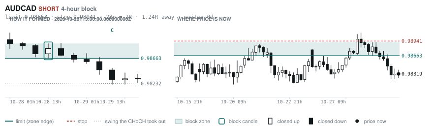
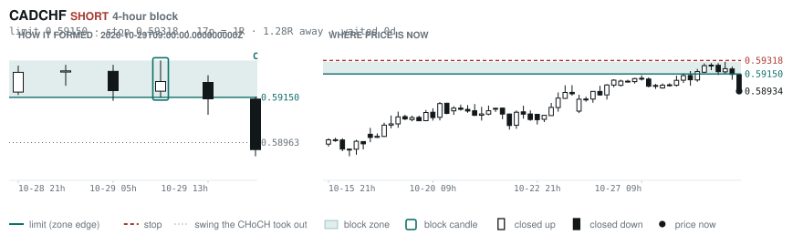
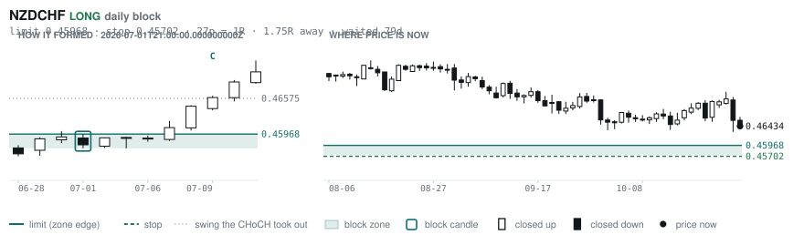
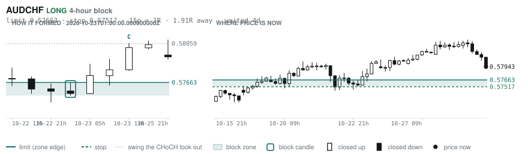

# Scanner Review — 2026-10-29 (evening)

Generated: 2026-10-29T23:03:42.393Z

```
## The clock

It is **18:00 Chicago** — a **DEAD** hour at 0.65x an average one.
An order placed now rests through **Tokyo, London and tomorrow's NY overlap** — about 16h of cover.
Next window: **Tokyo** in 1h.

_Evening pass. Orders placed now get the longest cover of the day: Tokyo, London, and tomorrow's NY overlap. Place limits and stops here — whatever does not fill overnight is still live for the morning._

## Where the energy is

**Running hot:** AUDNZD 1.29 · GBPNZD 1.23 · EURNZD 1.20 · NZDCAD 1.19 · GBPCAD 1.17 · GBPAUD 1.16 · EURCAD 1.16 · NZDCHF 1.15
**Quiet:** CHFJPY 0.86 · USDJPY 0.84

_Volatility persists for about two days, so a hot pair stays hot. It says nothing about direction — this picks the pair, the levels pick the side._

## Account

NAV **$694.73**   unrealised $-378.24   margin available $314.20   1 open

| pair | units | now | P/L | stop | distance | news lean |
|---|---|---|---|---|---|---|
| EURCAD | 17000 | 1.56480 | $-378.24 | **none** | — | 🔴 2 headwind |

**What the system reads on each position**

- **EURCAD** LONG — last REVERSAL LONG 6h ago at 1.55814 — system stop 1.54845, target **1.62445**; 597p to that target from here

## What is coming, and which way it leans

**EURCAD LONG**
- 🔴 10-30T10:00 EUR — GDP Growth Rate QoQ Flash  (fc 0.2 vs prev 0.6)
- 🔴 10-30T10:00 EUR — GDP Growth Rate YoY Flash  (fc 1.1 vs prev 1.2)

_Lean is read from forecast vs previous — which way consensus leans, not what will print._

## Order blocks live right now

### Daily

| pair | dir | limit | stop | 1R | spread | away | fills | waited | window | reaches 1R / 2R |
|---|---|---|---|---|---|---|---|---|---|---|
| USDCHF | SHORT | **0.83172** | 0.84030 | 86p $10.41 | 2% | 0.9R | 87% | 9d | 0.89x ⚠ | 68% / 39% |
| NZDCHF | LONG | **0.45968** | 0.45702 | 27p $3.23 | 15% | 1.8R | 81% | 79d | 1.03x | 75% / 53% |

_6 more live but further out, 2.0R to 7.2R away. They alert on their own when they come within 1R._
_Older blocks run further: 60+ days reaches 2R 58% of the time against 34% for a same-day fill._

### 4-hour

| pair | dir | limit | stop | 1R | spread | away | fills | waited | window | reaches 1R / 2R |
|---|---|---|---|---|---|---|---|---|---|---|
| AUDCAD | SHORT | **0.98663** | 0.98941 | 28p $1.99 | 14% | 1.2R | 79% | 0d | 1.00x | 70% / 46% |
| CADCHF | SHORT | **0.59150** | 0.59318 | 17p $2.04 | **20%** | 1.3R | 79% | 0d | 0.83x ⚠ | 70% / 46% |
| AUDCHF | LONG | **0.57663** | 0.57517 | 15p $1.77 | 16% | 1.9R | 79% | 4d | 1.04x | 77% / 47% |

_12 more live but further out, 3.1R to 7.4R away. They alert on their own when they come within 1R._
_H4 stops are a third of a daily one, so spread bites three times as hard — a bolded spread figure is most of the edge gone before price moves._

### In reach, drawn

_5 blocks within 2R of the limit. Blocks further out are in the tables above but not worth a picture yet._

**USDCHF SHORT** · daily · 0.86R away · waited 9d


**AUDCAD SHORT** · 4-hour · 1.24R away · waited 0d



**CADCHF SHORT** · 4-hour · 1.28R away · waited 0d



**NZDCHF LONG** · daily · 1.75R away · waited 79d



**AUDCHF LONG** · 4-hour · 1.91R away · waited 4d



_Left panel is the block forming, right is where price sits now. Legend is in each image._

## Scanner calls, last 1 day

| when | pair | dir | branch | firing | entry | stop | target | outcome |
|---|---|---|---|---|---|---|---|---|
| 10-29T01:00 | EURNZD | LONG | REV | 1st ⚠ | 1.98286 | 1.96421 | 2.01019 | open +0.09R |
| 10-29T01:00 | USDCAD | LONG | REV | 3rd | 1.39842 | 1.38945 | 1.48398 | open +0.06R |
| 10-29T01:00 | AUDUSD | SHORT | REV | 5th | 0.70524 | 0.71247 | 0.67750 | open +0.32R |
| 10-29T01:00 | AUDJPY | SHORT | REV | 4th | 111.300 | 112.511 | 107.672 | open +0.37R |
| 10-29T05:00 | GBPUSD | SHORT | REV | 1st ⚠ | 1.33122 | 1.34044 | 1.29883 | open -0.71R |
| 10-29T05:00 | AUDJPY | SHORT | REV | 2nd | 111.110 | 112.126 | 107.672 | open +0.26R |
| 10-29T05:00 | AUDCHF | SHORT | REV | 2nd | 0.58272 | 0.58899 | 0.55613 | open +0.52R |
| 10-29T05:00 | CHFJPY | LONG | WALL | 5th | 190.678 | 189.965 | 195.117 | open +0.89R |
| 10-29T09:00 | GBPCAD | LONG | REV | 8th | 1.86407 | 1.85247 | 1.91646 | open +0.62R |
| 10-29T09:00 | EURJPY | SHORT | REV | 5th | 175.896 | 177.644 | 172.228 | open -0.24R |
| 10-29T09:00 | GBPCHF | LONG | REV | 2nd | 1.10379 | 1.09713 | 1.11652 | open -0.15R |
| 10-29T09:00 | USDCAD | LONG | REV | 5th | 1.39973 | 1.39216 | 1.48398 | open -0.10R |
| 10-29T09:00 | GBPAUD | LONG | REV | 3rd | 1.89626 | 1.88079 | 1.95694 | open +0.46R |
| 10-29T09:00 | EURCAD | LONG | REV | 4th | 1.55741 | 1.54879 | 1.62445 | open +0.75R |
| 10-29T13:00 | EURNZD | LONG | REV | 2nd | 1.98246 | 1.96471 | 2.01019 | open +0.12R |
| 10-29T13:00 | NZDCHF | LONG | REV | 7th | 0.46522 | 0.46067 | 0.47370 | open -0.19R |
| 10-29T13:00 | EURCHF | LONG | REV | 1st ⚠ | 0.92233 | 0.91635 | 0.94100 | open -0.10R |
| 10-29T13:00 | CADCHF | SHORT | REV | 2nd | 0.59144 | 0.59772 | 0.57450 | open +0.33R |
| 10-29T13:00 | CADJPY | LONG | REV | 2nd | 113.022 | 111.694 | 115.222 | open -0.20R |
| 10-29T13:00 | EURUSD | LONG | REV | 2nd | 1.11636 | 1.10601 | 1.14261 | open +0.16R |
| 10-29T17:00 | EURCAD | LONG | REV | 2nd | 1.56388 | 1.54845 | 1.62445 | open +0.00R |
| 10-29T17:00 | AUDNZD | LONG | REV | 1st ⚠ | 1.24771 | 1.23937 | 1.26706 | open +0.00R |
| 10-29T17:00 | NZDCAD | LONG | REV | 1st ⚠ | 0.78802 | 0.78103 | 0.80874 | open +0.00R |

## Running tally, last 30 days

7 resolved · 3 target / 4 stopped · **+1.1R** · +0.159R per call · 53 still open

```
