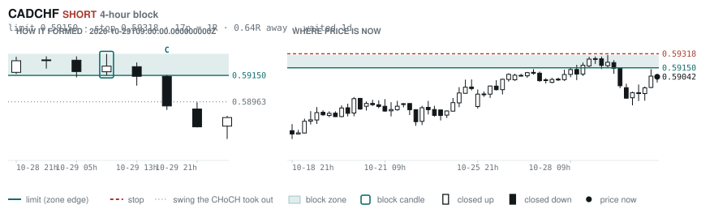
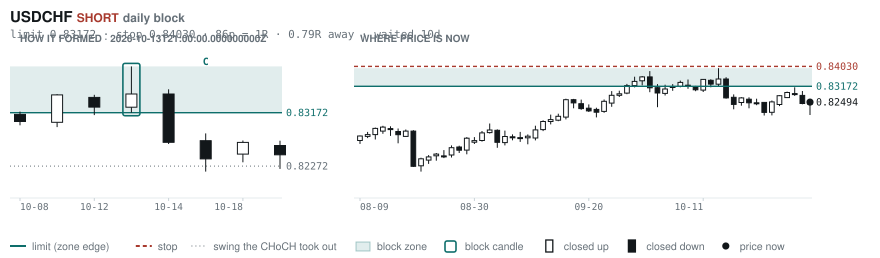
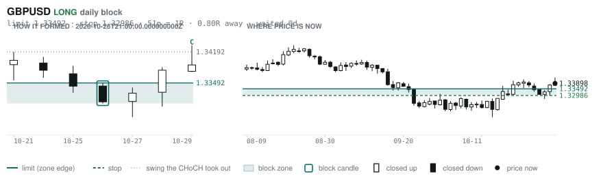
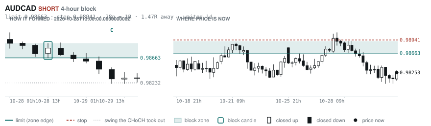
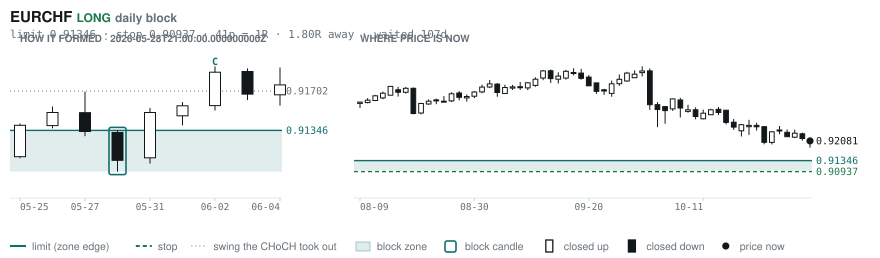
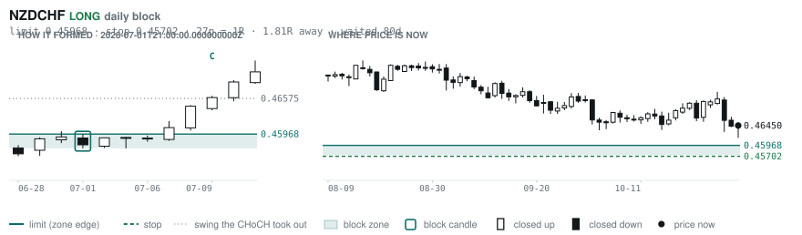

# Scanner Review — 2026-11-01 (evening)

Generated: 2026-11-02T00:03:59.268Z

```
## The clock

It is **18:00 Chicago** — a **DEAD** hour at 0.65x an average one.
An order placed now rests through **Tokyo, London and tomorrow's NY overlap** — about 16h of cover.
Next window: **Tokyo** in 1h.

_Evening pass. Orders placed now get the longest cover of the day: Tokyo, London, and tomorrow's NY overlap. Place limits and stops here — whatever does not fill overnight is still live for the morning._

## Where the energy is

**Running hot:** EURAUD 1.25 · GBPNZD 1.24 · EURNZD 1.24 · GBPAUD 1.23 · AUDNZD 1.23 · AUDCHF 1.20 · EURCAD 1.20 · NZDCHF 1.17 · GBPCAD 1.16 · CADCHF 1.16
**Quiet:** _none_

_Volatility persists for about two days, so a hot pair stays hot. It says nothing about direction — this picks the pair, the levels pick the side._

## Account

NAV **$622.36**   unrealised $-450.13   margin available $242.94   1 open

| pair | units | now | P/L | stop | distance | news lean |
|---|---|---|---|---|---|---|
| EURCAD | 17000 | 1.55892 | $-450.25 | **none** | — | 🟢 1 tailwind |

**What the system reads on each position**

- **EURCAD** LONG — last REVERSAL LONG 55h ago at 1.55583 — system stop 1.54751, target **1.62445**; 655p to that target from here

## What is coming, and which way it leans

**EURCAD LONG**
- 🟢 11-04T10:00 EUR — Inflation Rate YoY Flash  (fc 3.9 vs prev 3.8)

_Lean is read from forecast vs previous — which way consensus leans, not what will print._

## Order blocks live right now

### Daily

| pair | dir | limit | stop | 1R | spread | away | fills | waited | window | reaches 1R / 2R |
|---|---|---|---|---|---|---|---|---|---|---|
| USDCHF | SHORT | **0.83172** | 0.84030 | 86p $10.40 | 2% | 0.8R | 87% | 10d | 0.89x ⚠ | 68% / 39% |
| GBPUSD | LONG | **1.33492** | 1.32986 | 51p $5.06 | 4% | 0.8R | 87% | 0d | 0.89x ⚠ | 68% / 39% |
| EURCHF | LONG | **0.91346** | 0.90937 | 41p $4.96 | 5% | 1.8R | 81% | 107d | 0.90x ⚠ | 75% / 53% |
| NZDCHF | LONG | **0.45968** | 0.45702 | 27p $3.23 | 14% | 1.8R | 81% | 80d | 1.03x | 75% / 53% |

_5 more live but further out, 2.1R to 7.2R away. They alert on their own when they come within 1R._
_Older blocks run further: 60+ days reaches 2R 58% of the time against 34% for a same-day fill._

### 4-hour

| pair | dir | limit | stop | 1R | spread | away | fills | waited | window | reaches 1R / 2R |
|---|---|---|---|---|---|---|---|---|---|---|
| CADCHF | SHORT | **0.59150** | 0.59318 | 17p $2.04 | 16% | 0.6R | 83% | 1d | 0.83x ⚠ | 70% / 46% |
| AUDCAD | SHORT | **0.98663** | 0.98941 | 28p $1.99 | 10% | 1.5R | 79% | 1d | 1.00x | 70% / 46% |

_12 more live but further out, 2.4R to 7.4R away. They alert on their own when they come within 1R._
_H4 stops are a third of a daily one, so spread bites three times as hard — a bolded spread figure is most of the edge gone before price moves._

### In reach, drawn

_6 blocks within 2R of the limit. Blocks further out are in the tables above but not worth a picture yet._

**CADCHF SHORT** · 4-hour · 0.64R away · waited 1d



**USDCHF SHORT** · daily · 0.79R away · waited 10d



**GBPUSD LONG** · daily · 0.80R away · waited 0d



**AUDCAD SHORT** · 4-hour · 1.47R away · waited 1d



**EURCHF LONG** · daily · 1.80R away · waited 107d



**NZDCHF LONG** · daily · 1.81R away · waited 80d



_Left panel is the block forming, right is where price sits now. Legend is in each image._

## Scanner calls, last 1 day

_None._

## Running tally, last 30 days

1 resolved · 0 target / 1 stopped · **-1.0R** · -1.000R per call · 59 still open

```
