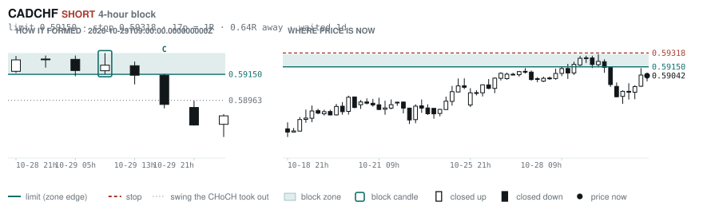
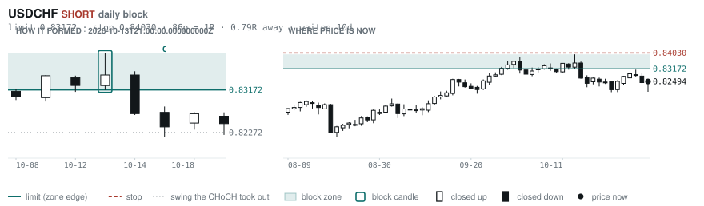
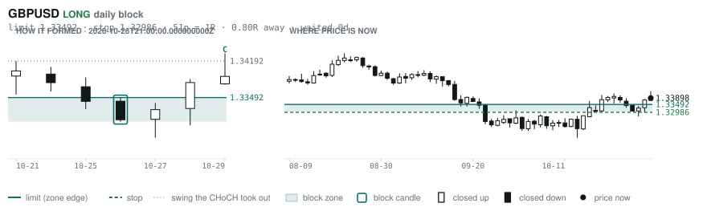
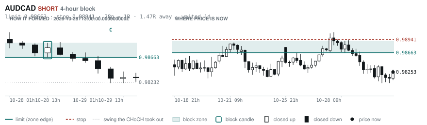
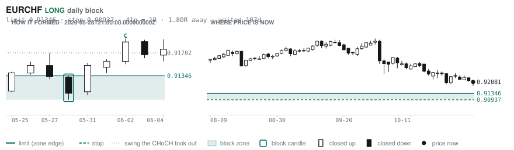
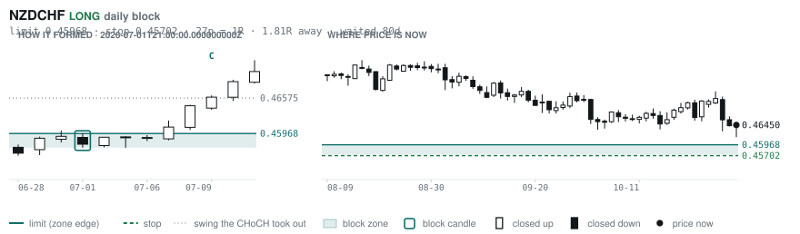

# Scanner Review — 2026-11-01 (weekly)

Generated: 2026-11-01T20:03:49.169Z

```
## The clock

It is **14:00 Chicago** — a **DEAD** hour at 0.74x an average one.
An order placed now rests through **tomorrow — the rest of today is dead**.
Next window: **Tokyo** in 5h.

## Where the energy is

**Running hot:** EURAUD 1.25 · GBPNZD 1.24 · EURNZD 1.24 · GBPAUD 1.23 · AUDNZD 1.23 · AUDCHF 1.20 · EURCAD 1.20 · NZDCHF 1.17 · GBPCAD 1.16 · CADCHF 1.16
**Quiet:** _none_

_Volatility persists for about two days, so a hot pair stays hot. It says nothing about direction — this picks the pair, the levels pick the side._

## Account

NAV **$623.15**   unrealised $-449.34   margin available $243.66   1 open

| pair | units | now | P/L | stop | distance | news lean |
|---|---|---|---|---|---|---|
| EURCAD | 17000 | 1.55929 | $-449.34 | **none** | — | 🟢 1 tailwind |

**What the system reads on each position**

- **EURCAD** LONG — last REVERSAL LONG 51h ago at 1.55583 — system stop 1.54751, target **1.62445**; 652p to that target from here

## What is coming, and which way it leans

**EURCAD LONG**
- 🟢 11-04T10:00 EUR — Inflation Rate YoY Flash  (fc 3.9 vs prev 3.8)

_Lean is read from forecast vs previous — which way consensus leans, not what will print._

## Order blocks live right now

### Daily

| pair | dir | limit | stop | 1R | spread | away | fills | waited | window | reaches 1R / 2R |
|---|---|---|---|---|---|---|---|---|---|---|
| USDCHF | SHORT | **0.83172** | 0.84030 | 86p $10.40 | 5% | 0.8R | 87% | 10d | 1.54x | 68% / 39% |
| GBPUSD | LONG | **1.33492** | 1.32986 | 51p $5.06 | 9% | 0.8R | 87% | 0d | 1.54x | 68% / 39% |
| EURCHF | LONG | **0.91346** | 0.90937 | 41p $4.96 | 13% | 1.8R | 81% | 107d | 1.53x | 75% / 53% |
| NZDCHF | LONG | **0.45968** | 0.45702 | 27p $3.23 | **30%** | 1.8R | 81% | 80d | 1.27x | 75% / 53% |

_5 more live but further out, 2.1R to 7.2R away. They alert on their own when they come within 1R._
_Older blocks run further: 60+ days reaches 2R 58% of the time against 34% for a same-day fill._

### 4-hour

| pair | dir | limit | stop | 1R | spread | away | fills | waited | window | reaches 1R / 2R |
|---|---|---|---|---|---|---|---|---|---|---|
| CADCHF | SHORT | **0.59150** | 0.59318 | 17p $2.04 | **37%** | 0.6R | 83% | 1d | 1.56x | 70% / 46% |
| AUDCAD | SHORT | **0.98663** | 0.98941 | 28p $1.99 | **38%** | 1.5R | 79% | 1d | 1.42x | 70% / 46% |

_12 more live but further out, 2.4R to 7.4R away. They alert on their own when they come within 1R._
_H4 stops are a third of a daily one, so spread bites three times as hard — a bolded spread figure is most of the edge gone before price moves._

### In reach, drawn

_6 blocks within 2R of the limit. Blocks further out are in the tables above but not worth a picture yet._

**CADCHF SHORT** · 4-hour · 0.64R away · waited 1d



**USDCHF SHORT** · daily · 0.79R away · waited 10d



**GBPUSD LONG** · daily · 0.80R away · waited 0d



**AUDCAD SHORT** · 4-hour · 1.47R away · waited 1d



**EURCHF LONG** · daily · 1.80R away · waited 107d



**NZDCHF LONG** · daily · 1.81R away · waited 80d



_Left panel is the block forming, right is where price sits now. Legend is in each image._

## Scanner calls, last 7 days

| when | pair | dir | branch | firing | entry | stop | target | outcome |
|---|---|---|---|---|---|---|---|---|
| 10-25T21:00 | EURCHF | SHORT | REV | 5th | 0.92420 | 0.93200 | 0.90334 | open +0.43R |
| 10-25T21:00 | GBPCAD | SHORT | REV | 10th | 1.87408 | 1.88699 | 1.85129 | open +0.24R |
| 10-25T21:00 | GBPCHF | LONG | REV | 4th | 1.10261 | 1.09332 | 1.12516 | open +0.21R |
| 10-25T21:00 | AUDJPY | SHORT | REV | 3rd | 110.462 | 111.840 | 106.138 | open -0.25R |
| 10-25T21:00 | NZDCAD | LONG | REV | 16th | 0.79856 | 0.79211 | 0.81182 | stopped -1.00R |
| 10-25T21:00 | GBPJPY | LONG | REV | 3rd | 210.267 | 208.252 | 213.533 | open +0.37R |
| 10-26T01:00 | GBPCAD | SHORT | REV | 5th | 1.87396 | 1.88270 | 1.85129 | open +0.33R |
| 10-26T01:00 | AUDUSD | SHORT | REV | 2nd | 0.70296 | 0.70911 | 0.67750 | open -0.04R |
| 10-26T01:00 | NZDJPY | SHORT | REV | 1st ⚠ | 89.453 | 90.339 | 87.497 | open +0.81R |
| 10-26T01:00 | USDCHF | LONG | REV | 4th | 0.82404 | 0.81614 | 0.85632 | open +0.11R |
| 10-26T01:00 | EURJPY | SHORT | REV | 2nd | 176.086 | 177.553 | 171.729 | open +0.16R |
| 10-26T05:00 | GBPUSD | SHORT | REV | 5th | 1.33466 | 1.34619 | 1.29883 | open -0.37R |
| 10-26T05:00 | CADCHF | LONG | REV | 2nd | 0.58932 | 0.58456 | 0.59450 | open +0.23R |
| 10-26T05:00 | GBPAUD | LONG | REV | 2nd | 1.89822 | 1.88530 | 1.95694 | open +0.46R |
| 10-26T05:00 | USDCHF | LONG | WALL | 3rd | 0.82601 | 0.82032 | 0.85632 | stopped -1.00R |
| 10-26T05:00 | EURUSD | SHORT | REV | 4th | 1.12060 | 1.12852 | 1.05714 | open +0.60R |
| 10-26T05:00 | EURAUD | SHORT | REV | 1st ⚠ | 1.59376 | 1.60451 | 1.55743 | open +0.63R |
| 10-26T09:00 | EURCHF | SHORT | REV | 6th | 0.92372 | 0.93194 | 0.90334 | open +0.35R |
| 10-26T09:00 | GBPAUD | LONG | REV | 7th | 1.90068 | 1.88197 | 1.95694 | open +0.19R |
| 10-26T09:00 | GBPNZD | LONG | REV | 2nd | 2.34957 | 2.33110 | 2.37918 | target +1.60R |
| 10-26T09:00 | NZDJPY | SHORT | REV | 1st ⚠ | 89.417 | 90.392 | 87.497 | open +0.70R |
| 10-26T09:00 | CADJPY | SHORT | REV | 1st ⚠ | 112.224 | 113.198 | 107.746 | open -0.58R |
| 10-26T09:00 | AUDCAD | SHORT | REV | 5th | 0.98495 | 0.99285 | 0.96059 | open +0.31R |
| 10-26T09:00 | AUDCHF | SHORT | REV | 8th | 0.58000 | 0.58608 | 0.55613 | open -0.01R |
| 10-26T09:00 | EURUSD | SHORT | REV | 2nd | 1.11904 | 1.12659 | 1.05714 | open +0.42R |
| 10-26T13:00 | NZDUSD | LONG | REV | 3rd | 0.56837 | 0.56152 | 0.61544 | stopped -1.00R |
| 10-26T13:00 | GBPCAD | SHORT | REV | 6th | 1.87129 | 1.88281 | 1.85129 | open +0.02R |
| 10-26T13:00 | AUDJPY | LONG | REV | 3rd | 110.551 | 109.208 | 113.562 | open +0.19R |
| 10-26T13:00 | EURJPY | SHORT | REV | 3rd | 176.136 | 177.496 | 171.729 | open +0.21R |
| 10-26T13:00 | GBPCHF | LONG | REV | 2nd | 1.10428 | 1.09605 | 1.12516 | open +0.04R |
| 10-26T17:00 | EURJPY | SHORT | REV | 2nd | 175.996 | 177.800 | 171.729 | open +0.08R |
| 10-26T17:00 | CHFJPY | SHORT | WALL | 4th | 190.280 | 190.947 | 187.540 | stopped -1.00R |
| 10-26T21:00 | NZDCAD | LONG | REV | 1st ⚠ | 0.79790 | 0.79096 | 0.81182 | stopped -1.00R |
| 10-26T21:00 | EURNZD | LONG | REV | 4th | 1.96263 | 1.94887 | 2.01019 | open +1.39R |
| 10-26T21:00 | NZDCHF | SHORT | REV | 1st ⚠ | 0.47124 | 0.47523 | 0.45836 | open +1.69R |
| 10-26T21:00 | AUDNZD | SHORT | REV | 1st ⚠ | 1.23262 | 1.24256 | 1.20438 | stopped -1.00R |
| 10-26T21:00 | NZDUSD | SHORT | REV | 4th | 0.56926 | 0.57509 | 0.51428 | open +1.07R |
| 10-27T01:00 | GBPNZD | LONG | REV | 3rd | 2.34335 | 2.32109 | 2.37918 | target +1.61R |
| 10-27T01:00 | EURCHF | SHORT | REV | 2nd | 0.92448 | 0.93028 | 0.90334 | open +0.63R |
| 10-27T01:00 | GBPCHF | SHORT | REV | 1st ⚠ | 1.10404 | 1.11079 | 1.08540 | open -0.08R |
| 10-27T01:00 | GBPAUD | LONG | REV | 1st ⚠ | 1.89995 | 1.88578 | 1.95694 | open +0.30R |
| 10-27T01:00 | USDJPY | SHORT | REV | 2nd | 157.593 | 158.942 | 156.143 | open -0.00R |
| 10-27T01:00 | AUDCHF | SHORT | REV | 2nd | 0.58108 | 0.58758 | 0.55613 | open +0.16R |
| 10-27T01:00 | NZDJPY | SHORT | REV | 3rd | 89.702 | 90.825 | 87.497 | open +0.86R |
| 10-27T05:00 | EURJPY | SHORT | REV | 3rd | 175.948 | 177.722 | 171.729 | open +0.05R |
| 10-27T05:00 | GBPJPY | SHORT | REV | 1st ⚠ | 210.142 | 211.915 | 206.523 | open -0.50R |
| 10-27T05:00 | AUDCAD | LONG | REV | 7th | 0.98484 | 0.97795 | 0.99852 | open -0.34R |
| 10-27T05:00 | CHFJPY | SHORT | REV | 1st ⚠ | 190.424 | 191.875 | 187.540 | stopped -1.00R |
| 10-27T09:00 | EURCAD | LONG | REV | 1st ⚠ | 1.56376 | 1.54908 | 1.62445 | open -0.31R |
| 10-27T09:00 | GBPCAD | LONG | REV | 1st ⚠ | 1.86942 | 1.85511 | 1.91646 | open +0.11R |
| 10-27T09:00 | USDCHF | LONG | REV | 3rd | 0.82854 | 0.81972 | 0.85632 | stopped -1.00R |
| 10-27T09:00 | USDCAD | LONG | REV | 7th | 1.40228 | 1.39466 | 1.48398 | stopped -1.00R |
| 10-27T09:00 | EURGBP | LONG | REV | 8th | 0.83650 | 0.83317 | 0.86717 | stopped -1.00R |
| 10-27T13:00 | EURNZD | LONG | REV | 1st ⚠ | 1.95892 | 1.93970 | 2.01019 | open +1.19R |
| 10-27T13:00 | GBPUSD | SHORT | REV | 1st ⚠ | 1.33147 | 1.34091 | 1.29883 | stopped -1.00R |
| 10-27T13:00 | GBPNZD | LONG | REV | 4th | 2.34131 | 2.32089 | 2.37918 | target +1.85R |
| 10-27T13:00 | AUDUSD | SHORT | REV | 3rd | 0.70304 | 0.70891 | 0.67750 | open -0.02R |
| 10-27T13:00 | NZDCHF | SHORT | REV | 2nd | 0.47124 | 0.47517 | 0.45836 | open +1.72R |
| 10-27T13:00 | NZDJPY | SHORT | REV | 4th | 89.790 | 90.823 | 87.497 | open +1.02R |
| 10-27T13:00 | EURGBP | LONG | REV | 10th | 0.83666 | 0.83194 | 0.86717 | open -0.69R |
| 10-27T17:00 | NZDCAD | SHORT | REV | 2nd | 0.79832 | 0.80532 | 0.78678 | target +1.65R |
| 10-27T21:00 | AUDCAD | SHORT | REV | 3rd | 0.98976 | 0.99830 | 0.96059 | open +0.85R |
| 10-27T21:00 | EURNZD | LONG | REV | 4th | 1.96019 | 1.94673 | 2.01019 | open +1.60R |
| 10-27T21:00 | CHFJPY | SHORT | REV | 1st ⚠ | 190.336 | 191.829 | 187.540 | stopped -1.00R |
| 10-27T21:00 | EURCHF | LONG | REV | 8th | 0.92266 | 0.91816 | 0.94100 | open -0.41R |
| 10-28T01:00 | NZDCHF | LONG | REV | 5th | 0.46536 | 0.46025 | 0.47370 | open -0.17R |
| 10-28T01:00 | NZDJPY | LONG | REV | 12th | 88.512 | 87.288 | 92.395 | open +0.18R |
| 10-28T01:00 | EURCAD | LONG | REV | 1st ⚠ | 1.56408 | 1.55478 | 1.62445 | open -0.52R |
| 10-28T01:00 | AUDJPY | SHORT | REV | 7th | 111.018 | 112.122 | 106.138 | open +0.19R |
| 10-28T05:00 | EURCHF | LONG | REV | 2nd | 0.92378 | 0.91789 | 0.94100 | open -0.50R |
| 10-28T05:00 | GBPUSD | LONG | REV | 3rd | 1.32912 | 1.31839 | 1.37014 | open +0.92R |
| 10-28T05:00 | AUDCAD | SHORT | REV | 2nd | 0.98875 | 0.99547 | 0.96059 | open +0.93R |
| 10-28T05:00 | USDCAD | SHORT | REV | 1st ⚠ | 1.40584 | 1.41283 | 1.35795 | open +1.21R |
| 10-28T05:00 | USDJPY | SHORT | REV | 3rd | 157.701 | 158.825 | 156.143 | open +0.09R |
| 10-28T05:00 | CHFJPY | SHORT | WALL | 3rd | 189.913 | 190.731 | 187.540 | stopped -1.00R |
| 10-28T05:00 | GBPCHF | LONG | REV | 4th | 1.10369 | 1.09717 | 1.11652 | open +0.14R |
| 10-28T13:00 | EURCHF | SHORT | REV | 3rd | 0.92418 | 0.92966 | 0.90334 | open +0.61R |
| 10-28T13:00 | EURCAD | LONG | REV | 2nd | 1.56441 | 1.55450 | 1.62445 | open -0.52R |
| 10-28T13:00 | USDCHF | SHORT | REV | 2nd | 0.82900 | 0.83773 | 0.79880 | open +0.47R |
| 10-28T13:00 | EURUSD | SHORT | REV | 1st ⚠ | 1.11482 | 1.12330 | 1.05714 | open -0.12R |
| 10-28T13:00 | AUDCHF | SHORT | REV | 1st ⚠ | 0.58384 | 0.58883 | 0.55613 | open +0.75R |
| 10-28T13:00 | CHFJPY | LONG | REV | 1st ⚠ | 190.774 | 189.096 | 195.117 | open +0.16R |
| 10-28T13:00 | GBPUSD | LONG | REV | 2nd | 1.33161 | 1.32231 | 1.37014 | open +0.79R |
| 10-28T13:00 | CADCHF | SHORT | REV | 1st ⚠ | 0.59076 | 0.59788 | 0.57450 | open +0.05R |
| 10-28T17:00 | AUDCAD | SHORT | REV | 3rd | 0.98715 | 0.99555 | 0.96059 | open +0.55R |
| 10-28T17:00 | USDCHF | SHORT | REV | 1st ⚠ | 0.82816 | 0.83792 | 0.79880 | open +0.33R |
| 10-28T17:00 | EURJPY | SHORT | REV | 1st ⚠ | 176.046 | 177.339 | 172.228 | open +0.15R |
| 10-28T21:00 | EURJPY | SHORT | REV | 4th | 175.971 | 177.662 | 172.228 | open +0.07R |
| 10-28T21:00 | USDCAD | LONG | REV | 1st ⚠ | 1.39915 | 1.39063 | 1.48398 | open -0.20R |
| 10-29T01:00 | EURNZD | LONG | REV | 1st ⚠ | 1.98286 | 1.96421 | 2.01019 | open -0.06R |
| 10-29T01:00 | USDCAD | LONG | REV | 3rd | 1.39842 | 1.38945 | 1.48398 | open -0.11R |
| 10-29T01:00 | AUDUSD | SHORT | REV | 5th | 0.70524 | 0.71247 | 0.67750 | open +0.29R |
| 10-29T01:00 | AUDJPY | SHORT | REV | 4th | 111.300 | 112.511 | 107.672 | open +0.41R |
| 10-29T05:00 | GBPUSD | SHORT | REV | 1st ⚠ | 1.33122 | 1.34044 | 1.29883 | stopped -1.00R |
| 10-29T05:00 | AUDJPY | SHORT | REV | 2nd | 111.110 | 112.126 | 107.672 | open +0.30R |
| 10-29T05:00 | AUDCHF | SHORT | REV | 2nd | 0.58272 | 0.58899 | 0.55613 | open +0.42R |
| 10-29T05:00 | CHFJPY | LONG | WALL | 5th | 190.678 | 189.965 | 195.117 | open +0.51R |
| 10-29T09:00 | GBPCAD | LONG | REV | 8th | 1.86407 | 1.85247 | 1.91646 | open +0.60R |
| 10-29T09:00 | EURJPY | SHORT | REV | 5th | 175.896 | 177.644 | 172.228 | open +0.02R |
| 10-29T09:00 | GBPCHF | LONG | REV | 2nd | 1.10379 | 1.09713 | 1.11652 | open +0.12R |
| 10-29T09:00 | USDCAD | LONG | REV | 5th | 1.39973 | 1.39216 | 1.48398 | open -0.31R |
| 10-29T09:00 | GBPAUD | LONG | REV | 3rd | 1.89626 | 1.88079 | 1.95694 | open +0.51R |
| 10-29T09:00 | EURCAD | LONG | REV | 4th | 1.55741 | 1.54879 | 1.62445 | open +0.22R |
| 10-29T13:00 | EURNZD | LONG | REV | 2nd | 1.98246 | 1.96471 | 2.01019 | open -0.04R |
| 10-29T13:00 | NZDCHF | LONG | REV | 7th | 0.46522 | 0.46067 | 0.47370 | open -0.16R |
| 10-29T13:00 | EURCHF | LONG | REV | 1st ⚠ | 0.92233 | 0.91635 | 0.94100 | open -0.25R |
| 10-29T13:00 | CADCHF | SHORT | REV | 2nd | 0.59144 | 0.59772 | 0.57450 | open +0.16R |
| 10-29T13:00 | CADJPY | LONG | REV | 2nd | 113.022 | 111.694 | 115.222 | open -0.18R |
| 10-29T13:00 | EURUSD | LONG | REV | 2nd | 1.11636 | 1.10601 | 1.14261 | open -0.05R |
| 10-29T17:00 | EURCAD | LONG | REV | 2nd | 1.56388 | 1.54845 | 1.62445 | open -0.30R |
| 10-29T17:00 | AUDNZD | LONG | REV | 1st ⚠ | 1.24771 | 1.23937 | 1.26706 | open +0.14R |
| 10-29T17:00 | NZDCAD | LONG | REV | 1st ⚠ | 0.78802 | 0.78103 | 0.80874 | open -0.18R |
| 10-29T21:00 | NZDCHF | LONG | REV | 2nd | 0.46228 | 0.45747 | 0.47370 | open +0.46R |
| 10-29T21:00 | GBPAUD | SHORT | REV | 1st ⚠ | 1.90666 | 1.92421 | 1.86649 | open +0.14R |
| 10-30T01:00 | GBPCAD | SHORT | REV | 4th | 1.87060 | 1.88094 | 1.85129 | open -0.04R |
| 10-30T01:00 | GBPUSD | SHORT | REV | 2nd | 1.33876 | 1.34790 | 1.29883 | open -0.02R |
| 10-30T01:00 | CADCHF | LONG | REV | 3rd | 0.58852 | 0.58287 | 0.59450 | open +0.34R |
| 10-30T01:00 | NZDUSD | SHORT | REV | 2nd | 0.56406 | 0.57078 | 0.51428 | open +0.15R |
| 10-30T01:00 | AUDCAD | LONG | REV | 5th | 0.98362 | 0.97421 | 0.99852 | open -0.12R |
| 10-30T01:00 | USDCHF | LONG | REV | 1st ⚠ | 0.82234 | 0.81397 | 0.85632 | open +0.31R |
| 10-30T01:00 | AUDJPY | LONG | REV | 1st ⚠ | 110.822 | 109.283 | 113.988 | open -0.01R |
| 10-30T01:00 | AUDCHF | LONG | REV | 7th | 0.57890 | 0.57092 | 0.59652 | open +0.15R |
| 10-30T01:00 | AUDUSD | LONG | REV | 1st ⚠ | 0.70397 | 0.69743 | 0.71228 | open -0.12R |
| 10-30T01:00 | NZDJPY | LONG | REV | 2nd | 88.798 | 87.568 | 92.395 | open -0.05R |
| 10-30T01:00 | GBPCHF | LONG | REV | 3rd | 1.10088 | 1.09397 | 1.11652 | open +0.54R |
| 10-30T01:00 | EURJPY | SHORT | REV | 2nd | 176.116 | 177.398 | 172.228 | open +0.20R |
| 10-30T01:00 | CADJPY | LONG | REV | 2nd | 112.670 | 111.699 | 115.222 | open +0.12R |
| 10-30T01:00 | EURUSD | SHORT | REV | 1st ⚠ | 1.11868 | 1.12928 | 1.05714 | open +0.27R |
| 10-30T01:00 | EURAUD | SHORT | REV | 2nd | 1.58909 | 1.60533 | 1.55743 | open +0.13R |
| 10-30T05:00 | NZDCHF | LONG | REV | 1st ⚠ | 0.46395 | 0.45944 | 0.47370 | open +0.12R |
| 10-30T05:00 | GBPCHF | LONG | REV | 5th | 1.10221 | 1.09407 | 1.11652 | open +0.29R |
| 10-30T05:00 | GBPJPY | SHORT | REV | 4th | 210.997 | 212.715 | 206.249 | open -0.01R |
| 10-30T09:00 | GBPAUD | SHORT | REV | 2nd | 1.90734 | 1.92502 | 1.86649 | open +0.18R |
| 10-30T09:00 | EURCHF | LONG | REV | 5th | 0.91938 | 0.91300 | 0.94100 | open +0.22R |
| 10-30T09:00 | EURJPY | SHORT | REV | 6th | 175.680 | 177.771 | 172.228 | open -0.08R |
| 10-30T09:00 | GBPCAD | SHORT | REV | 3rd | 1.87182 | 1.88358 | 1.85129 | open +0.07R |
| 10-30T09:00 | CHFJPY | SHORT | REV | 1st ⚠ | 191.092 | 192.670 | 187.540 | open +0.03R |
| 10-30T09:00 | AUDNZD | LONG | REV | 2nd | 1.24646 | 1.23692 | 1.26706 | open +0.25R |
| 10-30T13:00 | GBPUSD | LONG | REV | 1st ⚠ | 1.33990 | 1.32955 | 1.37014 | open -0.09R |
| 10-30T13:00 | USDJPY | LONG | REV | 2nd | 157.423 | 155.580 | 159.665 | open +0.10R |
| 10-30T13:00 | AUDJPY | LONG | REV | 2nd | 110.746 | 109.193 | 113.988 | open +0.04R |
| 10-30T13:00 | CADJPY | LONG | REV | 3rd | 112.875 | 111.616 | 115.222 | open -0.07R |
| 10-30T13:00 | AUDUSD | LONG | REV | 10th | 0.70352 | 0.69741 | 0.71228 | open -0.06R |
| 10-30T13:00 | AUDCHF | LONG | REV | 6th | 0.57938 | 0.57355 | 0.59652 | open +0.12R |
| 10-30T13:00 | EURGBP | LONG | REV | 1st ⚠ | 0.83272 | 0.82838 | 0.86717 | open +0.15R |
| 10-30T13:00 | AUDNZD | LONG | REV | 2nd | 1.24811 | 1.23938 | 1.26706 | open +0.09R |

## Running tally, last 30 days

23 resolved · 3 target / 20 stopped · **-16.1R** · -0.702R per call · 37 still open

```
