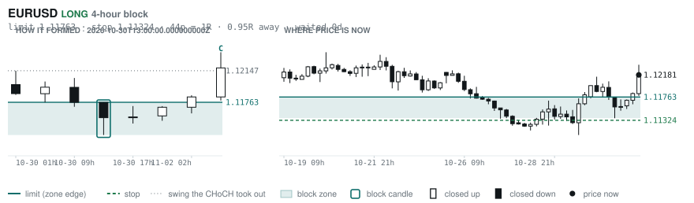
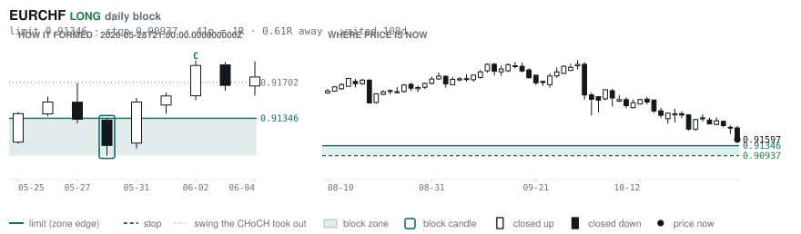
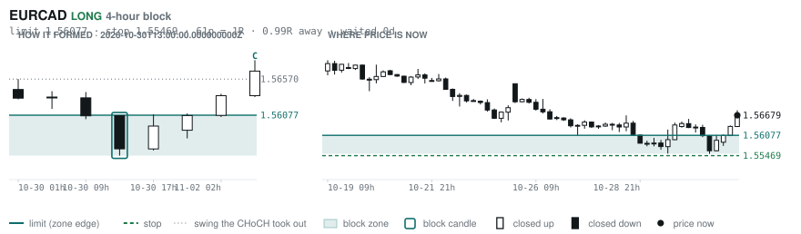
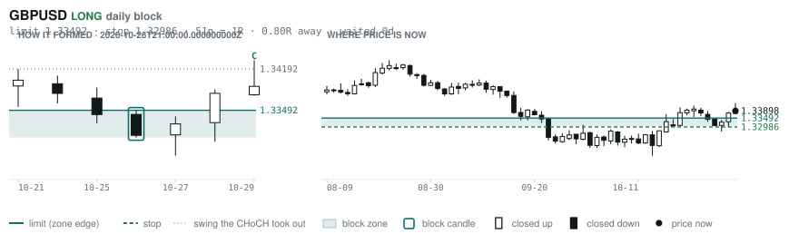
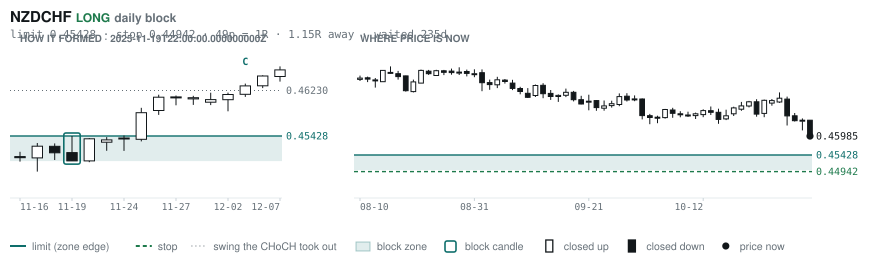
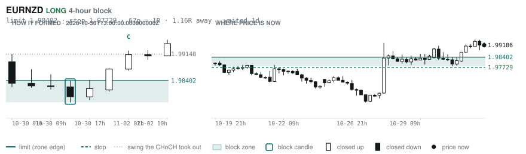

# Scanner Review — 2026-11-02 (evening)

Generated: 2026-11-03T00:03:37.824Z

```
## The clock

It is **18:00 Chicago** — a **DEAD** hour at 0.65x an average one.
An order placed now rests through **Tokyo, London and tomorrow's NY overlap** — about 16h of cover.
Next window: **Tokyo** in 1h.

_Evening pass. Orders placed now get the longest cover of the day: Tokyo, London, and tomorrow's NY overlap. Place limits and stops here — whatever does not fill overnight is still live for the morning._

## Where the energy is

**Running hot:** AUDCHF 1.27 · EURAUD 1.27 · EURCAD 1.24 · GBPAUD 1.22 · CADCHF 1.22 · AUDNZD 1.18 · EURNZD 1.17 · EURUSD 1.17 · NZDCHF 1.16 · GBPNZD 1.15
**Quiet:** _none_

_Volatility persists for about two days, so a hot pair stays hot. It says nothing about direction — this picks the pair, the levels pick the side._

## Account

NAV **$687.03**   unrealised $-384.56   margin available $0.00   2 open

| pair | units | now | P/L | stop | distance | news lean |
|---|---|---|---|---|---|---|
| EURCAD | 14000 | 1.56498 | $-8.51 | **none** | — | 🟢 2 tailwind · 🔴 1 headwind |
| EURCAD | 17000 | 1.56498 | $-376.05 | **none** | — | 🟢 2 tailwind · 🔴 1 headwind |

**What the system reads on each position**

- **EURCAD** LONG — last REVERSAL LONG 22h ago at 1.55786 — system stop 1.54785, target **1.62445**; 595p to that target from here

## What is coming, and which way it leans

**EURCAD LONG**
- 🟢 11-04T10:00 EUR — Inflation Rate YoY Flash  (fc 3.9 vs prev 3.8)
- 🔴 11-06T08:30 CAD — Employment Change  (fc 14.6K vs prev -68.3K)
- ⚪ 11-06T08:30 CAD — Unemployment Rate  (fc 6.5% vs prev 6.5%)
- ⚪ 11-06T13:30 CAD — Unemployment Rate  (fc 6.5 vs prev 6.5)
- 🟢 11-06T15:00 CAD — Ivey PMI s.a  (fc 58 vs prev 58.2)

_Lean is read from forecast vs previous — which way consensus leans, not what will print._

## Order blocks live right now

### Daily

| pair | dir | limit | stop | 1R | spread | away | fills | waited | window | reaches 1R / 2R |
|---|---|---|---|---|---|---|---|---|---|---|
| EURCHF | LONG | **0.91346** | 0.90937 | 41p $5.00 | 6% | 0.6R | 87% | 108d | 0.90x ⚠ | 75% / 53% |
| GBPUSD | LONG | **1.33492** | 1.32986 | 51p $5.06 | 4% | 1.1R | 81% | 1d | 0.89x ⚠ | 68% / 39% |
| NZDCHF | LONG | **0.45428** | 0.44942 | 49p $5.94 | 8% | 1.1R | 81% | 235d | 1.03x | 75% / 53% |
| USDCHF | SHORT | **0.83172** | 0.84030 | 86p $10.48 | 2% | 1.5R | 81% | 11d | 0.89x ⚠ | 68% / 39% |

_5 more live but further out, 3.0R to 7.9R away. They alert on their own when they come within 1R._
_Older blocks run further: 60+ days reaches 2R 58% of the time against 34% for a same-day fill._

### 4-hour

| pair | dir | limit | stop | 1R | spread | away | fills | waited | window | reaches 1R / 2R |
|---|---|---|---|---|---|---|---|---|---|---|
| EURUSD | LONG | **1.11763** | 1.11324 | 44p $4.39 | 4% | 0.3R | 87% | 1d | 0.90x ⚠ | 70% / 46% |
| EURCAD | LONG | **1.56077** | 1.55469 | 61p $4.35 | 6% | 0.6R | 83% | 1d | 0.80x ⚠ | 70% / 46% |
| EURNZD | LONG | **1.98402** | 1.97729 | 67p $3.78 | 11% | 1.2R | 79% | 1d | 1.06x | 70% / 46% |
| GBPAUD | LONG | **1.90809** | 1.90302 | 51p $3.55 | 13% | 1.5R | 79% | 1d | 1.04x | 70% / 46% |

_16 more live but further out, 2.1R to 7.7R away. They alert on their own when they come within 1R._
_H4 stops are a third of a daily one, so spread bites three times as hard — a bolded spread figure is most of the edge gone before price moves._

### In reach, drawn

_6 blocks within 2R of the limit. Blocks further out are in the tables above but not worth a picture yet._

**EURUSD LONG** · 4-hour · 0.25R away · waited 1d



**EURCHF LONG** · daily · 0.61R away · waited 108d



**EURCAD LONG** · 4-hour · 0.63R away · waited 1d



**GBPUSD LONG** · daily · 1.14R away · waited 1d



**NZDCHF LONG** · daily · 1.15R away · waited 235d



**EURNZD LONG** · 4-hour · 1.16R away · waited 1d



_Left panel is the block forming, right is where price sits now. Legend is in each image._

## Scanner calls, last 1 day

| when | pair | dir | branch | firing | entry | stop | target | outcome |
|---|---|---|---|---|---|---|---|---|
| 11-02T02:00 | GBPUSD | LONG | REV | 1st ⚠ | 1.33984 | 1.33008 | 1.37014 | open +0.09R |
| 11-02T02:00 | EURCAD | LONG | REV | 1st ⚠ | 1.56344 | 1.54785 | 1.62445 | open +0.07R |
| 11-02T02:00 | GBPCHF | SHORT | REV | 1st ⚠ | 1.10325 | 1.11078 | 1.08540 | open +0.73R |
| 11-02T02:00 | AUDCHF | SHORT | REV | 1st ⚠ | 0.57812 | 0.58554 | 0.55613 | open +0.70R |
| 11-02T02:00 | NZDJPY | SHORT | REV | 3rd | 88.614 | 89.646 | 87.497 | open -0.10R |
| 11-02T02:00 | EURJPY | SHORT | REV | 3rd | 176.458 | 177.695 | 172.228 | open -0.21R |
| 11-02T02:00 | CADCHF | SHORT | REV | 2nd | 0.58896 | 0.59368 | 0.57450 | open +0.75R |
| 11-02T02:00 | EURCHF | SHORT | REV | 11th | 0.92082 | 0.92568 | 0.90557 | open +1.00R |
| 11-02T06:00 | NZDUSD | SHORT | REV | 1st ⚠ | 0.56346 | 0.57083 | 0.51428 | open +0.24R |
| 11-02T06:00 | USDCHF | SHORT | REV | 1st ⚠ | 0.82086 | 0.83324 | 0.79880 | open +0.17R |
| 11-02T06:00 | EURUSD | LONG | REV | 4th | 1.12181 | 1.10958 | 1.14261 | open -0.25R |
| 11-02T06:00 | NZDJPY | SHORT | REV | 2nd | 88.998 | 89.900 | 87.497 | open +0.31R |
| 11-02T06:00 | AUDNZD | LONG | REV | 3rd | 1.24616 | 1.23688 | 1.26706 | open -0.02R |
| 11-02T10:00 | EURCHF | SHORT | REV | 2nd | 0.91956 | 0.92676 | 0.90557 | open +0.50R |
| 11-02T10:00 | AUDJPY | SHORT | REV | 4th | 110.504 | 111.809 | 107.672 | open -0.02R |
| 11-02T10:00 | USDCAD | SHORT | REV | 9th | 1.39868 | 1.40633 | 1.36370 | open +0.01R |
| 11-02T10:00 | GBPJPY | SHORT | REV | 1st ⚠ | 211.672 | 213.348 | 206.249 | open -0.06R |
| 11-02T10:00 | EURJPY | SHORT | REV | 2nd | 176.994 | 178.407 | 172.228 | open +0.20R |
| 11-02T14:00 | NZDCHF | LONG | REV | 1st ⚠ | 0.46030 | 0.45547 | 0.48192 | open -0.09R |
| 11-02T14:00 | USDJPY | LONG | REV | 2nd | 157.818 | 156.476 | 159.665 | open +0.10R |
| 11-02T10:00 | NZDUSD | SHORT | REV | 4th | 0.56230 | 0.56888 | 0.51428 | open +0.10R |
| 11-02T14:00 | GBPAUD | SHORT | REV | 1st ⚠ | 1.91360 | 1.92800 | 1.86649 | open -0.16R |
| 11-02T18:00 | EURNZD | SHORT | REV | 1st ⚠ | 1.99186 | 2.00838 | 1.90601 | open +0.00R |
| 11-02T18:00 | AUDJPY | LONG | REV | 12th | 110.533 | 109.333 | 113.988 | open +0.00R |
| 11-02T18:00 | AUDCHF | LONG | REV | 4th | 0.57296 | 0.56712 | 0.59652 | open +0.00R |
| 11-02T18:00 | AUDNZD | LONG | REV | 4th | 1.24601 | 1.23737 | 1.29364 | open +0.00R |

## Running tally, last 30 days

8 resolved · 0 target / 8 stopped · **-8.0R** · -1.000R per call · 52 still open

```
