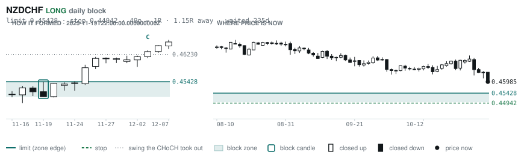
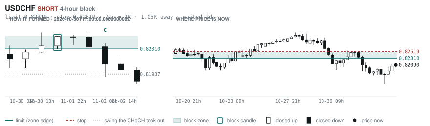
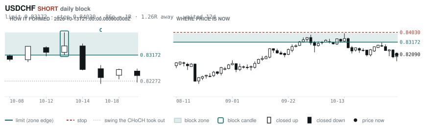
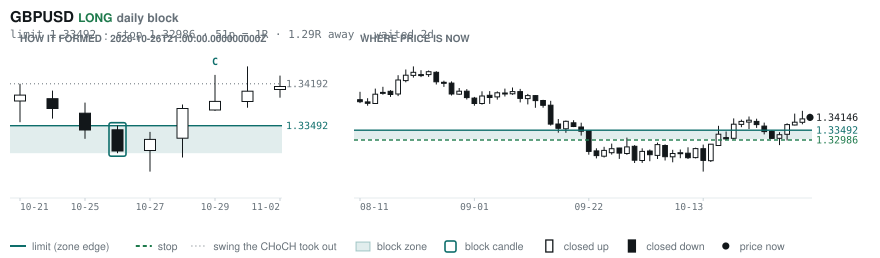
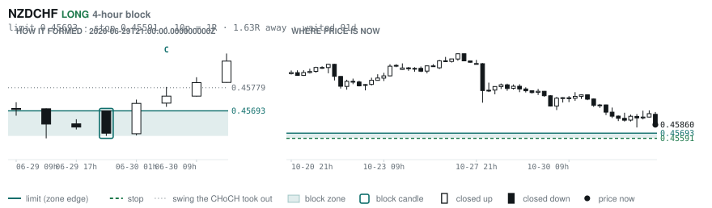

# Scanner Review — 2026-11-03 (evening)

Generated: 2026-11-04T00:03:42.413Z

```
## The clock

It is **18:00 Chicago** — a **DEAD** hour at 0.65x an average one.
An order placed now rests through **Tokyo, London and tomorrow's NY overlap** — about 16h of cover.
Next window: **Tokyo** in 1h.

_Evening pass. Orders placed now get the longest cover of the day: Tokyo, London, and tomorrow's NY overlap. Place limits and stops here — whatever does not fill overnight is still live for the morning._

## Where the energy is

**Running hot:** AUDNZD 1.37 · EURNZD 1.32 · GBPNZD 1.30 · NZDCHF 1.27 · EURAUD 1.26 · AUDCHF 1.25 · GBPAUD 1.23 · CADCHF 1.17 · EURCAD 1.16 · NZDCAD 1.16
**Quiet:** USDJPY 0.88

_Volatility persists for about two days, so a hot pair stays hot. It says nothing about direction — this picks the pair, the levels pick the side._

## Account

NAV **$779.20**   unrealised $-291.51   margin available $84.29   2 open

| pair | units | now | P/L | stop | distance | news lean |
|---|---|---|---|---|---|---|
| EURCAD | 14000 | 1.56918 | $33.29 | **none** | — | 🟢 1 tailwind · 🔴 1 headwind |
| EURCAD | 17000 | 1.56918 | $-324.80 | **none** | — | 🟢 1 tailwind · 🔴 1 headwind |

**What the system reads on each position**

- **EURCAD** LONG — last CONTINUATION LONG 14h ago at 1.56185 — system stop 1.55298, target **1.62445** (Grade C); 553p to that target from here

## What is coming, and which way it leans

**EURCAD LONG**
- 🟢 11-04T10:00 EUR — Inflation Rate YoY Flash  (fc 4 vs prev 3.8)
- 🔴 11-06T08:30 CAD — Employment Change  (fc 14.6K vs prev -68.3K)
- ⚪ 11-06T08:30 CAD — Unemployment Rate  (fc 6.5% vs prev 6.5%)
- ⚪ 11-06T13:30 CAD — Unemployment Rate  (fc 6.5 vs prev 6.5)
- ⚪ 11-06T15:00 CAD — Ivey PMI
- ⚪ 11-06T15:00 CAD — Ivey PMI s.a

_Lean is read from forecast vs previous — which way consensus leans, not what will print._

## Order blocks live right now

### Daily

| pair | dir | limit | stop | 1R | spread | away | fills | waited | window | reaches 1R / 2R |
|---|---|---|---|---|---|---|---|---|---|---|
| NZDCHF | LONG | **0.45428** | 0.44942 | 49p $5.92 | 8% | 0.9R | 87% | 236d | 1.03x | 75% / 53% |
| USDCHF | SHORT | **0.83172** | 0.84030 | 86p $10.45 | 2% | 1.3R | 81% | 12d | 0.89x ⚠ | 68% / 39% |
| GBPUSD | LONG | **1.33492** | 1.32986 | 51p $5.06 | 5% | 1.3R | 81% | 2d | 0.89x ⚠ | 68% / 39% |

_4 more live but further out, 2.5R to 6.3R away. They alert on their own when they come within 1R._
_Older blocks run further: 60+ days reaches 2R 58% of the time against 34% for a same-day fill._

### 4-hour

| pair | dir | limit | stop | 1R | spread | away | fills | waited | window | reaches 1R / 2R |
|---|---|---|---|---|---|---|---|---|---|---|
| USDCHF | SHORT | **0.82310** | 0.82519 | 21p $2.55 | 9% | 1.1R | 79% | 2d | 0.89x ⚠ | 77% / 47% |
| NZDCHF | LONG | **0.45693** | 0.45591 | 10p $1.25 | **38%** | 1.6R | 79% | 91d | 1.03x | 78% / 51% |

_15 more live but further out, 2.8R to 7.9R away. They alert on their own when they come within 1R._
_H4 stops are a third of a daily one, so spread bites three times as hard — a bolded spread figure is most of the edge gone before price moves._

### In reach, drawn

_5 blocks within 2R of the limit. Blocks further out are in the tables above but not worth a picture yet._

**NZDCHF LONG** · daily · 0.89R away · waited 236d



**USDCHF SHORT** · 4-hour · 1.05R away · waited 2d



**USDCHF SHORT** · daily · 1.26R away · waited 12d



**GBPUSD LONG** · daily · 1.29R away · waited 2d



**NZDCHF LONG** · 4-hour · 1.63R away · waited 91d



_Left panel is the block forming, right is where price sits now. Legend is in each image._

## Scanner calls, last 1 day

| when | pair | dir | branch | firing | entry | stop | target | outcome |
|---|---|---|---|---|---|---|---|---|
| 11-03T02:00 | NZDCHF | LONG | REV | 2nd | 0.46027 | 0.45550 | 0.48192 | open -0.35R |
| 11-03T02:00 | GBPCAD | SHORT | REV | 1st ⚠ | 1.87354 | 1.88470 | 1.85129 | open -0.52R |
| 11-03T02:00 | GBPAUD | LONG | REV | 2nd | 1.92154 | 1.89735 | 1.95694 | open +0.17R |
| 11-03T02:00 | AUDUSD | SHORT | WALL | 2nd | 0.69796 | 0.70171 | 0.67750 | open +0.36R |
| 11-03T02:00 | AUDCHF | LONG | REV | 6th | 0.57092 | 0.56467 | 0.59652 | open +0.15R |
| 11-03T02:00 | EURJPY | LONG | REV | 2nd | 176.692 | 175.388 | 179.642 | open +0.71R |
| 11-03T02:00 | CADJPY | LONG | REV | 1st ⚠ | 113.006 | 112.110 | 115.222 | open +0.31R |
| 11-03T06:00 | USDJPY | LONG | REV | 3rd | 158.110 | 156.549 | 160.624 | open +0.38R |
| 11-03T06:00 | NZDCHF | LONG | REV | 2nd | 0.45996 | 0.45389 | 0.48192 | open -0.22R |
| 11-03T06:00 | NZDUSD | SHORT | REV | 5th | 0.56232 | 0.56906 | 0.54493 | open +0.54R |
| 11-03T06:00 | GBPCHF | LONG | REV | 4th | 1.09756 | 1.08834 | 1.11652 | open +0.40R |
| 11-03T06:00 | AUDCHF | LONG | REV | 1st ⚠ | 0.57066 | 0.56238 | 0.59652 | open +0.14R |
| 11-03T06:00 | EURUSD | SHORT | WALL | 2nd | 1.11910 | 1.12349 | 1.05714 | open -0.01R |
| 11-03T06:00 | EURGBP | LONG | REV | 8th | 0.83403 | 0.83110 | 0.86717 | open +0.08R |
| 11-03T10:00 | AUDCAD | LONG | REV | 1st ⚠ | 0.97760 | 0.96760 | 1.00292 | open -0.17R |
| 11-03T10:00 | EURCAD | LONG | REV | 4th | 1.56522 | 1.55298 | 1.62445 | open +0.22R |
| 11-03T10:00 | AUDNZD | LONG | REV | 9th | 1.24425 | 1.23191 | 1.29364 | open +0.22R |
| 11-03T14:00 | NZDCHF | LONG | REV | 3rd | 0.46078 | 0.45534 | 0.48192 | open -0.40R |
| 11-03T10:00 | NZDUSD | SHORT | REV | 6th | 0.56181 | 0.56893 | 0.54493 | open +0.44R |
| 11-03T14:00 | EURNZD | LONG | REV | 2nd | 1.99363 | 1.97715 | 2.01019 | open +0.58R |
| 11-03T14:00 | USDCHF | SHORT | REV | 6th | 0.82053 | 0.82927 | 0.79880 | open -0.04R |
| 11-03T14:00 | EURCHF | SHORT | REV | 5th | 0.91856 | 0.92485 | 0.90557 | open -0.02R |
| 11-03T10:00 | USDJPY | SHORT | REV | 14th | 158.128 | 159.412 | 153.546 | open -0.45R |
| 11-03T18:00 | NZDUSD | SHORT | REV | 1st ⚠ | 0.55868 | 0.56687 | 0.54493 | open +0.00R |
| 11-03T18:00 | USDJPY | SHORT | REV | 5th | 158.710 | 159.761 | 153.546 | open +0.00R |
| 11-03T18:00 | EURJPY | SHORT | REV | 1st ⚠ | 177.614 | 178.837 | 172.228 | open +0.00R |
| 11-03T14:00 | AUDUSD | SHORT | WALL | 3rd | 0.69712 | 0.70095 | 0.67750 | open +0.13R |

## Running tally, last 30 days

14 resolved · 0 target / 14 stopped · **-14.0R** · -1.000R per call · 46 still open

```
