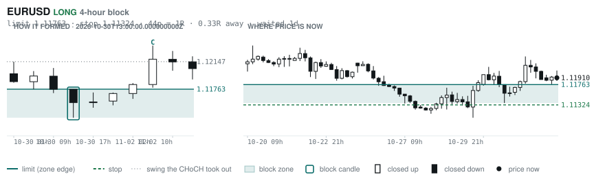
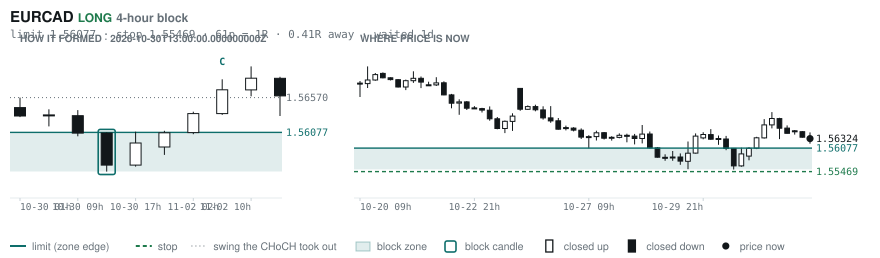
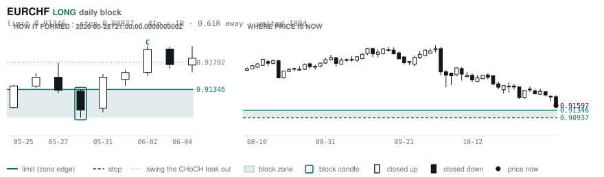
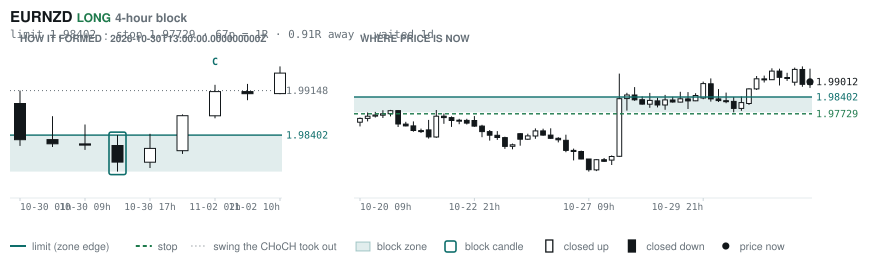
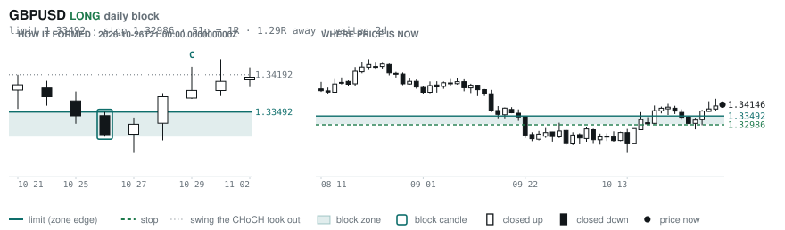
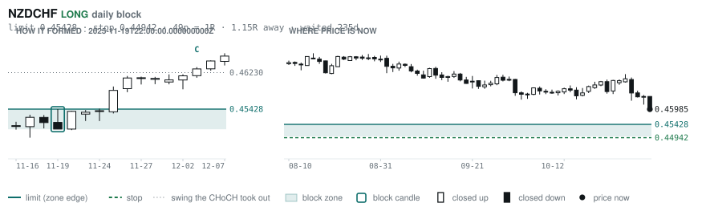

# Scanner Review — 2026-11-03 (morning)

Generated: 2026-11-03T12:03:38.460Z

```
## The clock

It is **06:00 Chicago** — a **normal** hour at 1.10x an average one.
An order placed now rests through **the NY overlap** — about 5h of cover.
Next window: **NY overlap** in 1h.

_Morning pass. The NY overlap is the single best window of the day but it is the only one left before the afternoon goes dead, so this is the adjustment pass: the morning-skewed pairs, and anything that filled overnight._

## Where the energy is

**Running hot:** AUDCHF 1.32 · AUDNZD 1.30 · EURAUD 1.29 · GBPAUD 1.28 · EURNZD 1.25 · GBPNZD 1.24 · NZDCHF 1.22 · CADCHF 1.19 · USDCHF 1.15
**Quiet:** USDJPY 0.86

_Volatility persists for about two days, so a hot pair stays hot. It says nothing about direction — this picks the pair, the levels pick the side._

## Account

NAV **$583.15**   unrealised $-488.44   margin available $0.00   2 open

| pair | units | now | P/L | stop | distance | news lean |
|---|---|---|---|---|---|---|
| EURCAD | 14000 | 1.56032 | $-55.08 | **none** | — | 🟢 1 tailwind · 🔴 1 headwind |
| EURCAD | 17000 | 1.56032 | $-433.36 | **none** | — | 🟢 1 tailwind · 🔴 1 headwind |

**What the system reads on each position**

- **EURCAD** LONG — last REVERSAL LONG 34h ago at 1.55786 — system stop 1.54785, target **1.62445**; 641p to that target from here

## What is coming, and which way it leans

**EURCAD LONG**
- 🟢 11-04T10:00 EUR — Inflation Rate YoY Flash  (fc 4 vs prev 3.8)
- 🔴 11-06T08:30 CAD — Employment Change  (fc 14.6K vs prev -68.3K)
- ⚪ 11-06T08:30 CAD — Unemployment Rate  (fc 6.5% vs prev 6.5%)
- ⚪ 11-06T13:30 CAD — Unemployment Rate  (fc 6.5 vs prev 6.5)
- ⚪ 11-06T15:00 CAD — Ivey PMI
- ⚪ 11-06T15:00 CAD — Ivey PMI s.a

_Lean is read from forecast vs previous — which way consensus leans, not what will print._

## Order blocks live right now

### Daily

| pair | dir | limit | stop | 1R | spread | away | fills | waited | window | reaches 1R / 2R |
|---|---|---|---|---|---|---|---|---|---|---|
| EURCHF | LONG | **0.91346** | 0.90937 | 41p $5.00 | 5% | 0.6R | 87% | 108d | 1.53x | 75% / 53% |
| GBPUSD | LONG | **1.33492** | 1.32986 | 51p $5.06 | 4% | 1.1R | 81% | 1d | 1.54x | 68% / 39% |
| NZDCHF | LONG | **0.45428** | 0.44942 | 49p $5.94 | 8% | 1.1R | 81% | 235d | 1.27x | 75% / 53% |
| USDCHF | SHORT | **0.83172** | 0.84030 | 86p $10.48 | 2% | 1.5R | 81% | 11d | 1.54x | 68% / 39% |

_5 more live but further out, 3.0R to 7.9R away. They alert on their own when they come within 1R._
_Older blocks run further: 60+ days reaches 2R 58% of the time against 34% for a same-day fill._

### 4-hour

| pair | dir | limit | stop | 1R | spread | away | fills | waited | window | reaches 1R / 2R |
|---|---|---|---|---|---|---|---|---|---|---|
| EURUSD | LONG | **1.11763** | 1.11324 | 44p $4.39 | 4% | 0.3R | 87% | 1d | 1.53x | 70% / 46% |
| EURCAD | LONG | **1.56077** | 1.55469 | 61p $4.35 | 5% | 0.4R | 87% | 1d | 1.59x | 70% / 46% |
| EURNZD | LONG | **1.98402** | 1.97729 | 67p $3.78 | 11% | 0.9R | 83% | 1d | 1.27x | 70% / 46% |

_16 more live but further out, 2.4R to 7.9R away. They alert on their own when they come within 1R._
_H4 stops are a third of a daily one, so spread bites three times as hard — a bolded spread figure is most of the edge gone before price moves._

### In reach, drawn

_6 blocks within 2R of the limit. Blocks further out are in the tables above but not worth a picture yet._

**EURUSD LONG** · 4-hour · 0.33R away · waited 1d



**EURCAD LONG** · 4-hour · 0.41R away · waited 1d



**EURCHF LONG** · daily · 0.61R away · waited 108d



**EURNZD LONG** · 4-hour · 0.91R away · waited 1d



**GBPUSD LONG** · daily · 1.14R away · waited 1d



**NZDCHF LONG** · daily · 1.15R away · waited 235d



_Left panel is the block forming, right is where price sits now. Legend is in each image._

## Scanner calls, last 1 day

| when | pair | dir | branch | firing | entry | stop | target | outcome |
|---|---|---|---|---|---|---|---|---|
| 11-02T14:00 | NZDCHF | LONG | REV | 1st ⚠ | 0.46030 | 0.45547 | 0.48192 | open -0.07R |
| 11-02T14:00 | USDJPY | LONG | REV | 2nd | 157.818 | 156.476 | 159.665 | open +0.22R |
| 11-02T14:00 | GBPAUD | SHORT | REV | 1st ⚠ | 1.91360 | 1.92800 | 1.86649 | open -0.67R |
| 11-02T18:00 | EURNZD | SHORT | REV | 1st ⚠ | 1.99186 | 2.00838 | 1.90601 | open +0.11R |
| 11-02T18:00 | AUDJPY | LONG | REV | 12th | 110.533 | 109.333 | 113.988 | open -0.19R |
| 11-02T18:00 | AUDCHF | LONG | REV | 4th | 0.57296 | 0.56712 | 0.59652 | open -0.39R |
| 11-02T18:00 | AUDNZD | LONG | REV | 4th | 1.24601 | 1.23737 | 1.29364 | open -0.62R |
| 11-02T22:00 | NZDJPY | SHORT | REV | 1st ⚠ | 88.532 | 89.654 | 85.876 | open -0.34R |
| 11-02T22:00 | NZDUSD | SHORT | REV | 1st ⚠ | 0.56067 | 0.56809 | 0.54493 | open -0.22R |
| 11-02T22:00 | GBPJPY | SHORT | REV | 1st ⚠ | 211.644 | 213.245 | 206.249 | open -0.32R |
| 11-02T22:00 | AUDCHF | LONG | REV | 1st ⚠ | 0.57330 | 0.56767 | 0.59652 | open -0.47R |
| 11-02T22:00 | AUDNZD | LONG | REV | 3rd | 1.24770 | 1.23967 | 1.29364 | stopped -1.00R |
| 11-03T02:00 | NZDCHF | LONG | REV | 2nd | 0.46027 | 0.45550 | 0.48192 | open -0.07R |
| 11-03T02:00 | GBPCAD | SHORT | REV | 1st ⚠ | 1.87354 | 1.88470 | 1.85129 | open -0.08R |
| 11-03T02:00 | GBPAUD | LONG | REV | 2nd | 1.92154 | 1.89735 | 1.95694 | open +0.07R |
| 11-03T02:00 | AUDUSD | SHORT | WALL | 2nd | 0.69796 | 0.70171 | 0.67750 | open +0.07R |
| 11-03T02:00 | AUDCHF | LONG | REV | 6th | 0.57092 | 0.56467 | 0.59652 | open -0.04R |
| 11-03T02:00 | EURJPY | LONG | REV | 2nd | 176.692 | 175.388 | 179.642 | open +0.19R |
| 11-03T02:00 | CADJPY | LONG | REV | 1st ⚠ | 113.006 | 112.110 | 115.222 | open +0.20R |
| 11-03T06:00 | USDJPY | LONG | REV | 3rd | 158.110 | 156.549 | 160.624 | open +0.00R |
| 11-03T06:00 | NZDCHF | LONG | REV | 2nd | 0.45996 | 0.45389 | 0.48192 | open +0.00R |
| 11-03T06:00 | NZDUSD | SHORT | REV | 5th | 0.56232 | 0.56906 | 0.54493 | open +0.00R |
| 11-03T06:00 | GBPCHF | LONG | REV | 4th | 1.09756 | 1.08834 | 1.11652 | open +0.00R |
| 11-03T06:00 | AUDCHF | LONG | REV | 1st ⚠ | 0.57066 | 0.56238 | 0.59652 | open +0.00R |
| 11-03T06:00 | EURUSD | SHORT | WALL | 2nd | 1.11910 | 1.12349 | 1.05714 | open +0.00R |
| 11-03T06:00 | EURGBP | LONG | REV | 8th | 0.83403 | 0.83110 | 0.86717 | open +0.00R |

## Running tally, last 30 days

15 resolved · 0 target / 15 stopped · **-15.0R** · -1.000R per call · 45 still open

```
