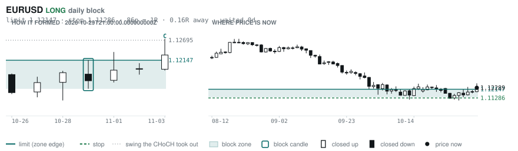
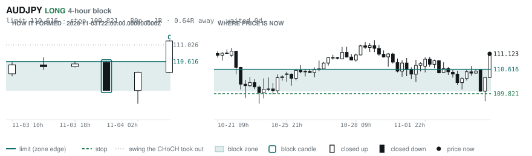
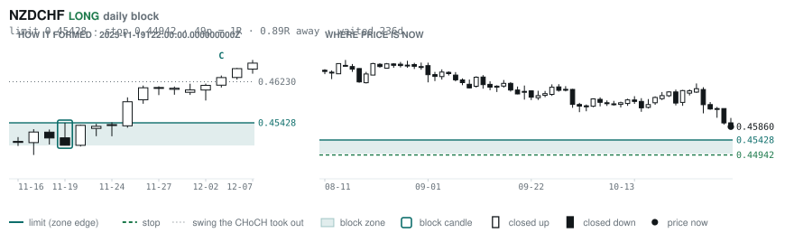
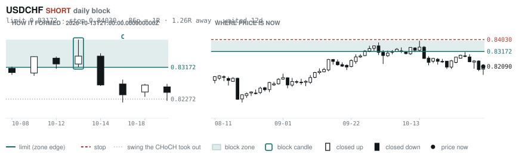
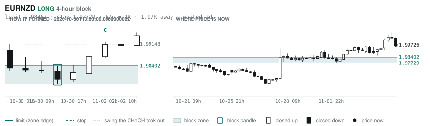

# Scanner Review — 2026-11-04 (evening)

Generated: 2026-11-05T00:00:40.167Z

```
## The clock

It is **18:00 Chicago** — a **DEAD** hour at 0.65x an average one.
An order placed now rests through **Tokyo, London and tomorrow's NY overlap** — about 16h of cover.
Next window: **Tokyo** in 1h.

_Evening pass. Orders placed now get the longest cover of the day: Tokyo, London, and tomorrow's NY overlap. Place limits and stops here — whatever does not fill overnight is still live for the morning._

## Where the energy is

**Running hot:** AUDCHF 1.34 · NZDCHF 1.32 · EURAUD 1.29 · AUDNZD 1.28 · EURNZD 1.27 · EURUSD 1.27 · GBPNZD 1.27 · USDCHF 1.27 · CADCHF 1.24 · EURCHF 1.23 · GBPAUD 1.22 · NZDJPY 1.21 · NZDUSD 1.20 · GBPCHF 1.19 · EURCAD 1.18 · NZDCAD 1.17 · AUDCAD 1.16
**Quiet:** _none_

_Volatility persists for about two days, so a hot pair stays hot. It says nothing about direction — this picks the pair, the levels pick the side._

## Account

NAV **$789.26**   unrealised $-278.78   margin available $92.65   2 open

| pair | units | now | P/L | stop | distance | news lean |
|---|---|---|---|---|---|---|
| EURCAD | 14000 | 1.56974 | $39.37 | **none** | — | 🔴 1 headwind |
| EURCAD | 17000 | 1.56974 | $-318.16 | **none** | — | 🔴 1 headwind |

**What the system reads on each position**

- **EURCAD** LONG — last CONTINUATION LONG 38h ago at 1.56185 — system stop 1.55298, target **1.62445** (Grade C); 547p to that target from here

## What is coming, and which way it leans

**EURCAD LONG**
- 🔴 11-06T08:30 CAD — Employment Change  (fc 14.6K vs prev -68.3K)
- ⚪ 11-06T08:30 CAD — Unemployment Rate  (fc 6.5% vs prev 6.5%)
- ⚪ 11-06T13:30 CAD — Unemployment Rate  (fc 6.5 vs prev 6.5)
- ⚪ 11-06T15:00 CAD — Ivey PMI
- ⚪ 11-06T15:00 CAD — Ivey PMI s.a

_Lean is read from forecast vs previous — which way consensus leans, not what will print._

## Order blocks live right now

### Daily

| pair | dir | limit | stop | 1R | spread | away | fills | waited | window | reaches 1R / 2R |
|---|---|---|---|---|---|---|---|---|---|---|
| EURUSD | LONG | **1.12147** | 1.11286 | 86p $8.61 | 2% | 0.2R | 94% | 0d | 0.90x ⚠ | 68% / 39% |
| NZDCHF | LONG | **0.45428** | 0.44942 | 49p $5.95 | 8% | 1.0R | 81% | 237d | 1.03x | 75% / 53% |
| USDCHF | SHORT | **0.83172** | 0.84030 | 86p $10.50 | 2% | 1.7R | 81% | 13d | 0.89x ⚠ | 68% / 39% |

_5 more live but further out, 2.4R to 6.9R away. They alert on their own when they come within 1R._
_Older blocks run further: 60+ days reaches 2R 58% of the time against 34% for a same-day fill._

### 4-hour

| pair | dir | limit | stop | 1R | spread | away | fills | waited | window | reaches 1R / 2R |
|---|---|---|---|---|---|---|---|---|---|---|
| AUDJPY | LONG | **110.616** | 109.821 | 80p $5.02 | 3% | 0.5R | 87% | 1d | 1.10x | 70% / 46% |
| EURNZD | LONG | **1.98402** | 1.97729 | 67p $3.79 | 12% | 2.0R | 79% | 3d | 1.06x | 77% / 47% |

_13 more live but further out, 2.5R to 7.6R away. They alert on their own when they come within 1R._
_H4 stops are a third of a daily one, so spread bites three times as hard — a bolded spread figure is most of the edge gone before price moves._

### In reach, drawn

_5 blocks within 2R of the limit. Blocks further out are in the tables above but not worth a picture yet._

**EURUSD LONG** · daily · 0.16R away · waited 0d



**AUDJPY LONG** · 4-hour · 0.47R away · waited 1d



**NZDCHF LONG** · daily · 1.04R away · waited 237d



**USDCHF SHORT** · daily · 1.70R away · waited 13d



**EURNZD LONG** · 4-hour · 1.95R away · waited 3d



_Left panel is the block forming, right is where price sits now. Legend is in each image._

## Scanner calls, last 1 day

| when | pair | dir | branch | firing | entry | stop | target | outcome |
|---|---|---|---|---|---|---|---|---|
| 11-04T02:00 | NZDCHF | LONG | REV | 2nd | 0.45783 | 0.45114 | 0.48192 | open +0.22R |
| 11-04T06:00 | NZDCHF | LONG | REV | 4th | 0.46022 | 0.45470 | 0.48192 | open -0.16R |
| 11-04T06:00 | EURCHF | SHORT | REV | 3rd | 0.91919 | 0.92517 | 0.90557 | open +0.27R |
| 11-04T06:00 | EURNZD | SHORT | REV | 1st ⚠ | 1.99726 | 2.01799 | 1.90601 | open +0.00R |
| 11-04T06:00 | AUDCAD | LONG | REV | 1st ⚠ | 0.97855 | 0.96721 | 1.00292 | open +0.06R |
| 11-04T06:00 | NZDUSD | LONG | REV | 2nd | 0.56365 | 0.55589 | 0.58552 | open -0.18R |
| 11-04T06:00 | EURAUD | SHORT | REV | 2nd | 1.60486 | 1.61961 | 1.52860 | open +0.15R |
| 11-04T06:00 | AUDUSD | LONG | REV | 4th | 0.70149 | 0.69302 | 0.72420 | open -0.11R |
| 11-04T06:00 | AUDNZD | LONG | REV | 2nd | 1.24454 | 1.23447 | 1.29364 | open +0.15R |
| 11-04T06:00 | NZDJPY | LONG | REV | 2nd | 89.290 | 87.838 | 92.395 | open -0.17R |
| 11-04T02:00 | NZDJPY | LONG | REV | 12th | 88.565 | 87.301 | 92.395 | open +0.38R |
| 11-04T06:00 | EURGBP | LONG | REV | 10th | 0.83452 | 0.82965 | 0.86717 | open -0.22R |
| 11-04T10:00 | CHFJPY | SHORT | REV | 7th | 194.170 | 195.724 | 187.587 | open +0.19R |
| 11-04T14:00 | GBPJPY | SHORT | REV | 3rd | 213.234 | 215.016 | 206.249 | open -0.11R |
| 11-04T14:00 | AUDJPY | SHORT | REV | 7th | 111.046 | 112.317 | 107.672 | open +0.04R |
| 11-04T14:00 | CHFJPY | SHORT | REV | 2nd | 193.778 | 195.839 | 187.587 | open -0.05R |
| 11-04T14:00 | EURJPY | SHORT | REV | 2nd | 177.841 | 179.504 | 172.228 | open -0.03R |
| 11-04T18:00 | GBPUSD | LONG | REV | 1st ⚠ | 1.34721 | 1.33760 | 1.37014 | open +0.00R |
| 11-04T18:00 | AUDUSD | SHORT | REV | 2nd | 0.70060 | 0.70759 | 0.67750 | open +0.00R |
| 11-04T18:00 | NZDJPY | SHORT | REV | 2nd | 89.048 | 90.051 | 85.876 | open +0.00R |
| 11-04T18:00 | AUDCHF | SHORT | REV | 5th | 0.57250 | 0.57914 | 0.55613 | open +0.00R |
| 11-04T18:00 | EURUSD | LONG | REV | 3rd | 1.12289 | 1.11429 | 1.14261 | open +0.00R |
| 11-04T14:00 | EURGBP | SHORT | REV | 1st ⚠ | 0.83402 | 0.83782 | 0.82418 | open +0.15R |

## Running tally, last 30 days

16 resolved · 1 target / 15 stopped · **-14.0R** · -0.875R per call · 44 still open

```
