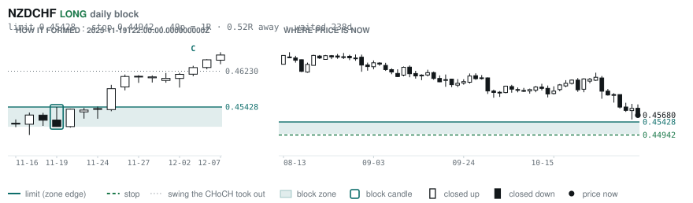
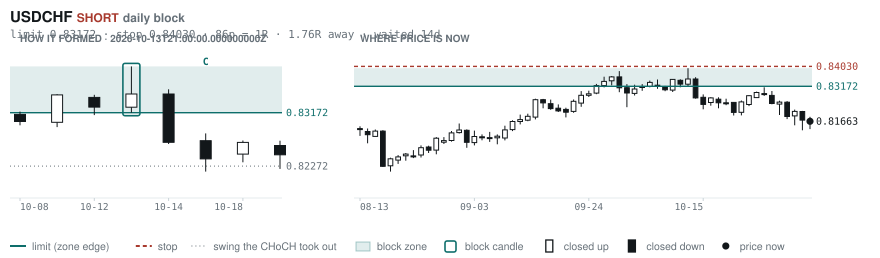
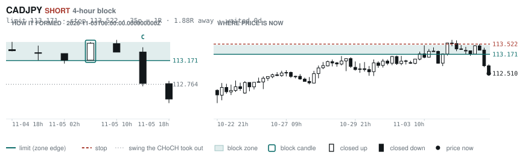
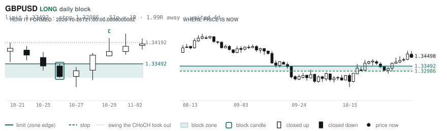

# Scanner Review — 2026-11-05 (evening)

Generated: 2026-11-06T00:00:51.739Z

```
## The clock

It is **18:00 Chicago** — a **DEAD** hour at 0.65x an average one.
An order placed now rests through **Tokyo, London and tomorrow's NY overlap** — about 16h of cover.
Next window: **Tokyo** in 1h.

_Evening pass. Orders placed now get the longest cover of the day: Tokyo, London, and tomorrow's NY overlap. Place limits and stops here — whatever does not fill overnight is still live for the morning._

## Where the energy is

**Running hot:** AUDCHF 1.45 · EURAUD 1.41 · GBPAUD 1.39 · NZDCHF 1.32 · USDCHF 1.31 · CADCHF 1.31 · AUDJPY 1.27 · AUDNZD 1.26 · GBPNZD 1.26 · GBPCHF 1.25 · AUDUSD 1.24 · EURNZD 1.23 · EURUSD 1.23 · EURCHF 1.22 · AUDCAD 1.21 · NZDJPY 1.20 · NZDUSD 1.18 · USDCAD 1.15
**Quiet:** _none_

_Volatility persists for about two days, so a hot pair stays hot. It says nothing about direction — this picks the pair, the levels pick the side._

## Account

NAV **$877.90**   unrealised $-189.23   margin available $181.72   2 open

| pair | units | now | P/L | stop | distance | news lean |
|---|---|---|---|---|---|---|
| EURCAD | 14000 | 1.57378 | $79.30 | **none** | — | 🔴 1 headwind |
| EURCAD | 17000 | 1.57378 | $-268.52 | **none** | — | 🔴 1 headwind |

**What the system reads on each position**

- **EURCAD** LONG — last CONTINUATION LONG 10h ago at 1.56694 — system stop 1.55761, target **1.62445** (Grade C); 507p to that target from here

## What is coming, and which way it leans

**EURCAD LONG**
- 🔴 11-06T08:30 CAD — Employment Change  (fc 14.6K vs prev -68.3K)
- ⚪ 11-06T08:30 CAD — Unemployment Rate  (fc 6.5% vs prev 6.5%)
- ⚪ 11-06T13:30 CAD — Unemployment Rate  (fc 6.5 vs prev 6.5)
- ⚪ 11-06T15:00 CAD — Ivey PMI
- ⚪ 11-06T15:00 CAD — Ivey PMI s.a

_Lean is read from forecast vs previous — which way consensus leans, not what will print._

## Order blocks live right now

### Daily

| pair | dir | limit | stop | 1R | spread | away | fills | waited | window | reaches 1R / 2R |
|---|---|---|---|---|---|---|---|---|---|---|
| NZDCHF | LONG | **0.45428** | 0.44942 | 49p $5.95 | 8% | 0.5R | 87% | 238d | 1.03x | 75% / 53% |
| USDCHF | SHORT | **0.83172** | 0.84030 | 86p $10.51 | 2% | 1.8R | 81% | 14d | 0.89x ⚠ | 68% / 39% |
| GBPUSD | LONG | **1.33492** | 1.32986 | 51p $5.06 | 4% | 2.0R | 81% | 4d | 0.89x ⚠ | 68% / 39% |

_5 more live but further out, 2.3R to 8.0R away. They alert on their own when they come within 1R._
_Older blocks run further: 60+ days reaches 2R 58% of the time against 34% for a same-day fill._

### 4-hour

| pair | dir | limit | stop | 1R | spread | away | fills | waited | window | reaches 1R / 2R |
|---|---|---|---|---|---|---|---|---|---|---|
| CADJPY | SHORT | **113.171** | 113.522 | 35p $2.23 | 11% | 1.9R | 79% | 0d | 0.99x ⚠ | 70% / 46% |

_19 more live but further out, 2.2R to 7.9R away. They alert on their own when they come within 1R._
_H4 stops are a third of a daily one, so spread bites three times as hard — a bolded spread figure is most of the edge gone before price moves._

### In reach, drawn

_4 blocks within 2R of the limit. Blocks further out are in the tables above but not worth a picture yet._

**NZDCHF LONG** · daily · 0.52R away · waited 238d



**USDCHF SHORT** · daily · 1.76R away · waited 14d



**CADJPY SHORT** · 4-hour · 1.88R away · waited 0d



**GBPUSD LONG** · daily · 1.99R away · waited 4d



_Left panel is the block forming, right is where price sits now. Legend is in each image._

## Scanner calls, last 1 day

| when | pair | dir | branch | firing | entry | stop | target | outcome |
|---|---|---|---|---|---|---|---|---|
| 11-05T02:00 | NZDUSD | SHORT | REV | 1st ⚠ | 0.56396 | 0.57161 | 0.54493 | open +0.59R |
| 11-05T02:00 | AUDCAD | SHORT | REV | 1st ⚠ | 0.97773 | 0.98659 | 0.96059 | open +0.71R |
| 11-05T02:00 | CHFJPY | SHORT | REV | 3rd | 193.878 | 195.748 | 187.587 | open +0.41R |
| 11-05T02:00 | GBPAUD | LONG | REV | 2nd | 1.92464 | 1.90916 | 1.95694 | open +1.04R |
| 11-05T02:00 | EURAUD | LONG | REV | 2nd | 1.60666 | 1.59266 | 1.65776 | open +0.87R |
| 11-05T06:00 | NZDCHF | LONG | REV | 5th | 0.46064 | 0.45484 | 0.48192 | open -0.66R |
| 11-05T06:00 | GBPCAD | SHORT | REV | 3rd | 1.87876 | 1.89101 | 1.83108 | open -0.54R |
| 11-05T06:00 | NZDJPY | LONG | REV | 3rd | 89.240 | 87.905 | 92.395 | open -0.77R |
| 11-05T06:00 | CADCHF | LONG | REV | 6th | 0.58572 | 0.58039 | 0.60486 | open -0.58R |
| 11-05T06:00 | EURGBP | SHORT | REV | 2nd | 0.83422 | 0.83770 | 0.82418 | open +0.03R |
| 11-05T10:00 | GBPCAD | LONG | REV | 3rd | 1.88194 | 1.86765 | 1.91646 | open +0.24R |
| 11-05T10:00 | GBPCHF | LONG | REV | 7th | 1.10101 | 1.09315 | 1.11572 | open -0.34R |
| 11-05T10:00 | GBPAUD | LONG | REV | 3rd | 1.92200 | 1.90332 | 1.95694 | open +1.00R |
| 11-05T14:00 | GBPUSD | LONG | REV | 2nd | 1.34828 | 1.33723 | 1.37014 | open -0.30R |
| 11-05T14:00 | GBPCAD | LONG | WALL | 1st ⚠ | 1.88540 | 1.87976 | 1.91646 | open -0.01R |
| 11-05T14:00 | USDCAD | SHORT | REV | 1st ⚠ | 1.39854 | 1.40775 | 1.36370 | open -0.36R |
| 11-05T14:00 | AUDJPY | SHORT | WALL | 2nd | 109.624 | 110.638 | 107.672 | open +0.33R |
| 11-05T14:00 | NZDCHF | LONG | REV | 1st ⚠ | 0.45704 | 0.45089 | 0.48192 | open -0.04R |
| 11-05T14:00 | CADJPY | SHORT | REV | 2nd | 112.778 | 114.146 | 110.284 | open +0.20R |
| 11-05T14:00 | EURCHF | SHORT | REV | 4th | 0.91528 | 0.92283 | 0.90557 | open -0.12R |
| 11-05T14:00 | EURJPY | SHORT | REV | 3rd | 177.256 | 179.049 | 172.184 | open +0.18R |
| 11-05T14:00 | EURUSD | LONG | REV | 1st ⚠ | 1.12398 | 1.11439 | 1.14261 | open -0.22R |
| 11-05T18:00 | EURNZD | SHORT | REV | 1st ⚠ | 2.00540 | 2.02581 | 1.90601 | open +0.00R |
| 11-05T18:00 | CADCHF | SHORT | REV | 7th | 0.58262 | 0.58872 | 0.57450 | open +0.00R |
| 11-05T18:00 | EURCHF | SHORT | REV | 9th | 0.91622 | 0.92283 | 0.90557 | open +0.00R |
| 11-05T18:00 | AUDUSD | SHORT | WALL | 1st ⚠ | 0.69300 | 0.69927 | 0.67750 | open +0.00R |
| 11-05T18:00 | NZDUSD | SHORT | WALL | 3rd | 0.55942 | 0.56395 | 0.54493 | open +0.00R |
| 11-05T18:00 | AUDJPY | SHORT | WALL | 1st ⚠ | 109.294 | 110.010 | 107.672 | open +0.00R |
| 11-05T18:00 | EURJPY | SHORT | WALL | 4th | 176.932 | 177.663 | 172.184 | open +0.00R |

## Running tally, last 30 days

8 resolved · 1 target / 7 stopped · **-6.0R** · -0.749R per call · 52 still open

```
