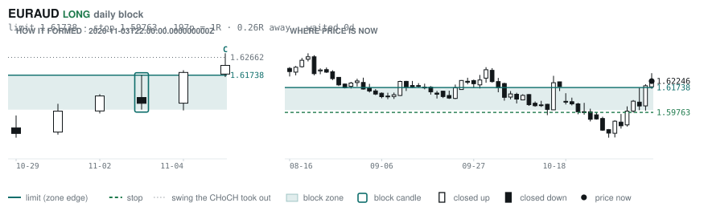
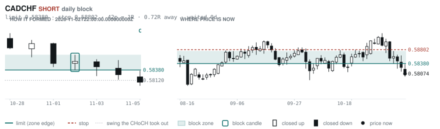
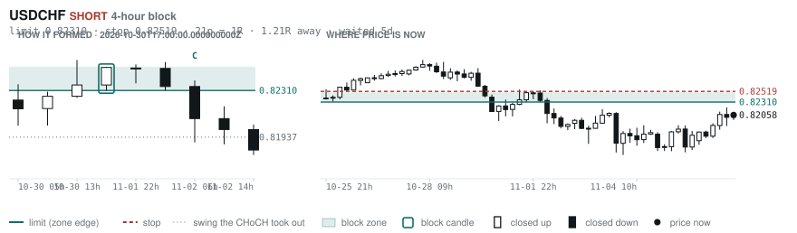
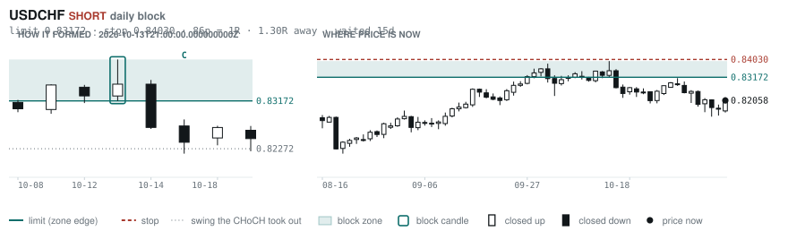
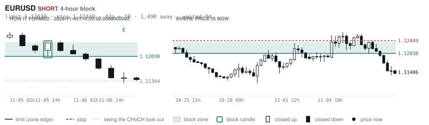

# Scanner Review — 2026-11-08 (evening)

Generated: 2026-11-09T00:00:37.466Z

```
## The clock

It is **18:00 Chicago** — a **DEAD** hour at 0.65x an average one.
An order placed now rests through **Tokyo, London and tomorrow's NY overlap** — about 16h of cover.
Next window: **Tokyo** in 1h.

_Evening pass. Orders placed now get the longest cover of the day: Tokyo, London, and tomorrow's NY overlap. Place limits and stops here — whatever does not fill overnight is still live for the morning._

## Where the energy is

**Running hot:** AUDCHF 1.45 · EURAUD 1.40 · GBPAUD 1.40 · AUDJPY 1.34 · AUDCAD 1.29 · AUDUSD 1.28 · CADCHF 1.28 · NZDCHF 1.26 · USDCHF 1.24 · GBPCHF 1.22 · AUDNZD 1.22 · EURNZD 1.20 · USDCAD 1.20 · NZDJPY 1.19 · GBPNZD 1.19 · EURUSD 1.16 · CADJPY 1.16 · NZDUSD 1.15
**Quiet:** _none_

_Volatility persists for about two days, so a hot pair stays hot. It says nothing about direction — this picks the pair, the levels pick the side._

## Account

NAV **$879.28**   unrealised $-185.90   margin available $188.03   2 open

| pair | units | now | P/L | stop | distance | news lean |
|---|---|---|---|---|---|---|
| EURCAD | 14000 | 1.57384 | $79.62 | **none** | — | — |
| EURCAD | 17000 | 1.57384 | $-265.52 | **none** | — | — |

**What the system reads on each position**

- **EURCAD** LONG — last CONTINUATION LONG 62h ago at 1.57060 — system stop 1.56253, target **1.62445** (Grade C); 506p to that target from here

## Order blocks live right now

### Daily

| pair | dir | limit | stop | 1R | spread | away | fills | waited | window | reaches 1R / 2R |
|---|---|---|---|---|---|---|---|---|---|---|
| EURAUD | LONG | **1.61738** | 1.59763 | 197p $13.56 | 2% | 0.3R | 94% | 0d | 1.08x | 68% / 39% |
| CADCHF | SHORT | **0.58380** | 0.58802 | 42p $5.15 | 6% | 0.7R | 87% | 0d | 0.83x ⚠ | 68% / 39% |
| USDCHF | SHORT | **0.83172** | 0.84030 | 86p $10.46 | 2% | 1.3R | 81% | 15d | 0.89x ⚠ | 78% / 46% |

_5 more live but further out, 2.2R to 7.5R away. They alert on their own when they come within 1R._
_Older blocks run further: 60+ days reaches 2R 58% of the time against 34% for a same-day fill._

### 4-hour

| pair | dir | limit | stop | 1R | spread | away | fills | waited | window | reaches 1R / 2R |
|---|---|---|---|---|---|---|---|---|---|---|
| USDCHF | SHORT | **0.82310** | 0.82519 | 21p $2.55 | 9% | 1.2R | 79% | 5d | 0.89x ⚠ | 77% / 47% |
| EURUSD | SHORT | **1.12030** | 1.12449 | 42p $4.19 | 4% | 1.5R | 79% | 0d | 0.90x ⚠ | 70% / 46% |

_16 more live but further out, 2.8R to 7.9R away. They alert on their own when they come within 1R._
_H4 stops are a third of a daily one, so spread bites three times as hard — a bolded spread figure is most of the edge gone before price moves._

### In reach, drawn

_5 blocks within 2R of the limit. Blocks further out are in the tables above but not worth a picture yet._

**EURAUD LONG** · daily · 0.26R away · waited 0d



**CADCHF SHORT** · daily · 0.72R away · waited 0d



**USDCHF SHORT** · 4-hour · 1.21R away · waited 5d



**USDCHF SHORT** · daily · 1.30R away · waited 15d



**EURUSD SHORT** · 4-hour · 1.49R away · waited 0d



_Left panel is the block forming, right is where price sits now. Legend is in each image._

## Scanner calls, last 1 day

_None._

## Running tally, last 30 days

7 resolved · 0 target / 7 stopped · **-7.0R** · -1.000R per call · 53 still open

```
