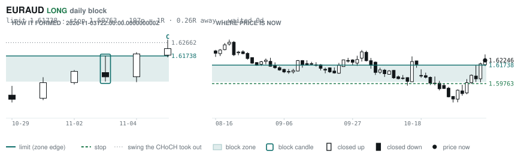
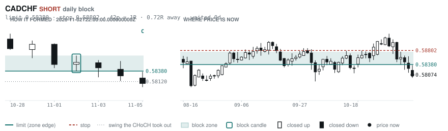
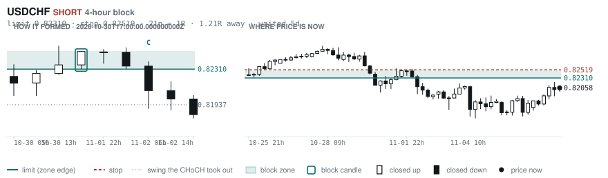
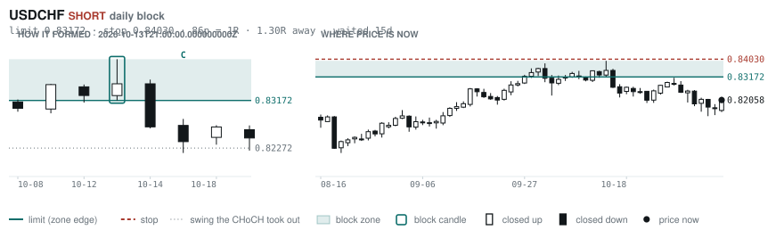
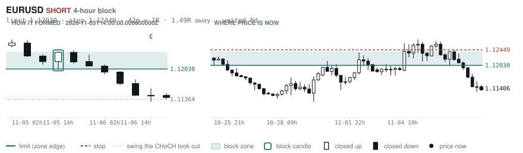

# Scanner Review — 2026-11-08 (weekly)

Generated: 2026-11-08T20:00:48.668Z

```
## The clock

It is **14:00 Chicago** — a **DEAD** hour at 0.74x an average one.
An order placed now rests through **tomorrow — the rest of today is dead**.
Next window: **Tokyo** in 5h.

## Where the energy is

**Running hot:** AUDCHF 1.45 · EURAUD 1.40 · GBPAUD 1.40 · AUDJPY 1.34 · AUDCAD 1.29 · AUDUSD 1.28 · CADCHF 1.28 · NZDCHF 1.26 · USDCHF 1.24 · GBPCHF 1.22 · AUDNZD 1.22 · EURNZD 1.20 · USDCAD 1.20 · NZDJPY 1.19 · GBPNZD 1.19 · EURUSD 1.16 · CADJPY 1.16 · NZDUSD 1.16
**Quiet:** _none_

_Volatility persists for about two days, so a hot pair stays hot. It says nothing about direction — this picks the pair, the levels pick the side._

## Account

NAV **$878.26**   unrealised $-186.92   margin available $187.48   2 open

| pair | units | now | P/L | stop | distance | news lean |
|---|---|---|---|---|---|---|
| EURCAD | 14000 | 1.57418 | $79.04 | **none** | — | — |
| EURCAD | 17000 | 1.57418 | $-265.96 | **none** | — | — |

**What the system reads on each position**

- **EURCAD** LONG — last CONTINUATION LONG 58h ago at 1.57060 — system stop 1.56253, target **1.62445** (Grade C); 503p to that target from here

## Order blocks live right now

### Daily

| pair | dir | limit | stop | 1R | spread | away | fills | waited | window | reaches 1R / 2R |
|---|---|---|---|---|---|---|---|---|---|---|
| EURAUD | LONG | **1.61738** | 1.59763 | 197p $13.56 | 9% | 0.3R | 94% | 0d | 1.34x | 68% / 39% |
| CADCHF | SHORT | **0.58380** | 0.58802 | 42p $5.15 | 17% | 0.7R | 87% | 0d | 1.56x | 68% / 39% |
| USDCHF | SHORT | **0.83172** | 0.84030 | 86p $10.46 | 6% | 1.3R | 81% | 15d | 1.54x | 78% / 46% |

_5 more live but further out, 2.2R to 7.5R away. They alert on their own when they come within 1R._
_Older blocks run further: 60+ days reaches 2R 58% of the time against 34% for a same-day fill._

### 4-hour

| pair | dir | limit | stop | 1R | spread | away | fills | waited | window | reaches 1R / 2R |
|---|---|---|---|---|---|---|---|---|---|---|
| USDCHF | SHORT | **0.82310** | 0.82519 | 21p $2.55 | **24%** | 1.2R | 79% | 5d | 1.54x | 77% / 47% |
| EURUSD | SHORT | **1.12030** | 1.12449 | 42p $4.19 | 5% | 1.5R | 79% | 0d | 1.53x | 70% / 46% |

_16 more live but further out, 2.8R to 7.9R away. They alert on their own when they come within 1R._
_H4 stops are a third of a daily one, so spread bites three times as hard — a bolded spread figure is most of the edge gone before price moves._

### In reach, drawn

_5 blocks within 2R of the limit. Blocks further out are in the tables above but not worth a picture yet._

**EURAUD LONG** · daily · 0.26R away · waited 0d



**CADCHF SHORT** · daily · 0.72R away · waited 0d



**USDCHF SHORT** · 4-hour · 1.21R away · waited 5d



**USDCHF SHORT** · daily · 1.30R away · waited 15d



**EURUSD SHORT** · 4-hour · 1.49R away · waited 0d



_Left panel is the block forming, right is where price sits now. Legend is in each image._

## Scanner calls, last 7 days

| when | pair | dir | branch | firing | entry | stop | target | outcome |
|---|---|---|---|---|---|---|---|---|
| 11-01T22:00 | GBPAUD | SHORT | REV | 1st ⚠ | 1.90422 | 1.92475 | 1.86649 | stopped -1.00R |
| 11-01T22:00 | USDCAD | LONG | REV | 5th | 1.39729 | 1.38937 | 1.48398 | open +1.99R |
| 11-01T22:00 | AUDJPY | LONG | REV | 2nd | 110.944 | 109.690 | 113.988 | stopped -1.00R |
| 11-02T02:00 | GBPUSD | LONG | REV | 1st ⚠ | 1.33984 | 1.33008 | 1.37014 | open -0.47R |
| 11-02T02:00 | EURCAD | LONG | REV | 1st ⚠ | 1.56344 | 1.54785 | 1.62445 | open +0.69R |
| 11-02T02:00 | GBPCHF | SHORT | REV | 1st ⚠ | 1.10325 | 1.11078 | 1.08540 | open +1.00R |
| 11-01T22:00 | GBPJPY | SHORT | REV | 3rd | 211.270 | 213.135 | 206.249 | stopped -1.00R |
| 11-02T02:00 | AUDCHF | SHORT | REV | 1st ⚠ | 0.57812 | 0.58554 | 0.55613 | open +1.98R |
| 11-02T02:00 | NZDJPY | SHORT | REV | 3rd | 88.614 | 89.646 | 87.497 | open +0.69R |
| 11-02T02:00 | EURJPY | SHORT | REV | 3rd | 176.458 | 177.695 | 172.228 | stopped -1.00R |
| 11-02T02:00 | CADCHF | SHORT | REV | 2nd | 0.58896 | 0.59368 | 0.57450 | open +1.74R |
| 11-02T02:00 | EURCHF | SHORT | REV | 11th | 0.92082 | 0.92568 | 0.90557 | open +1.37R |
| 11-02T06:00 | NZDUSD | SHORT | REV | 1st ⚠ | 0.56346 | 0.57083 | 0.51428 | open +1.21R |
| 11-02T06:00 | USDCHF | SHORT | REV | 1st ⚠ | 0.82086 | 0.83324 | 0.79880 | open +0.02R |
| 11-02T06:00 | EURUSD | LONG | REV | 4th | 1.12181 | 1.10958 | 1.14261 | open -0.63R |
| 11-02T06:00 | NZDJPY | SHORT | REV | 2nd | 88.998 | 89.900 | 87.497 | open +1.22R |
| 11-02T06:00 | AUDNZD | LONG | REV | 3rd | 1.24616 | 1.23688 | 1.26706 | stopped -1.00R |
| 11-01T22:00 | EURGBP | LONG | REV | 7th | 0.83426 | 0.83098 | 0.86717 | open +0.03R |
| 11-02T10:00 | EURCHF | SHORT | REV | 2nd | 0.91956 | 0.92676 | 0.90557 | open +0.75R |
| 11-02T10:00 | AUDJPY | SHORT | REV | 4th | 110.504 | 111.809 | 107.672 | open +1.28R |
| 11-02T10:00 | USDCAD | SHORT | REV | 9th | 1.39868 | 1.40633 | 1.36370 | stopped -1.00R |
| 11-02T10:00 | GBPJPY | SHORT | REV | 1st ⚠ | 211.672 | 213.348 | 206.249 | stopped -1.00R |
| 11-02T10:00 | EURJPY | SHORT | REV | 2nd | 176.994 | 178.407 | 172.228 | stopped -1.00R |
| 11-02T14:00 | NZDCHF | LONG | REV | 1st ⚠ | 0.46030 | 0.45547 | 0.48192 | stopped -1.00R |
| 11-02T14:00 | USDJPY | LONG | REV | 2nd | 157.818 | 156.476 | 159.665 | open +0.51R |
| 11-02T10:00 | NZDUSD | SHORT | REV | 4th | 0.56230 | 0.56888 | 0.51428 | open +1.18R |
| 11-02T14:00 | GBPAUD | SHORT | REV | 1st ⚠ | 1.91360 | 1.92800 | 1.86649 | stopped -1.00R |
| 11-02T18:00 | EURNZD | SHORT | REV | 1st ⚠ | 1.99186 | 2.00838 | 1.90601 | stopped -1.00R |
| 11-02T18:00 | AUDJPY | LONG | REV | 12th | 110.533 | 109.333 | 113.988 | stopped -1.00R |
| 11-02T18:00 | AUDCHF | LONG | REV | 4th | 0.57296 | 0.56712 | 0.59652 | stopped -1.00R |
| 11-02T18:00 | AUDNZD | LONG | REV | 4th | 1.24601 | 1.23737 | 1.29364 | stopped -1.00R |
| 11-02T22:00 | NZDJPY | SHORT | REV | 1st ⚠ | 88.532 | 89.654 | 85.876 | open +0.57R |
| 11-02T22:00 | NZDUSD | SHORT | REV | 1st ⚠ | 0.56067 | 0.56809 | 0.54493 | open +0.82R |
| 11-02T22:00 | GBPJPY | SHORT | REV | 1st ⚠ | 211.644 | 213.245 | 206.249 | stopped -1.00R |
| 11-02T22:00 | AUDCHF | LONG | REV | 1st ⚠ | 0.57330 | 0.56767 | 0.59652 | stopped -1.00R |
| 11-02T22:00 | AUDNZD | LONG | REV | 3rd | 1.24770 | 1.23967 | 1.29364 | stopped -1.00R |
| 11-03T02:00 | NZDCHF | LONG | REV | 2nd | 0.46027 | 0.45550 | 0.48192 | stopped -1.00R |
| 11-03T02:00 | GBPCAD | SHORT | REV | 1st ⚠ | 1.87354 | 1.88470 | 1.85129 | stopped -1.00R |
| 11-03T02:00 | GBPAUD | LONG | REV | 2nd | 1.92154 | 1.89735 | 1.95694 | open +0.95R |
| 11-03T02:00 | AUDUSD | SHORT | WALL | 2nd | 0.69796 | 0.70171 | 0.67750 | stopped -1.00R |
| 11-03T02:00 | AUDCHF | LONG | REV | 6th | 0.57092 | 0.56467 | 0.59652 | stopped -1.00R |
| 11-03T02:00 | EURJPY | LONG | REV | 2nd | 176.692 | 175.388 | 179.642 | open -0.08R |
| 11-03T02:00 | CADJPY | LONG | REV | 1st ⚠ | 113.006 | 112.110 | 115.222 | stopped -1.00R |
| 11-03T06:00 | USDJPY | LONG | REV | 3rd | 158.110 | 156.549 | 160.624 | open +0.26R |
| 11-03T06:00 | NZDCHF | LONG | REV | 2nd | 0.45996 | 0.45389 | 0.48192 | stopped -1.00R |
| 11-03T06:00 | NZDUSD | SHORT | REV | 5th | 0.56232 | 0.56906 | 0.54493 | open +1.15R |
| 11-03T06:00 | GBPCHF | LONG | REV | 4th | 1.09756 | 1.08834 | 1.11652 | open -0.20R |
| 11-03T06:00 | AUDCHF | LONG | REV | 1st ⚠ | 0.57066 | 0.56238 | 0.59652 | stopped -1.00R |
| 11-03T06:00 | EURUSD | SHORT | WALL | 2nd | 1.11910 | 1.12349 | 1.05714 | stopped -1.00R |
| 11-03T06:00 | EURGBP | LONG | REV | 8th | 0.83403 | 0.83110 | 0.86717 | open +0.11R |
| 11-03T10:00 | AUDCAD | LONG | REV | 1st ⚠ | 0.97760 | 0.96760 | 1.00292 | stopped -1.00R |
| 11-03T10:00 | EURCAD | LONG | REV | 4th | 1.56522 | 1.55298 | 1.62445 | open +0.73R |
| 11-03T10:00 | AUDNZD | LONG | REV | 9th | 1.24425 | 1.23191 | 1.29364 | open -0.48R |
| 11-03T14:00 | NZDCHF | LONG | REV | 3rd | 0.46078 | 0.45534 | 0.48192 | stopped -1.00R |
| 11-03T10:00 | NZDUSD | SHORT | REV | 6th | 0.56181 | 0.56893 | 0.54493 | open +1.02R |
| 11-03T14:00 | EURNZD | LONG | REV | 2nd | 1.99363 | 1.97715 | 2.01019 | target +1.00R |
| 11-03T14:00 | USDCHF | SHORT | REV | 6th | 0.82053 | 0.82927 | 0.79880 | open -0.01R |
| 11-03T14:00 | EURCHF | SHORT | REV | 5th | 0.91856 | 0.92485 | 0.90557 | open +0.70R |
| 11-03T10:00 | USDJPY | SHORT | REV | 14th | 158.128 | 159.412 | 153.546 | open -0.30R |
| 11-03T18:00 | NZDUSD | SHORT | REV | 1st ⚠ | 0.55868 | 0.56687 | 0.54493 | open +0.50R |
| 11-03T18:00 | USDJPY | SHORT | REV | 5th | 158.710 | 159.761 | 153.546 | open +0.19R |
| 11-03T18:00 | EURJPY | SHORT | REV | 1st ⚠ | 177.614 | 178.837 | 172.228 | open +0.84R |
| 11-03T14:00 | AUDUSD | SHORT | WALL | 3rd | 0.69712 | 0.70095 | 0.67750 | stopped -1.00R |
| 11-03T22:00 | GBPCAD | SHORT | REV | 1st ⚠ | 1.88050 | 1.89158 | 1.83108 | open -0.57R |
| 11-03T22:00 | USDJPY | SHORT | REV | 1st ⚠ | 157.633 | 159.400 | 153.546 | open -0.50R |
| 11-03T22:00 | EURCHF | SHORT | REV | 6th | 0.91615 | 0.92232 | 0.90557 | open +0.32R |
| 11-03T22:00 | USDCHF | SHORT | REV | 1st ⚠ | 0.81505 | 0.82690 | 0.79880 | open -0.47R |
| 11-03T22:00 | GBPJPY | SHORT | REV | 1st ⚠ | 212.236 | 214.379 | 206.249 | open +0.27R |
| 11-03T22:00 | AUDJPY | SHORT | WALL | 1st ⚠ | 109.902 | 110.600 | 107.672 | stopped -1.00R |
| 11-03T22:00 | AUDJPY | SHORT | REV | 3rd | 109.902 | 111.815 | 107.672 | open +0.56R |
| 11-03T22:00 | CADJPY | SHORT | REV | 1st ⚠ | 112.863 | 114.101 | 110.284 | open +0.56R |
| 11-03T22:00 | EURUSD | LONG | REV | 5th | 1.12404 | 1.10951 | 1.14261 | open -0.69R |
| 11-03T22:00 | CHFJPY | SHORT | REV | 1st ⚠ | 193.406 | 195.758 | 187.587 | open +0.10R |
| 11-03T22:00 | AUDCHF | SHORT | REV | 2nd | 0.56824 | 0.57787 | 0.55613 | open +0.50R |
| 11-03T22:00 | NZDJPY | SHORT | REV | 5th | 88.322 | 89.709 | 85.876 | open +0.31R |
| 11-03T22:00 | EURAUD | SHORT | REV | 4th | 1.61228 | 1.62574 | 1.52860 | stopped -1.00R |
| 11-04T02:00 | NZDCHF | LONG | REV | 2nd | 0.45783 | 0.45114 | 0.48192 | open -0.42R |
| 11-04T06:00 | NZDCHF | LONG | REV | 4th | 0.46022 | 0.45470 | 0.48192 | stopped -1.00R |
| 11-04T06:00 | EURCHF | SHORT | REV | 3rd | 0.91919 | 0.92517 | 0.90557 | open +0.84R |
| 11-04T06:00 | EURNZD | SHORT | REV | 1st ⚠ | 1.99726 | 2.01799 | 1.90601 | open -0.57R |
| 11-04T06:00 | AUDCAD | LONG | REV | 1st ⚠ | 0.97855 | 0.96721 | 1.00292 | stopped -1.00R |
| 11-04T06:00 | NZDUSD | LONG | REV | 2nd | 0.56365 | 0.55589 | 0.58552 | stopped -1.00R |
| 11-04T06:00 | EURAUD | SHORT | REV | 2nd | 1.60486 | 1.61961 | 1.52860 | stopped -1.00R |
| 11-04T06:00 | AUDUSD | LONG | REV | 4th | 0.70149 | 0.69302 | 0.72420 | stopped -1.00R |
| 11-04T06:00 | AUDNZD | LONG | REV | 2nd | 1.24454 | 1.23447 | 1.29364 | open -0.62R |
| 11-04T06:00 | NZDJPY | LONG | REV | 2nd | 89.290 | 87.838 | 92.395 | stopped -1.00R |
| 11-04T02:00 | NZDJPY | LONG | REV | 12th | 88.565 | 87.301 | 92.395 | open -0.53R |
| 11-04T06:00 | EURGBP | LONG | REV | 10th | 0.83452 | 0.82965 | 0.86717 | open -0.03R |
| 11-04T10:00 | CHFJPY | SHORT | REV | 7th | 194.170 | 195.724 | 187.587 | open +0.65R |
| 11-04T14:00 | GBPJPY | SHORT | REV | 3rd | 213.234 | 215.016 | 206.249 | open +0.89R |
| 11-04T14:00 | AUDJPY | SHORT | REV | 7th | 111.046 | 112.317 | 107.672 | open +1.74R |
| 11-04T14:00 | CHFJPY | SHORT | REV | 2nd | 193.778 | 195.839 | 187.587 | open +0.30R |
| 11-04T14:00 | EURJPY | SHORT | REV | 2nd | 177.841 | 179.504 | 172.228 | open +0.75R |
| 11-04T18:00 | GBPUSD | LONG | REV | 1st ⚠ | 1.34721 | 1.33760 | 1.37014 | stopped -1.00R |
| 11-04T18:00 | AUDUSD | SHORT | REV | 2nd | 0.70060 | 0.70759 | 0.67750 | open +1.99R |
| 11-04T18:00 | NZDJPY | SHORT | REV | 2nd | 89.048 | 90.051 | 85.876 | open +1.15R |
| 11-04T18:00 | AUDCHF | SHORT | REV | 5th | 0.57250 | 0.57914 | 0.55613 | open +1.36R |
| 11-04T18:00 | EURUSD | LONG | REV | 3rd | 1.12289 | 1.11429 | 1.14261 | stopped -1.00R |
| 11-04T14:00 | EURGBP | SHORT | REV | 1st ⚠ | 0.83402 | 0.83782 | 0.82418 | open -0.09R |
| 11-04T22:00 | GBPUSD | LONG | REV | 1st ⚠ | 1.34887 | 1.33729 | 1.37014 | stopped -1.00R |
| 11-04T22:00 | USDJPY | SHORT | REV | 16th | 158.073 | 159.593 | 155.574 | open -0.29R |
| 11-04T22:00 | AUDCAD | SHORT | REV | 8th | 0.97875 | 0.98665 | 0.96059 | open +1.07R |
| 11-04T22:00 | GBPJPY | SHORT | REV | 1st ⚠ | 213.218 | 215.006 | 206.249 | open +0.88R |
| 11-04T22:00 | EURUSD | LONG | REV | 1st ⚠ | 1.12548 | 1.11439 | 1.14261 | stopped -1.00R |
| 11-04T22:00 | AUDNZD | LONG | REV | 3rd | 1.24400 | 1.23508 | 1.29364 | open -0.64R |
| 11-04T22:00 | EURAUD | SHORT | WALL | 2nd | 1.60441 | 1.61140 | 1.52860 | stopped -1.00R |
| 11-05T02:00 | NZDUSD | SHORT | REV | 1st ⚠ | 0.56396 | 0.57161 | 0.54493 | open +1.23R |
| 11-05T02:00 | AUDCAD | SHORT | REV | 1st ⚠ | 0.97773 | 0.98659 | 0.96059 | open +0.84R |
| 11-05T02:00 | CHFJPY | SHORT | REV | 3rd | 193.878 | 195.748 | 187.587 | open +0.38R |
| 11-05T02:00 | GBPAUD | LONG | REV | 2nd | 1.92464 | 1.90916 | 1.95694 | open +1.29R |
| 11-05T02:00 | EURAUD | LONG | REV | 2nd | 1.60666 | 1.59266 | 1.65776 | open +1.13R |
| 11-05T06:00 | NZDCHF | LONG | REV | 5th | 0.46064 | 0.45484 | 0.48192 | stopped -1.00R |
| 11-05T06:00 | GBPCAD | SHORT | REV | 3rd | 1.87876 | 1.89101 | 1.83108 | open -0.66R |
| 11-05T06:00 | NZDJPY | LONG | REV | 3rd | 89.240 | 87.905 | 92.395 | stopped -1.00R |
| 11-05T06:00 | CADCHF | LONG | REV | 6th | 0.58572 | 0.58039 | 0.60486 | stopped -1.00R |
| 11-05T06:00 | EURGBP | SHORT | REV | 2nd | 0.83422 | 0.83770 | 0.82418 | open -0.04R |
| 11-05T10:00 | GBPCAD | LONG | REV | 3rd | 1.88194 | 1.86765 | 1.91646 | open +0.34R |
| 11-05T10:00 | GBPCHF | LONG | REV | 7th | 1.10101 | 1.09315 | 1.11572 | open -0.68R |
| 11-05T10:00 | GBPAUD | LONG | REV | 3rd | 1.92200 | 1.90332 | 1.95694 | open +1.21R |
| 11-05T14:00 | GBPUSD | LONG | REV | 2nd | 1.34828 | 1.33723 | 1.37014 | stopped -1.00R |
| 11-05T14:00 | GBPCAD | LONG | WALL | 1st ⚠ | 1.88540 | 1.87976 | 1.91646 | open +0.25R |
| 11-05T14:00 | USDCAD | SHORT | REV | 1st ⚠ | 1.39854 | 1.40775 | 1.36370 | stopped -1.00R |
| 11-05T14:00 | AUDJPY | SHORT | WALL | 2nd | 109.624 | 110.638 | 107.672 | open +0.77R |
| 11-05T14:00 | NZDCHF | LONG | REV | 1st ⚠ | 0.45704 | 0.45089 | 0.48192 | open -0.33R |
| 11-05T14:00 | CADJPY | SHORT | REV | 2nd | 112.778 | 114.146 | 110.284 | open +0.44R |
| 11-05T14:00 | EURCHF | SHORT | REV | 4th | 0.91528 | 0.92283 | 0.90557 | open +0.15R |
| 11-05T14:00 | EURJPY | SHORT | REV | 3rd | 177.256 | 179.049 | 172.184 | open +0.37R |
| 11-05T14:00 | EURUSD | LONG | REV | 1st ⚠ | 1.12398 | 1.11439 | 1.14261 | stopped -1.00R |
| 11-05T18:00 | EURNZD | SHORT | REV | 1st ⚠ | 2.00540 | 2.02581 | 1.90601 | open -0.18R |
| 11-05T18:00 | CADCHF | SHORT | REV | 7th | 0.58262 | 0.58872 | 0.57450 | open +0.31R |
| 11-05T18:00 | EURCHF | SHORT | REV | 9th | 0.91622 | 0.92283 | 0.90557 | open +0.31R |
| 11-05T18:00 | AUDUSD | SHORT | WALL | 1st ⚠ | 0.69300 | 0.69927 | 0.67750 | open +1.01R |
| 11-05T18:00 | NZDUSD | SHORT | WALL | 3rd | 0.55942 | 0.56395 | 0.54493 | open +1.07R |
| 11-05T18:00 | AUDJPY | SHORT | WALL | 1st ⚠ | 109.294 | 110.010 | 107.672 | open +0.63R |
| 11-05T18:00 | EURJPY | SHORT | WALL | 4th | 176.932 | 177.663 | 172.184 | open +0.47R |
| 11-05T22:00 | EURCHF | SHORT | REV | 1st ⚠ | 0.91610 | 0.92287 | 0.90557 | open +0.29R |
| 11-05T22:00 | GBPJPY | LONG | REV | 2nd | 212.344 | 209.897 | 215.624 | open -0.28R |
| 11-05T22:00 | CHFJPY | LONG | REV | 4th | 193.254 | 191.435 | 195.117 | open -0.05R |
| 11-06T02:00 | NZDUSD | SHORT | WALL | 1st ⚠ | 0.55598 | 0.56078 | 0.54493 | open +0.30R |
| 11-06T02:00 | NZDJPY | LONG | REV | 5th | 87.724 | 86.649 | 92.395 | open +0.16R |
| 11-06T02:00 | AUDUSD | SHORT | WALL | 1st ⚠ | 0.68871 | 0.69253 | 0.67750 | open +0.53R |
| 11-06T06:00 | GBPCHF | LONG | REV | 1st ⚠ | 1.09563 | 1.08734 | 1.11572 | open +0.01R |
| 11-06T06:00 | NZDJPY | LONG | REV | 7th | 87.764 | 86.512 | 92.395 | open +0.11R |
| 11-06T06:00 | GBPCAD | SHORT | REV | 1st ⚠ | 1.88447 | 1.89512 | 1.83108 | open -0.22R |
| 11-06T06:00 | USDCHF | LONG | REV | 2nd | 0.81852 | 0.80909 | 0.84348 | open +0.22R |
| 11-06T06:00 | GBPAUD | SHORT | REV | 1st ⚠ | 1.94856 | 1.96700 | 1.84868 | open +0.22R |
| 11-06T10:00 | EURCAD | LONG | REV | 4th | 1.57216 | 1.55733 | 1.62445 | open +0.14R |
| 11-06T10:00 | CADCHF | SHORT | REV | 2nd | 0.58177 | 0.58859 | 0.57450 | open +0.15R |
| 11-06T10:00 | EURCHF | SHORT | REV | 1st ⚠ | 0.91464 | 0.92089 | 0.90557 | open +0.08R |
| 11-06T10:00 | CADJPY | SHORT | REV | 1st ⚠ | 112.308 | 113.684 | 110.284 | open +0.10R |
| 11-06T10:00 | AUDUSD | SHORT | WALL | 1st ⚠ | 0.68638 | 0.68986 | 0.67750 | open -0.09R |
| 11-06T10:00 | EURGBP | SHORT | REV | 4th | 0.83432 | 0.83788 | 0.82418 | open -0.01R |
| 11-06T10:00 | CHFJPY | LONG | REV | 1st ⚠ | 193.046 | 191.444 | 195.117 | open +0.07R |
| 11-06T10:00 | AUDNZD | SHORT | REV | 3rd | 1.24014 | 1.24857 | 1.20438 | open +0.22R |
| 11-06T14:00 | EURNZD | SHORT | REV | 6th | 2.01080 | 2.03304 | 1.90601 | open +0.08R |
| 11-06T14:00 | GBPUSD | LONG | REV | 3rd | 1.33504 | 1.32556 | 1.37014 | open +0.02R |
| 11-06T14:00 | NZDJPY | LONG | REV | 6th | 87.724 | 86.660 | 92.395 | open +0.16R |
| 11-06T14:00 | EURUSD | SHORT | WALL | 4th | 1.11451 | 1.12109 | 1.09397 | open +0.07R |
| 11-06T14:00 | AUDNZD | SHORT | REV | 3rd | 1.23810 | 1.25014 | 1.20438 | open -0.01R |
| 11-06T14:00 | NZDCHF | LONG | REV | 2nd | 0.45456 | 0.44939 | 0.48192 | open +0.09R |

## Running tally, last 30 days

36 resolved · 1 target / 35 stopped · **-33.4R** · -0.929R per call · 24 still open

```
