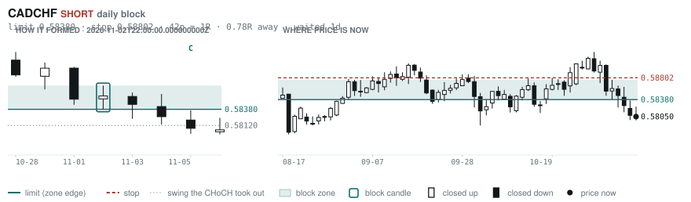
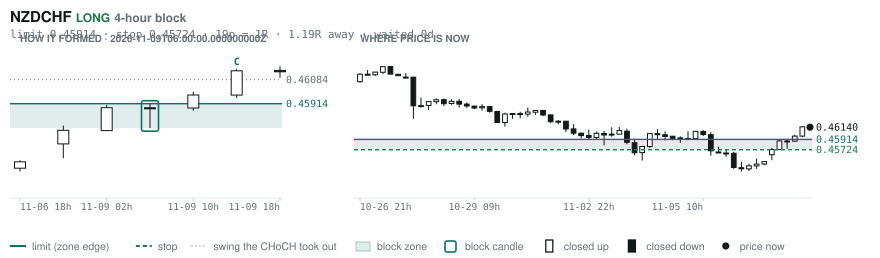
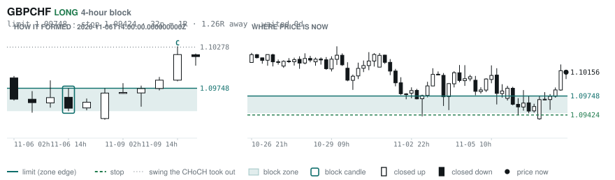
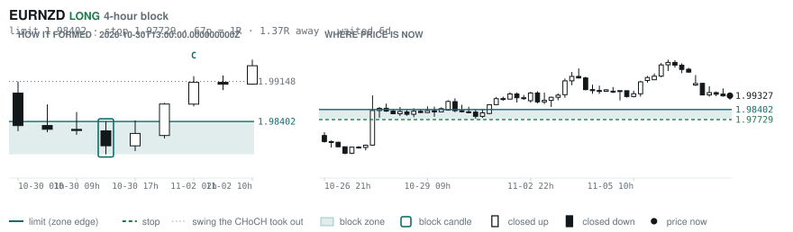
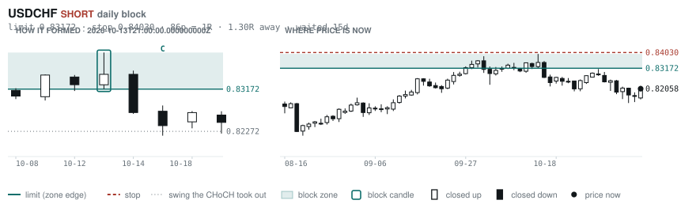
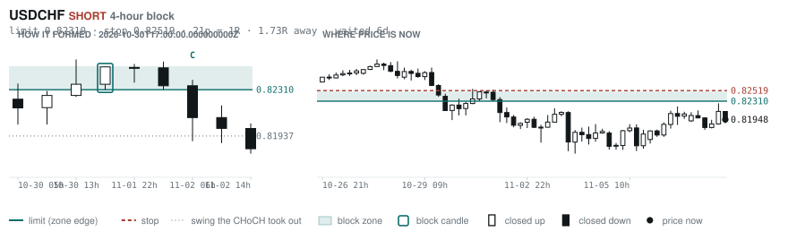

# Scanner Review — 2026-11-09 (evening)

Generated: 2026-11-10T00:00:39.973Z

```
## The clock

It is **18:00 Chicago** — a **DEAD** hour at 0.65x an average one.
An order placed now rests through **Tokyo, London and tomorrow's NY overlap** — about 16h of cover.
Next window: **Tokyo** in 1h.

_Evening pass. Orders placed now get the longest cover of the day: Tokyo, London, and tomorrow's NY overlap. Place limits and stops here — whatever does not fill overnight is still live for the morning._

## Where the energy is

**Running hot:** AUDCHF 1.33 · GBPAUD 1.31 · EURAUD 1.28 · AUDCAD 1.25 · AUDUSD 1.23 · AUDNZD 1.23 · NZDCHF 1.22 · AUDJPY 1.21 · GBPCHF 1.19 · GBPNZD 1.18 · EURNZD 1.17 · USDCHF 1.17 · CADCHF 1.16 · USDCAD 1.15 · EURCHF 1.15
**Quiet:** _none_

_Volatility persists for about two days, so a hot pair stays hot. It says nothing about direction — this picks the pair, the levels pick the side._

## Account

NAV **$1173.62**   unrealised $108.44   margin available $28.86   4 open

| pair | units | now | P/L | stop | distance | news lean |
|---|---|---|---|---|---|---|
| EURCAD | 9000 | 1.58444 | $3.57 | 1.57288 | 116p | — |
| EURCAD | 11000 | 1.58444 | $57.80 | 1.57288 | 116p | — |
| EURCAD | 14000 | 1.58444 | $184.82 | 1.57288 | 116p | — |
| EURCAD | 17000 | 1.58444 | $-137.75 | 1.57288 | 116p | — |

**What the system reads on each position**

- **EURCAD** LONG — last CONTINUATION LONG 14h ago at 1.57295 — system stop 1.56391, target **1.62445** (Grade B); 400p to that target from here

## Order blocks live right now

### Daily

| pair | dir | limit | stop | 1R | spread | away | fills | waited | window | reaches 1R / 2R |
|---|---|---|---|---|---|---|---|---|---|---|
| CADCHF | SHORT | **0.58380** | 0.58802 | 42p $5.15 | 5% | 0.8R | 87% | 1d | 0.83x ⚠ | 68% / 39% |
| USDCHF | SHORT | **0.83172** | 0.84030 | 86p $10.47 | 2% | 1.4R | 81% | 16d | 0.89x ⚠ | 78% / 46% |

_5 more live but further out, 3.0R to 6.1R away. They alert on their own when they come within 1R._
_Older blocks run further: 60+ days reaches 2R 58% of the time against 34% for a same-day fill._

### 4-hour

| pair | dir | limit | stop | 1R | spread | away | fills | waited | window | reaches 1R / 2R |
|---|---|---|---|---|---|---|---|---|---|---|
| NZDCHF | LONG | **0.45914** | 0.45724 | 19p $2.32 | 20% | 1.2R | 79% | 0d | 1.03x | 70% / 46% |
| GBPCHF | LONG | **1.09748** | 1.09424 | 32p $3.96 | 14% | 1.3R | 79% | 0d | 0.86x ⚠ | 70% / 46% |
| EURNZD | LONG | **1.98402** | 1.97729 | 67p $3.79 | 12% | 1.4R | 79% | 6d | 1.06x | 77% / 47% |
| USDCHF | SHORT | **0.82310** | 0.82519 | 21p $2.55 | 8% | 1.7R | 79% | 6d | 0.89x ⚠ | 77% / 47% |

_18 more live but further out, 2.9R to 7.5R away. They alert on their own when they come within 1R._
_H4 stops are a third of a daily one, so spread bites three times as hard — a bolded spread figure is most of the edge gone before price moves._

### In reach, drawn

_6 blocks within 2R of the limit. Blocks further out are in the tables above but not worth a picture yet._

**CADCHF SHORT** · daily · 0.78R away · waited 1d



**NZDCHF LONG** · 4-hour · 1.19R away · waited 0d



**GBPCHF LONG** · 4-hour · 1.26R away · waited 0d



**EURNZD LONG** · 4-hour · 1.37R away · waited 6d



**USDCHF SHORT** · daily · 1.43R away · waited 16d



**USDCHF SHORT** · 4-hour · 1.73R away · waited 6d



_Left panel is the block forming, right is where price sits now. Legend is in each image._

## Scanner calls, last 1 day

| when | pair | dir | branch | firing | entry | stop | target | outcome |
|---|---|---|---|---|---|---|---|---|
| 11-09T02:00 | EURCHF | SHORT | REV | 3rd | 0.91486 | 0.92069 | 0.90557 | stopped -1.00R |
| 11-09T02:00 | USDCHF | SHORT | REV | 1st ⚠ | 0.81980 | 0.82891 | 0.79880 | open +0.04R |
| 11-09T02:00 | AUDUSD | SHORT | REV | 2nd | 0.68883 | 0.69623 | 0.67750 | open -0.51R |
| 11-09T06:00 | EURJPY | LONG | REV | 5th | 176.894 | 175.327 | 179.642 | open +0.21R |
| 11-09T06:00 | USDCAD | SHORT | REV | 3rd | 1.40804 | 1.41758 | 1.36370 | open -0.39R |
| 11-09T10:00 | USDJPY | SHORT | REV | 1st ⚠ | 157.919 | 159.507 | 155.574 | open +0.01R |
| 11-09T10:00 | EURCAD | LONG | REV | 1st ⚠ | 1.57892 | 1.56391 | 1.62445 | open +0.37R |
| 11-09T10:00 | AUDCAD | SHORT | REV | 4th | 0.97250 | 0.98177 | 0.96059 | open -0.56R |
| 11-09T10:00 | CADJPY | SHORT | REV | 2nd | 112.022 | 113.311 | 110.284 | open +0.12R |
| 11-09T10:00 | EURAUD | LONG | REV | 2nd | 1.62358 | 1.60569 | 1.65776 | open -0.17R |
| 11-09T14:00 | AUDCHF | LONG | REV | 1st ⚠ | 0.56770 | 0.55657 | 0.60005 | open -0.01R |
| 11-09T14:00 | EURUSD | SHORT | REV | 3rd | 1.12032 | 1.12950 | 1.09397 | open -0.22R |
| 11-09T14:00 | EURGBP | SHORT | REV | 1st ⚠ | 0.83488 | 0.83795 | 0.82418 | open -0.04R |
| 11-09T14:00 | AUDNZD | LONG | REV | 3rd | 1.23004 | 1.22068 | 1.29364 | open +0.01R |
| 11-09T18:00 | EURNZD | LONG | REV | 4th | 1.99327 | 1.97696 | 2.01019 | open +0.00R |
| 11-09T18:00 | AUDJPY | SHORT | REV | 2nd | 109.370 | 110.691 | 107.672 | open +0.00R |
| 11-09T18:00 | USDCAD | SHORT | REV | 3rd | 1.41176 | 1.42077 | 1.37910 | open +0.00R |

## Running tally, last 30 days

12 resolved · 0 target / 12 stopped · **-12.0R** · -1.000R per call · 48 still open

```
