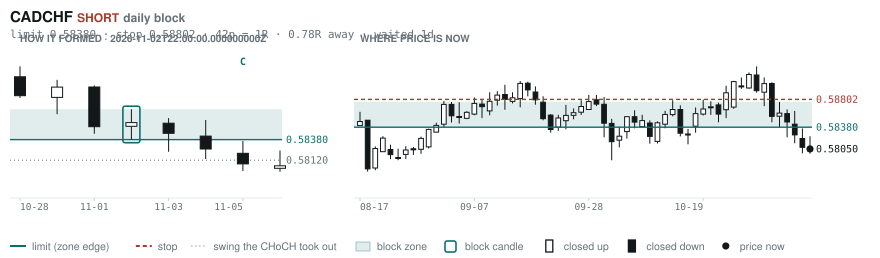
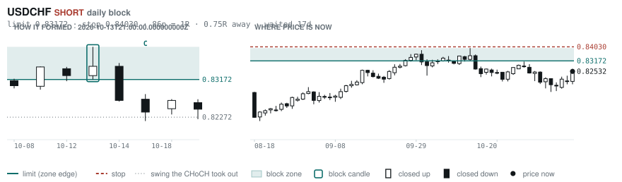
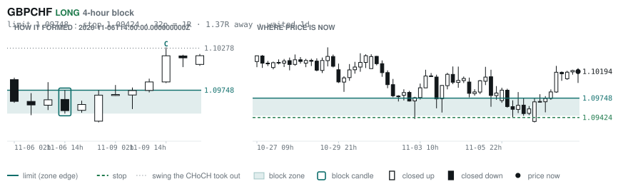
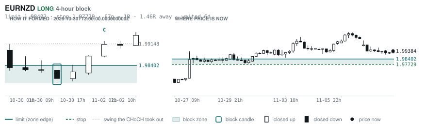
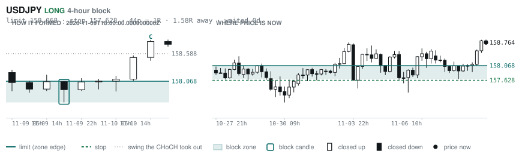
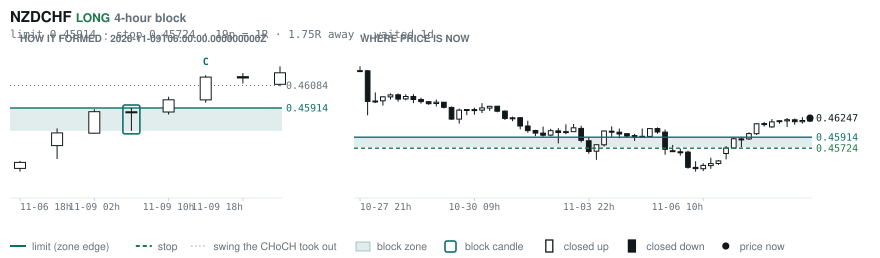

# Scanner Review — 2026-11-10 (evening)

Generated: 2026-11-11T00:00:45.840Z

```
## The clock

It is **18:00 Chicago** — a **DEAD** hour at 0.65x an average one.
An order placed now rests through **Tokyo, London and tomorrow's NY overlap** — about 16h of cover.
Next window: **Tokyo** in 1h.

_Evening pass. Orders placed now get the longest cover of the day: Tokyo, London, and tomorrow's NY overlap. Place limits and stops here — whatever does not fill overnight is still live for the morning._

## Where the energy is

**Running hot:** AUDUSD 1.24 · GBPAUD 1.19 · AUDCAD 1.17 · USDCAD 1.17 · EURAUD 1.17 · AUDNZD 1.15
**Quiet:** _none_

_Volatility persists for about two days, so a hot pair stays hot. It says nothing about direction — this picks the pair, the levels pick the side._

## Account

NAV **$1169.34**   unrealised $105.76   margin available $30.10   4 open

| pair | units | now | P/L | stop | distance | news lean |
|---|---|---|---|---|---|---|
| EURCAD | 9000 | 1.58441 | $3.17 | 1.57288 | 115p | — |
| EURCAD | 11000 | 1.58441 | $57.06 | 1.57288 | 115p | — |
| EURCAD | 14000 | 1.58441 | $183.34 | 1.57288 | 115p | — |
| EURCAD | 17000 | 1.58441 | $-137.81 | 1.57288 | 115p | — |

**What the system reads on each position**

- **EURCAD** LONG — last CONTINUATION LONG 14h ago at 1.58046 — system stop 1.57067, target **1.62445** (Grade B); 400p to that target from here

## Order blocks live right now

### Daily

| pair | dir | limit | stop | 1R | spread | away | fills | waited | window | reaches 1R / 2R |
|---|---|---|---|---|---|---|---|---|---|---|
| CADCHF | SHORT | **0.58380** | 0.58802 | 42p $5.12 | 6% | 0.5R | 94% | 2d | 0.83x ⚠ | 68% / 39% |
| USDCHF | SHORT | **0.83172** | 0.84030 | 86p $10.40 | 2% | 0.7R | 87% | 17d | 0.89x ⚠ | 78% / 46% |

_5 more live but further out, 3.0R to 7.1R away. They alert on their own when they come within 1R._
_Older blocks run further: 60+ days reaches 2R 58% of the time against 34% for a same-day fill._

### 4-hour

| pair | dir | limit | stop | 1R | spread | away | fills | waited | window | reaches 1R / 2R |
|---|---|---|---|---|---|---|---|---|---|---|
| GBPCHF | LONG | **1.09748** | 1.09424 | 32p $3.93 | 14% | 1.2R | 79% | 1d | 0.86x ⚠ | 70% / 46% |
| EURNZD | LONG | **1.98402** | 1.97729 | 67p $3.77 | 13% | 1.2R | 79% | 7d | 1.06x | 78% / 51% |
| USDJPY | LONG | **158.068** | 157.628 | 44p $2.77 | 4% | 1.6R | 79% | 0d | 1.04x | 70% / 46% |
| NZDCHF | LONG | **0.45914** | 0.45724 | 19p $2.31 | **20%** | 1.7R | 79% | 1d | 1.03x | 70% / 46% |

_21 more live but further out, 3.0R to 7.7R away. They alert on their own when they come within 1R._
_H4 stops are a third of a daily one, so spread bites three times as hard — a bolded spread figure is most of the edge gone before price moves._

### In reach, drawn

_6 blocks within 2R of the limit. Blocks further out are in the tables above but not worth a picture yet._

**CADCHF SHORT** · daily · 0.49R away · waited 2d



**USDCHF SHORT** · daily · 0.75R away · waited 17d



**GBPCHF LONG** · 4-hour · 1.22R away · waited 1d



**EURNZD LONG** · 4-hour · 1.24R away · waited 7d



**USDJPY LONG** · 4-hour · 1.58R away · waited 0d



**NZDCHF LONG** · 4-hour · 1.75R away · waited 1d



_Left panel is the block forming, right is where price sits now. Legend is in each image._

## Scanner calls, last 1 day

| when | pair | dir | branch | firing | entry | stop | target | outcome |
|---|---|---|---|---|---|---|---|---|
| 11-10T06:00 | NZDUSD | SHORT | REV | 1st ⚠ | 0.56308 | 0.57134 | 0.54493 | open +0.33R |
| 11-10T06:00 | USDJPY | LONG | REV | 5th | 158.107 | 156.647 | 160.574 | open +0.45R |
| 11-10T06:00 | CADCHF | LONG | REV | 8th | 0.58059 | 0.57497 | 0.60486 | open +0.20R |
| 11-10T06:00 | GBPJPY | SHORT | REV | 2nd | 212.264 | 214.398 | 206.249 | open +0.18R |
| 11-10T06:00 | USDCHF | LONG | REV | 1st ⚠ | 0.82080 | 0.80983 | 0.84348 | open +0.41R |
| 11-10T06:00 | EURJPY | SHORT | REV | 2nd | 177.502 | 178.818 | 172.184 | open +0.18R |
| 11-10T06:00 | NZDJPY | SHORT | REV | 2nd | 89.026 | 89.990 | 85.876 | open +0.08R |
| 11-10T06:00 | AUDJPY | SHORT | REV | 3rd | 109.297 | 110.594 | 107.672 | open +0.22R |
| 11-10T06:00 | CHFJPY | SHORT | REV | 4th | 192.622 | 194.823 | 187.587 | open +0.12R |
| 11-10T10:00 | EURCHF | SHORT | REV | 4th | 0.92054 | 0.92718 | 0.90557 | open -0.14R |
| 11-10T10:00 | NZDCHF | LONG | REV | 6th | 0.46183 | 0.45704 | 0.48192 | open +0.13R |
| 11-10T10:00 | GBPCHF | LONG | REV | 9th | 1.10205 | 1.09333 | 1.11572 | open -0.07R |
| 11-10T10:00 | USDCHF | LONG | REV | 3rd | 0.82290 | 0.81304 | 0.84348 | open +0.25R |
| 11-10T10:00 | AUDCAD | SHORT | REV | 5th | 0.97367 | 0.98478 | 0.96059 | open -0.05R |
| 11-10T10:00 | EURUSD | SHORT | REV | 4th | 1.11865 | 1.12950 | 1.09397 | open +0.20R |
| 11-10T10:00 | USDCAD | SHORT | REV | 4th | 1.41720 | 1.42685 | 1.37910 | open -0.17R |
| 11-10T10:00 | AUDUSD | SHORT | WALL | 3rd | 0.68704 | 0.69251 | 0.67750 | open +0.08R |
| 11-10T10:00 | CADJPY | SHORT | REV | 1st ⚠ | 111.852 | 112.693 | 110.284 | open -0.05R |
| 11-10T10:00 | EURGBP | SHORT | REV | 2nd | 0.83530 | 0.83879 | 0.82418 | open -0.38R |
| 11-10T10:00 | GBPCAD | LONG | REV | 1st ⚠ | 1.89796 | 1.88788 | 1.91646 | open -0.45R |
| 11-10T14:00 | NZDUSD | SHORT | WALL | 3rd | 0.55926 | 0.56575 | 0.54493 | open -0.17R |
| 11-10T14:00 | AUDCHF | SHORT | REV | 1st ⚠ | 0.56628 | 0.57308 | 0.55613 | open -0.06R |
| 11-10T14:00 | GBPJPY | SHORT | REV | 1st ⚠ | 211.752 | 213.810 | 206.249 | open -0.06R |
| 11-10T14:00 | CADCHF | LONG | REV | 4th | 0.58228 | 0.57695 | 0.60486 | open -0.11R |
| 11-10T14:00 | AUDUSD | SHORT | WALL | 1st ⚠ | 0.68550 | 0.68988 | 0.67750 | open -0.26R |
| 11-10T14:00 | GBPAUD | SHORT | REV | 2nd | 1.94513 | 1.96610 | 1.84868 | open +0.07R |
| 11-10T18:00 | NZDCHF | LONG | REV | 1st ⚠ | 0.46247 | 0.45739 | 0.48192 | open +0.00R |
| 11-10T18:00 | EURNZD | SHORT | REV | 3rd | 1.99236 | 2.00812 | 1.90601 | open +0.00R |
| 11-10T18:00 | GBPCAD | LONG | REV | 2nd | 1.89347 | 1.88291 | 1.91646 | open +0.00R |
| 11-10T10:00 | EURJPY | LONG | WALL | 6th | 177.326 | 176.764 | 181.884 | open -0.11R |

## Running tally, last 30 days

12 resolved · 0 target / 12 stopped · **-12.0R** · -1.000R per call · 48 still open

```
