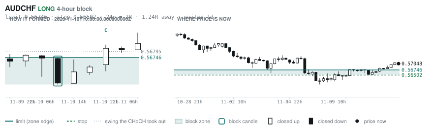
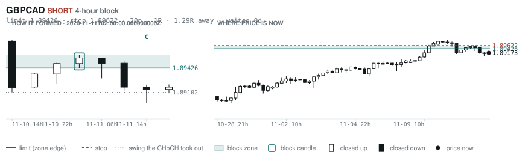
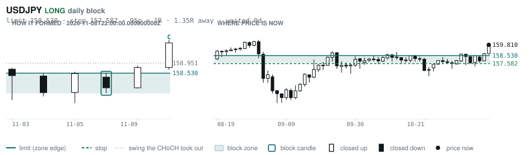
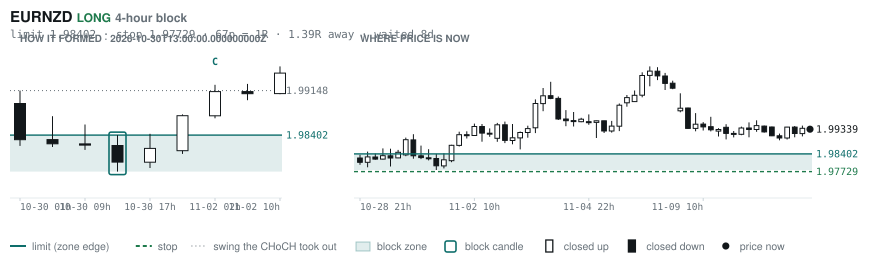
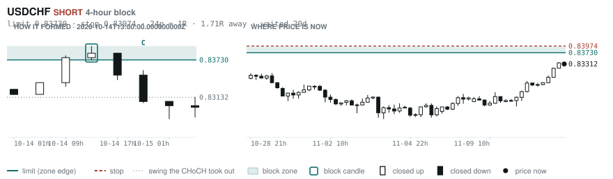
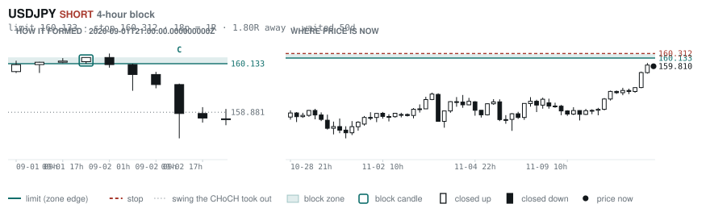

# Scanner Review — 2026-11-11 (evening)

Generated: 2026-11-12T00:00:40.799Z

```
## The clock

It is **18:00 Chicago** — a **DEAD** hour at 0.65x an average one.
An order placed now rests through **Tokyo, London and tomorrow's NY overlap** — about 16h of cover.
Next window: **Tokyo** in 1h.

_Evening pass. Orders placed now get the longest cover of the day: Tokyo, London, and tomorrow's NY overlap. Place limits and stops here — whatever does not fill overnight is still live for the morning._

## Where the energy is

**Running hot:** _nothing unusually active_
**Quiet:** USDJPY 0.89 · CADJPY 0.89 · EURJPY 0.87

_Volatility persists for about two days, so a hot pair stays hot. It says nothing about direction — this picks the pair, the levels pick the side._

## Account

NAV **$1022.85**   unrealised $-36.07   margin available $0.00   4 open

| pair | units | now | P/L | stop | distance | news lean |
|---|---|---|---|---|---|---|
| EURCAD | 9000 | 1.58045 | $-22.04 | **none** | — | — |
| EURCAD | 11000 | 1.58045 | $26.01 | **none** | — | — |
| EURCAD | 14000 | 1.58045 | $143.33 | **none** | — | — |
| EURCAD | 17000 | 1.58045 | $-184.80 | **none** | — | — |

**What the system reads on each position**

- **EURCAD** LONG — last CONTINUATION LONG 10h ago at 1.57624 — system stop 1.56789, target **1.62445** (Grade B); 440p to that target from here

## Order blocks live right now

### Daily

| pair | dir | limit | stop | 1R | spread | away | fills | waited | window | reaches 1R / 2R |
|---|---|---|---|---|---|---|---|---|---|---|
| USDJPY | LONG | **158.530** | 157.582 | 95p $5.93 | 2% | 1.3R | 81% | 0d | 1.04x | 68% / 39% |

_5 more live but further out, 2.5R to 5.1R away. They alert on their own when they come within 1R._
_Older blocks run further: 60+ days reaches 2R 58% of the time against 34% for a same-day fill._

### 4-hour

| pair | dir | limit | stop | 1R | spread | away | fills | waited | window | reaches 1R / 2R |
|---|---|---|---|---|---|---|---|---|---|---|
| AUDCHF | LONG | **0.56746** | 0.56502 | 24p $2.93 | 8% | 1.2R | 79% | 1d | 1.04x | 70% / 46% |
| GBPCAD | SHORT | **1.89426** | 1.89622 | 20p $1.37 | **33%** | 1.3R | 79% | 0d | 0.82x ⚠ | 70% / 46% |
| EURNZD | LONG | **1.98402** | 1.97729 | 67p $3.75 | 12% | 1.4R | 79% | 8d | 1.06x | 78% / 51% |
| USDCHF | SHORT | **0.83730** | 0.83974 | 24p $2.93 | 7% | 1.7R | 79% | 20d | 0.89x ⚠ | 78% / 51% |
| USDJPY | SHORT | **160.133** | 160.312 | 18p $1.12 | 8% | 1.8R | 79% | 50d | 1.04x | 78% / 51% |

_22 more live but further out, 2.3R to 7.5R away. They alert on their own when they come within 1R._
_H4 stops are a third of a daily one, so spread bites three times as hard — a bolded spread figure is most of the edge gone before price moves._

### In reach, drawn

_6 blocks within 2R of the limit. Blocks further out are in the tables above but not worth a picture yet._

**AUDCHF LONG** · 4-hour · 1.24R away · waited 1d



**GBPCAD SHORT** · 4-hour · 1.29R away · waited 0d



**USDJPY LONG** · daily · 1.35R away · waited 0d



**EURNZD LONG** · 4-hour · 1.39R away · waited 8d



**USDCHF SHORT** · 4-hour · 1.71R away · waited 20d



**USDJPY SHORT** · 4-hour · 1.80R away · waited 50d



_Left panel is the block forming, right is where price sits now. Legend is in each image._

## Scanner calls, last 1 day

| when | pair | dir | branch | firing | entry | stop | target | outcome |
|---|---|---|---|---|---|---|---|---|
| 11-11T02:00 | NZDUSD | SHORT | WALL | 4th | 0.56082 | 0.56565 | 0.54493 | open +0.92R |
| 11-11T02:00 | EURGBP | SHORT | REV | 1st ⚠ | 0.83640 | 0.84031 | 0.82430 | open +0.23R |
| 11-11T02:00 | AUDCAD | LONG | REV | 16th | 0.97682 | 0.96806 | 1.00292 | open -0.11R |
| 11-11T02:00 | CHFJPY | SHORT | REV | 4th | 192.218 | 193.828 | 187.587 | open +0.25R |
| 11-11T06:00 | NZDCAD | SHORT | REV | 3rd | 0.79420 | 0.80134 | 0.78678 | open +0.18R |
| 11-11T06:00 | EURCHF | SHORT | REV | 6th | 0.92250 | 0.92723 | 0.90557 | open -0.30R |
| 11-11T06:00 | AUDCHF | SHORT | REV | 5th | 0.56862 | 0.57484 | 0.55613 | open -0.30R |
| 11-11T10:00 | AUDJPY | SHORT | REV | 5th | 109.376 | 110.542 | 107.672 | open -0.05R |
| 11-11T06:00 | AUDUSD | SHORT | REV | 1st ⚠ | 0.68654 | 0.69314 | 0.67750 | open +0.27R |
| 11-11T06:00 | EURUSD | LONG | REV | 1st ⚠ | 1.11382 | 1.10557 | 1.14416 | open -0.59R |
| 11-11T10:00 | GBPCHF | SHORT | REV | 14th | 1.10472 | 1.11152 | 1.08202 | open -0.17R |
| 11-11T10:00 | GBPCAD | SHORT | REV | 3rd | 1.89172 | 1.90296 | 1.83108 | open -0.00R |
| 11-11T14:00 | CADCHF | SHORT | REV | 5th | 0.58503 | 0.58965 | 0.57450 | open +0.09R |
| 11-11T14:00 | GBPAUD | LONG | REV | 1st ⚠ | 1.93826 | 1.92344 | 1.95694 | open +0.01R |
| 11-11T14:00 | EURCAD | LONG | REV | 3rd | 1.58044 | 1.56789 | 1.62445 | open +0.00R |
| 11-11T14:00 | GBPCHF | SHORT | REV | 1st ⚠ | 1.10652 | 1.11284 | 1.08202 | open +0.10R |
| 11-11T14:00 | EURJPY | LONG | REV | 8th | 177.332 | 176.194 | 181.884 | open -0.09R |
| 11-11T18:00 | GBPJPY | SHORT | REV | 3rd | 212.140 | 213.689 | 208.596 | open +0.00R |
| 11-11T18:00 | EURCHF | SHORT | REV | 1st ⚠ | 0.92392 | 0.92992 | 0.90557 | open +0.00R |
| 11-11T18:00 | CADJPY | SHORT | REV | 3rd | 112.140 | 113.137 | 110.284 | open +0.00R |
| 11-11T18:00 | CHFJPY | LONG | REV | 4th | 191.817 | 190.436 | 198.808 | open +0.00R |
| 11-11T18:00 | NZDCAD | LONG | REV | 7th | 0.79290 | 0.78731 | 0.80874 | open +0.00R |

## Running tally, last 30 days

6 resolved · 0 target / 6 stopped · **-6.0R** · -1.000R per call · 54 still open

```
