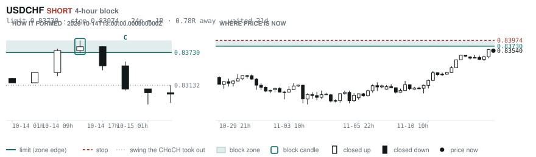
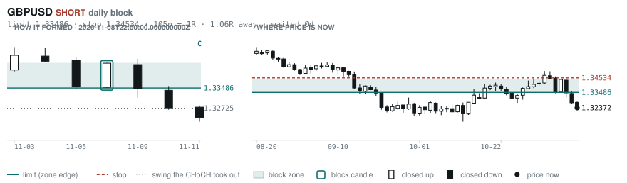
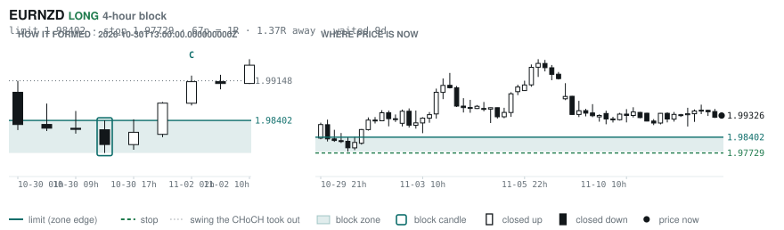
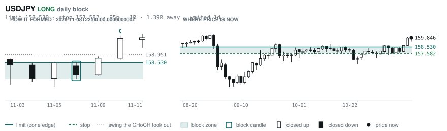
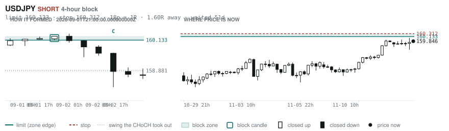

# Scanner Review — 2026-11-12 (evening)

Generated: 2026-11-13T00:00:41.499Z

```
## The clock

It is **18:00 Chicago** — a **DEAD** hour at 0.65x an average one.
An order placed now rests through **Tokyo, London and tomorrow's NY overlap** — about 16h of cover.
Next window: **Tokyo** in 1h.

_Evening pass. Orders placed now get the longest cover of the day: Tokyo, London, and tomorrow's NY overlap. Place limits and stops here — whatever does not fill overnight is still live for the morning._

## Where the energy is

**Running hot:** _nothing unusually active_
**Quiet:** CADJPY 0.90 · USDJPY 0.89 · EURCHF 0.84 · GBPCHF 0.83

_Volatility persists for about two days, so a hot pair stays hot. It says nothing about direction — this picks the pair, the levels pick the side._

## Account

NAV **$1359.38**   unrealised $-197.99   margin available $232.40   4 open

| pair | units | now | P/L | stop | distance | news lean |
|---|---|---|---|---|---|---|
| EURCAD | 9000 | 1.57592 | $-50.35 | **none** | — | 2 neutral |
| EURCAD | 11000 | 1.57592 | $-8.64 | **none** | — | 2 neutral |
| EURCAD | 14000 | 1.57592 | $99.12 | **none** | — | 2 neutral |
| EURCAD | 17000 | 1.57592 | $-238.12 | **none** | — | 2 neutral |

**What the system reads on each position**

- **EURCAD** LONG — last CONTINUATION LONG 6h ago at 1.57295 — system stop 1.56399, target **1.62445** (Grade C); 485p to that target from here

## What is coming, and which way it leans

**EURCAD LONG**
- ⚪ 11-16T13:30 CAD — Core Inflation Rate MoM s.a
- ⚪ 11-16T13:30 CAD — Inflation Rate YoY

_Lean is read from forecast vs previous — which way consensus leans, not what will print._

## Order blocks live right now

### Daily

| pair | dir | limit | stop | 1R | spread | away | fills | waited | window | reaches 1R / 2R |
|---|---|---|---|---|---|---|---|---|---|---|
| GBPUSD | SHORT | **1.33486** | 1.34534 | 105p $10.48 | 2% | 1.1R | 81% | 0d | 0.89x ⚠ | 68% / 39% |
| USDJPY | LONG | **158.530** | 157.582 | 95p $5.93 | 1% | 1.4R | 81% | 1d | 1.04x | 68% / 39% |

_5 more live but further out, 2.1R to 5.1R away. They alert on their own when they come within 1R._
_Older blocks run further: 60+ days reaches 2R 58% of the time against 34% for a same-day fill._

### 4-hour

| pair | dir | limit | stop | 1R | spread | away | fills | waited | window | reaches 1R / 2R |
|---|---|---|---|---|---|---|---|---|---|---|
| USDCHF | SHORT | **0.83730** | 0.83974 | 24p $2.92 | 6% | 0.8R | 83% | 21d | 0.89x ⚠ | 78% / 51% |
| EURNZD | LONG | **1.98402** | 1.97729 | 67p $3.73 | 12% | 1.4R | 79% | 9d | 1.06x | 78% / 51% |
| USDJPY | SHORT | **160.133** | 160.312 | 18p $1.12 | 8% | 1.6R | 79% | 51d | 1.04x | 78% / 51% |

_21 more live but further out, 2.2R to 7.8R away. They alert on their own when they come within 1R._
_H4 stops are a third of a daily one, so spread bites three times as hard — a bolded spread figure is most of the edge gone before price moves._

### In reach, drawn

_5 blocks within 2R of the limit. Blocks further out are in the tables above but not worth a picture yet._

**USDCHF SHORT** · 4-hour · 0.78R away · waited 21d



**GBPUSD SHORT** · daily · 1.06R away · waited 0d



**EURNZD LONG** · 4-hour · 1.37R away · waited 9d



**USDJPY LONG** · daily · 1.39R away · waited 1d



**USDJPY SHORT** · 4-hour · 1.60R away · waited 51d



_Left panel is the block forming, right is where price sits now. Legend is in each image._

## Scanner calls, last 1 day

| when | pair | dir | branch | firing | entry | stop | target | outcome |
|---|---|---|---|---|---|---|---|---|
| 11-12T02:00 | GBPCHF | SHORT | REV | 1st ⚠ | 1.10407 | 1.11055 | 1.08202 | open -0.27R |
| 11-12T02:00 | AUDCHF | SHORT | REV | 1st ⚠ | 0.56922 | 0.57473 | 0.53584 | open +0.09R |
| 11-12T02:00 | EURJPY | LONG | REV | 1st ⚠ | 176.969 | 175.720 | 181.884 | open -0.19R |
| 11-12T02:00 | GBPAUD | LONG | REV | 2nd | 1.93962 | 1.92367 | 2.01992 | open +0.29R |
| 11-12T02:00 | USDCHF | SHORT | REV | 1st ⚠ | 0.83254 | 0.84059 | 0.79420 | open -0.36R |
| 11-12T02:00 | EURCAD | LONG | REV | 4th | 1.57984 | 1.56823 | 1.62445 | open -0.32R |
| 11-12T06:00 | CADCHF | SHORT | REV | 1st ⚠ | 0.58356 | 0.58763 | 0.57450 | open -0.60R |
| 11-12T06:00 | NZDCAD | LONG | REV | 2nd | 0.79242 | 0.78474 | 0.80874 | open -0.21R |
| 11-12T06:00 | GBPCAD | LONG | REV | 1st ⚠ | 1.89162 | 1.88232 | 1.91646 | open -0.49R |
| 11-12T06:00 | NZDUSD | LONG | REV | 1st ⚠ | 0.55598 | 0.54928 | 0.57364 | open -0.20R |
| 11-12T10:00 | EURAUD | SHORT | REV | 9th | 1.62493 | 1.63721 | 1.52860 | open +0.08R |
| 11-12T10:00 | USDCAD | SHORT | REV | 3rd | 1.42370 | 1.43409 | 1.37910 | open -0.20R |
| 11-12T14:00 | NZDJPY | LONG | REV | 13th | 88.580 | 87.453 | 90.685 | open +0.06R |
| 11-12T14:00 | AUDCHF | LONG | REV | 2nd | 0.56890 | 0.56318 | 0.60005 | open -0.03R |
| 11-12T14:00 | NZDCHF | LONG | REV | 7th | 0.46348 | 0.45962 | 0.48192 | open -0.02R |
| 11-12T14:00 | EURCAD | SHORT | REV | 3rd | 1.57494 | 1.59027 | 1.49662 | open -0.07R |
| 11-12T14:00 | EURJPY | LONG | REV | 2nd | 176.508 | 175.044 | 181.884 | open +0.15R |
| 11-12T14:00 | USDJPY | SHORT | REV | 5th | 159.772 | 160.896 | 155.748 | open -0.07R |
| 11-12T18:00 | EURJPY | LONG | REV | 5th | 176.729 | 175.429 | 181.884 | open +0.00R |
| 11-12T18:00 | GBPCAD | LONG | REV | 4th | 1.88708 | 1.87796 | 1.91646 | open +0.00R |

## Running tally, last 30 days

4 resolved · 0 target / 4 stopped · **-4.0R** · -1.000R per call · 56 still open

```
