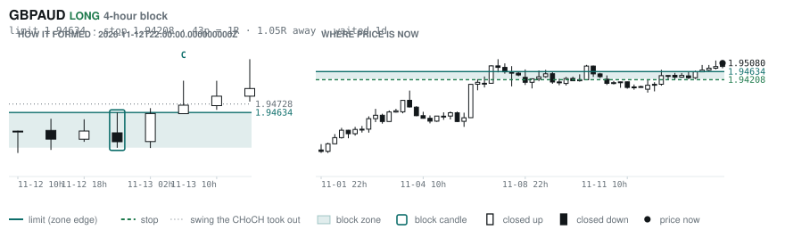
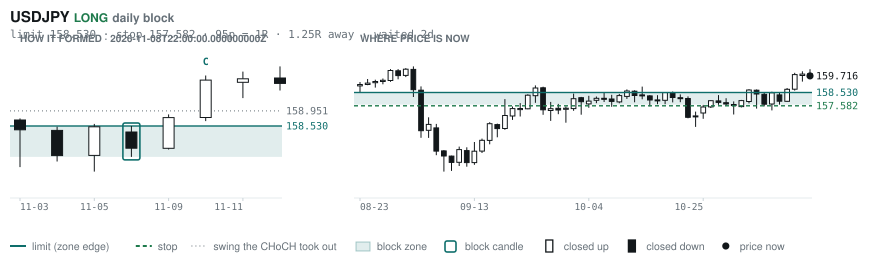
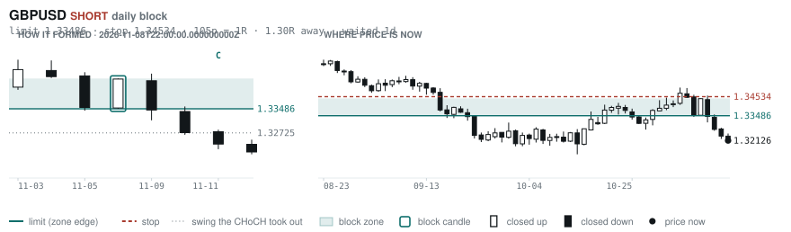
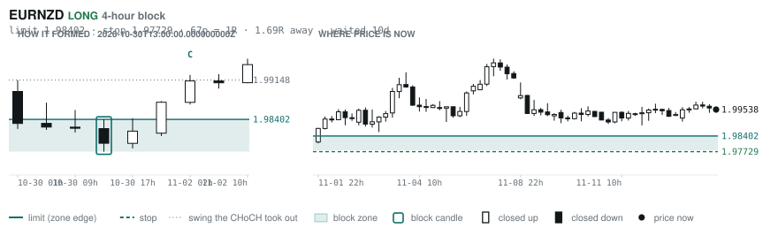
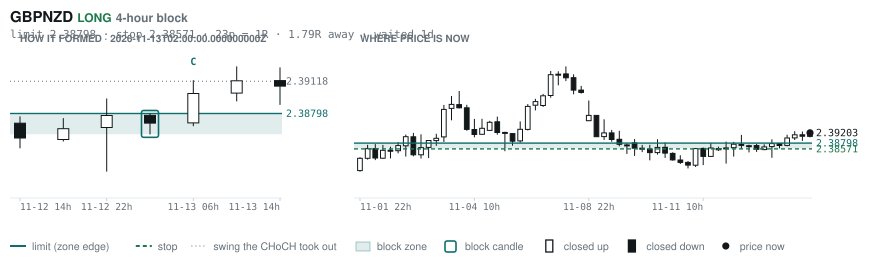
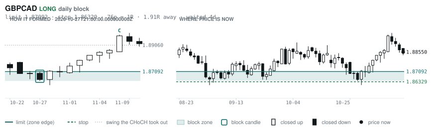

# Scanner Review — 2026-11-15 (evening)

Generated: 2026-11-16T00:00:34.005Z

```
## The clock

It is **18:00 Chicago** — a **DEAD** hour at 0.65x an average one.
An order placed now rests through **Tokyo, London and tomorrow's NY overlap** — about 16h of cover.
Next window: **Tokyo** in 1h.

_Evening pass. Orders placed now get the longest cover of the day: Tokyo, London, and tomorrow's NY overlap. Place limits and stops here — whatever does not fill overnight is still live for the morning._

## Where the energy is

**Running hot:** _nothing unusually active_
**Quiet:** NZDCAD 0.88 · GBPCHF 0.88 · USDJPY 0.87 · GBPNZD 0.85 · EURNZD 0.83 · NZDCHF 0.83

_Volatility persists for about two days, so a hot pair stays hot. It says nothing about direction — this picks the pair, the levels pick the side._

## Account

NAV **$1254.58**   unrealised $-301.23   margin available $129.98   4 open

| pair | units | now | P/L | stop | distance | news lean |
|---|---|---|---|---|---|---|
| EURCAD | 9000 | 1.57305 | $-68.57 | **none** | — | 🔴 4 headwind |
| EURCAD | 11000 | 1.57305 | $-30.92 | **none** | — | 🔴 4 headwind |
| EURCAD | 14000 | 1.57305 | $70.74 | **none** | — | 🔴 4 headwind |
| EURCAD | 17000 | 1.57305 | $-272.49 | **none** | — | 🔴 4 headwind |

**What the system reads on each position**

- **EURCAD** LONG — last CONTINUATION LONG 58h ago at 1.57060 — system stop 1.56353, target **1.62068** (Grade C); 476p to that target from here

## What is coming, and which way it leans

**EURCAD LONG**
- 🔴 11-16T08:30 CAD — CPI m/m  (fc 0.3% vs prev 0.1%)
- 🔴 11-16T08:30 CAD — Median CPI y/y  (fc 2.0% vs prev 1.9%)
- 🔴 11-16T08:30 CAD — Trimmed CPI y/y  (fc 1.9% vs prev 1.8%)
- ⚪ 11-16T13:30 CAD — Core Inflation Rate MoM s.a
- 🔴 11-16T13:30 CAD — Inflation Rate YoY  (fc 3.2 vs prev 3.1)

_Lean is read from forecast vs previous — which way consensus leans, not what will print._

## Order blocks live right now

### Daily

| pair | dir | limit | stop | 1R | spread | away | fills | waited | window | reaches 1R / 2R |
|---|---|---|---|---|---|---|---|---|---|---|
| USDJPY | LONG | **158.530** | 157.582 | 95p $5.94 | 2% | 1.3R | 81% | 2d | 1.04x | 68% / 39% |
| GBPUSD | SHORT | **1.33486** | 1.34534 | 105p $10.48 | 2% | 1.3R | 81% | 1d | 0.89x ⚠ | 68% / 39% |
| GBPCAD | LONG | **1.87092** | 1.86329 | 76p $5.35 | 7% | 1.9R | 81% | 4d | 0.82x ⚠ | 68% / 39% |

_4 more live but further out, 2.9R to 4.9R away. They alert on their own when they come within 1R._
_Older blocks run further: 60+ days reaches 2R 58% of the time against 34% for a same-day fill._

### 4-hour

| pair | dir | limit | stop | 1R | spread | away | fills | waited | window | reaches 1R / 2R |
|---|---|---|---|---|---|---|---|---|---|---|
| GBPAUD | LONG | **1.94634** | 1.94208 | 43p $2.88 | 13% | 1.0R | 79% | 1d | 1.04x | 70% / 46% |
| EURNZD | LONG | **1.98402** | 1.97729 | 67p $3.72 | 13% | 1.7R | 79% | 10d | 1.06x | 78% / 51% |
| GBPNZD | LONG | **2.38798** | 2.38571 | 23p $1.25 | **59%** | 1.8R | 79% | 1d | 1.04x | 70% / 46% |

_18 more live but further out, 2.2R to 7.8R away. They alert on their own when they come within 1R._
_H4 stops are a third of a daily one, so spread bites three times as hard — a bolded spread figure is most of the edge gone before price moves._

### In reach, drawn

_6 blocks within 2R of the limit. Blocks further out are in the tables above but not worth a picture yet._

**GBPAUD LONG** · 4-hour · 1.05R away · waited 1d



**USDJPY LONG** · daily · 1.25R away · waited 2d



**GBPUSD SHORT** · daily · 1.30R away · waited 1d



**EURNZD LONG** · 4-hour · 1.69R away · waited 10d



**GBPNZD LONG** · 4-hour · 1.79R away · waited 1d



**GBPCAD LONG** · daily · 1.91R away · waited 4d



_Left panel is the block forming, right is where price sits now. Legend is in each image._

## Scanner calls, last 1 day

_None._

## Running tally, last 30 days

4 resolved · 0 target / 4 stopped · **-4.0R** · -1.000R per call · 56 still open

```
