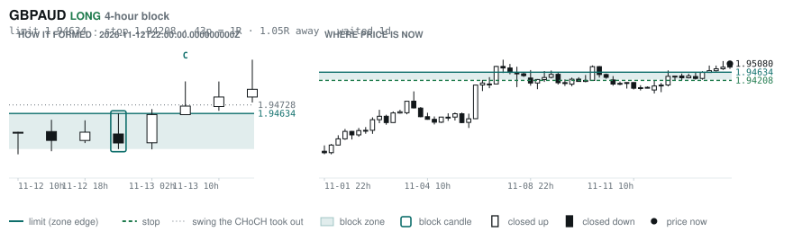
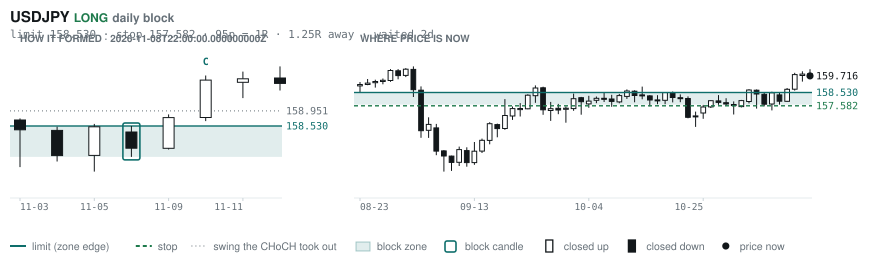
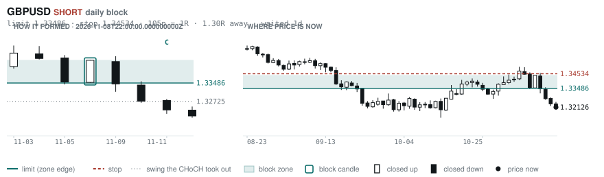
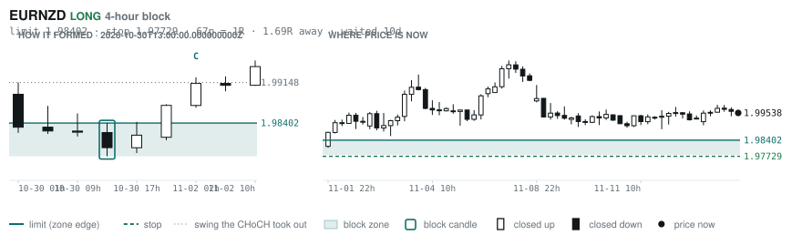
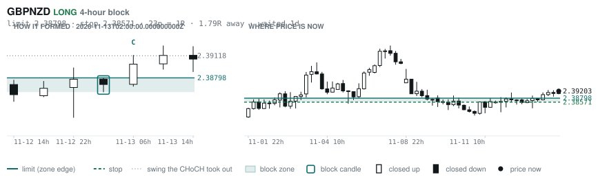
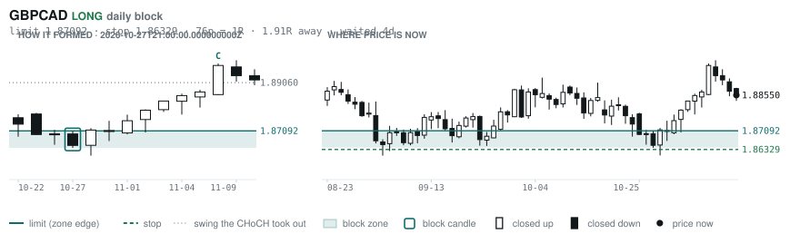

# Scanner Review — 2026-11-15 (weekly)

Generated: 2026-11-15T20:00:44.742Z

```
## The clock

It is **14:00 Chicago** — a **DEAD** hour at 0.74x an average one.
An order placed now rests through **tomorrow — the rest of today is dead**.
Next window: **Tokyo** in 5h.

## Where the energy is

**Running hot:** _nothing unusually active_
**Quiet:** NZDCAD 0.88 · GBPCHF 0.88 · USDJPY 0.87 · GBPNZD 0.85 · EURNZD 0.83 · NZDCHF 0.83

_Volatility persists for about two days, so a hot pair stays hot. It says nothing about direction — this picks the pair, the levels pick the side._

## Account

NAV **$1237.77**   unrealised $-318.04   margin available $113.45   4 open

| pair | units | now | P/L | stop | distance | news lean |
|---|---|---|---|---|---|---|
| EURCAD | 9000 | 1.57285 | $-71.53 | **none** | — | 🔴 4 headwind |
| EURCAD | 11000 | 1.57285 | $-34.54 | **none** | — | 🔴 4 headwind |
| EURCAD | 14000 | 1.57285 | $66.11 | **none** | — | 🔴 4 headwind |
| EURCAD | 17000 | 1.57285 | $-278.09 | **none** | — | 🔴 4 headwind |

**What the system reads on each position**

- **EURCAD** LONG — last CONTINUATION LONG 54h ago at 1.57060 — system stop 1.56353, target **1.62068** (Grade C); 478p to that target from here

## What is coming, and which way it leans

**EURCAD LONG**
- 🔴 11-16T08:30 CAD — CPI m/m  (fc 0.3% vs prev 0.1%)
- 🔴 11-16T08:30 CAD — Median CPI y/y  (fc 2.0% vs prev 1.9%)
- 🔴 11-16T08:30 CAD — Trimmed CPI y/y  (fc 1.9% vs prev 1.8%)
- ⚪ 11-16T13:30 CAD — Core Inflation Rate MoM s.a
- 🔴 11-16T13:30 CAD — Inflation Rate YoY  (fc 3.2 vs prev 3.1)

_Lean is read from forecast vs previous — which way consensus leans, not what will print._

## Order blocks live right now

### Daily

| pair | dir | limit | stop | 1R | spread | away | fills | waited | window | reaches 1R / 2R |
|---|---|---|---|---|---|---|---|---|---|---|
| USDJPY | LONG | **158.530** | 157.582 | 95p $5.94 | 5% | 1.3R | 81% | 2d | 1.37x | 68% / 39% |
| GBPUSD | SHORT | **1.33486** | 1.34534 | 105p $10.48 | 9% | 1.3R | 81% | 1d | 1.54x | 68% / 39% |
| GBPCAD | LONG | **1.87092** | 1.86329 | 76p $5.35 | **25%** | 1.9R | 81% | 4d | 1.58x | 68% / 39% |

_4 more live but further out, 2.9R to 4.9R away. They alert on their own when they come within 1R._
_Older blocks run further: 60+ days reaches 2R 58% of the time against 34% for a same-day fill._

### 4-hour

| pair | dir | limit | stop | 1R | spread | away | fills | waited | window | reaches 1R / 2R |
|---|---|---|---|---|---|---|---|---|---|---|
| GBPAUD | LONG | **1.94634** | 1.94208 | 43p $2.88 | **72%** | 1.0R | 79% | 1d | 1.34x | 70% / 46% |
| EURNZD | LONG | **1.98402** | 1.97729 | 67p $3.72 | **30%** | 1.7R | 79% | 10d | 1.27x | 78% / 51% |
| GBPNZD | LONG | **2.38798** | 2.38571 | 23p $1.25 | **184%** | 1.8R | 79% | 1d | 1.26x | 70% / 46% |

_18 more live but further out, 2.2R to 7.8R away. They alert on their own when they come within 1R._
_H4 stops are a third of a daily one, so spread bites three times as hard — a bolded spread figure is most of the edge gone before price moves._

### In reach, drawn

_6 blocks within 2R of the limit. Blocks further out are in the tables above but not worth a picture yet._

**GBPAUD LONG** · 4-hour · 1.05R away · waited 1d



**USDJPY LONG** · daily · 1.25R away · waited 2d



**GBPUSD SHORT** · daily · 1.30R away · waited 1d



**EURNZD LONG** · 4-hour · 1.69R away · waited 10d



**GBPNZD LONG** · 4-hour · 1.79R away · waited 1d



**GBPCAD LONG** · daily · 1.91R away · waited 4d



_Left panel is the block forming, right is where price sits now. Legend is in each image._

## Scanner calls, last 7 days

| when | pair | dir | branch | firing | entry | stop | target | outcome |
|---|---|---|---|---|---|---|---|---|
| 11-08T22:00 | CADCHF | SHORT | REV | 1st ⚠ | 0.58134 | 0.58694 | 0.57450 | stopped -1.00R |
| 11-08T22:00 | GBPUSD | LONG | REV | 2nd | 1.33714 | 1.32537 | 1.37014 | stopped -1.00R |
| 11-08T22:00 | AUDCAD | SHORT | REV | 3rd | 0.97221 | 0.98214 | 0.96059 | open +0.57R |
| 11-08T22:00 | CADJPY | SHORT | REV | 1st ⚠ | 112.142 | 113.345 | 110.284 | open +0.18R |
| 11-08T22:00 | AUDCHF | SHORT | REV | 2nd | 0.56519 | 0.57205 | 0.55613 | open -0.44R |
| 11-08T22:00 | AUDUSD | LONG | REV | 2nd | 0.68898 | 0.68172 | 0.72420 | stopped -1.00R |
| 11-08T22:00 | EURAUD | SHORT | WALL | 7th | 1.61910 | 1.62578 | 1.52860 | stopped -1.00R |
| 11-08T22:00 | EURGBP | SHORT | REV | 5th | 0.83430 | 0.83779 | 0.82418 | open +0.03R |
| 11-09T02:00 | EURCHF | SHORT | REV | 3rd | 0.91486 | 0.92069 | 0.90557 | stopped -1.00R |
| 11-09T02:00 | USDCHF | SHORT | REV | 1st ⚠ | 0.81980 | 0.82891 | 0.79880 | stopped -1.00R |
| 11-09T02:00 | AUDUSD | SHORT | REV | 2nd | 0.68883 | 0.69623 | 0.67750 | target +1.53R |
| 11-09T06:00 | EURJPY | LONG | REV | 5th | 176.894 | 175.327 | 179.642 | open -0.55R |
| 11-09T06:00 | USDCAD | SHORT | REV | 3rd | 1.40804 | 1.41758 | 1.36370 | stopped -1.00R |
| 11-09T10:00 | USDJPY | SHORT | REV | 1st ⚠ | 157.919 | 159.507 | 155.574 | stopped -1.00R |
| 11-09T10:00 | EURCAD | LONG | REV | 1st ⚠ | 1.57892 | 1.56391 | 1.62445 | open -0.41R |
| 11-09T10:00 | AUDCAD | SHORT | REV | 4th | 0.97250 | 0.98177 | 0.96059 | open +0.64R |
| 11-09T10:00 | CADJPY | SHORT | REV | 2nd | 112.022 | 113.311 | 110.284 | open +0.08R |
| 11-09T10:00 | EURAUD | LONG | REV | 2nd | 1.62358 | 1.60569 | 1.65776 | open +0.21R |
| 11-09T14:00 | AUDCHF | LONG | REV | 1st ⚠ | 0.56770 | 0.55657 | 0.60005 | open +0.04R |
| 11-09T14:00 | EURUSD | SHORT | REV | 3rd | 1.12032 | 1.12950 | 1.09397 | open +1.98R |
| 11-09T14:00 | EURGBP | SHORT | REV | 1st ⚠ | 0.83488 | 0.83795 | 0.82418 | open +0.22R |
| 11-09T14:00 | AUDNZD | LONG | REV | 3rd | 1.23004 | 1.22068 | 1.29364 | open -0.41R |
| 11-09T18:00 | EURNZD | LONG | REV | 4th | 1.99327 | 1.97696 | 2.01019 | open +0.13R |
| 11-09T18:00 | AUDJPY | SHORT | REV | 2nd | 109.370 | 110.691 | 107.672 | open +0.91R |
| 11-09T18:00 | USDCAD | SHORT | REV | 3rd | 1.41176 | 1.42077 | 1.37910 | stopped -1.00R |
| 11-09T22:00 | GBPUSD | SHORT | REV | 4th | 1.34436 | 1.35247 | 1.31258 | open +2.85R |
| 11-09T22:00 | NZDCAD | SHORT | REV | 18th | 0.79582 | 0.80301 | 0.78678 | open +1.05R |
| 11-09T22:00 | AUDUSD | SHORT | REV | 2nd | 0.69202 | 0.69913 | 0.67750 | target +2.04R |
| 11-09T22:00 | NZDJPY | SHORT | REV | 3rd | 89.055 | 90.002 | 85.876 | open +0.88R |
| 11-10T06:00 | NZDUSD | SHORT | REV | 1st ⚠ | 0.56308 | 0.57134 | 0.54493 | open +1.29R |
| 11-10T06:00 | USDJPY | LONG | REV | 5th | 158.107 | 156.647 | 160.574 | open +1.10R |
| 11-10T06:00 | CADCHF | LONG | REV | 8th | 0.58059 | 0.57497 | 0.60486 | open +1.29R |
| 11-10T06:00 | GBPJPY | SHORT | REV | 2nd | 212.264 | 214.398 | 206.249 | open +0.58R |
| 11-10T06:00 | USDCHF | LONG | REV | 1st ⚠ | 0.82080 | 0.80983 | 0.84348 | open +1.65R |
| 11-10T06:00 | EURJPY | SHORT | REV | 2nd | 177.502 | 178.818 | 172.184 | open +1.11R |
| 11-10T06:00 | NZDJPY | SHORT | REV | 2nd | 89.026 | 89.990 | 85.876 | open +0.84R |
| 11-10T06:00 | AUDJPY | SHORT | REV | 3rd | 109.297 | 110.594 | 107.672 | open +0.87R |
| 11-10T06:00 | CHFJPY | SHORT | REV | 4th | 192.622 | 194.823 | 187.587 | open +1.02R |
| 11-10T10:00 | EURCHF | SHORT | REV | 4th | 0.92054 | 0.92718 | 0.90557 | open -0.61R |
| 11-10T10:00 | NZDCHF | LONG | REV | 6th | 0.46183 | 0.45704 | 0.48192 | open +0.32R |
| 11-10T10:00 | GBPCHF | LONG | REV | 9th | 1.10205 | 1.09333 | 1.11572 | open +0.73R |
| 11-10T10:00 | USDCHF | LONG | REV | 3rd | 0.82290 | 0.81304 | 0.84348 | open +1.62R |
| 11-10T10:00 | AUDCAD | SHORT | REV | 5th | 0.97367 | 0.98478 | 0.96059 | open +0.64R |
| 11-10T10:00 | EURUSD | SHORT | REV | 4th | 1.11865 | 1.12950 | 1.09397 | open +1.52R |
| 11-10T10:00 | USDCAD | SHORT | REV | 4th | 1.41720 | 1.42685 | 1.37910 | stopped -1.00R |
| 11-10T10:00 | AUDUSD | SHORT | WALL | 3rd | 0.68704 | 0.69251 | 0.67750 | target +1.75R |
| 11-10T10:00 | CADJPY | SHORT | REV | 1st ⚠ | 111.852 | 112.693 | 110.284 | open -0.08R |
| 11-10T10:00 | EURGBP | SHORT | REV | 2nd | 0.83530 | 0.83879 | 0.82418 | open +0.32R |
| 11-10T10:00 | GBPCAD | LONG | REV | 1st ⚠ | 1.89796 | 1.88788 | 1.91646 | stopped -1.00R |
| 11-10T14:00 | NZDUSD | SHORT | WALL | 3rd | 0.55926 | 0.56575 | 0.54493 | open +1.06R |
| 11-10T14:00 | AUDCHF | SHORT | REV | 1st ⚠ | 0.56628 | 0.57308 | 0.55613 | open -0.28R |
| 11-10T14:00 | GBPJPY | SHORT | REV | 1st ⚠ | 211.752 | 213.810 | 206.249 | open +0.35R |
| 11-10T14:00 | CADCHF | LONG | REV | 4th | 0.58228 | 0.57695 | 0.60486 | open +1.05R |
| 11-10T14:00 | AUDUSD | SHORT | WALL | 1st ⚠ | 0.68550 | 0.68988 | 0.67750 | target +1.83R |
| 11-10T14:00 | GBPAUD | SHORT | REV | 2nd | 1.94513 | 1.96610 | 1.84868 | open -0.27R |
| 11-10T18:00 | NZDCHF | LONG | REV | 1st ⚠ | 0.46247 | 0.45739 | 0.48192 | open +0.18R |
| 11-10T18:00 | EURNZD | SHORT | REV | 3rd | 1.99236 | 2.00812 | 1.90601 | open -0.19R |
| 11-10T18:00 | GBPCAD | LONG | REV | 2nd | 1.89347 | 1.88291 | 1.91646 | open -0.75R |
| 11-10T10:00 | EURJPY | LONG | WALL | 6th | 177.326 | 176.764 | 181.884 | stopped -1.00R |
| 11-10T22:00 | GBPCHF | LONG | REV | 10th | 1.10242 | 1.09365 | 1.11572 | open +0.69R |
| 11-10T22:00 | EURAUD | SHORT | REV | 8th | 1.62256 | 1.63842 | 1.52860 | open -0.30R |
| 11-10T22:00 | AUDCAD | LONG | REV | 5th | 0.97670 | 0.96696 | 1.00292 | stopped -1.00R |
| 11-10T22:00 | EURJPY | LONG | REV | 7th | 177.426 | 176.197 | 181.884 | stopped -1.00R |
| 11-11T02:00 | NZDUSD | SHORT | WALL | 4th | 0.56082 | 0.56565 | 0.54493 | open +1.75R |
| 11-11T02:00 | EURGBP | SHORT | REV | 1st ⚠ | 0.83640 | 0.84031 | 0.82430 | open +0.56R |
| 11-11T02:00 | AUDCAD | LONG | REV | 16th | 0.97682 | 0.96806 | 1.00292 | stopped -1.00R |
| 11-11T02:00 | CHFJPY | SHORT | REV | 4th | 192.218 | 193.828 | 187.587 | open +1.14R |
| 11-11T06:00 | NZDCAD | SHORT | REV | 3rd | 0.79420 | 0.80134 | 0.78678 | open +0.83R |
| 11-11T06:00 | EURCHF | SHORT | REV | 6th | 0.92250 | 0.92723 | 0.90557 | open -0.44R |
| 11-11T06:00 | AUDCHF | SHORT | REV | 5th | 0.56862 | 0.57484 | 0.55613 | open +0.07R |
| 11-11T10:00 | AUDJPY | SHORT | REV | 5th | 109.376 | 110.542 | 107.672 | open +1.03R |
| 11-11T06:00 | AUDUSD | SHORT | REV | 1st ⚠ | 0.68654 | 0.69314 | 0.67750 | target +1.37R |
| 11-11T06:00 | EURUSD | LONG | REV | 1st ⚠ | 1.11382 | 1.10557 | 1.14416 | stopped -1.00R |
| 11-11T10:00 | GBPCHF | SHORT | REV | 14th | 1.10472 | 1.11152 | 1.08202 | open -0.55R |
| 11-11T10:00 | GBPCAD | SHORT | REV | 3rd | 1.89172 | 1.90296 | 1.83108 | open +0.55R |
| 11-11T14:00 | CADCHF | SHORT | REV | 5th | 0.58503 | 0.58965 | 0.57450 | open -0.61R |
| 11-11T14:00 | GBPAUD | LONG | REV | 1st ⚠ | 1.93826 | 1.92344 | 1.95694 | open +0.85R |
| 11-11T14:00 | EURCAD | LONG | REV | 3rd | 1.58044 | 1.56789 | 1.62445 | open -0.61R |
| 11-11T14:00 | GBPCHF | SHORT | REV | 1st ⚠ | 1.10652 | 1.11284 | 1.08202 | open -0.30R |
| 11-11T14:00 | EURJPY | LONG | REV | 8th | 177.332 | 176.194 | 181.884 | stopped -1.00R |
| 11-11T18:00 | GBPJPY | SHORT | REV | 3rd | 212.140 | 213.689 | 208.596 | open +0.72R |
| 11-11T18:00 | EURCHF | SHORT | REV | 1st ⚠ | 0.92392 | 0.92992 | 0.90557 | open -0.11R |
| 11-11T18:00 | CADJPY | SHORT | REV | 3rd | 112.140 | 113.137 | 110.284 | open +0.22R |
| 11-11T18:00 | CHFJPY | LONG | REV | 4th | 191.817 | 190.436 | 198.808 | stopped -1.00R |
| 11-11T18:00 | NZDCAD | LONG | REV | 7th | 0.79290 | 0.78731 | 0.80874 | open -0.83R |
| 11-11T22:00 | EURNZD | LONG | REV | 1st ⚠ | 1.99400 | 1.97455 | 2.08038 | open +0.07R |
| 11-11T22:00 | NZDJPY | SHORT | REV | 1st ⚠ | 88.853 | 89.928 | 85.691 | open +0.59R |
| 11-11T22:00 | USDJPY | SHORT | REV | 5th | 159.666 | 160.515 | 155.748 | open -0.06R |
| 11-12T02:00 | GBPCHF | SHORT | REV | 1st ⚠ | 1.10407 | 1.11055 | 1.08202 | open -0.67R |
| 11-12T02:00 | AUDCHF | SHORT | REV | 1st ⚠ | 0.56922 | 0.57473 | 0.53584 | open +0.19R |
| 11-12T02:00 | EURJPY | LONG | REV | 1st ⚠ | 176.969 | 175.720 | 181.884 | open -0.75R |
| 11-12T02:00 | GBPAUD | LONG | REV | 2nd | 1.93962 | 1.92367 | 2.01992 | open +0.70R |
| 11-12T02:00 | USDCHF | SHORT | REV | 1st ⚠ | 0.83254 | 0.84059 | 0.79420 | open -0.79R |
| 11-12T02:00 | EURCAD | LONG | REV | 4th | 1.57984 | 1.56823 | 1.62445 | open -0.60R |
| 11-12T06:00 | CADCHF | SHORT | REV | 1st ⚠ | 0.58356 | 0.58763 | 0.57450 | stopped -1.00R |
| 11-12T06:00 | NZDCAD | LONG | REV | 2nd | 0.79242 | 0.78474 | 0.80874 | open -0.54R |
| 11-12T06:00 | GBPCAD | LONG | REV | 1st ⚠ | 1.89162 | 1.88232 | 1.91646 | open -0.66R |
| 11-12T06:00 | NZDUSD | LONG | REV | 1st ⚠ | 0.55598 | 0.54928 | 0.57364 | open -0.54R |
| 11-12T10:00 | EURAUD | SHORT | REV | 9th | 1.62493 | 1.63721 | 1.52860 | open -0.19R |
| 11-12T10:00 | USDCAD | SHORT | REV | 3rd | 1.42370 | 1.43409 | 1.37910 | open -0.32R |
| 11-12T14:00 | NZDJPY | LONG | REV | 13th | 88.580 | 87.453 | 90.685 | open -0.32R |
| 11-12T14:00 | AUDCHF | LONG | REV | 2nd | 0.56890 | 0.56318 | 0.60005 | open -0.12R |
| 11-12T14:00 | NZDCHF | LONG | REV | 7th | 0.46348 | 0.45962 | 0.48192 | open -0.03R |
| 11-12T14:00 | EURCAD | SHORT | REV | 3rd | 1.57494 | 1.59027 | 1.49662 | open +0.14R |
| 11-12T14:00 | EURJPY | LONG | REV | 2nd | 176.508 | 175.044 | 181.884 | open -0.32R |
| 11-12T14:00 | USDJPY | SHORT | REV | 5th | 159.772 | 160.896 | 155.748 | open +0.05R |
| 11-12T18:00 | EURJPY | LONG | REV | 5th | 176.729 | 175.429 | 181.884 | open -0.53R |
| 11-12T18:00 | GBPCAD | LONG | REV | 4th | 1.88708 | 1.87796 | 1.91646 | open -0.17R |
| 11-12T22:00 | GBPCHF | LONG | REV | 2nd | 1.10565 | 1.09710 | 1.11572 | open +0.33R |
| 11-12T22:00 | EURCHF | LONG | REV | 1st ⚠ | 0.92394 | 0.91782 | 0.94100 | open +0.10R |
| 11-12T22:00 | EURAUD | SHORT | REV | 10th | 1.62376 | 1.63666 | 1.52860 | open -0.27R |
| 11-12T22:00 | EURNZD | LONG | REV | 1st ⚠ | 1.99531 | 1.97523 | 2.08038 | open +0.00R |
| 11-12T22:00 | GBPAUD | LONG | REV | 1st ⚠ | 1.94313 | 1.92651 | 2.01992 | open +0.46R |
| 11-12T22:00 | AUDCAD | LONG | REV | 5th | 0.97100 | 0.96423 | 1.00292 | open -0.66R |
| 11-12T22:00 | AUDNZD | LONG | REV | 3rd | 1.22886 | 1.22071 | 1.29364 | open -0.32R |
| 11-13T02:00 | USDCAD | SHORT | REV | 1st ⚠ | 1.42608 | 1.43462 | 1.37910 | open -0.11R |
| 11-13T02:00 | GBPUSD | LONG | REV | 9th | 1.32283 | 1.31168 | 1.37339 | open -0.14R |
| 11-13T02:00 | EURGBP | LONG | REV | 2nd | 0.83604 | 0.83198 | 0.86717 | open -0.45R |
| 11-13T02:00 | USDJPY | SHORT | REV | 1st ⚠ | 159.967 | 160.813 | 155.748 | open +0.30R |
| 11-13T06:00 | GBPUSD | LONG | REV | 1st ⚠ | 1.32334 | 1.31249 | 1.37339 | open -0.19R |
| 11-13T06:00 | EURCAD | LONG | REV | 3rd | 1.57686 | 1.56460 | 1.62445 | open -0.33R |
| 11-13T06:00 | AUDCAD | LONG | REV | 2nd | 0.96902 | 0.96059 | 1.00292 | open -0.29R |
| 11-13T06:00 | GBPCAD | SHORT | REV | 2nd | 1.88680 | 1.89677 | 1.83108 | open +0.13R |
| 11-13T10:00 | NZDCHF | LONG | REV | 7th | 0.46382 | 0.45990 | 0.48192 | open -0.11R |
| 11-13T10:00 | CHFJPY | SHORT | REV | 1st ⚠ | 190.799 | 192.333 | 187.587 | open +0.27R |
| 11-13T10:00 | EURGBP | SHORT | REV | 5th | 0.83510 | 0.83847 | 0.82430 | open +0.27R |
| 11-13T14:00 | GBPCAD | SHORT | REV | 2nd | 1.88406 | 1.89479 | 1.83108 | open -0.13R |
| 11-13T14:00 | AUDJPY | SHORT | REV | 1st ⚠ | 108.380 | 110.012 | 105.171 | open +0.13R |
| 11-13T14:00 | USDJPY | SHORT | REV | 2nd | 159.929 | 160.829 | 155.748 | open +0.24R |

## Running tally, last 30 days

26 resolved · 1 target / 25 stopped · **-22.5R** · -0.866R per call · 34 still open

```
