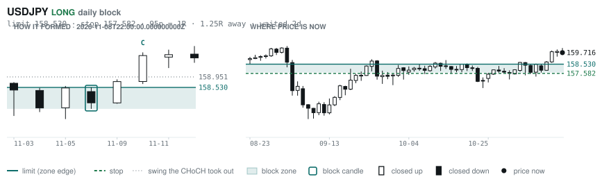
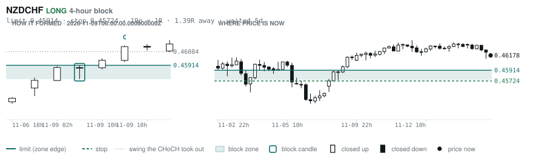
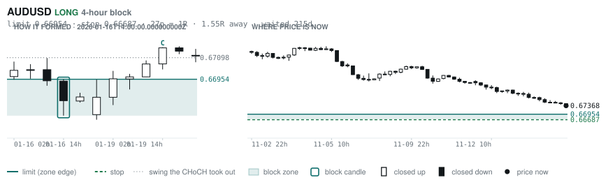
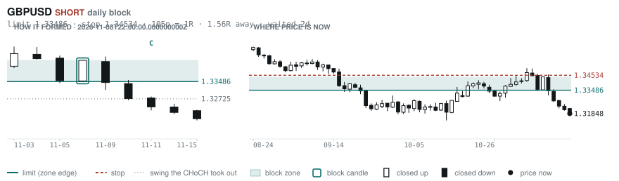
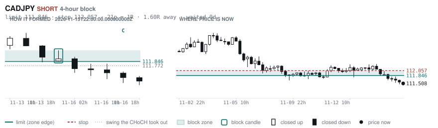
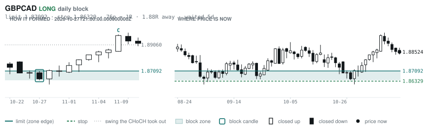

# Scanner Review — 2026-11-16 (evening)

Generated: 2026-11-17T00:00:39.858Z

```
## The clock

It is **18:00 Chicago** — a **DEAD** hour at 0.65x an average one.
An order placed now rests through **Tokyo, London and tomorrow's NY overlap** — about 16h of cover.
Next window: **Tokyo** in 1h.

_Evening pass. Orders placed now get the longest cover of the day: Tokyo, London, and tomorrow's NY overlap. Place limits and stops here — whatever does not fill overnight is still live for the morning._

## Where the energy is

**Running hot:** _nothing unusually active_
**Quiet:** USDJPY 0.84 · GBPNZD 0.83 · NZDUSD 0.83 · NZDCAD 0.83 · NZDCHF 0.82 · EURNZD 0.81

_Volatility persists for about two days, so a hot pair stays hot. It says nothing about direction — this picks the pair, the levels pick the side._

## Account

NAV **$1230.83**   unrealised $-323.46   margin available $108.99   4 open

| pair | units | now | P/L | stop | distance | news lean |
|---|---|---|---|---|---|---|
| EURCAD | 9000 | 1.57240 | $-72.46 | **none** | — | — |
| EURCAD | 11000 | 1.57240 | $-35.78 | **none** | — | — |
| EURCAD | 14000 | 1.57240 | $64.33 | **none** | — | — |
| EURCAD | 17000 | 1.57240 | $-279.55 | **none** | — | — |

**What the system reads on each position**

- **EURCAD** LONG — last REVERSAL LONG 6h ago at 1.57067 — system stop 1.56413, target **1.62068**; 483p to that target from here

## Order blocks live right now

### Daily

| pair | dir | limit | stop | 1R | spread | away | fills | waited | window | reaches 1R / 2R |
|---|---|---|---|---|---|---|---|---|---|---|
| USDJPY | LONG | **158.530** | 157.582 | 95p $5.95 | 2% | 1.0R | 87% | 3d | 1.04x | 68% / 39% |
| GBPUSD | SHORT | **1.33486** | 1.34534 | 105p $10.48 | 2% | 1.6R | 81% | 2d | 0.89x ⚠ | 68% / 39% |
| GBPCAD | LONG | **1.87092** | 1.86329 | 76p $5.34 | 8% | 1.9R | 81% | 5d | 0.82x ⚠ | 68% / 39% |

_5 more live but further out, 2.6R to 5.1R away. They alert on their own when they come within 1R._
_Older blocks run further: 60+ days reaches 2R 58% of the time against 34% for a same-day fill._

### 4-hour

| pair | dir | limit | stop | 1R | spread | away | fills | waited | window | reaches 1R / 2R |
|---|---|---|---|---|---|---|---|---|---|---|
| NZDCHF | LONG | **0.45914** | 0.45724 | 19p $2.27 | 19% | 1.4R | 79% | 5d | 1.03x | 77% / 47% |
| AUDUSD | LONG | **0.66954** | 0.66687 | 27p $2.67 | 5% | 1.5R | 79% | 215d | 1.00x | 78% / 51% |
| CADJPY | SHORT | **111.846** | 112.057 | 21p $1.32 | **21%** | 1.6R | 79% | 0d | 0.99x ⚠ | 70% / 46% |
| GBPAUD | SHORT | **1.96458** | 1.96839 | 38p $2.56 | 13% | 2.0R | 79% | 205d | 1.04x | 78% / 51% |

_18 more live but further out, 2.3R to 8.0R away. They alert on their own when they come within 1R._
_H4 stops are a third of a daily one, so spread bites three times as hard — a bolded spread figure is most of the edge gone before price moves._

### In reach, drawn

_6 blocks within 2R of the limit. Blocks further out are in the tables above but not worth a picture yet._

**USDJPY LONG** · daily · 0.95R away · waited 3d



**NZDCHF LONG** · 4-hour · 1.39R away · waited 5d



**AUDUSD LONG** · 4-hour · 1.55R away · waited 215d



**GBPUSD SHORT** · daily · 1.56R away · waited 2d



**CADJPY SHORT** · 4-hour · 1.60R away · waited 0d



**GBPCAD LONG** · daily · 1.88R away · waited 5d



_Left panel is the block forming, right is where price sits now. Legend is in each image._

## Scanner calls, last 1 day

| when | pair | dir | branch | firing | entry | stop | target | outcome |
|---|---|---|---|---|---|---|---|---|
| 11-16T02:00 | NZDJPY | LONG | REV | 5th | 88.044 | 87.150 | 90.685 | open -0.45R |
| 11-16T02:00 | CADJPY | LONG | REV | 3rd | 111.722 | 110.727 | 115.844 | open -0.22R |
| 11-16T02:00 | EURJPY | LONG | REV | 1st ⚠ | 175.750 | 174.314 | 181.884 | open -0.29R |
| 11-16T02:00 | AUDCHF | LONG | REV | 1st ⚠ | 0.56637 | 0.56113 | 0.60005 | open -0.07R |
| 11-16T02:00 | NZDCAD | SHORT | REV | 5th | 0.78809 | 0.79433 | 0.75568 | open +0.33R |
| 11-16T02:00 | GBPAUD | LONG | WALL | 4th | 1.95560 | 1.94560 | 2.01992 | open +0.15R |
| 11-16T06:00 | CADCHF | LONG | REV | 1st ⚠ | 0.58830 | 0.58328 | 0.60486 | open -0.15R |
| 11-16T06:00 | GBPCAD | SHORT | REV | 3rd | 1.88408 | 1.89459 | 1.83108 | open -0.11R |
| 11-16T06:00 | EURCHF | LONG | REV | 2nd | 0.92526 | 0.91940 | 0.94100 | open -0.23R |
| 11-16T06:00 | AUDCHF | LONG | REV | 4th | 0.56752 | 0.56171 | 0.60005 | open -0.26R |
| 11-16T06:00 | AUDCAD | LONG | REV | 2nd | 0.96466 | 0.95478 | 1.00292 | open -0.14R |
| 11-16T06:00 | EURGBP | LONG | REV | 14th | 0.83476 | 0.83046 | 0.84230 | open -0.15R |
| 11-16T10:00 | EURNZD | LONG | REV | 1st ⚠ | 1.99767 | 1.98388 | 2.08038 | open +0.21R |
| 11-16T10:00 | EURCHF | LONG | REV | 8th | 0.92444 | 0.91963 | 0.94100 | open -0.11R |
| 11-16T02:00 | EURAUD | SHORT | REV | 7th | 1.63178 | 1.64375 | 1.52860 | open -0.05R |
| 11-16T10:00 | GBPCHF | SHORT | REV | 2nd | 1.10802 | 1.11617 | 1.08088 | open +0.04R |
| 11-16T10:00 | CHFJPY | LONG | REV | 8th | 190.155 | 188.570 | 198.808 | open -0.24R |
| 11-16T10:00 | USDJPY | LONG | REV | 4th | 159.631 | 158.720 | 160.574 | open -0.22R |
| 11-16T14:00 | NZDCHF | LONG | REV | 3rd | 0.46236 | 0.45817 | 0.48192 | open -0.14R |
| 11-16T14:00 | EURAUD | SHORT | REV | 8th | 1.63116 | 1.64345 | 1.52860 | open -0.10R |
| 11-16T14:00 | AUDNZD | LONG | REV | 3rd | 1.22516 | 1.21818 | 1.29364 | open +0.04R |
| 11-16T14:00 | GBPAUD | LONG | WALL | 5th | 1.95527 | 1.94567 | 2.01992 | open +0.19R |
| 11-16T18:00 | NZDJPY | LONG | REV | 8th | 87.644 | 86.775 | 90.685 | open +0.00R |
| 11-16T18:00 | GBPJPY | LONG | REV | 1st ⚠ | 210.206 | 208.693 | 218.430 | open +0.00R |
| 11-16T18:00 | EURCAD | LONG | REV | 2nd | 1.57236 | 1.56413 | 1.62068 | open +0.00R |
| 11-16T14:00 | EURGBP | SHORT | REV | 1st ⚠ | 0.83424 | 0.83727 | 0.82430 | open +0.04R |

## Running tally, last 30 days

9 resolved · 1 target / 8 stopped · **-6.7R** · -0.749R per call · 51 still open

```
