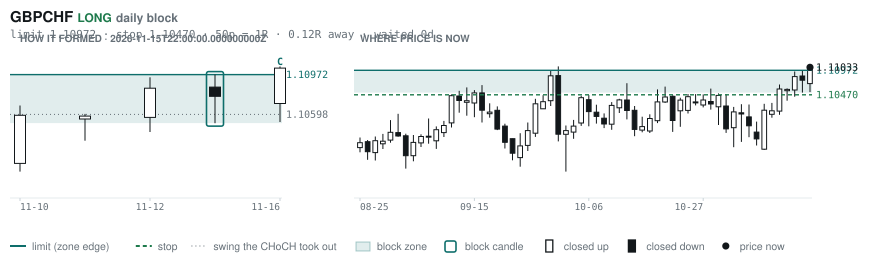
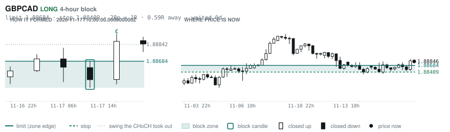
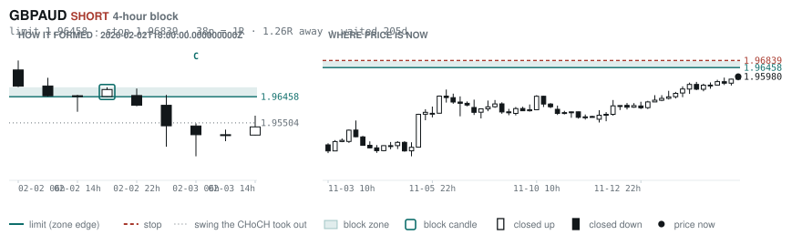
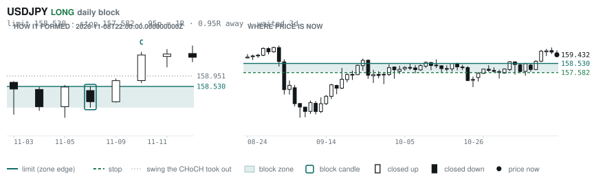
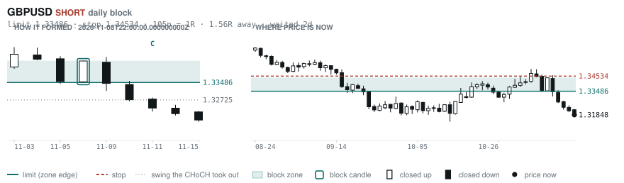
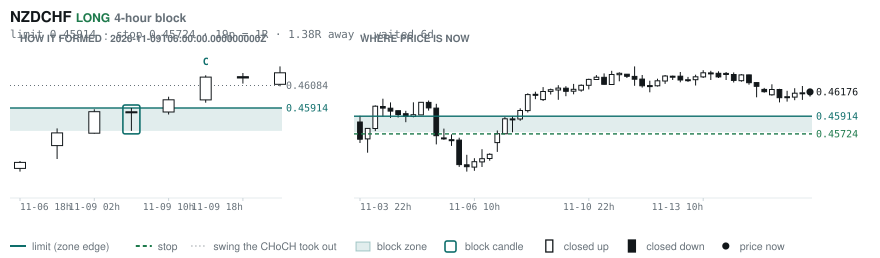

# Scanner Review — 2026-11-17 (evening)

Generated: 2026-11-18T00:00:42.204Z

```
## The clock

It is **18:00 Chicago** — a **DEAD** hour at 0.65x an average one.
An order placed now rests through **Tokyo, London and tomorrow's NY overlap** — about 16h of cover.
Next window: **Tokyo** in 1h.

_Evening pass. Orders placed now get the longest cover of the day: Tokyo, London, and tomorrow's NY overlap. Place limits and stops here — whatever does not fill overnight is still live for the morning._

## Where the energy is

**Running hot:** _nothing unusually active_
**Quiet:** NZDCHF 0.86 · GBPNZD 0.85 · NZDJPY 0.84 · EURNZD 0.84 · CADJPY 0.84 · NZDCAD 0.84

_Volatility persists for about two days, so a hot pair stays hot. It says nothing about direction — this picks the pair, the levels pick the side._

## Account

NAV **$1209.82**   unrealised $-343.00   margin available $88.58   4 open

| pair | units | now | P/L | stop | distance | news lean |
|---|---|---|---|---|---|---|
| EURCAD | 9000 | 1.57185 | $-75.90 | **none** | — | — |
| EURCAD | 11000 | 1.57185 | $-40.00 | **none** | — | — |
| EURCAD | 14000 | 1.57185 | $58.93 | **none** | — | — |
| EURCAD | 17000 | 1.57185 | $-286.03 | **none** | — | — |

**What the system reads on each position**

- **EURCAD** LONG — last REVERSAL LONG 10h ago at 1.56689 — system stop 1.55853, target **1.62068**; 488p to that target from here

## Order blocks live right now

### Daily

| pair | dir | limit | stop | 1R | spread | away | fills | waited | window | reaches 1R / 2R |
|---|---|---|---|---|---|---|---|---|---|---|
| GBPCHF | LONG | **1.10972** | 1.10470 | 50p $5.97 | 9% | 0.1R | 94% | 0d | 0.86x ⚠ | 68% / 39% |
| USDJPY | LONG | **158.530** | 157.582 | 95p $5.95 | 1% | 0.9R | 87% | 4d | 1.04x | 68% / 39% |
| GBPUSD | SHORT | **1.33486** | 1.34534 | 105p $10.48 | 2% | 1.3R | 81% | 3d | 0.89x ⚠ | 68% / 39% |

_6 more live but further out, 2.3R to 4.9R away. They alert on their own when they come within 1R._
_Older blocks run further: 60+ days reaches 2R 58% of the time against 34% for a same-day fill._

### 4-hour

| pair | dir | limit | stop | 1R | spread | away | fills | waited | window | reaches 1R / 2R |
|---|---|---|---|---|---|---|---|---|---|---|
| GBPCAD | LONG | **1.88684** | 1.88409 | 28p $1.92 | **21%** | 0.6R | 83% | 0d | 0.82x ⚠ | 70% / 46% |
| GBPAUD | SHORT | **1.96458** | 1.96839 | 38p $2.56 | 15% | 0.9R | 83% | 206d | 1.04x | 78% / 51% |
| NZDCHF | LONG | **0.45914** | 0.45724 | 19p $2.26 | **20%** | 1.4R | 79% | 6d | 1.03x | 77% / 47% |
| AUDUSD | LONG | **0.66954** | 0.66687 | 27p $2.67 | 5% | 1.4R | 79% | 216d | 1.00x | 78% / 51% |
| CADJPY | SHORT | **111.846** | 112.057 | 21p $1.33 | **21%** | 1.8R | 79% | 1d | 0.99x ⚠ | 70% / 46% |

_17 more live but further out, 2.1R to 7.8R away. They alert on their own when they come within 1R._
_H4 stops are a third of a daily one, so spread bites three times as hard — a bolded spread figure is most of the edge gone before price moves._

### In reach, drawn

_6 blocks within 2R of the limit. Blocks further out are in the tables above but not worth a picture yet._

**GBPCHF LONG** · daily · 0.12R away · waited 0d



**GBPCAD LONG** · 4-hour · 0.59R away · waited 0d



**GBPAUD SHORT** · 4-hour · 0.85R away · waited 206d



**USDJPY LONG** · daily · 0.90R away · waited 4d



**GBPUSD SHORT** · daily · 1.34R away · waited 3d



**NZDCHF LONG** · 4-hour · 1.38R away · waited 6d



_Left panel is the block forming, right is where price sits now. Legend is in each image._

## Scanner calls, last 1 day

| when | pair | dir | branch | firing | entry | stop | target | outcome |
|---|---|---|---|---|---|---|---|---|
| 11-17T02:00 | GBPCHF | SHORT | REV | 2nd | 1.10684 | 1.11354 | 1.08088 | open -0.52R |
| 11-17T02:00 | EURAUD | LONG | REV | 1st ⚠ | 1.63364 | 1.62127 | 1.65776 | open -0.03R |
| 11-17T02:00 | AUDCAD | SHORT | REV | 4th | 0.96358 | 0.97275 | 0.93882 | open +0.09R |
| 11-17T02:00 | CHFJPY | SHORT | REV | 2nd | 189.772 | 191.042 | 187.587 | open +0.14R |
| 11-17T02:00 | AUDNZD | SHORT | REV | 1st ⚠ | 1.22558 | 1.23470 | 1.18616 | open -0.02R |
| 11-17T06:00 | NZDJPY | LONG | REV | 1st ⚠ | 87.479 | 86.444 | 90.685 | open +0.07R |
| 11-17T06:00 | CADCHF | SHORT | REV | 4th | 0.58648 | 0.58981 | 0.56581 | open -0.44R |
| 11-17T10:00 | EURCHF | LONG | REV | 1st ⚠ | 0.92350 | 0.91753 | 0.94100 | open +0.18R |
| 11-17T10:00 | AUDCHF | LONG | REV | 2nd | 0.56618 | 0.55842 | 0.60005 | open -0.01R |
| 11-17T10:00 | AUDUSD | LONG | REV | 1st ⚠ | 0.67329 | 0.66645 | 0.72420 | open +0.02R |
| 11-17T10:00 | GBPAUD | SHORT | REV | 2nd | 1.95882 | 1.96957 | 1.84868 | open -0.23R |
| 11-17T10:00 | AUDJPY | LONG | REV | 3rd | 107.280 | 105.965 | 113.118 | open +0.03R |
| 11-17T10:00 | NZDUSD | SHORT | REV | 1st ⚠ | 0.54895 | 0.55544 | 0.53969 | open -0.06R |
| 11-17T14:00 | NZDCHF | SHORT | REV | 9th | 0.46166 | 0.46576 | 0.43366 | open -0.02R |
| 11-17T14:00 | GBPJPY | LONG | REV | 2nd | 210.610 | 208.664 | 218.430 | open -0.05R |
| 11-17T10:00 | CADJPY | SHORT | REV | 3rd | 111.476 | 112.576 | 109.609 | open +0.00R |
| 11-17T18:00 | USDJPY | LONG | REV | 2nd | 159.384 | 158.447 | 160.574 | open +0.00R |
| 11-17T18:00 | AUDCAD | LONG | REV | 2nd | 0.96278 | 0.95506 | 1.00292 | open +0.00R |
| 11-17T18:00 | CHFJPY | SHORT | REV | 3rd | 189.592 | 191.057 | 187.587 | open +0.00R |
| 11-17T18:00 | NZDCAD | SHORT | REV | 2nd | 0.78549 | 0.79105 | 0.75568 | open +0.00R |

## Running tally, last 30 days

3 resolved · 0 target / 3 stopped · **-3.0R** · -1.000R per call · 57 still open

```
