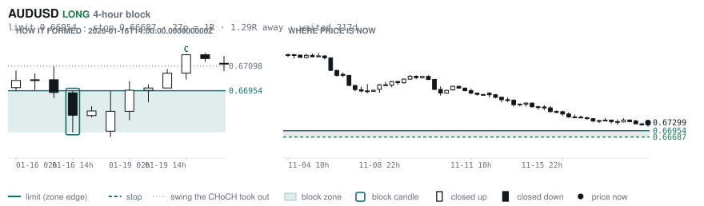
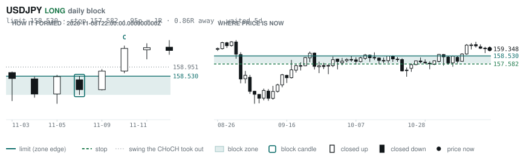
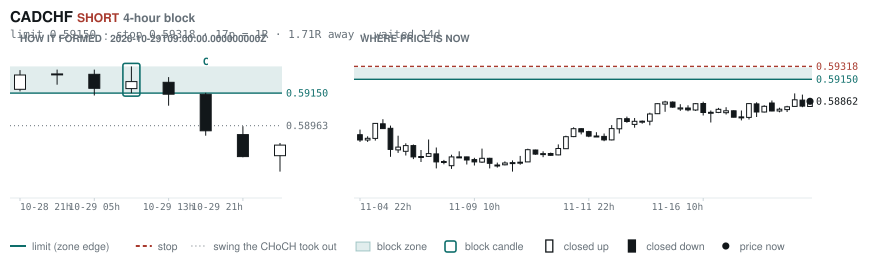
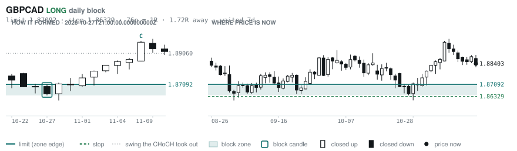
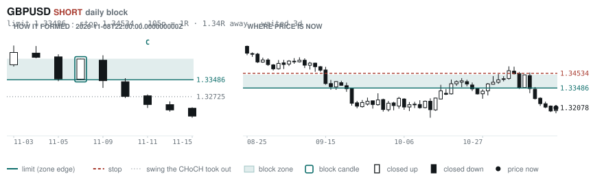

# Scanner Review — 2026-11-18 (evening)

Generated: 2026-11-19T00:00:39.009Z

```
## The clock

It is **18:00 Chicago** — a **DEAD** hour at 0.65x an average one.
An order placed now rests through **Tokyo, London and tomorrow's NY overlap** — about 16h of cover.
Next window: **Tokyo** in 1h.

_Evening pass. Orders placed now get the longest cover of the day: Tokyo, London, and tomorrow's NY overlap. Place limits and stops here — whatever does not fill overnight is still live for the morning._

## Where the energy is

**Running hot:** _nothing unusually active_
**Quiet:** AUDNZD 0.85 · EURNZD 0.85 · NZDCHF 0.85 · NZDUSD 0.83 · USDJPY 0.82 · NZDCAD 0.82

_Volatility persists for about two days, so a hot pair stays hot. It says nothing about direction — this picks the pair, the levels pick the side._

## Account

NAV **$1225.16**   unrealised $-323.38   margin available $105.91   4 open

| pair | units | now | P/L | stop | distance | news lean |
|---|---|---|---|---|---|---|
| EURCAD | 9000 | 1.57237 | $-72.41 | **none** | — | — |
| EURCAD | 11000 | 1.57237 | $-35.84 | **none** | — | — |
| EURCAD | 14000 | 1.57237 | $63.98 | **none** | — | — |
| EURCAD | 17000 | 1.57237 | $-279.11 | **none** | — | — |

**What the system reads on each position**

- **EURCAD** LONG — last REVERSAL LONG 10h ago at 1.57033 — system stop 1.56324, target **1.62068**; 483p to that target from here

## Order blocks live right now

### Daily

| pair | dir | limit | stop | 1R | spread | away | fills | waited | window | reaches 1R / 2R |
|---|---|---|---|---|---|---|---|---|---|---|
| USDJPY | LONG | **158.530** | 157.582 | 95p $5.95 | 2% | 0.9R | 87% | 5d | 1.04x | 68% / 39% |
| GBPCAD | LONG | **1.87092** | 1.86329 | 76p $5.33 | 9% | 1.7R | 81% | 7d | 0.82x ⚠ | 68% / 39% |
| GBPUSD | SHORT | **1.33486** | 1.34534 | 105p $10.48 | 2% | 1.9R | 81% | 4d | 0.89x ⚠ | 68% / 39% |

_6 more live but further out, 2.7R to 7.9R away. They alert on their own when they come within 1R._
_Older blocks run further: 60+ days reaches 2R 58% of the time against 34% for a same-day fill._

### 4-hour

| pair | dir | limit | stop | 1R | spread | away | fills | waited | window | reaches 1R / 2R |
|---|---|---|---|---|---|---|---|---|---|---|
| AUDUSD | LONG | **0.66954** | 0.66687 | 27p $2.67 | 5% | 0.7R | 83% | 217d | 1.00x | 78% / 51% |
| CADCHF | SHORT | **0.59150** | 0.59318 | 17p $2.00 | 17% | 1.7R | 79% | 14d | 0.83x ⚠ | 78% / 51% |

_18 more live but further out, 2.1R to 7.8R away. They alert on their own when they come within 1R._
_H4 stops are a third of a daily one, so spread bites three times as hard — a bolded spread figure is most of the edge gone before price moves._

### In reach, drawn

_5 blocks within 2R of the limit. Blocks further out are in the tables above but not worth a picture yet._

**AUDUSD LONG** · 4-hour · 0.65R away · waited 217d



**USDJPY LONG** · daily · 0.86R away · waited 5d



**CADCHF SHORT** · 4-hour · 1.71R away · waited 14d



**GBPCAD LONG** · daily · 1.72R away · waited 7d



**GBPUSD SHORT** · daily · 1.89R away · waited 4d



_Left panel is the block forming, right is where price sits now. Legend is in each image._

## Scanner calls, last 1 day

| when | pair | dir | branch | firing | entry | stop | target | outcome |
|---|---|---|---|---|---|---|---|---|
| 11-18T02:00 | GBPJPY | SHORT | REV | 3rd | 210.122 | 211.590 | 208.596 | open +0.39R |
| 11-18T02:00 | GBPCAD | SHORT | REV | 3rd | 1.88850 | 1.89802 | 1.83108 | open +0.47R |
| 11-18T02:00 | EURAUD | SHORT | REV | 1st ⚠ | 1.63426 | 1.64641 | 1.52860 | open -0.05R |
| 11-18T02:00 | AUDNZD | LONG | REV | 1st ⚠ | 1.22387 | 1.21468 | 1.29364 | open -0.17R |
| 11-18T02:00 | GBPAUD | SHORT | REV | 3rd | 1.96309 | 1.97829 | 1.91766 | open +0.27R |
| 11-18T06:00 | EURCHF | LONG | REV | 1st ⚠ | 0.92372 | 0.91764 | 0.94100 | open +0.30R |
| 11-18T06:00 | EURAUD | SHORT | REV | 4th | 1.63086 | 1.64261 | 1.52860 | open -0.34R |
| 11-18T06:00 | GBPUSD | LONG | REV | 1st ⚠ | 1.31710 | 1.30793 | 1.37339 | open -0.22R |
| 11-18T06:00 | AUDUSD | LONG | REV | 2nd | 0.67299 | 0.66661 | 0.72420 | open -0.27R |
| 11-18T06:00 | GBPCHF | SHORT | REV | 1st ⚠ | 1.10848 | 1.11647 | 1.08088 | open -0.06R |
| 11-18T06:00 | GBPAUD | SHORT | REV | 3rd | 1.95708 | 1.97013 | 1.91766 | open -0.15R |
| 11-18T06:00 | AUDJPY | LONG | REV | 4th | 107.171 | 105.984 | 110.924 | open -0.17R |
| 11-18T06:00 | EURJPY | LONG | REV | 5th | 174.780 | 173.639 | 181.884 | open +0.08R |
| 11-18T10:00 | USDCAD | SHORT | REV | 1st ⚠ | 1.43100 | 1.43862 | 1.37910 | open -0.23R |
| 11-18T10:00 | NZDCAD | SHORT | REV | 1st ⚠ | 0.78660 | 0.79247 | 0.75568 | open -0.04R |
| 11-18T14:00 | USDCAD | SHORT | REV | 7th | 1.43341 | 1.44159 | 1.37910 | open +0.08R |
| 11-18T14:00 | CADJPY | SHORT | WALL | 1st ⚠ | 111.116 | 111.732 | 109.609 | open -0.17R |
| 11-18T14:00 | GBPCHF | SHORT | REV | 1st ⚠ | 1.10836 | 1.11666 | 1.08088 | open -0.07R |
| 11-18T14:00 | EURGBP | LONG | REV | 1st ⚠ | 0.83463 | 0.83005 | 0.84230 | open -0.02R |
| 11-18T14:00 | AUDNZD | LONG | REV | 2nd | 1.22320 | 1.21490 | 1.29364 | open -0.11R |
| 11-18T18:00 | GBPJPY | LONG | REV | 4th | 209.544 | 207.824 | 218.430 | open +0.00R |
| 11-18T18:00 | EURJPY | LONG | REV | 1st ⚠ | 174.866 | 173.717 | 181.884 | open +0.00R |

```
