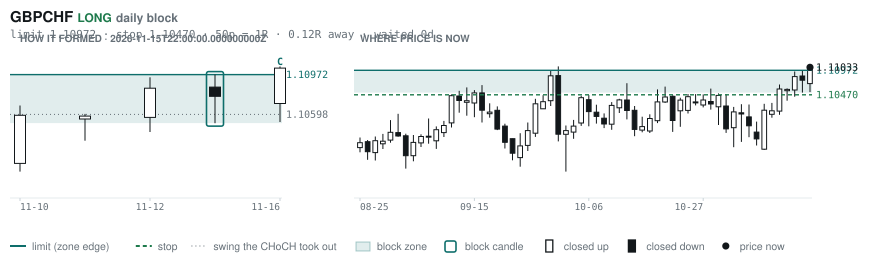
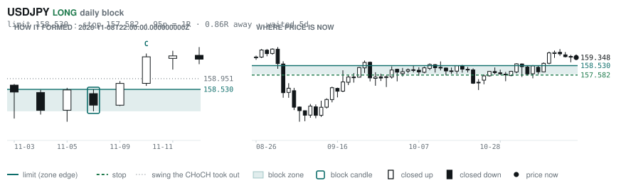
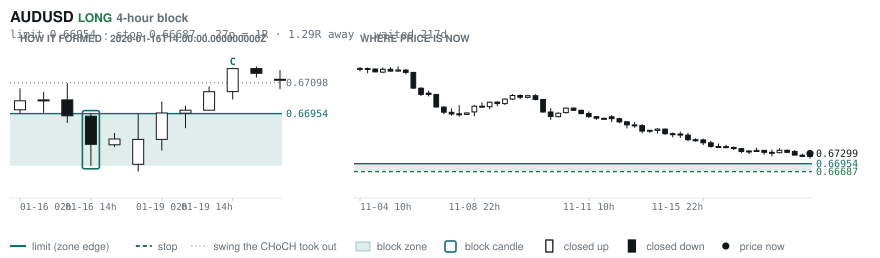
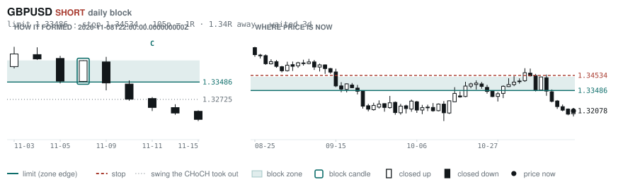
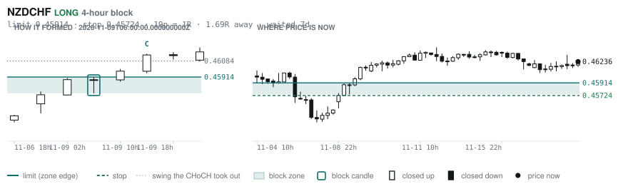

# Scanner Review — 2026-11-18 (morning)

Generated: 2026-11-18T12:00:40.357Z

```
## The clock

It is **06:00 Chicago** — a **normal** hour at 1.10x an average one.
An order placed now rests through **the NY overlap** — about 5h of cover.
Next window: **NY overlap** in 1h.

_Morning pass. The NY overlap is the single best window of the day but it is the only one left before the afternoon goes dead, so this is the adjustment pass: the morning-skewed pairs, and anything that filled overnight._

## Where the energy is

**Running hot:** _nothing unusually active_
**Quiet:** NZDJPY 0.88 · NZDCHF 0.87 · USDJPY 0.87 · NZDUSD 0.84 · NZDCAD 0.84 · CADJPY 0.84

_Volatility persists for about two days, so a hot pair stays hot. It says nothing about direction — this picks the pair, the levels pick the side._

## Account

NAV **$1091.69**   unrealised $-461.13   margin available $0.00   4 open

| pair | units | now | P/L | stop | distance | news lean |
|---|---|---|---|---|---|---|
| EURCAD | 9000 | 1.56852 | $-96.74 | **none** | — | — |
| EURCAD | 11000 | 1.56852 | $-65.50 | **none** | — | — |
| EURCAD | 14000 | 1.56852 | $26.41 | **none** | — | — |
| EURCAD | 17000 | 1.56852 | $-325.30 | **none** | — | — |

**What the system reads on each position**

- **EURCAD** LONG — last REVERSAL LONG 14h ago at 1.57033 — system stop 1.56352, target **1.62068**; 522p to that target from here

## Order blocks live right now

### Daily

| pair | dir | limit | stop | 1R | spread | away | fills | waited | window | reaches 1R / 2R |
|---|---|---|---|---|---|---|---|---|---|---|
| GBPCHF | LONG | **1.10972** | 1.10470 | 50p $5.97 | 8% | 0.1R | 94% | 0d | 1.51x | 68% / 39% |
| USDJPY | LONG | **158.530** | 157.582 | 95p $5.95 | 2% | 0.9R | 87% | 4d | 1.37x | 68% / 39% |
| GBPUSD | SHORT | **1.33486** | 1.34534 | 105p $10.48 | 2% | 1.3R | 81% | 3d | 1.54x | 68% / 39% |

_6 more live but further out, 2.3R to 4.9R away. They alert on their own when they come within 1R._
_Older blocks run further: 60+ days reaches 2R 58% of the time against 34% for a same-day fill._

### 4-hour

| pair | dir | limit | stop | 1R | spread | away | fills | waited | window | reaches 1R / 2R |
|---|---|---|---|---|---|---|---|---|---|---|
| AUDUSD | LONG | **0.66954** | 0.66687 | 27p $2.67 | 5% | 1.3R | 79% | 217d | 1.44x | 78% / 51% |
| NZDCHF | LONG | **0.45914** | 0.45724 | 19p $2.26 | 19% | 1.7R | 79% | 7d | 1.27x | 78% / 51% |

_18 more live but further out, 2.0R to 8.0R away. They alert on their own when they come within 1R._
_H4 stops are a third of a daily one, so spread bites three times as hard — a bolded spread figure is most of the edge gone before price moves._

### In reach, drawn

_5 blocks within 2R of the limit. Blocks further out are in the tables above but not worth a picture yet._

**GBPCHF LONG** · daily · 0.12R away · waited 0d



**USDJPY LONG** · daily · 0.90R away · waited 4d



**AUDUSD LONG** · 4-hour · 1.29R away · waited 217d



**GBPUSD SHORT** · daily · 1.34R away · waited 3d



**NZDCHF LONG** · 4-hour · 1.69R away · waited 7d



_Left panel is the block forming, right is where price sits now. Legend is in each image._

## Scanner calls, last 1 day

| when | pair | dir | branch | firing | entry | stop | target | outcome |
|---|---|---|---|---|---|---|---|---|
| 11-17T14:00 | NZDCHF | SHORT | REV | 9th | 0.46166 | 0.46576 | 0.43366 | open -0.17R |
| 11-17T14:00 | GBPJPY | LONG | REV | 2nd | 210.610 | 208.664 | 218.430 | open -0.44R |
| 11-17T18:00 | USDJPY | LONG | REV | 2nd | 159.384 | 158.447 | 160.574 | open -0.15R |
| 11-17T18:00 | AUDCAD | LONG | REV | 2nd | 0.96278 | 0.95506 | 1.00292 | open +0.09R |
| 11-17T18:00 | CHFJPY | SHORT | REV | 3rd | 189.592 | 191.057 | 187.587 | open +0.26R |
| 11-17T18:00 | NZDCAD | SHORT | REV | 2nd | 0.78549 | 0.79105 | 0.75568 | open -0.18R |
| 11-17T22:00 | EURNZD | LONG | REV | 3rd | 2.00044 | 1.98452 | 2.08038 | open -0.17R |
| 11-17T22:00 | NZDCHF | SHORT | REV | 2nd | 0.46176 | 0.46629 | 0.43366 | open -0.13R |
| 11-17T22:00 | NZDCAD | SHORT | REV | 1st ⚠ | 0.78621 | 0.79274 | 0.75568 | open -0.04R |
| 11-17T22:00 | AUDCAD | SHORT | REV | 3rd | 0.96187 | 0.96968 | 0.93882 | open -0.20R |
| 11-17T22:00 | CADJPY | SHORT | REV | 4th | 111.457 | 112.548 | 109.609 | open +0.20R |
| 11-18T02:00 | GBPJPY | SHORT | REV | 3rd | 210.122 | 211.590 | 208.596 | open +0.26R |
| 11-18T02:00 | GBPCAD | SHORT | REV | 3rd | 1.88850 | 1.89802 | 1.83108 | open +0.31R |
| 11-18T02:00 | EURAUD | SHORT | REV | 1st ⚠ | 1.63426 | 1.64641 | 1.52860 | open +0.28R |
| 11-18T02:00 | AUDNZD | LONG | REV | 1st ⚠ | 1.22387 | 1.21468 | 1.29364 | open +0.13R |
| 11-18T02:00 | GBPAUD | SHORT | REV | 3rd | 1.96309 | 1.97829 | 1.91766 | open +0.40R |
| 11-18T06:00 | EURCHF | LONG | REV | 1st ⚠ | 0.92372 | 0.91764 | 0.94100 | open +0.00R |
| 11-18T06:00 | EURAUD | SHORT | REV | 4th | 1.63086 | 1.64261 | 1.52860 | open +0.00R |
| 11-18T06:00 | GBPUSD | LONG | REV | 1st ⚠ | 1.31710 | 1.30793 | 1.37339 | open +0.00R |
| 11-18T06:00 | AUDUSD | LONG | REV | 2nd | 0.67299 | 0.66661 | 0.72420 | open +0.00R |
| 11-18T06:00 | GBPCHF | SHORT | REV | 1st ⚠ | 1.10848 | 1.11647 | 1.08088 | open +0.00R |
| 11-18T06:00 | GBPAUD | SHORT | REV | 3rd | 1.95708 | 1.97013 | 1.91766 | open +0.00R |
| 11-18T06:00 | AUDJPY | LONG | REV | 4th | 107.171 | 105.984 | 110.924 | open +0.00R |
| 11-18T06:00 | EURJPY | LONG | REV | 5th | 174.780 | 173.639 | 181.884 | open +0.00R |

## Running tally, last 30 days

1 resolved · 0 target / 1 stopped · **-1.0R** · -1.000R per call · 59 still open

```
