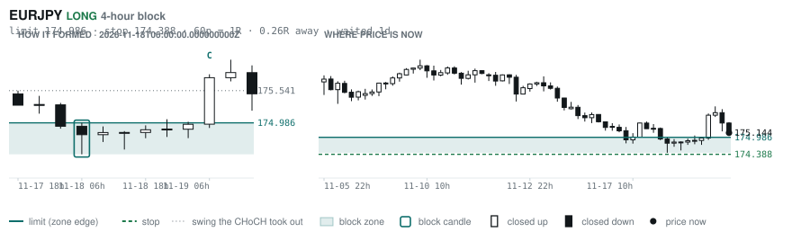
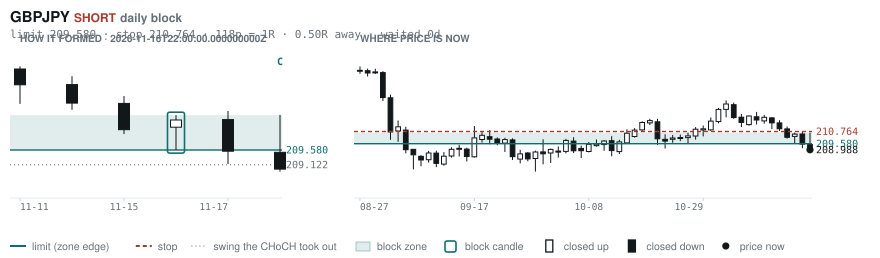
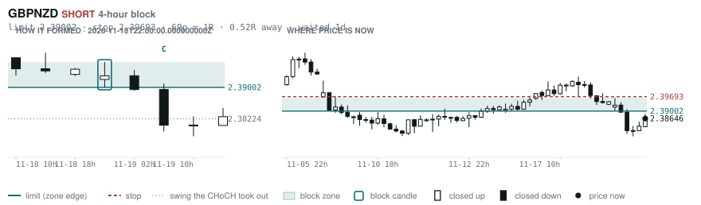
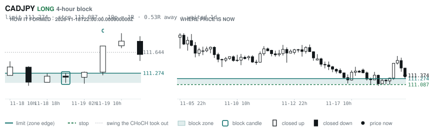
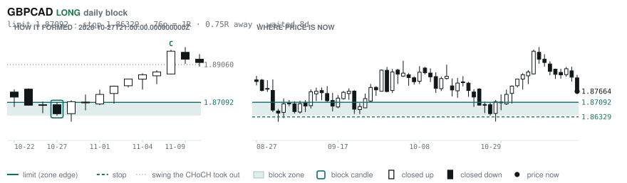
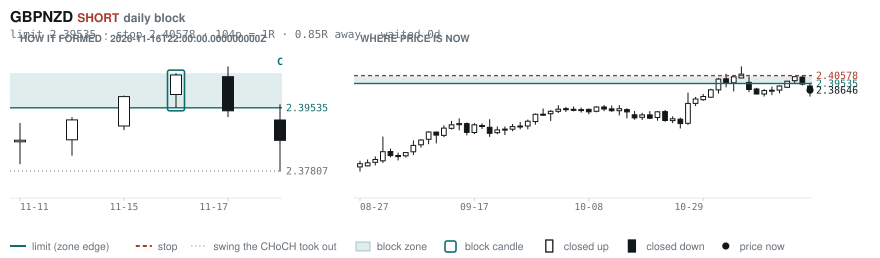

# Scanner Review — 2026-11-19 (evening)

Generated: 2026-11-20T00:00:43.609Z

```
## The clock

It is **18:00 Chicago** — a **DEAD** hour at 0.65x an average one.
An order placed now rests through **Tokyo, London and tomorrow's NY overlap** — about 16h of cover.
Next window: **Tokyo** in 1h.

_Evening pass. Orders placed now get the longest cover of the day: Tokyo, London, and tomorrow's NY overlap. Place limits and stops here — whatever does not fill overnight is still live for the morning._

## Where the energy is

**Running hot:** AUDJPY 1.17 · AUDUSD 1.17
**Quiet:** EURCHF 0.88 · USDCHF 0.88 · USDJPY 0.80

_Volatility persists for about two days, so a hot pair stays hot. It says nothing about direction — this picks the pair, the levels pick the side._

## Account

NAV **$1252.80**   unrealised $-294.33   margin available $133.95   4 open

| pair | units | now | P/L | stop | distance | news lean |
|---|---|---|---|---|---|---|
| EURCAD | 9000 | 1.57319 | $-67.27 | **none** | — | — |
| EURCAD | 11000 | 1.57319 | $-29.60 | **none** | — | — |
| EURCAD | 14000 | 1.57319 | $71.83 | **none** | — | — |
| EURCAD | 17000 | 1.57319 | $-269.29 | **none** | — | — |

**What the system reads on each position**

- **EURCAD** LONG — last REVERSAL LONG 10h ago at 1.57033 — system stop 1.56329, target **1.62068**; 475p to that target from here

## Order blocks live right now

### Daily

| pair | dir | limit | stop | 1R | spread | away | fills | waited | window | reaches 1R / 2R |
|---|---|---|---|---|---|---|---|---|---|---|
| GBPJPY | SHORT | **209.580** | 210.764 | 118p $7.41 | 3% | 0.5R | 87% | 0d | 1.03x | 68% / 39% |
| GBPCAD | LONG | **1.87092** | 1.86329 | 76p $5.32 | 7% | 0.7R | 87% | 8d | 0.82x ⚠ | 68% / 39% |
| GBPNZD | SHORT | **2.39535** | 2.40578 | 104p $5.72 | 13% | 0.9R | 87% | 0d | 1.04x | 68% / 39% |
| USDJPY | LONG | **158.530** | 157.582 | 95p $5.94 | 2% | 1.2R | 81% | 6d | 1.04x | 68% / 39% |
| EURGBP | LONG | **0.83460** | 0.83222 | 24p $3.11 | 5% | 1.4R | 81% | 0d | 0.85x ⚠ | 68% / 39% |

_7 more live but further out, 2.1R to 7.5R away. They alert on their own when they come within 1R._
_Older blocks run further: 60+ days reaches 2R 58% of the time against 34% for a same-day fill._

### 4-hour

| pair | dir | limit | stop | 1R | spread | away | fills | waited | window | reaches 1R / 2R |
|---|---|---|---|---|---|---|---|---|---|---|
| EURJPY | LONG | **174.986** | 174.388 | 60p $3.75 | 5% | 0.3R | 87% | 1d | 1.07x | 70% / 46% |
| GBPNZD | SHORT | **2.39002** | 2.39693 | 69p $3.79 | 19% | 0.5R | 83% | 1d | 1.04x | 70% / 46% |
| CADJPY | LONG | **111.274** | 111.087 | 19p $1.17 | **24%** | 0.5R | 83% | 1d | 0.99x ⚠ | 70% / 46% |
| USDJPY | LONG | **159.400** | 159.131 | 27p $1.69 | 6% | 1.0R | 79% | 1d | 1.04x | 70% / 46% |
| CADCHF | SHORT | **0.59150** | 0.59318 | 17p $1.99 | 17% | 1.7R | 79% | 15d | 0.83x ⚠ | 78% / 51% |
| NZDCHF | LONG | **0.45914** | 0.45724 | 19p $2.25 | 20% | 2.0R | 79% | 8d | 1.03x | 78% / 51% |

_19 more live but further out, 2.1R to 8.0R away. They alert on their own when they come within 1R._
_H4 stops are a third of a daily one, so spread bites three times as hard — a bolded spread figure is most of the edge gone before price moves._

### In reach, drawn

_6 blocks within 2R of the limit. Blocks further out are in the tables above but not worth a picture yet._

**EURJPY LONG** · 4-hour · 0.26R away · waited 1d



**GBPJPY SHORT** · daily · 0.50R away · waited 0d



**GBPNZD SHORT** · 4-hour · 0.52R away · waited 1d



**CADJPY LONG** · 4-hour · 0.53R away · waited 1d



**GBPCAD LONG** · daily · 0.75R away · waited 8d



**GBPNZD SHORT** · daily · 0.85R away · waited 0d



_Left panel is the block forming, right is where price sits now. Legend is in each image._

## Scanner calls, last 1 day

| when | pair | dir | branch | firing | entry | stop | target | outcome |
|---|---|---|---|---|---|---|---|---|
| 11-19T02:00 | GBPCAD | SHORT | REV | 2nd | 1.88310 | 1.89467 | 1.83108 | open +0.56R |
| 11-19T02:00 | EURCHF | LONG | REV | 4th | 0.92510 | 0.91954 | 0.94103 | open +0.11R |
| 11-19T02:00 | USDCAD | SHORT | REV | 1st ⚠ | 1.43381 | 1.44339 | 1.37910 | open -0.01R |
| 11-19T02:00 | AUDCAD | LONG | REV | 1st ⚠ | 0.95891 | 0.94976 | 1.00292 | open -0.46R |
| 11-19T02:00 | AUDUSD | LONG | REV | 1st ⚠ | 0.66888 | 0.66182 | 0.72420 | open -0.42R |
| 11-19T06:00 | EURNZD | SHORT | REV | 4th | 1.99074 | 2.00710 | 1.95988 | open -0.55R |
| 11-19T06:00 | USDCAD | SHORT | REV | 8th | 1.43095 | 1.44155 | 1.37910 | open -0.28R |
| 11-19T06:00 | EURGBP | SHORT | REV | 1st ⚠ | 0.83620 | 0.83987 | 0.82430 | open -0.48R |
| 11-19T06:00 | CHFJPY | SHORT | REV | 4th | 189.770 | 191.054 | 187.587 | open +0.44R |
| 11-19T10:00 | EURJPY | SHORT | REV | 1st ⚠ | 175.854 | 177.173 | 173.846 | open +0.54R |
| 11-19T10:00 | GBPUSD | LONG | REV | 4th | 1.31562 | 1.30598 | 1.37339 | open -0.71R |
| 11-19T10:00 | NZDCAD | SHORT | REV | 8th | 0.79004 | 0.79652 | 0.75568 | open +0.56R |
| 11-19T14:00 | NZDCHF | LONG | REV | 10th | 0.46404 | 0.45969 | 0.47585 | open -0.27R |
| 11-19T14:00 | EURCAD | LONG | REV | 4th | 1.57240 | 1.56329 | 1.62068 | open +0.00R |
| 11-19T14:00 | GBPAUD | LONG | REV | 2nd | 1.96443 | 1.94480 | 2.01992 | open +0.05R |
| 11-19T14:00 | NZDCAD | SHORT | REV | 4th | 0.78770 | 0.79468 | 0.75568 | open +0.18R |
| 11-19T14:00 | GBPCHF | LONG | REV | 1st ⚠ | 1.10568 | 1.09940 | 1.11572 | open -0.17R |
| 11-19T14:00 | CADJPY | SHORT | REV | 1st ⚠ | 111.604 | 112.407 | 109.609 | open +0.29R |
| 11-19T14:00 | AUDJPY | SHORT | WALL | 2nd | 106.618 | 107.340 | 105.171 | open +0.40R |
| 11-19T18:00 | NZDJPY | SHORT | REV | 3rd | 87.573 | 88.611 | 85.691 | open +0.00R |
| 11-19T18:00 | CADJPY | SHORT | REV | 5th | 111.374 | 112.633 | 109.609 | open +0.00R |
| 11-19T18:00 | USDCAD | SHORT | REV | 1st ⚠ | 1.43394 | 1.44413 | 1.37910 | open +0.00R |
| 11-19T18:00 | CHFJPY | SHORT | REV | 2nd | 189.202 | 190.801 | 187.587 | open +0.00R |
| 11-19T18:00 | EURGBP | SHORT | REV | 1st ⚠ | 0.83796 | 0.84117 | 0.82430 | open +0.00R |
| 11-19T18:00 | USDJPY | SHORT | REV | 5th | 159.679 | 160.404 | 155.748 | open +0.00R |

## Running tally, last 30 days

17 resolved · 0 target / 17 stopped · **-17.0R** · -1.000R per call · 43 still open

```
