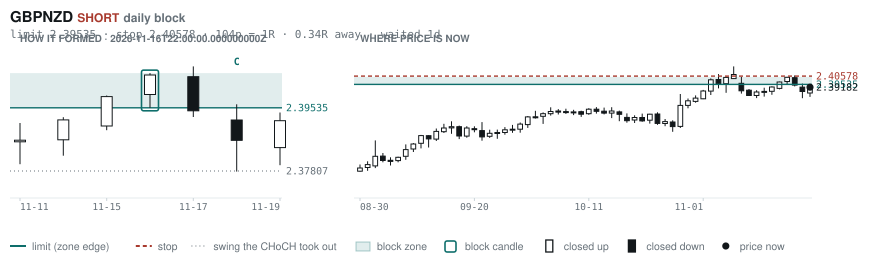
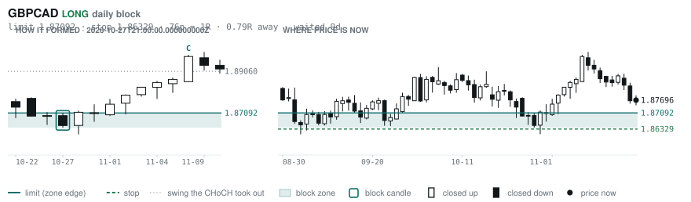
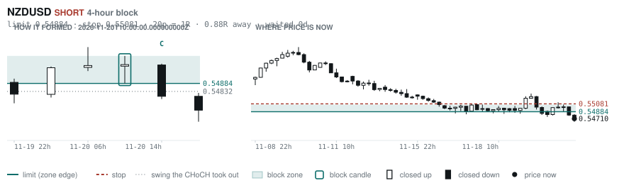
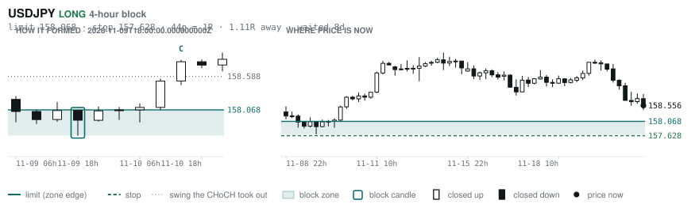
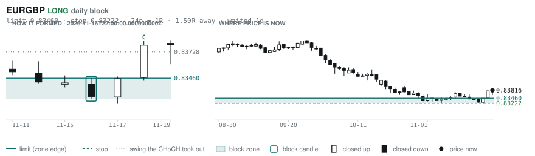
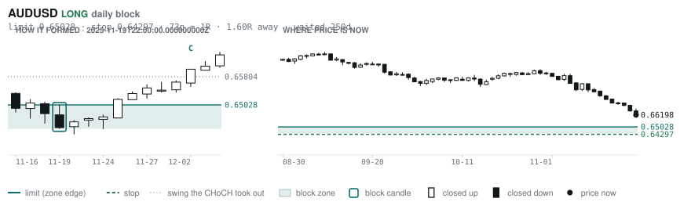

# Scanner Review — 2026-11-22 (evening)

Generated: 2026-11-23T00:00:36.132Z

```
## The clock

It is **18:00 Chicago** — a **DEAD** hour at 0.65x an average one.
An order placed now rests through **Tokyo, London and tomorrow's NY overlap** — about 16h of cover.
Next window: **Tokyo** in 1h.

_Evening pass. Orders placed now get the longest cover of the day: Tokyo, London, and tomorrow's NY overlap. Place limits and stops here — whatever does not fill overnight is still live for the morning._

## Where the energy is

**Running hot:** AUDJPY 1.28 · EURAUD 1.23 · AUDCHF 1.21 · AUDUSD 1.20 · GBPAUD 1.20 · AUDCAD 1.17 · GBPJPY 1.15
**Quiet:** _none_

_Volatility persists for about two days, so a hot pair stays hot. It says nothing about direction — this picks the pair, the levels pick the side._

## Account

NAV **$1256.27**   unrealised $-289.43   margin available $137.04   4 open

| pair | units | now | P/L | stop | distance | news lean |
|---|---|---|---|---|---|---|
| EURCAD | 9000 | 1.57334 | $-66.41 | **none** | — | — |
| EURCAD | 11000 | 1.57334 | $-28.54 | **none** | — | — |
| EURCAD | 14000 | 1.57334 | $73.22 | **none** | — | — |
| EURCAD | 17000 | 1.57334 | $-267.70 | **none** | — | — |

**What the system reads on each position**

- **EURCAD** LONG — last REVERSAL LONG 62h ago at 1.57033 — system stop 1.56337, target **1.62068**; 473p to that target from here

## Order blocks live right now

### Daily

| pair | dir | limit | stop | 1R | spread | away | fills | waited | window | reaches 1R / 2R |
|---|---|---|---|---|---|---|---|---|---|---|
| GBPNZD | SHORT | **2.39535** | 2.40578 | 104p $5.71 | 13% | 0.3R | 94% | 1d | 1.04x | 68% / 39% |
| GBPCAD | LONG | **1.87092** | 1.86329 | 76p $5.32 | 8% | 0.8R | 87% | 9d | 0.82x ⚠ | 68% / 39% |
| EURGBP | LONG | **0.83460** | 0.83222 | 24p $3.11 | 5% | 1.5R | 81% | 1d | 0.85x ⚠ | 68% / 39% |
| AUDUSD | LONG | **0.65028** | 0.64297 | 73p $7.31 | 2% | 1.6R | 81% | 250d | 1.00x | 75% / 53% |
| GBPJPY | SHORT | **209.580** | 210.764 | 118p $7.46 | 4% | 1.8R | 81% | 1d | 1.03x | 68% / 39% |

_6 more live but further out, 2.4R to 6.6R away. They alert on their own when they come within 1R._
_Older blocks run further: 60+ days reaches 2R 58% of the time against 34% for a same-day fill._

### 4-hour

| pair | dir | limit | stop | 1R | spread | away | fills | waited | window | reaches 1R / 2R |
|---|---|---|---|---|---|---|---|---|---|---|
| NZDUSD | SHORT | **0.54884** | 0.55081 | 20p $1.97 | 12% | 0.9R | 83% | 0d | 0.99x ⚠ | 70% / 46% |
| USDJPY | LONG | **158.068** | 157.628 | 44p $2.78 | 4% | 1.1R | 79% | 8d | 1.04x | 78% / 51% |
| CADCHF | SHORT | **0.58862** | 0.59032 | 17p $2.03 | 18% | 1.7R | 79% | 0d | 0.83x ⚠ | 70% / 46% |

_16 more live but further out, 2.6R to 7.9R away. They alert on their own when they come within 1R._
_H4 stops are a third of a daily one, so spread bites three times as hard — a bolded spread figure is most of the edge gone before price moves._

### In reach, drawn

_6 blocks within 2R of the limit. Blocks further out are in the tables above but not worth a picture yet._

**GBPNZD SHORT** · daily · 0.34R away · waited 1d



**GBPCAD LONG** · daily · 0.79R away · waited 9d



**NZDUSD SHORT** · 4-hour · 0.88R away · waited 0d



**USDJPY LONG** · 4-hour · 1.11R away · waited 8d



**EURGBP LONG** · daily · 1.50R away · waited 1d



**AUDUSD LONG** · daily · 1.60R away · waited 250d



_Left panel is the block forming, right is where price sits now. Legend is in each image._

## Scanner calls, last 1 day

_None._

## Running tally, last 30 days

13 resolved · 3 target / 10 stopped · **-4.6R** · -0.351R per call · 47 still open

```
