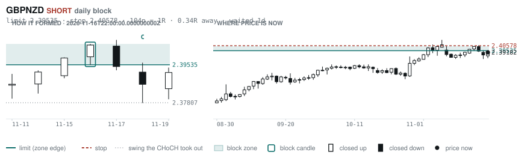
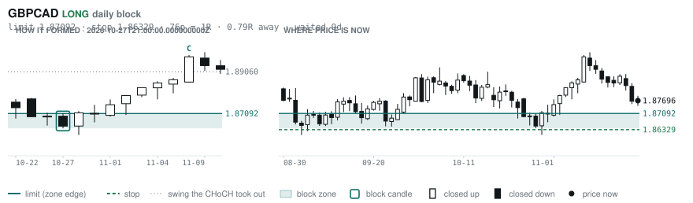
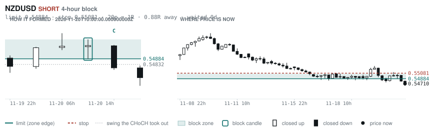
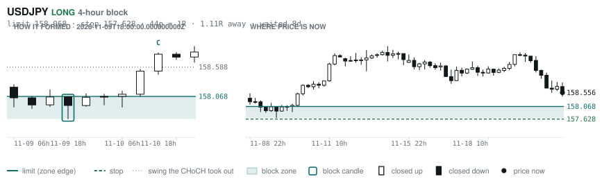
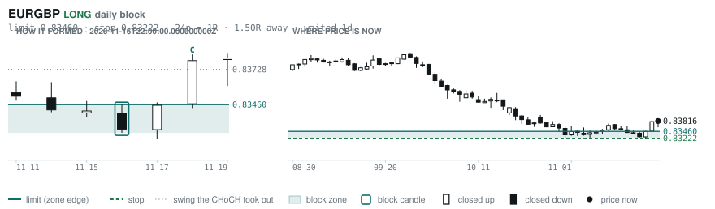
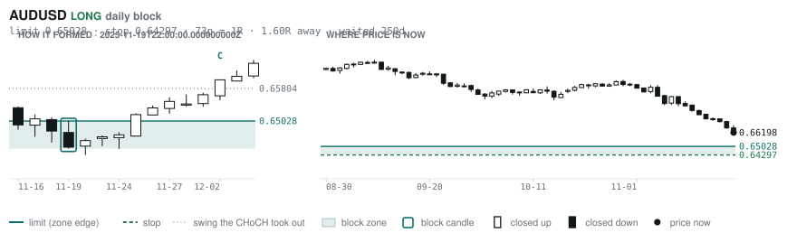

# Scanner Review — 2026-11-22 (weekly)

Generated: 2026-11-22T20:00:49.797Z

```
## The clock

It is **14:00 Chicago** — a **DEAD** hour at 0.74x an average one.
An order placed now rests through **tomorrow — the rest of today is dead**.
Next window: **Tokyo** in 5h.

## Where the energy is

**Running hot:** AUDJPY 1.28 · EURAUD 1.23 · AUDCHF 1.21 · AUDUSD 1.20 · GBPAUD 1.20 · AUDCAD 1.17 · GBPJPY 1.15
**Quiet:** _none_

_Volatility persists for about two days, so a hot pair stays hot. It says nothing about direction — this picks the pair, the levels pick the side._

## Account

NAV **$1238.83**   unrealised $-306.87   margin available $119.87   4 open

| pair | units | now | P/L | stop | distance | news lean |
|---|---|---|---|---|---|---|
| EURCAD | 9000 | 1.57319 | $-69.48 | **none** | — | — |
| EURCAD | 11000 | 1.57319 | $-32.29 | **none** | — | — |
| EURCAD | 14000 | 1.57319 | $68.41 | **none** | — | — |
| EURCAD | 17000 | 1.57319 | $-273.50 | **none** | — | — |

**What the system reads on each position**

- **EURCAD** LONG — last REVERSAL LONG 58h ago at 1.57033 — system stop 1.56337, target **1.62068**; 475p to that target from here

## Order blocks live right now

### Daily

| pair | dir | limit | stop | 1R | spread | away | fills | waited | window | reaches 1R / 2R |
|---|---|---|---|---|---|---|---|---|---|---|
| GBPNZD | SHORT | **2.39535** | 2.40578 | 104p $5.71 | **30%** | 0.3R | 94% | 1d | 1.26x | 68% / 39% |
| GBPCAD | LONG | **1.87092** | 1.86329 | 76p $5.32 | **27%** | 0.8R | 87% | 9d | 1.58x | 68% / 39% |
| EURGBP | LONG | **0.83460** | 0.83222 | 24p $3.11 | **33%** | 1.5R | 81% | 1d | 1.50x | 68% / 39% |
| AUDUSD | LONG | **0.65028** | 0.64297 | 73p $7.31 | 9% | 1.6R | 81% | 250d | 1.44x | 75% / 53% |
| GBPJPY | SHORT | **209.580** | 210.764 | 118p $7.46 | 18% | 1.8R | 81% | 1d | 1.37x | 68% / 39% |

_6 more live but further out, 2.4R to 6.6R away. They alert on their own when they come within 1R._
_Older blocks run further: 60+ days reaches 2R 58% of the time against 34% for a same-day fill._

### 4-hour

| pair | dir | limit | stop | 1R | spread | away | fills | waited | window | reaches 1R / 2R |
|---|---|---|---|---|---|---|---|---|---|---|
| NZDUSD | SHORT | **0.54884** | 0.55081 | 20p $1.97 | **34%** | 0.9R | 83% | 0d | 1.39x | 70% / 46% |
| USDJPY | LONG | **158.068** | 157.628 | 44p $2.78 | 12% | 1.1R | 79% | 8d | 1.37x | 78% / 51% |
| CADCHF | SHORT | **0.58862** | 0.59032 | 17p $2.03 | **36%** | 1.7R | 79% | 0d | 1.56x | 70% / 46% |

_16 more live but further out, 2.6R to 7.9R away. They alert on their own when they come within 1R._
_H4 stops are a third of a daily one, so spread bites three times as hard — a bolded spread figure is most of the edge gone before price moves._

### In reach, drawn

_6 blocks within 2R of the limit. Blocks further out are in the tables above but not worth a picture yet._

**GBPNZD SHORT** · daily · 0.34R away · waited 1d



**GBPCAD LONG** · daily · 0.79R away · waited 9d



**NZDUSD SHORT** · 4-hour · 0.88R away · waited 0d



**USDJPY LONG** · 4-hour · 1.11R away · waited 8d



**EURGBP LONG** · daily · 1.50R away · waited 1d



**AUDUSD LONG** · daily · 1.60R away · waited 250d



_Left panel is the block forming, right is where price sits now. Legend is in each image._

## Scanner calls, last 7 days

| when | pair | dir | branch | firing | entry | stop | target | outcome |
|---|---|---|---|---|---|---|---|---|
| 11-15T22:00 | NZDCHF | LONG | REV | 8th | 0.46364 | 0.46002 | 0.48192 | stopped -1.00R |
| 11-15T22:00 | USDCAD | SHORT | REV | 7th | 1.42727 | 1.43596 | 1.37910 | open -0.81R |
| 11-15T22:00 | GBPCHF | SHORT | REV | 1st ⚠ | 1.10859 | 1.11614 | 1.08088 | open +1.22R |
| 11-15T22:00 | AUDNZD | SHORT | REV | 4th | 1.22416 | 1.23292 | 1.18616 | open +1.62R |
| 11-16T02:00 | NZDJPY | LONG | REV | 5th | 88.044 | 87.150 | 90.685 | stopped -1.00R |
| 11-16T02:00 | CADJPY | LONG | REV | 3rd | 111.722 | 110.727 | 115.844 | stopped -1.00R |
| 11-16T02:00 | EURJPY | LONG | REV | 1st ⚠ | 175.750 | 174.314 | 181.884 | stopped -1.00R |
| 11-16T02:00 | AUDCHF | LONG | REV | 1st ⚠ | 0.56637 | 0.56113 | 0.60005 | stopped -1.00R |
| 11-16T02:00 | NZDCAD | SHORT | REV | 5th | 0.78809 | 0.79433 | 0.75568 | open +0.54R |
| 11-16T02:00 | GBPAUD | LONG | WALL | 4th | 1.95560 | 1.94560 | 2.01992 | open +2.11R |
| 11-16T06:00 | CADCHF | LONG | REV | 1st ⚠ | 0.58830 | 0.58328 | 0.60486 | open -0.50R |
| 11-16T06:00 | GBPCAD | SHORT | REV | 3rd | 1.88408 | 1.89459 | 1.83108 | open +0.68R |
| 11-16T06:00 | EURCHF | LONG | REV | 2nd | 0.92526 | 0.91940 | 0.94100 | open -0.64R |
| 11-16T06:00 | AUDCHF | LONG | REV | 4th | 0.56752 | 0.56171 | 0.60005 | stopped -1.00R |
| 11-16T06:00 | AUDCAD | LONG | REV | 2nd | 0.96466 | 0.95478 | 1.00292 | stopped -1.00R |
| 11-16T06:00 | EURGBP | LONG | REV | 14th | 0.83476 | 0.83046 | 0.84230 | open +0.79R |
| 11-16T10:00 | EURNZD | LONG | REV | 1st ⚠ | 1.99767 | 1.98388 | 2.08038 | open +0.51R |
| 11-16T10:00 | EURCHF | LONG | REV | 8th | 0.92444 | 0.91963 | 0.94100 | stopped -1.00R |
| 11-16T02:00 | EURAUD | SHORT | REV | 7th | 1.63178 | 1.64375 | 1.52860 | stopped -1.00R |
| 11-16T10:00 | GBPCHF | SHORT | REV | 2nd | 1.10802 | 1.11617 | 1.08088 | open +1.06R |
| 11-16T10:00 | CHFJPY | LONG | REV | 8th | 190.155 | 188.570 | 198.808 | stopped -1.00R |
| 11-16T10:00 | USDJPY | LONG | REV | 4th | 159.631 | 158.720 | 160.574 | stopped -1.00R |
| 11-16T14:00 | NZDCHF | LONG | REV | 3rd | 0.46236 | 0.45817 | 0.48192 | open -0.65R |
| 11-16T14:00 | EURAUD | SHORT | REV | 8th | 1.63116 | 1.64345 | 1.52860 | stopped -1.00R |
| 11-16T14:00 | AUDNZD | LONG | REV | 3rd | 1.22516 | 1.21818 | 1.29364 | stopped -1.00R |
| 11-16T14:00 | GBPAUD | LONG | WALL | 5th | 1.95527 | 1.94567 | 2.01992 | open +2.24R |
| 11-16T18:00 | NZDJPY | LONG | REV | 8th | 87.644 | 86.775 | 90.685 | stopped -1.00R |
| 11-16T18:00 | GBPJPY | LONG | REV | 1st ⚠ | 210.206 | 208.693 | 218.430 | stopped -1.00R |
| 11-16T18:00 | EURCAD | LONG | REV | 2nd | 1.57236 | 1.56413 | 1.62068 | open +0.10R |
| 11-16T14:00 | EURGBP | SHORT | REV | 1st ⚠ | 0.83424 | 0.83727 | 0.82430 | stopped -1.00R |
| 11-16T22:00 | GBPCAD | LONG | REV | 4th | 1.88592 | 1.87598 | 1.93866 | stopped -1.00R |
| 11-17T02:00 | GBPCHF | SHORT | REV | 2nd | 1.10684 | 1.11354 | 1.08088 | open +1.12R |
| 11-17T02:00 | EURAUD | LONG | REV | 1st ⚠ | 1.63364 | 1.62127 | 1.65776 | target +1.95R |
| 11-17T02:00 | AUDCAD | SHORT | REV | 4th | 0.96358 | 0.97275 | 0.93882 | open +1.53R |
| 11-17T02:00 | CHFJPY | SHORT | REV | 2nd | 189.772 | 191.042 | 187.587 | open +0.82R |
| 11-17T02:00 | AUDNZD | SHORT | REV | 1st ⚠ | 1.22558 | 1.23470 | 1.18616 | open +1.71R |
| 11-17T06:00 | NZDJPY | LONG | REV | 1st ⚠ | 87.479 | 86.444 | 90.685 | open -0.70R |
| 11-17T06:00 | CADCHF | SHORT | REV | 4th | 0.58648 | 0.58981 | 0.56581 | stopped -1.00R |
| 11-17T10:00 | EURCHF | LONG | REV | 1st ⚠ | 0.92350 | 0.91753 | 0.94100 | open -0.33R |
| 11-17T10:00 | AUDCHF | LONG | REV | 2nd | 0.56618 | 0.55842 | 0.60005 | stopped -1.00R |
| 11-17T10:00 | AUDUSD | LONG | REV | 1st ⚠ | 0.67329 | 0.66645 | 0.72420 | stopped -1.00R |
| 11-17T10:00 | GBPAUD | SHORT | REV | 2nd | 1.95882 | 1.96957 | 1.84868 | stopped -1.00R |
| 11-17T10:00 | AUDJPY | LONG | REV | 3rd | 107.280 | 105.965 | 113.118 | stopped -1.00R |
| 11-17T10:00 | NZDUSD | SHORT | REV | 1st ⚠ | 0.54895 | 0.55544 | 0.53969 | open +0.29R |
| 11-17T14:00 | NZDCHF | SHORT | REV | 9th | 0.46166 | 0.46576 | 0.43366 | stopped -1.00R |
| 11-17T14:00 | GBPJPY | LONG | REV | 2nd | 210.610 | 208.664 | 218.430 | stopped -1.00R |
| 11-17T10:00 | CADJPY | SHORT | REV | 3rd | 111.476 | 112.576 | 109.609 | open +0.84R |
| 11-17T18:00 | USDJPY | LONG | REV | 2nd | 159.384 | 158.447 | 160.574 | stopped -1.00R |
| 11-17T18:00 | AUDCAD | LONG | REV | 2nd | 0.96278 | 0.95506 | 1.00292 | stopped -1.00R |
| 11-17T18:00 | CHFJPY | SHORT | REV | 3rd | 189.592 | 191.057 | 187.587 | open +0.59R |
| 11-17T18:00 | NZDCAD | SHORT | REV | 2nd | 0.78549 | 0.79105 | 0.75568 | stopped -1.00R |
| 11-17T22:00 | EURNZD | LONG | REV | 3rd | 2.00044 | 1.98452 | 2.08038 | open +0.27R |
| 11-17T22:00 | NZDCHF | SHORT | REV | 2nd | 0.46176 | 0.46629 | 0.43366 | open +0.47R |
| 11-17T22:00 | NZDCAD | SHORT | REV | 1st ⚠ | 0.78621 | 0.79274 | 0.75568 | open +0.23R |
| 11-17T22:00 | AUDCAD | SHORT | REV | 3rd | 0.96187 | 0.96968 | 0.93882 | open +1.58R |
| 11-17T22:00 | CADJPY | SHORT | REV | 4th | 111.457 | 112.548 | 109.609 | open +0.83R |
| 11-18T02:00 | GBPJPY | SHORT | REV | 3rd | 210.122 | 211.590 | 208.596 | target +1.04R |
| 11-18T02:00 | GBPCAD | SHORT | REV | 3rd | 1.88850 | 1.89802 | 1.83108 | open +1.21R |
| 11-18T02:00 | EURAUD | SHORT | REV | 1st ⚠ | 1.63426 | 1.64641 | 1.52860 | stopped -1.00R |
| 11-18T02:00 | AUDNZD | LONG | REV | 1st ⚠ | 1.22387 | 1.21468 | 1.29364 | stopped -1.00R |
| 11-18T02:00 | GBPAUD | SHORT | REV | 3rd | 1.96309 | 1.97829 | 1.91766 | stopped -1.00R |
| 11-18T06:00 | EURCHF | LONG | REV | 1st ⚠ | 0.92372 | 0.91764 | 0.94100 | open -0.36R |
| 11-18T06:00 | EURAUD | SHORT | REV | 4th | 1.63086 | 1.64261 | 1.52860 | stopped -1.00R |
| 11-18T06:00 | GBPUSD | LONG | REV | 1st ⚠ | 1.31710 | 1.30793 | 1.37339 | stopped -1.00R |
| 11-18T06:00 | AUDUSD | LONG | REV | 2nd | 0.67299 | 0.66661 | 0.72420 | stopped -1.00R |
| 11-18T06:00 | GBPCHF | SHORT | REV | 1st ⚠ | 1.10848 | 1.11647 | 1.08088 | open +1.14R |
| 11-18T06:00 | GBPAUD | SHORT | REV | 3rd | 1.95708 | 1.97013 | 1.91766 | stopped -1.00R |
| 11-18T06:00 | AUDJPY | LONG | REV | 4th | 107.171 | 105.984 | 110.924 | stopped -1.00R |
| 11-18T06:00 | EURJPY | LONG | REV | 5th | 174.780 | 173.639 | 181.884 | open -0.76R |
| 11-18T10:00 | USDCAD | SHORT | REV | 1st ⚠ | 1.43100 | 1.43862 | 1.37910 | open -0.44R |
| 11-18T10:00 | NZDCAD | SHORT | REV | 1st ⚠ | 0.78660 | 0.79247 | 0.75568 | open +0.32R |
| 11-18T14:00 | USDCAD | SHORT | REV | 7th | 1.43341 | 1.44159 | 1.37910 | open -0.11R |
| 11-18T14:00 | CADJPY | SHORT | WALL | 1st ⚠ | 111.116 | 111.732 | 109.609 | stopped -1.00R |
| 11-18T14:00 | GBPCHF | SHORT | REV | 1st ⚠ | 1.10836 | 1.11666 | 1.08088 | open +1.08R |
| 11-18T14:00 | EURGBP | LONG | REV | 1st ⚠ | 0.83463 | 0.83005 | 0.84230 | open +0.77R |
| 11-18T14:00 | AUDNZD | LONG | REV | 2nd | 1.22320 | 1.21490 | 1.29364 | stopped -1.00R |
| 11-18T18:00 | GBPJPY | LONG | REV | 4th | 209.544 | 207.824 | 218.430 | stopped -1.00R |
| 11-18T18:00 | EURJPY | LONG | REV | 1st ⚠ | 174.866 | 173.717 | 181.884 | open -0.83R |
| 11-18T22:00 | NZDCHF | SHORT | REV | 3rd | 0.46304 | 0.46742 | 0.43366 | open +0.77R |
| 11-18T22:00 | NZDJPY | SHORT | REV | 2nd | 87.544 | 88.481 | 85.691 | stopped -1.00R |
| 11-18T22:00 | AUDCHF | SHORT | REV | 1st ⚠ | 0.56328 | 0.57227 | 0.53584 | open +0.80R |
| 11-18T22:00 | EURNZD | SHORT | REV | 1st ⚠ | 1.99752 | 2.01261 | 1.95988 | open -0.48R |
| 11-18T18:00 | EURAUD | LONG | REV | 6th | 1.63490 | 1.62293 | 1.65776 | target +1.91R |
| 11-18T22:00 | GBPAUD | LONG | REV | 1st ⚠ | 1.96722 | 1.94563 | 2.01992 | open +0.44R |
| 11-18T22:00 | AUDJPY | SHORT | WALL | 5th | 106.484 | 107.307 | 105.171 | stopped -1.00R |
| 11-18T22:00 | CADCHF | SHORT | REV | 3rd | 0.58818 | 0.59275 | 0.56581 | open +0.53R |
| 11-19T02:00 | GBPCAD | SHORT | REV | 2nd | 1.88310 | 1.89467 | 1.83108 | open +0.53R |
| 11-18T22:00 | CADJPY | SHORT | REV | 1st ⚠ | 111.204 | 112.066 | 109.609 | open +0.76R |
| 11-19T02:00 | EURCHF | LONG | REV | 4th | 0.92510 | 0.91954 | 0.94103 | stopped -1.00R |
| 11-19T02:00 | USDCAD | SHORT | REV | 1st ⚠ | 1.43381 | 1.44339 | 1.37910 | open -0.06R |
| 11-19T02:00 | AUDCAD | LONG | REV | 1st ⚠ | 0.95891 | 0.94976 | 1.00292 | stopped -1.00R |
| 11-19T02:00 | AUDUSD | LONG | REV | 1st ⚠ | 0.66888 | 0.66182 | 0.72420 | stopped -1.00R |
| 11-19T06:00 | EURNZD | SHORT | REV | 4th | 1.99074 | 2.00710 | 1.95988 | open -0.85R |
| 11-19T06:00 | USDCAD | SHORT | REV | 8th | 1.43095 | 1.44155 | 1.37910 | open -0.32R |
| 11-19T06:00 | EURGBP | SHORT | REV | 1st ⚠ | 0.83620 | 0.83987 | 0.82430 | open -0.53R |
| 11-18T22:00 | CHFJPY | SHORT | REV | 1st ⚠ | 189.072 | 190.344 | 187.587 | open +0.27R |
| 11-19T06:00 | CHFJPY | SHORT | REV | 4th | 189.770 | 191.054 | 187.587 | open +0.81R |
| 11-19T10:00 | EURJPY | SHORT | REV | 1st ⚠ | 175.854 | 177.173 | 173.846 | target +1.52R |
| 11-19T10:00 | GBPUSD | LONG | REV | 4th | 1.31562 | 1.30598 | 1.37339 | open -0.73R |
| 11-19T10:00 | NZDCAD | SHORT | REV | 8th | 0.79004 | 0.79652 | 0.75568 | open +0.82R |
| 11-19T14:00 | NZDCHF | LONG | REV | 10th | 0.46404 | 0.45969 | 0.47585 | stopped -1.00R |
| 11-19T14:00 | EURCAD | LONG | REV | 4th | 1.57240 | 1.56329 | 1.62068 | open +0.09R |
| 11-19T14:00 | GBPAUD | LONG | REV | 2nd | 1.96443 | 1.94480 | 2.01992 | open +0.63R |
| 11-19T14:00 | NZDCAD | SHORT | REV | 4th | 0.78770 | 0.79468 | 0.75568 | open +0.43R |
| 11-19T14:00 | GBPCHF | LONG | REV | 1st ⚠ | 1.10568 | 1.09940 | 1.11572 | stopped -1.00R |
| 11-19T14:00 | CADJPY | SHORT | REV | 1st ⚠ | 111.604 | 112.407 | 109.609 | open +1.32R |
| 11-19T14:00 | AUDJPY | SHORT | WALL | 2nd | 106.618 | 107.340 | 105.171 | target +2.00R |
| 11-19T18:00 | NZDJPY | SHORT | REV | 3rd | 87.573 | 88.611 | 85.691 | open +0.79R |
| 11-19T18:00 | CADJPY | SHORT | REV | 5th | 111.374 | 112.633 | 109.609 | open +0.66R |
| 11-19T18:00 | USDCAD | SHORT | REV | 1st ⚠ | 1.43394 | 1.44413 | 1.37910 | open -0.04R |
| 11-19T18:00 | CHFJPY | SHORT | REV | 2nd | 189.202 | 190.801 | 187.587 | open +0.30R |
| 11-19T18:00 | EURGBP | SHORT | REV | 1st ⚠ | 0.83796 | 0.84117 | 0.82430 | open -0.06R |
| 11-19T18:00 | USDJPY | SHORT | REV | 5th | 159.679 | 160.404 | 155.748 | open +1.55R |
| 11-19T22:00 | USDJPY | SHORT | REV | 1st ⚠ | 159.338 | 160.592 | 155.748 | open +0.62R |
| 11-19T22:00 | CADJPY | SHORT | REV | 2nd | 111.115 | 112.159 | 109.609 | open +0.54R |
| 11-20T02:00 | GBPJPY | LONG | REV | 1st ⚠ | 208.612 | 206.519 | 218.430 | open -0.54R |
| 11-20T02:00 | USDCAD | SHORT | REV | 9th | 1.43252 | 1.44171 | 1.37910 | open -0.20R |
| 11-20T02:00 | GBPCAD | LONG | REV | 1st ⚠ | 1.87745 | 1.86880 | 1.93866 | open -0.06R |
| 11-20T02:00 | EURJPY | LONG | REV | 6th | 174.746 | 173.556 | 181.884 | open -0.70R |
| 11-20T02:00 | EURUSD | LONG | REV | 1st ⚠ | 1.09784 | 1.09071 | 1.14416 | open -0.15R |
| 11-20T06:00 | EURCAD | SHORT | REV | 7th | 1.57126 | 1.58377 | 1.49662 | open -0.15R |
| 11-20T10:00 | EURGBP | LONG | REV | 2nd | 0.83804 | 0.83414 | 0.84230 | open +0.03R |
| 11-20T10:00 | CHFJPY | SHORT | WALL | 3rd | 189.108 | 189.817 | 187.587 | open +0.53R |
| 11-20T10:00 | USDCAD | SHORT | REV | 3rd | 1.43074 | 1.43903 | 1.37910 | open -0.43R |
| 11-20T10:00 | AUDCAD | SHORT | REV | 2nd | 0.95443 | 0.96306 | 0.93882 | open +0.57R |
| 11-20T14:00 | USDCAD | SHORT | REV | 10th | 1.43316 | 1.44191 | 1.37910 | open -0.13R |

## Running tally, last 30 days

36 resolved · 3 target / 33 stopped · **-27.5R** · -0.763R per call · 24 still open

```
