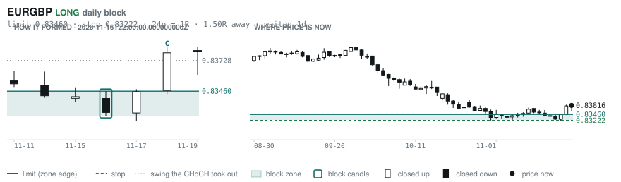
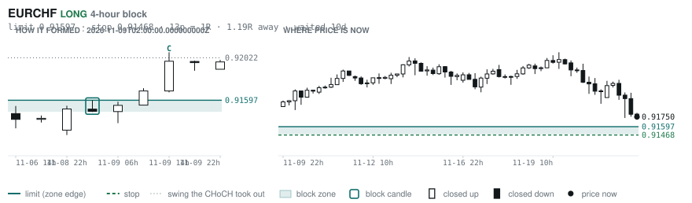
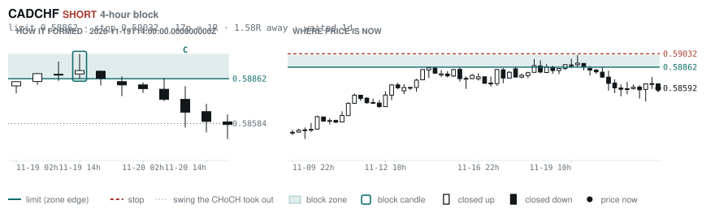
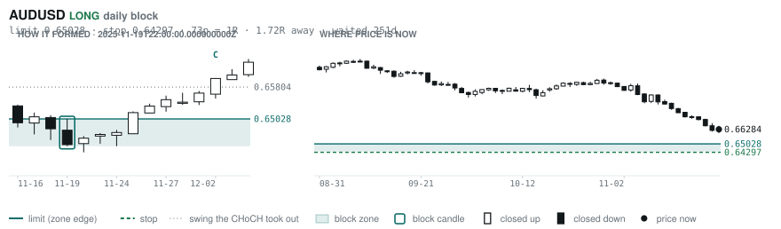
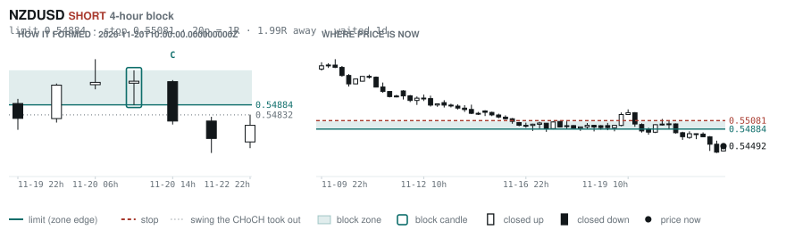

# Scanner Review — 2026-11-23 (evening)

Generated: 2026-11-24T00:00:39.723Z

```
## The clock

It is **18:00 Chicago** — a **DEAD** hour at 0.65x an average one.
An order placed now rests through **Tokyo, London and tomorrow's NY overlap** — about 16h of cover.
Next window: **Tokyo** in 1h.

_Evening pass. Orders placed now get the longest cover of the day: Tokyo, London, and tomorrow's NY overlap. Place limits and stops here — whatever does not fill overnight is still live for the morning._

## Where the energy is

**Running hot:** AUDJPY 1.32 · EURAUD 1.27 · AUDUSD 1.26 · GBPJPY 1.25 · GBPAUD 1.25 · AUDCHF 1.23 · EURJPY 1.23 · AUDCAD 1.22 · GBPCHF 1.20 · NZDJPY 1.18 · EURUSD 1.17 · EURCHF 1.17 · GBPUSD 1.16
**Quiet:** _none_

_Volatility persists for about two days, so a hot pair stays hot. It says nothing about direction — this picks the pair, the levels pick the side._

## Account

NAV **$1021.42**   unrealised $-521.13   margin available $0.00   4 open

| pair | units | now | P/L | stop | distance | news lean |
|---|---|---|---|---|---|---|
| EURCAD | 9000 | 1.56678 | $-107.27 | **none** | — | — |
| EURCAD | 11000 | 1.56678 | $-78.57 | **none** | — | — |
| EURCAD | 14000 | 1.56678 | $9.36 | **none** | — | — |
| EURCAD | 17000 | 1.56678 | $-344.64 | **none** | — | — |

**What the system reads on each position**

- **EURCAD** LONG — last REVERSAL LONG 86h ago at 1.56689 — system stop 1.55869, target **1.62068**; 539p to that target from here

## Order blocks live right now

### Daily

| pair | dir | limit | stop | 1R | spread | away | fills | waited | window | reaches 1R / 2R |
|---|---|---|---|---|---|---|---|---|---|---|
| EURGBP | LONG | **0.83460** | 0.83222 | 24p $3.10 | 6% | 0.9R | 87% | 2d | 0.85x ⚠ | 68% / 39% |
| AUDUSD | LONG | **0.65028** | 0.64297 | 73p $7.31 | 2% | 1.7R | 81% | 251d | 1.00x | 75% / 53% |

_8 more live but further out, 2.0R to 7.7R away. They alert on their own when they come within 1R._
_Older blocks run further: 60+ days reaches 2R 58% of the time against 34% for a same-day fill._

### 4-hour

| pair | dir | limit | stop | 1R | spread | away | fills | waited | window | reaches 1R / 2R |
|---|---|---|---|---|---|---|---|---|---|---|
| EURCHF | LONG | **0.91597** | 0.91468 | 13p $1.53 | 19% | 1.2R | 79% | 10d | 0.90x ⚠ | 78% / 51% |
| CADCHF | SHORT | **0.58862** | 0.59032 | 17p $2.03 | 16% | 1.6R | 79% | 1d | 0.83x ⚠ | 70% / 46% |
| NZDUSD | SHORT | **0.54884** | 0.55081 | 20p $1.97 | 11% | 2.0R | 79% | 1d | 0.99x ⚠ | 70% / 46% |

_16 more live but further out, 2.1R to 8.0R away. They alert on their own when they come within 1R._
_H4 stops are a third of a daily one, so spread bites three times as hard — a bolded spread figure is most of the edge gone before price moves._

### In reach, drawn

_5 blocks within 2R of the limit. Blocks further out are in the tables above but not worth a picture yet._

**EURGBP LONG** · daily · 0.91R away · waited 2d



**EURCHF LONG** · 4-hour · 1.19R away · waited 10d



**CADCHF SHORT** · 4-hour · 1.58R away · waited 1d



**AUDUSD LONG** · daily · 1.72R away · waited 251d



**NZDUSD SHORT** · 4-hour · 1.99R away · waited 1d



_Left panel is the block forming, right is where price sits now. Legend is in each image._

## Scanner calls, last 1 day

| when | pair | dir | branch | firing | entry | stop | target | outcome |
|---|---|---|---|---|---|---|---|---|
| 11-23T02:00 | USDCAD | SHORT | REV | 11th | 1.43223 | 1.44192 | 1.37910 | open -0.42R |
| 11-23T02:00 | CHFJPY | SHORT | REV | 3rd | 189.392 | 190.903 | 187.587 | open +0.30R |
| 11-23T06:00 | GBPCHF | SHORT | REV | 3rd | 1.10046 | 1.10997 | 1.08088 | open +0.41R |
| 11-23T06:00 | CADCHF | LONG | REV | 3rd | 0.58572 | 0.58099 | 0.60486 | open +0.04R |
| 11-23T06:00 | AUDNZD | LONG | REV | 3rd | 1.21455 | 1.20507 | 1.29364 | open +0.19R |
| 11-23T06:00 | EURCHF | SHORT | REV | 9th | 0.92085 | 0.92750 | 0.89149 | open +0.50R |
| 11-23T06:00 | GBPJPY | LONG | REV | 2nd | 208.671 | 206.432 | 218.430 | open -0.66R |
| 11-23T06:00 | CHFJPY | SHORT | REV | 1st ⚠ | 189.624 | 191.512 | 187.587 | open +0.36R |
| 11-23T06:00 | EURGBP | LONG | REV | 1st ⚠ | 0.83682 | 0.83354 | 0.84230 | open -0.02R |
| 11-23T06:00 | AUDCAD | LONG | REV | 3rd | 0.95192 | 0.94411 | 1.00292 | open +0.00R |
| 11-23T10:00 | EURCHF | SHORT | REV | 1st ⚠ | 0.92032 | 0.92718 | 0.89149 | open +0.41R |
| 11-23T10:00 | EURCAD | SHORT | REV | 1st ⚠ | 1.56921 | 1.58080 | 1.49662 | open +0.29R |
| 11-23T10:00 | EURNZD | LONG | REV | 1st ⚠ | 2.00456 | 1.99003 | 2.08038 | open -0.26R |
| 11-23T10:00 | GBPCAD | SHORT | REV | 1st ⚠ | 1.87598 | 1.88687 | 1.83108 | open +0.41R |
| 11-23T10:00 | NZDJPY | SHORT | REV | 3rd | 86.867 | 87.956 | 85.691 | open +0.21R |
| 11-23T10:00 | EURGBP | LONG | REV | 3rd | 0.83648 | 0.83235 | 0.84230 | open +0.07R |
| 11-23T14:00 | GBPCHF | SHORT | REV | 13th | 1.09764 | 1.10648 | 1.08088 | open +0.12R |
| 11-23T14:00 | AUDCHF | SHORT | REV | 1st ⚠ | 0.55821 | 0.56613 | 0.53584 | open +0.06R |
| 11-23T14:00 | CADJPY | SHORT | REV | 1st ⚠ | 110.760 | 111.827 | 109.609 | open +0.05R |
| 11-23T14:00 | USDJPY | SHORT | REV | 8th | 159.278 | 160.297 | 155.748 | open +0.27R |
| 11-23T14:00 | GBPNZD | LONG | REV | 1st ⚠ | 2.39407 | 2.37883 | 2.50037 | open -0.18R |
| 11-23T18:00 | USDJPY | SHORT | REV | 1st ⚠ | 159.004 | 160.343 | 155.748 | open +0.00R |
| 11-23T18:00 | EURGBP | LONG | REV | 2nd | 0.83676 | 0.83344 | 0.84230 | open +0.00R |

## Running tally, last 30 days

20 resolved · 3 target / 17 stopped · **-11.6R** · -0.578R per call · 40 still open

```
