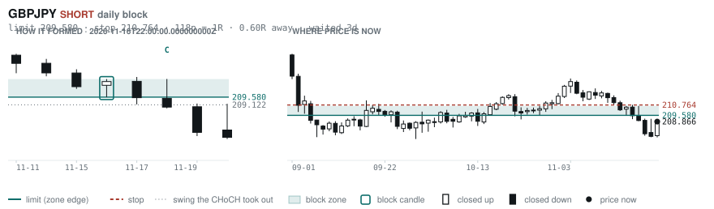
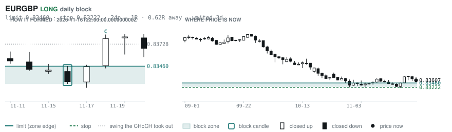
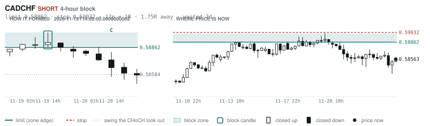
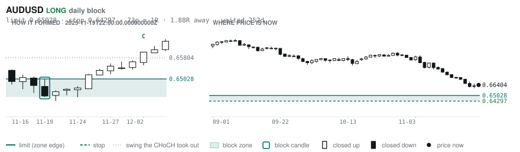

# Scanner Review — 2026-11-24 (evening)

Generated: 2026-11-25T00:00:38.273Z

```
## The clock

It is **18:00 Chicago** — a **DEAD** hour at 0.65x an average one.
An order placed now rests through **Tokyo, London and tomorrow's NY overlap** — about 16h of cover.
Next window: **Tokyo** in 1h.

_Evening pass. Orders placed now get the longest cover of the day: Tokyo, London, and tomorrow's NY overlap. Place limits and stops here — whatever does not fill overnight is still live for the morning._

## Where the energy is

**Running hot:** EURAUD 1.18 · AUDJPY 1.18 · GBPAUD 1.17 · GBPJPY 1.17
**Quiet:** _none_

_Volatility persists for about two days, so a hot pair stays hot. It says nothing about direction — this picks the pair, the levels pick the side._

## Account

NAV **$964.21**   unrealised $-587.57   margin available $152.92   3 open

| pair | units | now | P/L | stop | distance | news lean |
|---|---|---|---|---|---|---|
| EURCAD | 9000 | 1.56470 | $-121.01 | **none** | — | — |
| EURCAD | 11000 | 1.56470 | $-95.03 | **none** | — | — |
| EURCAD | 17000 | 1.56470 | $-371.52 | **none** | — | — |

**What the system reads on each position**

- **EURCAD** LONG — last REVERSAL LONG 607h ago at 1.55583 — system stop 1.54751, target **1.62445**; 598p to that target from here

## Order blocks live right now

### Daily

| pair | dir | limit | stop | 1R | spread | away | fills | waited | window | reaches 1R / 2R |
|---|---|---|---|---|---|---|---|---|---|---|
| GBPJPY | SHORT | **209.580** | 210.764 | 118p $7.43 | 3% | 0.6R | 87% | 3d | 1.03x | 68% / 39% |
| EURGBP | LONG | **0.83460** | 0.83222 | 24p $3.12 | 6% | 0.6R | 87% | 3d | 0.85x ⚠ | 68% / 39% |
| AUDUSD | LONG | **0.65028** | 0.64297 | 73p $7.31 | 2% | 1.9R | 81% | 252d | 1.00x | 75% / 53% |

_7 more live but further out, 2.1R to 7.6R away. They alert on their own when they come within 1R._
_Older blocks run further: 60+ days reaches 2R 58% of the time against 34% for a same-day fill._

### 4-hour

| pair | dir | limit | stop | 1R | spread | away | fills | waited | window | reaches 1R / 2R |
|---|---|---|---|---|---|---|---|---|---|---|
| CADCHF | SHORT | **0.58862** | 0.59032 | 17p $2.04 | 15% | 1.8R | 79% | 2d | 0.83x ⚠ | 77% / 47% |

_16 more live but further out, 2.3R to 7.8R away. They alert on their own when they come within 1R._
_H4 stops are a third of a daily one, so spread bites three times as hard — a bolded spread figure is most of the edge gone before price moves._

### In reach, drawn

_4 blocks within 2R of the limit. Blocks further out are in the tables above but not worth a picture yet._

**GBPJPY SHORT** · daily · 0.60R away · waited 3d



**EURGBP LONG** · daily · 0.62R away · waited 3d



**CADCHF SHORT** · 4-hour · 1.75R away · waited 2d



**AUDUSD LONG** · daily · 1.88R away · waited 252d



_Left panel is the block forming, right is where price sits now. Legend is in each image._

## Scanner calls, last 1 day

| when | pair | dir | branch | firing | entry | stop | target | outcome |
|---|---|---|---|---|---|---|---|---|
| 11-24T02:00 | GBPNZD | LONG | REV | 2nd | 2.39362 | 2.37952 | 2.43525 | open -0.13R |
| 11-24T02:00 | AUDCAD | LONG | REV | 1st ⚠ | 0.95182 | 0.94408 | 1.00292 | open -0.56R |
| 11-24T06:00 | EURNZD | LONG | REV | 2nd | 2.00510 | 1.99059 | 2.08038 | open -0.36R |
| 11-24T06:00 | AUDCHF | SHORT | REV | 1st ⚠ | 0.55736 | 0.56538 | 0.53584 | open +0.31R |
| 11-24T06:00 | USDJPY | LONG | REV | 4th | 159.559 | 158.026 | 163.126 | open -0.20R |
| 11-24T06:00 | EURCAD | SHORT | REV | 2nd | 1.56840 | 1.57786 | 1.49662 | open +0.40R |
| 11-24T06:00 | NZDCHF | SHORT | REV | 8th | 0.45859 | 0.46270 | 0.43366 | open +0.09R |
| 11-24T06:00 | NZDJPY | LONG | REV | 1st ⚠ | 87.014 | 85.944 | 90.685 | open +0.30R |
| 11-24T06:00 | GBPAUD | LONG | REV | 1st ⚠ | 1.97146 | 1.94337 | 2.01992 | open +0.13R |
| 11-24T06:00 | CADCHF | SHORT | REV | 3rd | 0.58629 | 0.59027 | 0.56581 | open +0.17R |
| 11-24T06:00 | EURJPY | LONG | REV | 1st ⚠ | 174.474 | 172.270 | 181.884 | open +0.07R |
| 11-24T10:00 | NZDCHF | SHORT | REV | 1st ⚠ | 0.45813 | 0.46286 | 0.43366 | open -0.02R |
| 11-24T10:00 | CADCHF | SHORT | REV | 1st ⚠ | 0.58458 | 0.59059 | 0.56581 | open -0.17R |
| 11-24T10:00 | EURCHF | SHORT | REV | 1st ⚠ | 0.91826 | 0.92502 | 0.89149 | open +0.28R |
| 11-24T10:00 | GBPCHF | SHORT | REV | 14th | 1.09687 | 1.10622 | 1.08088 | open +0.10R |
| 11-24T10:00 | AUDUSD | LONG | WALL | 1st ⚠ | 0.66388 | 0.65929 | 0.72420 | open +0.03R |
| 11-24T10:00 | CADJPY | SHORT | REV | 1st ⚠ | 111.064 | 112.139 | 109.609 | open -0.51R |
| 11-24T10:00 | EURGBP | LONG | REV | 2nd | 0.83715 | 0.83355 | 0.84230 | open -0.30R |
| 11-24T10:00 | NZDCAD | SHORT | REV | 1st ⚠ | 0.78370 | 0.79035 | 0.75568 | open +0.19R |
| 11-24T10:00 | EURUSD | LONG | WALL | 6th | 1.09650 | 1.08961 | 1.14416 | open +0.01R |
| 11-24T14:00 | GBPCAD | SHORT | REV | 4th | 1.87326 | 1.88481 | 1.83108 | open +0.16R |
| 11-24T14:00 | EURCHF | SHORT | REV | 1st ⚠ | 0.91667 | 0.92271 | 0.89149 | open +0.05R |
| 11-24T14:00 | CADJPY | SHORT | REV | 2nd | 111.523 | 112.510 | 109.609 | open -0.09R |
| 11-24T14:00 | AUDCAD | SHORT | WALL | 1st ⚠ | 0.94840 | 0.95374 | 0.93882 | open +0.16R |
| 11-24T18:00 | CADCHF | LONG | REV | 4th | 0.58563 | 0.58081 | 0.60092 | open +0.00R |
| 11-24T18:00 | EURCAD | SHORT | WALL | 1st ⚠ | 1.56463 | 1.57040 | 1.49662 | open +0.00R |

## Running tally, last 30 days

8 resolved · 1 target / 7 stopped · **-5.0R** · -0.625R per call · 52 still open

```
