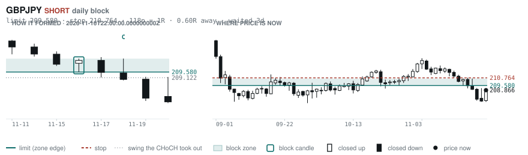
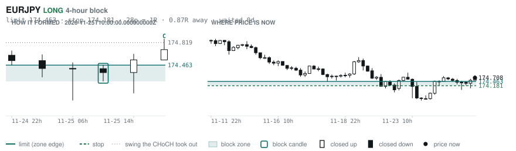
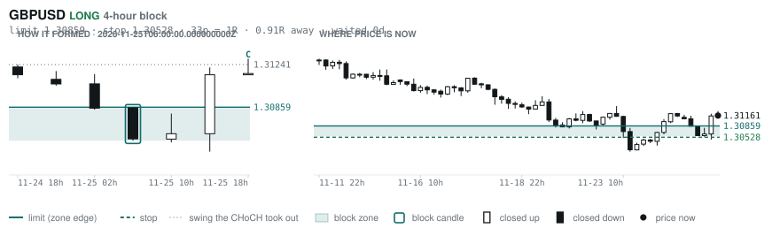
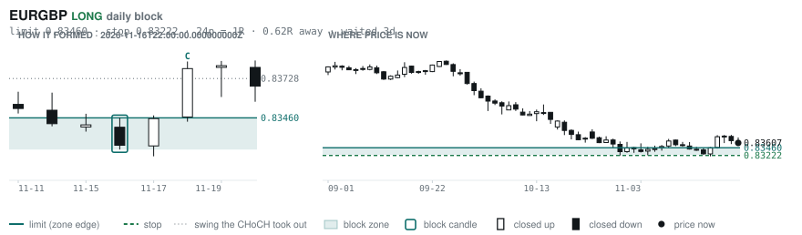
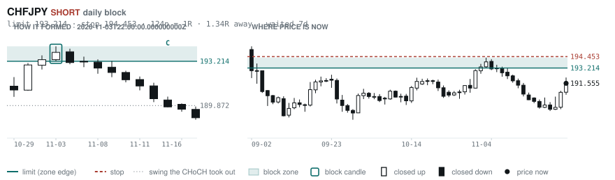
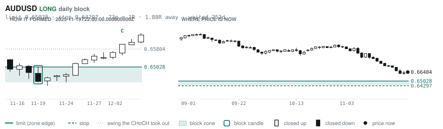

# Scanner Review — 2026-11-25 (evening)

Generated: 2026-11-26T00:00:39.251Z

```
## The clock

It is **18:00 Chicago** — a **DEAD** hour at 0.65x an average one.
An order placed now rests through **Tokyo, London and tomorrow's NY overlap** — about 16h of cover.
Next window: **Tokyo** in 1h.

_Evening pass. Orders placed now get the longest cover of the day: Tokyo, London, and tomorrow's NY overlap. Place limits and stops here — whatever does not fill overnight is still live for the morning._

## Where the energy is

**Running hot:** AUDCHF 1.32 · EURAUD 1.31 · GBPCHF 1.31 · AUDCAD 1.28 · GBPAUD 1.28 · AUDUSD 1.28 · EURCHF 1.26 · AUDJPY 1.25 · CHFJPY 1.20 · USDCAD 1.17 · GBPCAD 1.16
**Quiet:** GBPNZD 0.89

_Volatility persists for about two days, so a hot pair stays hot. It says nothing about direction — this picks the pair, the levels pick the side._

## Account

NAV **$817.95**   unrealised $-730.69   margin available $6.14   3 open

| pair | units | now | P/L | stop | distance | news lean |
|---|---|---|---|---|---|---|
| EURCAD | 9000 | 1.55933 | $-155.74 | **none** | — | — |
| EURCAD | 11000 | 1.55933 | $-137.27 | **none** | — | — |
| EURCAD | 17000 | 1.55933 | $-437.68 | **none** | — | — |

**What the system reads on each position**

- **EURCAD** LONG — last REVERSAL LONG 631h ago at 1.55583 — system stop 1.54751, target **1.62445**; 651p to that target from here

## Order blocks live right now

### Daily

| pair | dir | limit | stop | 1R | spread | away | fills | waited | window | reaches 1R / 2R |
|---|---|---|---|---|---|---|---|---|---|---|
| GBPJPY | SHORT | **209.580** | 210.764 | 118p $7.44 | 3% | 0.7R | 87% | 4d | 1.03x | 68% / 39% |
| EURGBP | LONG | **0.83460** | 0.83222 | 24p $3.12 | 7% | 0.9R | 87% | 4d | 0.85x ⚠ | 68% / 39% |
| CHFJPY | SHORT | **193.214** | 194.453 | 124p $7.78 | 4% | 1.3R | 81% | 7d | 1.01x | 68% / 39% |
| AUDUSD | LONG | **0.65028** | 0.64297 | 73p $7.31 | 2% | 1.7R | 81% | 253d | 1.00x | 75% / 53% |

_6 more live but further out, 2.1R to 7.9R away. They alert on their own when they come within 1R._
_Older blocks run further: 60+ days reaches 2R 58% of the time against 34% for a same-day fill._

### 4-hour

| pair | dir | limit | stop | 1R | spread | away | fills | waited | window | reaches 1R / 2R |
|---|---|---|---|---|---|---|---|---|---|---|
| EURJPY | LONG | **174.463** | 174.181 | 28p $1.77 | 11% | 0.9R | 83% | 0d | 1.07x | 70% / 46% |
| GBPUSD | LONG | **1.30859** | 1.30528 | 33p $3.31 | 6% | 0.9R | 83% | 0d | 0.89x ⚠ | 70% / 46% |
| EURUSD | LONG | **1.09460** | 1.09299 | 16p $1.61 | 10% | 1.9R | 79% | 0d | 0.90x ⚠ | 70% / 46% |

_18 more live but further out, 2.4R to 8.0R away. They alert on their own when they come within 1R._
_H4 stops are a third of a daily one, so spread bites three times as hard — a bolded spread figure is most of the edge gone before price moves._

### In reach, drawn

_6 blocks within 2R of the limit. Blocks further out are in the tables above but not worth a picture yet._

**GBPJPY SHORT** · daily · 0.68R away · waited 4d



**EURJPY LONG** · 4-hour · 0.87R away · waited 0d



**GBPUSD LONG** · 4-hour · 0.91R away · waited 0d



**EURGBP LONG** · daily · 0.94R away · waited 4d



**CHFJPY SHORT** · daily · 1.34R away · waited 7d



**AUDUSD LONG** · daily · 1.71R away · waited 253d



_Left panel is the block forming, right is where price sits now. Legend is in each image._

## Scanner calls, last 1 day

| when | pair | dir | branch | firing | entry | stop | target | outcome |
|---|---|---|---|---|---|---|---|---|
| 11-25T02:00 | NZDCAD | SHORT | REV | 1st ⚠ | 0.78028 | 0.78752 | 0.75568 | open +0.05R |
| 11-25T06:00 | CADCHF | SHORT | REV | 1st ⚠ | 0.58401 | 0.59063 | 0.56581 | open -0.08R |
| 11-25T06:00 | NZDCHF | SHORT | WALL | 1st ⚠ | 0.45502 | 0.45883 | 0.43366 | open -0.23R |
| 11-25T06:00 | EURNZD | LONG | REV | 4th | 2.00624 | 1.99093 | 2.08038 | open -0.38R |
| 11-25T06:00 | EURCHF | SHORT | WALL | 1st ⚠ | 0.91288 | 0.91610 | 0.89149 | open +0.26R |
| 11-25T06:00 | NZDJPY | LONG | REV | 2nd | 86.933 | 85.973 | 89.424 | open +0.41R |
| 11-25T06:00 | USDCHF | SHORT | REV | 2nd | 0.83458 | 0.84274 | 0.79420 | open +0.44R |
| 11-25T06:00 | EURJPY | LONG | REV | 6th | 174.406 | 172.827 | 181.884 | open +0.19R |
| 11-25T10:00 | EURCHF | SHORT | WALL | 2nd | 0.90881 | 0.91605 | 0.89149 | open -0.45R |
| 11-25T10:00 | USDCAD | SHORT | REV | 1st ⚠ | 1.42470 | 1.43572 | 1.37910 | open +0.29R |
| 11-25T10:00 | NZDCHF | SHORT | WALL | 2nd | 0.45320 | 0.45704 | 0.43366 | open -0.70R |
| 11-25T10:00 | EURCAD | SHORT | WALL | 1st ⚠ | 1.55855 | 1.56546 | 1.49662 | open -0.24R |
| 11-25T10:00 | USDCHF | SHORT | REV | 1st ⚠ | 0.83074 | 0.84173 | 0.79420 | open -0.02R |
| 11-25T14:00 | AUDUSD | LONG | REV | 1st ⚠ | 0.66193 | 0.65176 | 0.72420 | open +0.09R |
| 11-25T14:00 | GBPCHF | LONG | REV | 16th | 1.08833 | 1.07944 | 1.12975 | open +0.18R |
| 11-25T14:00 | EURUSD | LONG | REV | 7th | 1.09837 | 1.08563 | 1.14416 | open -0.06R |
| 11-25T18:00 | NZDJPY | SHORT | REV | 4th | 87.329 | 88.351 | 85.691 | open +0.00R |
| 11-25T18:00 | GBPJPY | LONG | REV | 3rd | 208.776 | 206.422 | 218.430 | open +0.00R |
| 11-25T18:00 | GBPCHF | LONG | REV | 1st ⚠ | 1.08993 | 1.07998 | 1.12975 | open +0.00R |
| 11-25T18:00 | EURGBP | LONG | REV | 1st ⚠ | 0.83684 | 0.83335 | 0.84230 | open +0.00R |
| 11-25T18:00 | AUDCHF | LONG | REV | 4th | 0.55074 | 0.54228 | 0.58186 | open +0.00R |
| 11-25T18:00 | AUDNZD | LONG | REV | 1st ⚠ | 1.20796 | 1.19920 | 1.29364 | open +0.00R |

## Running tally, last 30 days

10 resolved · 1 target / 9 stopped · **-7.2R** · -0.721R per call · 50 still open

```
