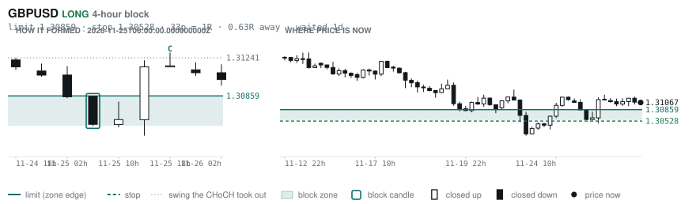
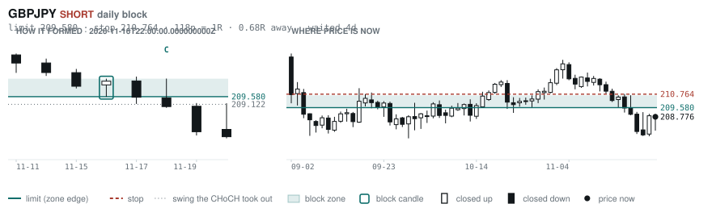
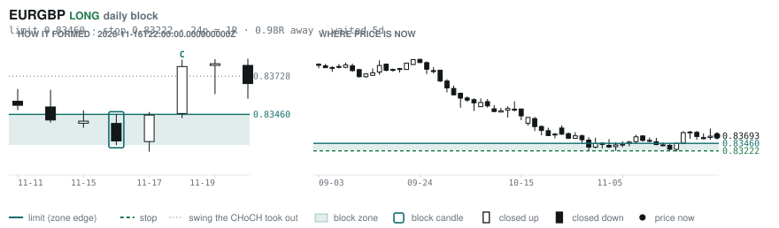
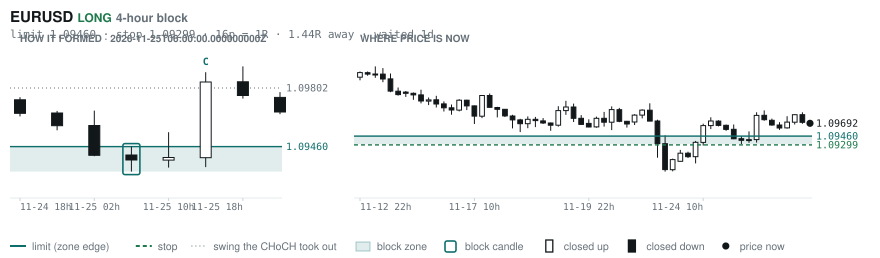
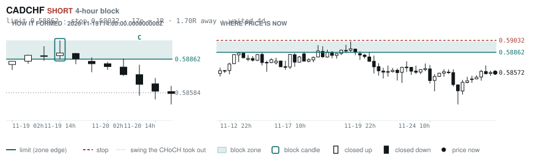
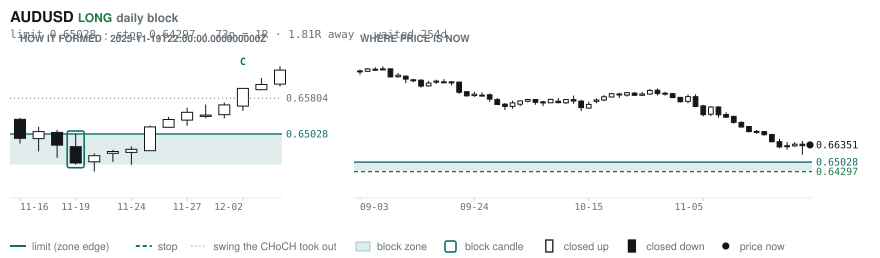

# Scanner Review — 2026-11-26 (evening)

Generated: 2026-11-27T00:00:39.041Z

```
## The clock

It is **18:00 Chicago** — a **DEAD** hour at 0.65x an average one.
An order placed now rests through **Tokyo, London and tomorrow's NY overlap** — about 16h of cover.
Next window: **Tokyo** in 1h.

_Evening pass. Orders placed now get the longest cover of the day: Tokyo, London, and tomorrow's NY overlap. Place limits and stops here — whatever does not fill overnight is still live for the morning._

## Where the energy is

**Running hot:** _nothing unusually active_
**Quiet:** NZDJPY 0.88 · NZDUSD 0.86 · EURNZD 0.83 · USDJPY 0.83 · NZDCAD 0.82 · GBPNZD 0.81

_Volatility persists for about two days, so a hot pair stays hot. It says nothing about direction — this picks the pair, the levels pick the side._

## Account

NAV **$906.09**   unrealised $-641.43   margin available $94.24   3 open

| pair | units | now | P/L | stop | distance | news lean |
|---|---|---|---|---|---|---|
| EURCAD | 9000 | 1.56265 | $-134.07 | **none** | — | 2 neutral |
| EURCAD | 11000 | 1.56265 | $-110.89 | **none** | — | 2 neutral |
| EURCAD | 17000 | 1.56265 | $-396.46 | **none** | — | 2 neutral |

**What the system reads on each position**

- **EURCAD** LONG — last REVERSAL LONG 655h ago at 1.55583 — system stop 1.54751, target **1.62445**; 618p to that target from here

## What is coming, and which way it leans

**EURCAD LONG**
- ⚪ 11-30T13:30 CAD — GDP Growth Rate Annualized
- ⚪ 11-30T13:30 CAD — GDP Growth Rate QoQ

_Lean is read from forecast vs previous — which way consensus leans, not what will print._

## Order blocks live right now

### Daily

| pair | dir | limit | stop | 1R | spread | away | fills | waited | window | reaches 1R / 2R |
|---|---|---|---|---|---|---|---|---|---|---|
| GBPJPY | SHORT | **209.580** | 210.764 | 118p $7.43 | 3% | 0.7R | 87% | 5d | 1.03x | 68% / 39% |
| EURGBP | LONG | **0.83460** | 0.83222 | 24p $3.11 | 6% | 1.0R | 87% | 5d | 0.85x ⚠ | 68% / 39% |
| AUDUSD | LONG | **0.65028** | 0.64297 | 73p $7.31 | 2% | 1.8R | 81% | 254d | 1.00x | 75% / 53% |
| CHFJPY | SHORT | **193.214** | 194.453 | 124p $7.78 | 3% | 1.9R | 81% | 8d | 1.01x | 68% / 39% |

_6 more live but further out, 2.3R to 7.4R away. They alert on their own when they come within 1R._
_Older blocks run further: 60+ days reaches 2R 58% of the time against 34% for a same-day fill._

### 4-hour

| pair | dir | limit | stop | 1R | spread | away | fills | waited | window | reaches 1R / 2R |
|---|---|---|---|---|---|---|---|---|---|---|
| GBPUSD | LONG | **1.30859** | 1.30528 | 33p $3.31 | 5% | 0.6R | 83% | 1d | 0.89x ⚠ | 70% / 46% |
| EURUSD | LONG | **1.09460** | 1.09299 | 16p $1.61 | 10% | 1.4R | 79% | 1d | 0.90x ⚠ | 70% / 46% |
| CADCHF | SHORT | **0.58862** | 0.59032 | 17p $2.04 | 15% | 1.7R | 79% | 4d | 0.83x ⚠ | 77% / 47% |

_15 more live but further out, 2.8R to 7.9R away. They alert on their own when they come within 1R._
_H4 stops are a third of a daily one, so spread bites three times as hard — a bolded spread figure is most of the edge gone before price moves._

### In reach, drawn

_6 blocks within 2R of the limit. Blocks further out are in the tables above but not worth a picture yet._

**GBPUSD LONG** · 4-hour · 0.63R away · waited 1d



**GBPJPY SHORT** · daily · 0.68R away · waited 5d



**EURGBP LONG** · daily · 0.98R away · waited 5d



**EURUSD LONG** · 4-hour · 1.44R away · waited 1d



**CADCHF SHORT** · 4-hour · 1.70R away · waited 4d



**AUDUSD LONG** · daily · 1.81R away · waited 254d



_Left panel is the block forming, right is where price sits now. Legend is in each image._

## Scanner calls, last 1 day

| when | pair | dir | branch | firing | entry | stop | target | outcome |
|---|---|---|---|---|---|---|---|---|
| 11-26T02:00 | GBPCAD | SHORT | REV | 14th | 1.86320 | 1.87518 | 1.83108 | open -0.35R |
| 11-26T02:00 | AUDUSD | LONG | WALL | 2nd | 0.66416 | 0.65920 | 0.72420 | open -0.13R |
| 11-26T06:00 | AUDNZD | SHORT | REV | 4th | 1.21048 | 1.22072 | 1.18616 | open -0.24R |
| 11-26T06:00 | USDJPY | LONG | REV | 6th | 159.228 | 158.062 | 162.686 | open +0.05R |
| 11-26T06:00 | CADJPY | LONG | REV | 2nd | 111.924 | 110.981 | 113.036 | open -0.13R |
| 11-26T06:00 | EURUSD | LONG | WALL | 2nd | 1.09714 | 1.09387 | 1.14416 | open -0.07R |
| 11-26T06:00 | GBPNZD | LONG | REV | 2nd | 2.39258 | 2.37881 | 2.43525 | open +0.25R |
| 11-26T10:00 | CADCHF | SHORT | REV | 2nd | 0.58556 | 0.59061 | 0.56581 | open -0.03R |
| 11-26T10:00 | EURNZD | LONG | REV | 2nd | 2.00369 | 1.99038 | 2.08038 | open +0.12R |
| 11-26T10:00 | GBPNZD | LONG | WALL | 5th | 2.39286 | 2.38731 | 2.43525 | open +0.58R |
| 11-26T14:00 | EURCAD | SHORT | REV | 2nd | 1.56250 | 1.57541 | 1.49662 | open -0.02R |
| 11-26T14:00 | GBPNZD | LONG | REV | 1st ⚠ | 2.39502 | 2.37846 | 2.43525 | open +0.06R |
| 11-26T10:00 | GBPAUD | SHORT | WALL | 2nd | 1.97654 | 1.98404 | 1.91766 | open +0.16R |
| 11-26T14:00 | NZDUSD | SHORT | REV | 3rd | 0.54730 | 0.55333 | 0.53969 | open +0.05R |
| 11-26T18:00 | EURGBP | SHORT | REV | 2nd | 0.83693 | 0.84071 | 0.82668 | open +0.00R |
| 11-26T18:00 | EURAUD | SHORT | REV | 4th | 1.65322 | 1.66884 | 1.52860 | open +0.00R |
| 11-26T18:00 | AUDUSD | LONG | REV | 7th | 0.66351 | 0.65810 | 0.72420 | open +0.00R |

## Running tally, last 30 days

6 resolved · 1 target / 5 stopped · **-3.2R** · -0.534R per call · 54 still open

```
